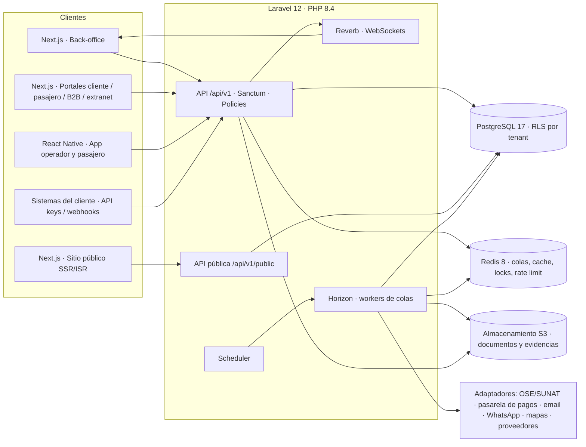

# Arquitectura objetivo

Stack definido por el cliente: **Laravel 12 / PHP 8.4 · PostgreSQL 17 · Redis 8 · Next.js**. Se mantiene **React Native (Expo)** para las apps móviles, como indica la documentación inicial. Las reglas detalladas de tablas, API, colas y pruebas están en `CONVENCIONES.md`; este documento fija la estructura.

## 1. Vista general



## 2. Repositorios

| Repositorio | Contenido | Notas |
| --- | --- | --- |
| `backend` | Laravel 12 (API, jobs, scheduler, Reverb, Horizon) | Monolito modular por dominios. |
| `web` | Next.js (App Router, TypeScript): back-office, portales, extranet, consola de plataforma y sitio público | Un proyecto con grupos de rutas; el sitio público puede desplegarse aparte si se requiere escalar. |
| `mobile` | React Native (Expo): app operador y app pasajero | SQLite local + outbox para modo offline. |
| `infra` | Docker Compose local, IaC, pipelines | Opcional dentro de `backend`. |

Cliente de API tipado: generar desde el OpenAPI del backend (p. ej. `orval` u `openapi-typescript`) hacia `web` y `mobile`, para no duplicar contratos.

## 3. Backend Laravel: estructura por dominios

```
app/
  Domain/
    Shared/        (Tenancy, Sequences, Money, Idempotency, StateMachine, Audit, Documents)
    Iam/           (usuarios, roles, permisos, sedes, MFA)
    Platform/      (tenants, planes, suscripciones, feature flags, facturación de plataforma)
    Crm/           (leads, oportunidades, actividades, clientes, postventa, metas, reclamaciones)
    Catalog/       (destinos, proveedores, servicios, productos, tarifas, temporadas, salidas, holds, cupos)
    Quotes/        (cotizaciones, versiones, pricing, aprobaciones internas)
    Bookings/      (reservas, pasajeros, servicios reservados, documentos de viaje)
    Operations/    (órdenes, asignaciones, recursos, rooming, vouchers, incidencias, evidencias)
    Finance/       (CxC, pagos, CxP, comisiones, rentabilidad, comprobantes, conciliación, tesorería)
    Channels/      (B2B, e-commerce, CMS, portales, sitio público)
    Collaboration/ (bandeja de aprobaciones, inbox omnicanal)
    Marketing/     (segmentos, campañas, automatizaciones, consentimientos)
    Supplier/      (extranet de proveedores)
    Integrations/  (adaptadores OSE, pagos, email, WhatsApp, mapas, proveedores; webhooks salientes)
  Http/            (middleware: ResolveTenant, SetPostgresTenant, EnsureFeatureEnabled, Idempotency)
```

Cada dominio contiene: `Models/`, `Actions/` (casos de uso, una clase por acción: `ConvertQuoteToReservation`, `RegisterPayment`…), `StateMachines/`, `Policies/`, `Http/Controllers|Requests|Resources/`, `Events/`, `Listeners/`, `Jobs/`, `Data/` (DTOs). Controladores delgados: validan (FormRequest), autorizan (Policy) y llaman a una Action dentro de una transacción.

Paquetes sugeridos: `laravel/sanctum`, `laravel/horizon`, `laravel/reverb`, `spatie/laravel-permission` (teams), `spatie/laravel-activitylog` o auditoría propia, `spatie/laravel-query-builder` (filtros/orden), `dedoc/scramble` (OpenAPI), `pestphp/pest`, `larastan/larastan`, `laravel/pint`, `spatie/browsershot` (PDF). Para facturación de la plataforma: Laravel Cashier solo si la pasarela elegida la soporta; si no, adaptador propio (ver especificación 13).

## 4. Multi-tenancy (resumen)

1. El tenant se resuelve desde el token Sanctum (usuarios) o desde el host/subdominio (sitio público y portales). Nunca desde un parámetro del cliente.
2. Middleware `SetPostgresTenant` ejecuta `SET LOCAL app.tenant_id` en cada transacción; RLS en todas las tablas con `tenant_id`.
3. Global scope `BelongsToTenant` en Eloquent + `tenant_id` asignado en `creating`.
4. Colas: cada job serializa `tenant_id` y lo restablece antes de ejecutarse (middleware de job).
5. Cache y locks con prefijo `t:{tenant_id}:`.
6. Prueba obligatoria E2E-08 en cada módulo: un usuario del tenant A recibe 404/403 sobre recursos del tenant B.

## 5. Seguridad y roles

- Autenticación Sanctum + MFA TOTP para roles internos; sesiones revocables; bloqueo por intentos.
- Autorización: permiso por endpoint (spatie) + Policy por recurso (ownership de Ventas, experiencia externa, relación cliente/agencia/proveedor/recurso).
- La tabla `ACCESS` y `ROLE_UX` del prototipo (`assets/js/core.js`) son la fuente para: middleware de Next.js (redirección por experiencia) y policies del backend. Detalle en `especificaciones/00-transversal-seguridad-rbac.md`.
- Datos sensibles: costos y márgenes se omiten en el `JsonResource` según permiso (no solo se ocultan en pantalla).
- Datos personales (Ley 29733): consentimiento por canal, derecho de acceso/rectificación/supresión, registro de tratamientos. Documentos de identidad cifrados en reposo (columna cifrada con `encrypted` cast).

## 6. Frontend Next.js

```
app/
  (auth)/login
  (backoffice)/            → layout con menú lateral (roles internos)
     dashboard, crm/…, catalogo/…, cotizaciones/…, reservas/…, operaciones/…, finanzas/…,
     canales/…, marketing/…, aprobaciones, inbox, reportes, admin/…
  (plataforma)/admin/tenants|plataforma|integraciones|auditoria   → Super Admin
  (portal-cliente)/portal/[clientId]/…
  (portal-pasajero)/viaje/…
  (b2b)/agencias/…
  (extranet)/proveedor/…
  (sitio)/[locale]/…       → sitio público SSR/ISR, sin sesión
```

- `middleware.ts`: lee la experiencia del usuario (claim del token) y redirige a su home; bloquea grupos de rutas ajenos. Es una mejora de UX: la API vuelve a validar todo.
- Estado de servidor con TanStack Query; formularios React Hook Form + Zod; tablas TanStack Table con búsqueda, filtros, orden, paginación por cursor y exportación (job).
- Componentes: Radix/shadcn con los tokens del prototipo. Tokens a trasladar (de `app.css`): `--accent #0A3A73` (azul marino), `--sun #F4B400` (dorado), `--info #2F80D1`, `--ok #22A55A`, `--bad #E5484D`, `--warn #D98A0B`, `--violet #9B4FC0`, fondo `#F3F5F9`, texto `#15202E`, radios 16/10 px, tipografía Plus Jakarta Sans; variantes de modo oscuro definidas en el mismo archivo.
- Tiempo real con Laravel Echo (Reverb) para notificaciones, aprobaciones, inbox y operaciones.
- i18n (ES/EN) y multimoneda (PEN/USD) al menos en el sitio público y portales externos.

## 7. Apps móviles (React Native / Expo)

- Mismo backend y mismos permisos; la app no replica reglas de negocio (principio 12).
- Offline: SQLite local, outbox con `Idempotency-Key` por acción, estados Pending → Syncing → Synced/Failed/Conflict, reintentos con backoff, resolución de conflictos por reglas del servidor (especificación 05 §8.4).
- Push: Expo Notifications (FCM/APNs). Evidencias: foto comprimida y subida a URL firmada.

## 8. Entornos, CI/CD y observabilidad

| Tema | Propuesta |
| --- | --- |
| Local | Docker Compose: php 8.4-fpm (o Octane/FrankenPHP), nginx, postgres:17, redis:8, horizon, reverb, minio (S3), mailpit. |
| Entornos | desarrollo, staging (datos anonimizados), producción. |
| CI | Pint + Larastan + Pest (con PostgreSQL y Redis reales en el pipeline) · ESLint + tsc + Vitest · Playwright E2E contra staging. |
| Migraciones | Reversibles; RLS y CHECK en la misma migración que la tabla. |
| Observabilidad | Logs JSON con `tenant_id`, `user_id`, `correlation_id`; Horizon para colas; Laravel Pulse o APM; alertas de jobs fallidos (PROC-065). |
| Backups | PostgreSQL con PITR; retención según contrato; prueba de restauración trimestral. |
| Seguridad | HTTPS obligatorio, CSP en Next.js, rate limit por usuario y por API key (Redis), rotación de secretos, escaneo de dependencias. |

## 9. Qué del prototipo NO se traslada tal cual

- `localStorage` como base de datos: en producción todo persiste en PostgreSQL.
- Cálculos en el navegador (`Pricing`, disponibilidad, permisos): se reimplementan en Actions del backend; el frontend solo muestra el resultado.
- Integraciones simuladas (OSE, pasarela, WhatsApp, proveedores, OTA/GDS): se construyen como adaptadores detrás de interfaces, con proveedor por definir.
- Datos semilla (`data.js` y semillas de cada módulo): sirven como fixtures para seeders de desarrollo y pruebas.
