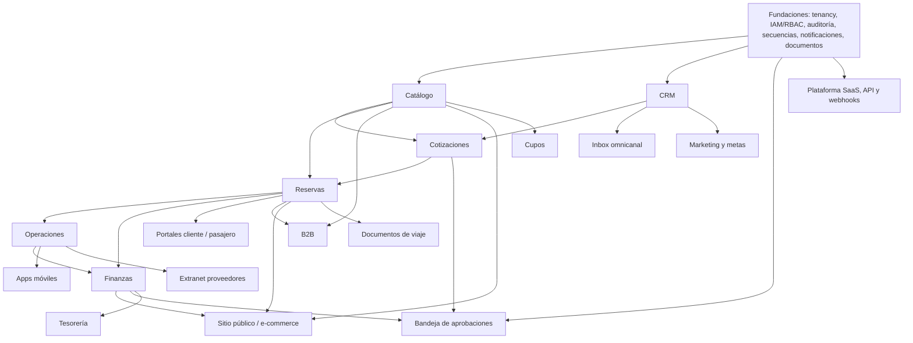

# Plan de implementación

Orden recomendado de construcción según dependencias entre dominios. Las fases respetan las prioridades P0 / P1 / Futuro de DOC-PROC-001 §33–35 e incorporan los módulos nuevos. **La duración de cada fase es referencial** y depende del tamaño del equipo.

## 1. Dependencias entre dominios

## 2. Fases

| Fase | Alcance | Especificaciones | Criterio de salida |
| --- | --- | --- | --- |
| 0 · Fundaciones | Repositorios, CI, Docker, tenancy con RLS, Sanctum + MFA, roles/permisos con `ACCESS`/`ROLE_UX`, auditoría, secuencias, idempotencia, notificaciones (email), documentos PDF, layout Next.js por experiencia, 403. | 00, 09 (usuarios, roles, configuración, auditoría) | E2E-08 (aislamiento) y pruebas RBAC en verde. |
| 1 · MVP P0 | Catálogo (productos, servicios, proveedores, destinos, tarifas, temporadas, salidas/holds), CRM básico, cotizaciones con versiones y aprobación interna, reservas con conversión idempotente y cancelación, operaciones (órdenes, asignaciones, vouchers, incidencias, cierre), finanzas (CxC, pagos, CxP, costos, rentabilidad), portal del cliente básico, reportes básicos, **Libro de Reclamaciones** (obligación legal). | 01, 02, 03, 04, 05 (sin apps), 07 (sin OSE ni conciliación), 08 (portal cliente), 12 (reclamaciones) | E2E-01, 02, 03, 05, 06, 09, 10 en verde. |
| 2 · P1 canales y campo | Apps móviles operador/pasajero con offline, portal pasajero, extranet de proveedores, B2B con crédito, sitio público con checkout y pagos, facturación electrónica OSE, conciliación, bandeja de aprobaciones, inbox omnicanal (WhatsApp), cupos, documentos de viaje, tesorería. | 05 (apps), 06, 08, 10, 11, 12 (tesorería), 15, 07 (OSE, conciliación) | E2E-04 y E2E-07 en verde; integración OSE y pasarela validadas con proveedor real. |
| 3 · SaaS y crecimiento | Suscripciones y facturación de plataforma, feature flags, API keys y webhooks, marketing (segmentos, campañas, automatizaciones), metas comerciales, CMS avanzado, reportes avanzados. | 13, 14, 09 (reportes avanzados) | Alta de un segundo tenant real de punta a punta sin intervención manual. |
| Futuro | IA, scoring, OTA/GDS, marketplace, fiscal internacional, omnicanal avanzado. | — | — |

## 3. Orden interno sugerido dentro de Catálogo

Tipos → categorías → destinos → proveedores → servicios → productos → componentes → versiones → políticas → itinerarios → tarifas → condiciones → temporadas → reglas de precio → disponibilidad → salidas → B2B → promociones → contenido → canales → rentabilidad (spec. PRD §46, confirmado).

## 4. Definición de terminado por módulo (resumen de DOC-PROC-001 §37 + convenciones)

- Migraciones con RLS, CHECK de estados, índices y FK.
- Actions con transacción, locks donde haya cupos/dinero, eventos y auditoría.
- Endpoints con FormRequest, Policy, recursos que omiten campos sensibles por permiso, OpenAPI actualizado.
- Pantallas Next.js equivalentes al prototipo, con estados vacíos, errores y 403.
- Pruebas: tenant isolation, RBAC, ownership, estados, reglas, idempotencia; E2E del flujo del módulo.
- Especificación actualizada si hubo cambios (sección 11 de la especificación y `CHANGELOG.md`).

## 5. Cómo mantener la documentación viva

1. Toda diferencia entre lo programado y la especificación se registra en la sección 11 de la especificación del módulo y en `CHANGELOG.md` (fecha, módulo, cambio, motivo, quién aprobó).
2. Las decisiones de negocio pendientes (`04-HALLAZGOS-Y-DECISIONES.md`) se cierran con fecha y responsable antes de programar el módulo afectado.
3. Si una pantalla cambia de comportamiento, se actualiza también el prototipo (módulo `.js` correspondiente) para que siga siendo la referencia visual.
