# Máquinas de estado · Qhapaq Travel Suite

_Generado por `tools/build_state_machines.py`: valores tomados del catálogo de PostgreSQL (CHECK de cada columna de estado) y transiciones de la §4 de `proto/docs/especificaciones/00…18-*.md` (tablas «Desde | Hacia» leídas automáticamente y prosa transcrita en `tools/estados_fuentes.py`), más los endpoints de escritura de `api/openapi.yaml` por tabla (`x-resource`). No editar a mano: corregir la fuente o `estados_fuentes.py` y regenerar con `python3 kit-ia/referencia/tools/build_state_machines.py` (requiere PostgreSQL 16/17; Node + Playwright + mermaid para validar los diagramas, o `--no-check`)._

**108 columnas de estado** con CHECK de lista de valores · 87 con transiciones documentadas · 21 con «Transiciones por definir» · 456 filas de transición · 665 pares desde→hacia distintos.

Convenciones de las tablas: «— (alta)» = creación del registro (estado inicial). Cuando la spec usa una expresión («cualquiera ≠ …», «no cerrada», «abierta», etiquetas de la extranet), la celda muestra los estados resueltos y debajo el texto original. «Ref.» indica la sección de origen; «(prosa)» = transcrito de un párrafo, no de una tabla. Lo marcado «Supuesto» o «Por definir» no está fijado por la spec.

## Cómo implementarlas

- **Enum de PHP con los mismos valores del CHECK.** Un `enum` respaldado por `string` por columna de estado, con los valores **idénticos** a los de la tabla «Valores válidos» de cada sección (son los del `CHECK` de SQL; no traducir ni cambiar mayúsculas). Ejemplo para `quote_quotes.status`:

  ```php
  enum QuoteStatus: string
  {
      case Borrador = 'borrador';
      case Enviada = 'enviada';
      // … un case por cada valor del CHECK
  }
  ```

  Una prueba unitaria compara `QuoteStatus::cases()` con el CHECK (ver `kit-ia/tests/pest/Unit/Quotes/QuoteStateMachineTest.php`, prueba «los estados coinciden con el CHECK»).
- **Cambios solo vía la máquina de estados del dominio.** Cada dominio declara su grafo en `App\Domain\<Dominio>\StateMachines\<Entidad>StateMachine` (`can($from, $to)`, `assertTransition($from, $to)`, `allowedFrom($from)`, `states()`), tomando las transiciones de este documento. Nunca `update(['status' => …])` directo (backend/CLAUDE.md, CONVENCIONES §2). Una transición no declarada lanza `TransitionNotAllowed` → **409** con `code`; una guarda de negocio incumplida → **409/422** con el `code` de la regla (p. ej. `QTE-BR-16`, `RT-3`).
- **Guardas y efectos en la acción.** La acción de dominio (`App\Domain\<Dominio>\Actions\…`) valida permiso (`x-permission` del contrato), guardas y `lock_version` (`If-Match` → 409), aplica el cambio y los efectos en **una transacción** con `SET LOCAL app.tenant_id`, y registra los eventos de dominio en `sys_outbox`.
- **Auditoría.** Toda transición escribe `audit_events` con entidad, acción (la indicada en «Efectos», p. ej. `cambio_estado`, `aprobar`), estado anterior → nuevo, actor (o Sistema) y motivo cuando la spec lo exige. Las bitácoras específicas (`fin_status_history`, `crm_case_events`, `collab_approval_events`, `mkt_consent_events`, `ops_incident_logs`…) se escriben además donde existan.
- **Transiciones automáticas** (jobs, webhooks, listeners) pasan por la misma máquina con actor `Sistema`; los jobs multi-tenant despachan un job por tenant.
- **Estados derivados** (vencida por fecha, estado efectivo de agencia, «Por responder» de la extranet, etc.) no se persisten salvo que la sección diga lo contrario: se calculan en lectura.
- **«Transiciones por definir»**: la columna existe con su CHECK pero ninguna spec documenta transiciones. No inventarlas: registrar la decisión en `docs/04-HALLAZGOS-Y-DECISIONES.md` antes de programarlas.

## Índice

| # | Entidad | Tabla.columna | Fase | Valores | Filas de transición | Specs |
|---|---|---|---|---|---|---|
| 1 | [Solicitud de acceso](#m-iam-access-requests-status) | `iam_access_requests.status` | Fase 0 · Fundaciones | 3 | 3 | 00 |
| 2 | [Clave de idempotencia](#m-sys-idempotency-keys-status) | `sys_idempotency_keys.status` | Fase 0 · Fundaciones | 3 | 3 | 00 |
| 3 | [Mensaje de outbox](#m-sys-outbox-status) | `sys_outbox.status` | Fase 0 · Fundaciones | 3 | 3 | 00 |
| 4 | [Actividad](#m-crm-activities-status) | `crm_activities.status` | Fase 1 · MVP | 3 | 5 | 01 |
| 5 | [Caso de postventa](#m-crm-cases-status) | `crm_cases.status` | Fase 1 · MVP | 4 | 6 | 01 |
| 6 | [Lead](#m-crm-leads-status) | `crm_leads.status` | Fase 1 · MVP | 6 | 10 | 01 |
| 7 | [Oportunidad (etapa)](#m-crm-opportunities-stage) | `crm_opportunities.stage` | Fase 1 · MVP | 6 | 9 | 01 |
| 8 | [Hold de inventario de la reserva](#m-booking-inventory-holds-status) | `booking_inventory_holds.status` | Fase 1 · MVP | 5 | 7 | 02, 04 |
| 9 | [Hold de disponibilidad](#m-catalog-availability-holds-status) | `catalog_availability_holds.status` | Fase 1 · MVP | 5 | 7 | 02, 15 |
| 10 | [Regla de pricing](#m-catalog-price-rules-status) | `catalog_price_rules.status` | Fase 1 · MVP | 2 | 2 | 02 |
| 11 | [Salida](#m-catalog-product-departures-status) | `catalog_product_departures.status` | Fase 1 · MVP | 4 | 5 | 02, 08 |
| 12 | [Promoción de producto](#m-catalog-product-promotions-status) | `catalog_product_promotions.status` | Fase 1 · MVP | 2 | 2 | 02, 08 |
| 13 | [Versión de producto](#m-catalog-product-versions-status) | `catalog_product_versions.status` | Fase 1 · MVP | 4 | 4 | 02 |
| 14 | [Producto](#m-catalog-products-status) | `catalog_products.status` | Fase 1 · MVP | 7 | 10 | 02 |
| 15 | [Proveedor](#m-catalog-providers-status) | `catalog_providers.status` | Fase 1 · MVP | 3 | 5 | 02 |
| 16 | [Tarifa](#m-catalog-rates-status) | `catalog_rates.status` | Fase 1 · MVP | 2 | 2 | 02 |
| 17 | [Temporada](#m-catalog-seasons-status) | `catalog_seasons.status` | Fase 1 · MVP | 2 | 2 | 02 |
| 18 | [Servicio](#m-catalog-services-status) | `catalog_services.status` | Fase 1 · MVP | 3 | 3 | 02 |
| 19 | [Aprobación interna de cotización](#m-quote-internal-approvals-status) | `quote_internal_approvals.status` | Fase 1 · MVP | 4 | 4 | 03 |
| 20 | [Cotización](#m-quote-quotes-status) | `quote_quotes.status` | Fase 1 · MVP | 9 | 14 | 03, 08 |
| 21 | [Versión de cotización](#m-quote-versions-status) | `quote_versions.status` | Fase 1 · MVP | 6 | 6 | 03 |
| 22 | [Solicitud de anulación](#m-booking-cancel-requests-status) | `booking_cancel_requests.status` | Fase 1 · MVP | 4 | 4 | 04, 10 |
| 23 | [Modificación / reprogramación de reserva](#m-booking-changes-status) | `booking_changes.status` | Fase 1 · MVP | 3 | 4 | 04 |
| 24 | [Servicio de reserva](#m-booking-reservation-services-status) | `booking_reservation_services.status` | Fase 1 · MVP | 7 | 15 | 04, 05, 06 |
| 25 | [Reserva](#m-booking-reservations-status) | `booking_reservations.status` | Fase 1 · MVP | 11 | 18 | 04, 07, 08, 15 |
| 26 | [Comentario del pasajero](#m-channel-pax-feedback-status) | `channel_pax_feedback.status` | Fase 2 · Canales y campo | 4 | 5 | 04 |
| 27 | [Asignación de recurso](#m-ops-assignments-status) | `ops_assignments.status` | Fase 1 · MVP | 5 | 6 | 04, 05 |
| 28 | [Conductor (recurso)](#m-ops-drivers-status) | `ops_drivers.status` | Fase 1 · MVP | 4 | 1 | 05 |
| 29 | [Guía (recurso)](#m-ops-guides-status) | `ops_guides.status` | Fase 1 · MVP | 4 | 1 | 05 |
| 30 | [Incidencia](#m-ops-incidents-status) | `ops_incidents.status` | Fase 1 · MVP | 4 | 6 | 05, 06 |
| 31 | [Orden operativa](#m-ops-orders-status) | `ops_orders.status` | Fase 1 · MVP | 7 | 9 | 05 |
| 32 | [Rooming list](#m-ops-rooming-lists-status) | `ops_rooming_lists.status` | Fase 1 · MVP | 4 | 5 | 05, 06 |
| 33 | [Habitación de rooming list](#m-ops-rooming-rooms-status) | `ops_rooming_rooms.status` | Fase 1 · MVP | 3 | 4 | 05, 06 |
| 34 | [Solicitud al proveedor (PROC-032)](#m-ops-supplier-requests-status) | `ops_supplier_requests.status` | Fase 1 · MVP | 5 | Por definir | — |
| 35 | [Vehículo (recurso)](#m-ops-vehicles-status) | `ops_vehicles.status` | Fase 1 · MVP | 3 | 1 | 05 |
| 36 | [Voucher](#m-ops-vouchers-status) | `ops_vouchers.status` | Fase 1 · MVP | 3 | 5 | 05, 06 |
| 37 | [Factura del proveedor](#m-supplier-invoices-status) | `supplier_invoices.status` | Fase 2 · Canales y campo | 4 | 4 | 06 |
| 38 | [Solicitud de tarifa del proveedor](#m-supplier-rate-requests-status) | `supplier_rate_requests.status` | Fase 2 · Canales y campo | 4 | 4 | 06, 10 |
| 39 | [Revisión de alternativa del proveedor](#m-supplier-request-responses-review-status) | `supplier_request_responses.review_status` | Fase 2 · Canales y campo | 4 | 3 | 06 |
| 40 | [Línea de extracto bancario](#m-fin-bank-lines-status) | `fin_bank_lines.status` | Fase 2 · Canales y campo | 4 | 5 | 07 |
| 41 | [Comisión](#m-fin-commissions-status) | `fin_commissions.status` | Fase 1 · MVP | 3 | 4 | 07, 10, 14 |
| 42 | [Comprobante electrónico](#m-fin-invoices-status) | `fin_invoices.status` | Fase 2 · Canales y campo | 6 | 10 | 07 |
| 43 | [Cuenta por pagar (CxP)](#m-fin-payables-status) | `fin_payables.status` | Fase 1 · MVP | 6 | 8 | 07, 10 |
| 44 | [Pago](#m-fin-payments-status) | `fin_payments.status` | Fase 1 · MVP | 5 | 9 | 07, 10 |
| 45 | [Periodo contable](#m-fin-period-closes-status) | `fin_period_closes.status` | Fase 2 · Canales y campo | 2 | 2 | 07 |
| 46 | [Cuenta por cobrar (CxC)](#m-fin-receivables-status) | `fin_receivables.status` | Fase 1 · MVP | 5 | 6 | 07, 15 |
| 47 | [Agencia B2B](#m-channel-b2b-agencies-status) | `channel_b2b_agencies.status` | Fase 2 · Canales y campo | 3 | 4 | 08, 10 |
| 48 | [Pedido web (e-commerce)](#m-channel-ecom-orders-status) | `channel_ecom_orders.status` | Fase 2 · Canales y campo | 6 | 12 | 08, 15 |
| 49 | [Ticket de soporte](#m-channel-support-tickets-status) | `channel_support_tickets.status` | Fase 1 · MVP | 4 | 3 | 08, 10 |
| 50 | [Contenido CMS](#m-cms-contents-status) | `cms_contents.status` | Fase 2 · Canales y campo | 5 | 6 | 08 |
| 51 | [Sede](#m-iam-sedes-status) | `iam_sedes.status` | Fase 0 · Fundaciones | 2 | 3 | 09 |
| 52 | [Usuario del tenant](#m-iam-users-status) | `iam_users.status` | Fase 0 · Fundaciones | 3 | 4 | 00, 09 |
| 53 | [Adaptador de integración](#m-integration-adapters-status) | `integration_adapters.status` | Fase 0 · Fundaciones | 5 | Por definir | — |
| 54 | [Error de integración](#m-integration-errors-status) | `integration_errors.status` | Fase 0 · Fundaciones | 3 | 5 | 09 |
| 55 | [Notificación](#m-notif-messages-status) | `notif_messages.status` | Fase 0 · Fundaciones | 3 | 5 | 09 |
| 56 | [Exportación de reporte](#m-report-exports-status) | `report_exports.status` | Fase 1 · MVP | 5 | 5 | 09 |
| 57 | [Ejecución de job](#m-sys-job-runs-status) | `sys_job_runs.status` | Fase 0 · Fundaciones | 4 | 2 | 09 |
| 58 | [Job programado (último resultado)](#m-sys-scheduled-jobs-last-status) | `sys_scheduled_jobs.last_status` | Fase 0 · Fundaciones | 4 | 2 | 09 |
| 59 | [Tenant](#m-tenants-status) | `tenants.status` | Plataforma | 3 | 4 | 09, 13 |
| 60 | [Solicitud de aprobación](#m-collab-approval-requests-status) | `collab_approval_requests.status` | Fase 2 · Canales y campo | 5 | 10 | 10 |
| 61 | [Conversación (inbox)](#m-collab-conversations-status) | `collab_conversations.status` | Fase 2 · Canales y campo | 3 | 5 | 10, 15 |
| 62 | [Ampliación de cupo](#m-catalog-allotment-requests-status) | `catalog_allotment_requests.status` | Fase 2 · Canales y campo | 3 | 3 | 11 |
| 63 | [Contrato de cupo](#m-catalog-allotments-status) | `catalog_allotments.status` | Fase 2 · Canales y campo | 4 | 6 | 11 |
| 64 | [Ítem documental de viaje](#m-ops-travel-doc-items-status) | `ops_travel_doc_items.status` | Fase 2 · Canales y campo | 4 | 3 | 11 |
| 65 | [Hoja de reclamación (Libro de Reclamaciones)](#m-crm-cases-book-status) | `crm_cases.book_status` | Fase 1 · MVP | 4 | 5 | 12, 15 |
| 66 | [Arqueo de caja](#m-fin-cash-counts-status) | `fin_cash_counts.status` | Fase 2 · Canales y campo | 4 | 5 | 12 |
| 67 | [Reposición de caja](#m-fin-cash-replenishments-status) | `fin_cash_replenishments.status` | Fase 2 · Canales y campo | 4 | 5 | 12 |
| 68 | [Sesión de caja](#m-fin-cash-sessions-status) | `fin_cash_sessions.status` | Fase 2 · Canales y campo | 2 | 2 | 12 |
| 69 | [Movimiento de tesorería](#m-fin-treasury-movements-status) | `fin_treasury_movements.status` | Fase 2 · Canales y campo | 2 | 2 | 12 |
| 70 | [API key](#m-integration-api-keys-status) | `integration_api_keys.status` | Fase 3 · SaaS y crecimiento | 3 | 3 | 13 |
| 71 | [Entrega de webhook](#m-integration-webhook-deliveries-status) | `integration_webhook_deliveries.status` | Fase 3 · SaaS y crecimiento | 4 | 5 | 13 |
| 72 | [Webhook](#m-integration-webhooks-status) | `integration_webhooks.status` | Fase 3 · SaaS y crecimiento | 4 | 6 | 13 |
| 73 | [Factura de plataforma](#m-platform-invoices-status) | `platform_invoices.status` | Plataforma | 6 | 8 | 13 |
| 74 | [Cambio programado de suscripción](#m-subscription-changes-status) | `subscription_changes.status` | Plataforma | 3 | 2 | 13 |
| 75 | [Suscripción](#m-subscriptions-status) | `subscriptions.status` | Plataforma | 6 | 14 | 13 |
| 76 | [Meta comercial](#m-crm-sales-targets-status) | `crm_sales_targets.status` | Fase 3 · SaaS y crecimiento | 4 | 5 | 14 |
| 77 | [Automatización](#m-mkt-automations-status) | `mkt_automations.status` | Fase 3 · SaaS y crecimiento | 2 | 2 | 14 |
| 78 | [Campaña](#m-mkt-campaigns-status) | `mkt_campaigns.status` | Fase 3 · SaaS y crecimiento | 5 | 8 | 14 |
| 79 | [Consentimiento](#m-mkt-consents-status) | `mkt_consents.status` | Fase 3 · SaaS y crecimiento | 2 | 3 | 14 |
| 80 | [Plantilla de marketing](#m-mkt-templates-status) | `mkt_templates.status` | Fase 3 · SaaS y crecimiento | 4 | 5 | 14 |
| 81 | [Carrito web](#m-channel-web-carts-status) | `channel_web_carts.status` | Fase 2 · Canales y campo | 4 | 5 | 15 |
| 82 | [Rango de disponibilidad](#m-catalog-availability-ranges-status) | `catalog_availability_ranges.status` | Fase 1 · MVP | 3 | 2 | 16 |
| 83 | [Respuesta a reseña externa](#m-channel-external-reviews-response-status) | `channel_external_reviews.response_status` | Fase 3 · SaaS y crecimiento | 4 | 5 | 17 |
| 84 | [Dominio del widget](#m-channel-widget-domains-status) | `channel_widget_domains.status` | Fase 2 · Canales y campo | 2 | 2 | 17 |
| 85 | [Traspaso del widget](#m-channel-widget-handoffs-status) | `channel_widget_handoffs.status` | Fase 2 · Canales y campo | 4 | 4 | 17 |
| 86 | [Conector de reseñas](#m-integration-review-sources-status) | `integration_review_sources.status` | Fase 3 · SaaS y crecimiento | 4 | 5 | 17 |
| 87 | [Mensaje al pasajero](#m-notif-pax-messages-status) | `notif_pax_messages.status` | Fase 2 · Canales y campo | 6 | 7 | 17 |
| 88 | [Reseña propia](#m-crm-own-reviews-status) | `crm_own_reviews.status` | Fase 3 · SaaS y crecimiento | 4 | 6 | 18 |
| 89 | [Solicitud de reseña](#m-crm-review-requests-status) | `crm_review_requests.status` | Fase 3 · SaaS y crecimiento | 6 | 7 | 18 |
| 90 | [Consumo de cupo por servicio de reserva (idempotente)](#m-catalog-allotment-consumptions-state) | `catalog_allotment_consumptions.state` | Fase 2 · Canales y campo | 3 | Por definir | — |
| 91 | [Listas de precios B2B](#m-channel-b2b-price-lists-status) | `channel_b2b_price_lists.status` | Fase 2 · Canales y campo | 2 | Por definir | — |
| 92 | [Solicitudes de liquidación de comisiones B2B](#m-channel-b2b-settlement-requests-status) | `channel_b2b_settlement_requests.status` | Fase 2 · Canales y campo | 4 | Por definir | — |
| 93 | [Cuentas de canal del inbox (WhatsApp, email, webchat)](#m-collab-channel-accounts-status) | `collab_channel_accounts.status` | Fase 2 · Canales y campo | 3 | Por definir | — |
| 94 | [Eventos entrantes de webhooks (idempotencia, retención 30 días)](#m-collab-inbound-events-status) | `collab_inbound_events.status` | Fase 2 · Canales y campo | 4 | Por definir | — |
| 95 | [Adjuntos de mensajes](#m-collab-message-attachments-scan-status) | `collab_message_attachments.scan_status` | Fase 2 · Canales y campo | 3 | Por definir | — |
| 96 | [Mensajes de la conversación](#m-collab-messages-delivery-status) | `collab_messages.delivery_status` | Fase 2 · Canales y campo | 5 | Por definir | — |
| 97 | [Cupones de suscripción](#m-coupons-status) | `coupons.status` | Plataforma | 2 | Por definir | — |
| 98 | [Bitácora de integración fiscal OSE/PSE](#m-fin-fiscal-events-status) | `fin_fiscal_events.status` | Fase 2 · Canales y campo | 3 | Por definir | — |
| 99 | [Cuentas de tesorería (banco, caja chica, pasarela)](#m-fin-treasury-accounts-status) | `fin_treasury_accounts.status` | Fase 2 · Canales y campo | 2 | Por definir | — |
| 100 | [Proveedores de tipo de cambio](#m-fx-rate-providers-status) | `fx_rate_providers.status` | Fase 2 · Canales y campo | 4 | Por definir | — |
| 101 | [Apps OAuth de terceros autorizadas (Authorization Code + PKCE)](#m-integration-oauth-apps-status) | `integration_oauth_apps.status` | Fase 3 · SaaS y crecimiento | 2 | Por definir | — |
| 102 | [Disparos procesados por automatización (idempotencia)](#m-mkt-automation-enrollments-status) | `mkt_automation_enrollments.status` | Fase 3 · SaaS y crecimiento | 2 | Por definir | — |
| 103 | [Destinatarios de la campaña y métricas](#m-mkt-campaign-recipients-status) | `mkt_campaign_recipients.status` | Fase 3 · SaaS y crecimiento | 5 | Por definir | — |
| 104 | [Medios de pago del tenant para la suscripción (solo token)](#m-payment-methods-status) | `payment_methods.status` | Plataforma | 3 | Por definir | — |
| 105 | [Planes comerciales (Starter/Professional/Enterprise)](#m-plans-status) | `plans.status` | Plataforma | 3 | Por definir | — |
| 106 | [Notas de crédito de plataforma (serie NQ01)](#m-platform-credit-notes-sunat-status) | `platform_credit_notes.sunat_status` | Plataforma | 4 | Por definir | — |
| 107 | [Facturas de plataforma (emisor Qhapaq Cloud)](#m-platform-invoices-sunat-status) | `platform_invoices.sunat_status` | Plataforma | 4 | Por definir | — |
| 108 | [Usuarios de plataforma (Super Admin)](#m-platform-users-status) | `platform_users.status` | Plataforma | 2 | Por definir | — |

## Máquinas por entidad

<a id="m-iam-access-requests-status"></a>
### 1. Solicitud de acceso — `iam_access_requests.status`

| Tabla | Columna | Fase | Nulo | Default |
|---|---|---|---|---|
| `iam_access_requests` | `status` | Fase 0 · Fundaciones (`10_fase0.sql`) | no | `'pendiente'::character varying` |

**Valores válidos (CHECK):** `pendiente`, `atendida`, `rechazada`

**Estados iniciales:** `pendiente`  
**Estados terminales:** `atendida`, `rechazada`  
**Fuentes:** spec 00 §4 · Solicitud de acceso (`00-transversal-seguridad-rbac.md`)

| Desde | Hacia | Acción / endpoint | Permiso / quién | Guardas | Efectos | Ref. |
|---|---|---|---|---|---|---|
| — (alta) | `pendiente` | Solicitud de acceso |  |  |  | 00 §4 (prosa) |
| `pendiente` | `atendida` | Atender | Tenant Admin |  |  | 00 §4 (prosa) |
| `pendiente` | `rechazada` | Rechazar | Tenant Admin |  |  | 00 §4 (prosa) |

<details><summary>Texto de la especificación (prosa transcrita arriba)</summary>

_spec 00 §4 · Solicitud de acceso:_

> | Objeto | Estados y transiciones | Quién | Efectos |
> |---|---|---|---|
> | Solicitud de acceso | `pendiente` → `atendida` \| `rechazada` | Tenant Admin | |

</details>

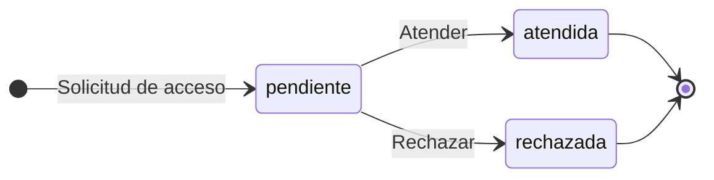

<a id="m-sys-idempotency-keys-status"></a>
### 2. Clave de idempotencia — `sys_idempotency_keys.status`

| Tabla | Columna | Fase | Nulo | Default |
|---|---|---|---|---|
| `sys_idempotency_keys` | `status` | Fase 0 · Fundaciones (`10_fase0.sql`) | no | `'processing'::character varying` |

**Valores válidos (CHECK):** `processing`, `completed`, `failed`

**Estados iniciales:** `processing`  
**Estados terminales:** `completed`  
**Sin transiciones de salida documentadas:** `failed`  
**Fuentes:** spec 00 §4 · Idempotency key (`00-transversal-seguridad-rbac.md`)

| Desde | Hacia | Acción / endpoint | Permiso / quién | Guardas | Efectos | Ref. |
|---|---|---|---|---|---|---|
| — (alta) | `processing` | Primera solicitud con `Idempotency-Key` | Middleware |  |  | 00 §4 (prosa) |
| `processing` | `completed` | La solicitud termina bien | Middleware |  | Respuesta cacheada 24 h | 00 §4 (prosa) |
| `processing` | `failed` | La solicitud falla | Middleware |  | `failed` permite reintento con la misma key | 00 §4 (prosa) |

<details><summary>Texto de la especificación (prosa transcrita arriba)</summary>

_spec 00 §4 · Idempotency key:_

> | Objeto | Estados y transiciones | Quién | Efectos |
> |---|---|---|---|
> | Idempotency key | `processing` → `completed` \| `failed` (failed permite reintento con la misma key) | Middleware | Respuesta cacheada 24 h |

</details>

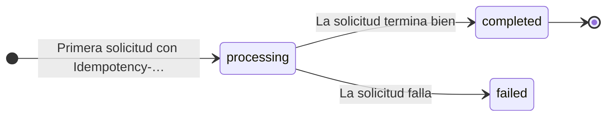

<a id="m-sys-outbox-status"></a>
### 3. Mensaje de outbox — `sys_outbox.status`

| Tabla | Columna | Fase | Nulo | Default |
|---|---|---|---|---|
| `sys_outbox` | `status` | Fase 0 · Fundaciones (`10_fase0.sql`) | no | `'pending'::character varying` |

**Valores válidos (CHECK):** `pending`, `dispatched`, `failed`

**Estados iniciales:** `pending`  
**Estados terminales:** `dispatched`  
**Sin transiciones de salida documentadas:** `failed`  
**Fuentes:** spec 00 §4 · Outbox (`00-transversal-seguridad-rbac.md`)

| Desde | Hacia | Acción / endpoint | Permiso / quién | Guardas | Efectos | Ref. |
|---|---|---|---|---|---|---|
| — (alta) | `pending` | Se registra en la misma transacción del cambio | Sistema |  |  | 00 §4 (prosa) |
| `pending` | `dispatched` | Worker publica el evento | Worker |  |  | 00 §4 (prosa) |
| `pending` | `failed` | Fallo al publicar | Worker |  | Reintentos con backoff | 00 §4 (prosa) |

<details><summary>Texto de la especificación (prosa transcrita arriba)</summary>

_spec 00 §4 · Outbox:_

> | Objeto | Estados y transiciones | Quién | Efectos |
> |---|---|---|---|
> | Outbox | `pending` → `dispatched` \| `failed` (reintentos con backoff) | Worker | |

</details>

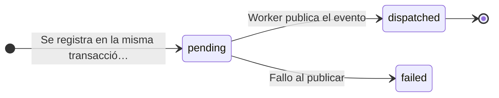

<a id="m-crm-activities-status"></a>
### 4. Actividad — `crm_activities.status`

| Tabla | Columna | Fase | Nulo | Default |
|---|---|---|---|---|
| `crm_activities` | `status` | Fase 1 · MVP (`20_fase1.sql`) | no | `'pendiente'::character varying` |

**Valores válidos (CHECK):** `pendiente`, `vencida`, `completada`

**Estados iniciales:** `pendiente`  
**Estados terminales:** `completada`  
**Fuentes:** spec 01 §4.3 Actividad (`01-crm.md`)

| Desde | Hacia | Acción / endpoint | Permiso / quién | Guardas | Efectos | Ref. |
|---|---|---|---|---|---|---|
| — (alta) | `pendiente` | Crear (manual, "Tomar lead", asignar lead con primer contacto, conversión con reunión, completar con próxima, "NPS ≤ 6", llamada de postventa) | `crm.activities.manage` / Sistema |  | audit `crear`; notificación `actividad.asignada` (Push) si owner ≠ actor | 01 §4.3 |
| `pendiente` | `vencida` | Job JOB-04 (cada hora) cuando `due_at < now()` | Sistema |  | Recordatorio al owner. La UI además deriva "vencida" en tiempo real (`due < ahora`) | 01 §4.3 |
| `pendiente`, `vencida` | `completada` | "Completar" con resultado | owner (Ventas) o supervisor |  | `completed_at`; opcional crea la próxima (`previous_activity_id`); lead `nuevo`→`contactado` (CRM-BR-30); audit `completar` | 01 §4.3 |
| `pendiente`, `vencida` | `pendiente` | "Reprogramar" | idem |  | nuevo `due_at`; audit `reprogramar` (antes → después · motivo) | 01 §4.3 |
| `pendiente`, `vencida` | `completada` <br>_spec: «completada (auto)»_ | Lead descartado | Sistema |  | result "Cerrada automáticamente: lead descartado", `auto_closed` | 01 §4.3 |

**Acciones documentadas que no cambian este estado:**

- completada → —: Final (01 §4.3)

<details><summary>Endpoints de escritura del contrato sobre <code>crm_activities</code> (5, de <code>api/openapi.yaml</code>)</summary>

| Método | Ruta | Permiso (`x-permission`) | Spec | Idempotente |
|---|---|---|---|---|
| POST | `/api/v1/crm/activities` | crm.activities.manage | 01-crm.md §6.3 Actividades |  |
| POST | `/api/v1/crm/activities/{code}/complete` | crm.activities.manage + own | 01-crm.md §6.3 Actividades | sí |
| POST | `/api/v1/crm/activities/{code}/reschedule` | crm.activities.manage + own | 01-crm.md §6.3 Actividades |  |
| POST | `/api/v1/crm/activities/{code}/reassign` | crm.records.reassign | 01-crm.md §6.3 Actividades |  |
| POST | `/api/v1/inbox/conversations/{code}/activities` | crm.activities.manage | 10-aprobaciones-inbox.md §6 |  |

</details>

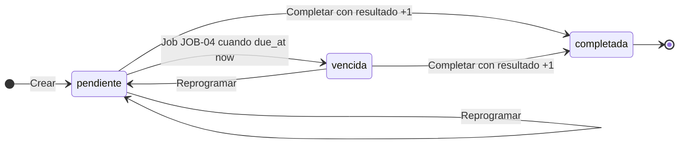

<a id="m-crm-cases-status"></a>
### 5. Caso de postventa — `crm_cases.status`

| Tabla | Columna | Fase | Nulo | Default |
|---|---|---|---|---|
| `crm_cases` | `status` | Fase 1 · MVP (`20_fase1.sql`) | no | `'abierta'::character varying` |

**Valores válidos (CHECK):** `abierta`, `en_proceso`, `resuelta`, `cerrada`

**Estados iniciales:** `abierta`, `cerrada`  
**Estados terminales:** `cerrada`  
**Fuentes:** spec 01 §4.4 Caso de postventa (`01-crm.md`)

| Desde | Hacia | Acción / endpoint | Permiso / quién | Guardas | Efectos | Ref. |
|---|---|---|---|---|---|---|
| — (alta) | `abierta` | Registro manual (tipo ≠ Felicitación) o automático por NPS ≤ 6 |  | — | evento `registro`; audit `crear`; notificación `postventa.caso` al owner si ≠ actor (manual) / `postventa.detractor` (auto) | 01 §4.4 |
| — (alta) | `cerrada` | Registro manual de tipo **Felicitación** |  | — | Nace cerrado | 01 §4.4 |
| `abierta` | `en_proceso` | "Iniciar atención" |  | — | evento `estado` | 01 §4.4 |
| `abierta`, `en_proceso` | (mismo estado) | "Registrar seguimiento" |  | nota obligatoria | evento `seguimiento`; audit `seguimiento` | 01 §4.4 |
| `abierta`, `en_proceso` | `resuelta` | "Resolver" |  | resolución obligatoria | `resolution`, `resolved_at`; evento `estado` | 01 §4.4 |
| `resuelta` | `cerrada` | "Cerrar caso" |  | — | `closed_at`; notificación Email al cliente `postventa.cierre` | 01 §4.4 |

**Notas:**

- Las hojas del Libro de Reclamaciones usan además `book_status` (ver «Hoja de reclamación»). Al cerrar la hoja, la spec 12 sincroniza el caso con Postventa.

<details><summary>Endpoints de escritura del contrato sobre <code>crm_cases</code> (5, de <code>api/openapi.yaml</code>)</summary>

| Método | Ruta | Permiso (`x-permission`) | Spec | Idempotente |
|---|---|---|---|---|
| POST | `/api/v1/crm/cases` | crm.clients.manage | 01-crm.md §6.5 Postventa y fidelización | sí |
| POST | `/api/v1/crm/cases/{code}/start` | crm.clients.manage + CRM-BR-44 | 01-crm.md §6.5 Postventa y fidelización |  |
| POST | `/api/v1/crm/cases/{code}/follow-ups` | crm.clients.manage | 01-crm.md §6.5 Postventa y fidelización |  |
| POST | `/api/v1/crm/cases/{code}/resolve` | crm.clients.manage | 01-crm.md §6.5 Postventa y fidelización |  |
| POST | `/api/v1/crm/cases/{code}/close` | crm.clients.manage | 01-crm.md §6.5 Postventa y fidelización |  |

</details>

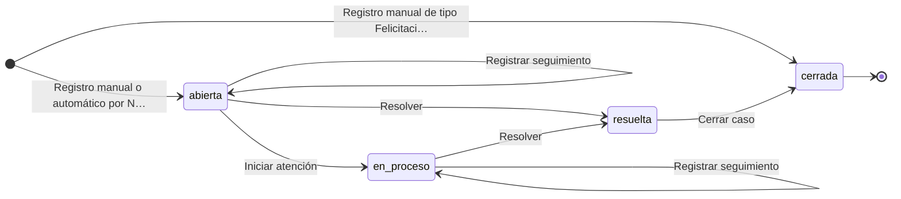

<a id="m-crm-leads-status"></a>
### 6. Lead — `crm_leads.status`

| Tabla | Columna | Fase | Nulo | Default |
|---|---|---|---|---|
| `crm_leads` | `status` | Fase 1 · MVP (`20_fase1.sql`) | no | `'nuevo'::character varying` |

**Valores válidos (CHECK):** `nuevo`, `contactado`, `calificado`, `convertido`, `duplicado`, `descartado`

**Estados iniciales:** `nuevo`, `duplicado`  
**Estados terminales:** `convertido`  
**Fuentes:** spec 01 §4.1 Lead (`01-crm.md`)

| Desde | Hacia | Acción / endpoint | Permiso / quién | Guardas | Efectos | Ref. |
|---|---|---|---|---|---|---|
| — (alta) | `nuevo` | Registrar lead (`POST /crm/leads`), ingreso de sistema | `crm.leads.manage` / Sistema | CRM-BR-01..06 | Score inicial (CRM-BR-07); si hay owner: audit `asignar` + notificación `lead.asignado` (si owner ≠ actor) | 01 §4.1 |
| — (alta) | `duplicado` | Registrar con resolución `mark_duplicate` | idem | hay coincidencias | `duplicate_of` = primera coincidencia; nota "Coincide con X (correo y teléfono)"; no entra a la cola | 01 §4.1 |
| `nuevo` | `contactado` | Completar actividad Llamada/Email/WhatsApp/Reunión relacionada al lead | dueño de la actividad | lead en `nuevo` | `first_contact_at`; audit `primer_contacto` | 01 §4.1 |
| `nuevo`, `contactado`, `calificado` | `nuevo`, `contactado`, `calificado` | "Cambiar estado" (`POST …/status`) | `crm.leads.manage` + propietario | → `calificado` exige score ≥ 50; ≠ `nuevo` exige owner (CRM-BR-10/11) | → `contactado` fija `first_contact_at` si vacío; audit `cambio_estado` | 01 §4.1 |
| `nuevo`, `contactado`, `calificado` | `calificado` | "Calificar (BANT)" con "Marcar como calificado" (`POST …/qualify`) | idem | score BANT ≥ 50 | Si no tenía owner: owner = actor (solo posible para supervisor); `first_contact_at` si vacío; audit `calificar` | 01 §4.1 |
| `calificado` | `convertido` | "Convertir" (`POST …/convert`) | `crm.leads.manage` **y** `crm.opportunities.manage` + propietario | CRM-BR-12, 15–17 | Crea/vincula cliente, crea oportunidad, reunión opcional; audits `Cliente crear`, `Lead convertir`, `Oportunidad crear`; notificación `lead.convertido` | 01 §4.1 |
| `nuevo`, `contactado`, `calificado` | `descartado` | "Descartar con motivo" (`POST …/discard`) | `crm.leads.manage` + propietario | motivo obligatorio | Guarda `discarded_at_step`; cierra actividades pendientes del lead (CRM-BR-14); audit `descartar` | 01 §4.1 |
| `nuevo`, `contactado`, `calificado` | `duplicado` | "Marcar como duplicado" (`POST …/mark-duplicate`) | idem | existen coincidencias | `duplicate_of` = 1ª coincidencia; audit `marcar_duplicado` | 01 §4.1 |
| `nuevo`, `contactado`, `calificado` <br>_spec: «(otro lead) nuevo/contactado/calificado»_ | `duplicado` | "Fusionar en este lead" (`POST /crm/leads/{destino}/merge`) | idem | lead origen no convertido/duplicado | Origen → duplicado de destino; campos vacíos del destino se completan; `pax` si vacío; score = máx; actividades del origen pasan al destino (`merged_from_lead_id`); audits `fusionar` en ambos | 01 §4.1 |
| `descartado`, `duplicado` | `nuevo` | "Reabrir lead" (`POST …/reopen`) | `crm.leads.manage` + propietario | — | Limpia `duplicate_of`; audit `reabrir` | 01 §4.1 |

**Acciones documentadas que no cambian este estado:**

- — → (sin alta): Resolución `merge` · idem · existe lead coincidente en `nuevo/contactado/calificado` · Se completan campos vacíos del existente, nota "[Fusionado dd mmm · fuente/canal] …", score +5 (máx 100); audit `fusionar` (01 §4.1)
- convertido → —: Estado final (sin acciones salvo "Registrar actividad") (01 §4.1)

**Notas:**

- La resolución `merge` al registrar no crea lead (fila «(sin alta)»): completa el lead existente.
- Asignación («Tomar lead», «Asignar/Reasignar») no cambia el estado.
- CHECK adicional de tabla: un lead distinto de `nuevo`, `duplicado` y `descartado` exige `owner_id` (CRM-BR-10/11).

<details><summary>Endpoints de escritura del contrato sobre <code>crm_leads</code> (12, de <code>api/openapi.yaml</code>)</summary>

| Método | Ruta | Permiso (`x-permission`) | Spec | Idempotente |
|---|---|---|---|---|
| POST | `/api/v1/crm/leads` | crm.leads.manage | 01-crm.md §6.1 Leads | sí |
| PATCH | `/api/v1/crm/leads/{code}` | crm.leads.manage + propietario | 01-crm.md §6.1 Leads |  |
| POST | `/api/v1/crm/leads/{code}/take` | crm.leads.manage | 01-crm.md §6.1 Leads |  |
| POST | `/api/v1/crm/leads/{code}/assign` | crm.records.reassign | 01-crm.md §6.1 Leads |  |
| POST | `/api/v1/crm/leads/{code}/status` | crm.leads.manage + propietario | 01-crm.md §6.1 Leads |  |
| POST | `/api/v1/crm/leads/{code}/qualify` | crm.leads.manage | 01-crm.md §6.1 Leads |  |
| POST | `/api/v1/crm/leads/{code}/discard` | crm.leads.manage | 01-crm.md §6.1 Leads |  |
| POST | `/api/v1/crm/leads/{code}/reopen` | crm.leads.manage | 01-crm.md §6.1 Leads |  |
| POST | `/api/v1/crm/leads/{code}/mark-duplicate` | crm.leads.manage | 01-crm.md §6.1 Leads |  |
| POST | `/api/v1/crm/leads/{code}/merge` | crm.leads.manage | 01-crm.md §6.1 Leads |  |
| POST | `/api/v1/crm/leads/{code}/convert` | crm.leads.manage + crm.opportunities.manage + propietario | 01-crm.md §6.1 Leads | sí |
| POST | `/api/v1/public/leads` | público + captcha invisible | 15-sitio-web-publico.md §6.4 Captación y legal | sí |

</details>

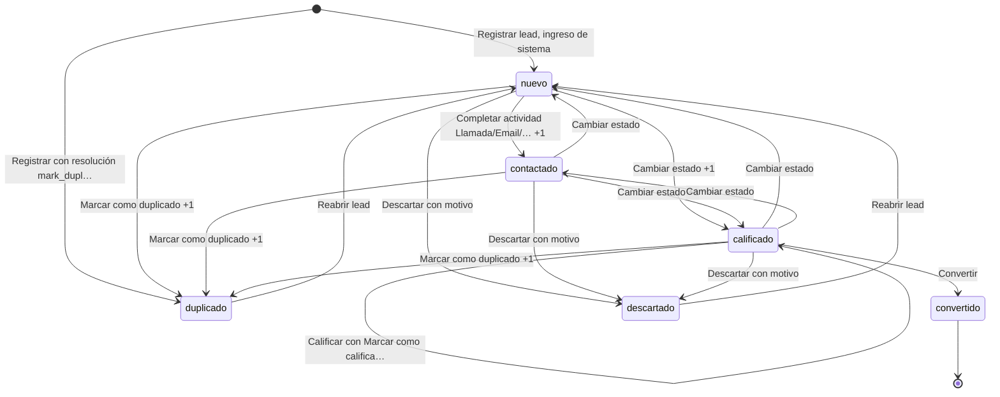

<a id="m-crm-opportunities-stage"></a>
### 7. Oportunidad (etapa) — `crm_opportunities.stage`

| Tabla | Columna | Fase | Nulo | Default |
|---|---|---|---|---|
| `crm_opportunities` | `stage` | Fase 1 · MVP (`20_fase1.sql`) | no | `'descubrimiento'::character varying` |

**Valores válidos (CHECK):** `calificacion`, `descubrimiento`, `cotizacion`, `negociacion`, `ganada`, `perdida`

**Estados iniciales:** `calificacion`, `descubrimiento`, `cotizacion`, `negociacion`  
**Estados terminales:** no declarados en la spec  
**Fuentes:** spec 01 §4.2 Oportunidad (`01-crm.md`)

| Desde | Hacia | Acción / endpoint | Permiso / quién | Guardas | Efectos | Ref. |
|---|---|---|---|---|---|---|
| — (alta) | `calificacion`, `descubrimiento`, `cotizacion`, `negociacion` | Alta manual (etapa inicial elegible), conversión de lead (solo `calificacion`/`descubrimiento`, default `descubrimiento`), recompra (`calificacion`) | `crm.opportunities.manage` | CRM-BR-20/21 | probability = `default_probability` de la etapa; audit `crear`; notificación `oportunidad.asignada` si owner ≠ actor | 01 §4.2 |
| `calificacion`, `descubrimiento`, `cotizacion`, `negociacion` <br>_spec: «abierta»_ | `calificacion`, `descubrimiento`, `cotizacion`, `negociacion` <br>_spec: «otra abierta»_ | Drag & drop, menú ⋯, "Mover a" (`POST …/stage`) | `crm.opportunities.manage` + propietario | — | probability = default de la etapa destino; audit `cambio_etapa` | 01 §4.2 |
| `calificacion`, `descubrimiento`, `cotizacion`, `negociacion` <br>_spec: «abierta»_ | `ganada` | "Marcar como ganada" | idem | Confirmación; **advertencia no bloqueante** si no hay cotización `aprobada`/`convertida` vinculada (CRM-BR-23) | probability 100, `closed_at` = hoy, limpia motivo; audit; notificación `oportunidad.ganada` al owner | 01 §4.2 |
| `calificacion`, `descubrimiento`, `cotizacion`, `negociacion` <br>_spec: «abierta»_ | `perdida` | "Marcar como perdida" | idem | motivo obligatorio; "Otro" exige detalle (CRM-BR-24) | probability 0, `closed_at` = hoy, `lost_at_stage` = etapa previa; audit con motivo; notificación `oportunidad.perdida` | 01 §4.2 |
| `ganada`, `perdida` | `calificacion`, `descubrimiento`, `cotizacion`, `negociacion` <br>_spec: «abierta»_ | "Reabrir oportunidad" / mover desde columna cerrada | idem | Confirmación "Reabrir…" | Destino por defecto: `lost_at_stage` si es abierta, si no `negociacion`; probability = default; `closed_at` NULL; desde `perdida` limpia motivo; audit `cambio_etapa` | 01 §4.2 |
| `ganada` | `perdida` <br>_spec: «perdida (y viceversa)»_ | Mover entre columnas cerradas | idem | perdida exige motivo | idem anteriores | 01 §4.2 |
| `calificacion`, `descubrimiento` | `cotizacion` | **Automático**: se crea una cotización con `opportunity_id` (evento `QuoteCreated`, módulo Ventas) | Sistema | — | probability 55; audit `cambio_etapa` | 01 §4.2 |
| `calificacion`, `descubrimiento`, `cotizacion` <br>_spec: «no ganada/perdida/negociacion»_ | `negociacion` | **Automático**: se registra negociación en la cotización (`QuoteNegotiationRecorded`) | Sistema | — | probability 70 | 01 §4.2 |
| `calificacion`, `descubrimiento`, `cotizacion`, `negociacion`, `perdida` <br>_spec: «≠ ganada»_ | `ganada` | **Automático**: cotización convertida en reserva (`QuoteConverted`) | Sistema | — | probability 100, `closed_at` = hoy (el prototipo sobrescribe `closeDate`, ver §11) | 01 §4.2 |

**Notas:**

- La spec la llama `STATUS`; en SQL es `crm_opportunities.stage` (`default 'descubrimiento'`).
- «abierta» = `calificacion`, `descubrimiento`, `cotizacion` o `negociacion`. CHECK adicional: `closed_at` solo con etapa `ganada`/`perdida`.

<details><summary>Endpoints de escritura del contrato sobre <code>crm_opportunities</code> (4, de <code>api/openapi.yaml</code>)</summary>

| Método | Ruta | Permiso (`x-permission`) | Spec | Idempotente |
|---|---|---|---|---|
| POST | `/api/v1/crm/opportunities` | crm.opportunities.manage | 01-crm.md §6.2 Oportunidades | sí |
| PATCH | `/api/v1/crm/opportunities/{code}` | crm.opportunities.manage + own | 01-crm.md §6.2 Oportunidades |  |
| POST | `/api/v1/crm/opportunities/{code}/stage` | crm.opportunities.manage + own | 01-crm.md §6.2 Oportunidades |  |
| POST | `/api/v1/crm/opportunities/{code}/reassign` | crm.records.reassign | 01-crm.md §6.2 Oportunidades |  |

</details>

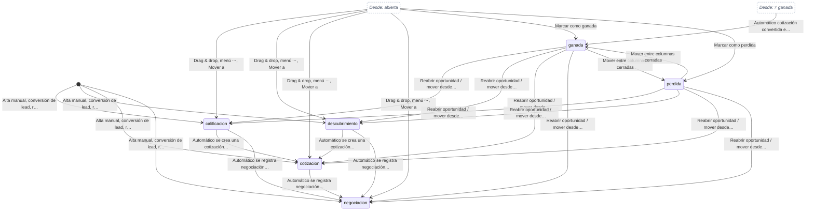

<a id="m-booking-inventory-holds-status"></a>
### 8. Hold de inventario de la reserva — `booking_inventory_holds.status`

| Tabla | Columna | Fase | Nulo | Default |
|---|---|---|---|---|
| `booking_inventory_holds` | `status` | Fase 1 · MVP (`20_fase1.sql`) | no | `'hold'::character varying` |

**Valores válidos (CHECK):** `hold`, `confirmada`, `liberada`, `expirada`, `consumida`

**Estados iniciales:** `hold`, `confirmada`  
**Estados terminales:** `liberada`, `expirada`, `consumida`  
**Fuentes:** spec 02 §4.5 Hold de disponibilidad (`02-catalogo.md`); spec 04 §4.3 Conversión idempotente cotización → reserva (PROC-025), paso a paso (`04-reservas.md`)

| Desde | Hacia | Acción / endpoint | Permiso / quién | Guardas | Efectos | Ref. |
|---|---|---|---|---|---|---|
| — (alta) <br>_spec: «(disponible)»_ | `hold` | Nuevo hold |  | CAT-BR-21 | resta de disponibles (no de `sold`) | 02 §4.5 |
| — (alta) <br>_spec: «(disponible)»_ | `confirmada` | Confirmar cupos (venta directa) |  | CAT-BR-23 | `sold += qty`; completa si llena | 02 §4.5 |
| `hold` | `confirmada` | Confirmar |  | CAT-BR-22 | `sold += qty`; completa si llena; notificación `disponibilidad.confirmada` al creador del hold | 02 §4.5 |
| `hold` | `liberada` | Liberar (motivo) |  | — | devuelve cupos retenidos | 02 §4.5 |
| `confirmada` | `liberada` | Liberar (motivo; cancelación) |  | — | `sold -= qty`; completa → abierta | 02 §4.5 |
| `hold` | `expirada` | Job JOB-01 (cada 5 min) o botón “Expirar holds vencidos” |  | `expires_at < now` | devuelve cupos | 02 §4.5 |
| `confirmada` | `consumida` | Consumir (servicio ejecutado) |  | — | `sold` no cambia | 02 §4.5 |

**Notas:**

- Mismos valores y ciclo que `catalog_availability_holds` (PROC-020). La conversión (04 §4.3 paso 9) crea el hold ya `confirmada` para POR_SALIDA y `hold` para modelos sin control por salida; la cancelación (04 §4.6) lo pasa a `liberada`.

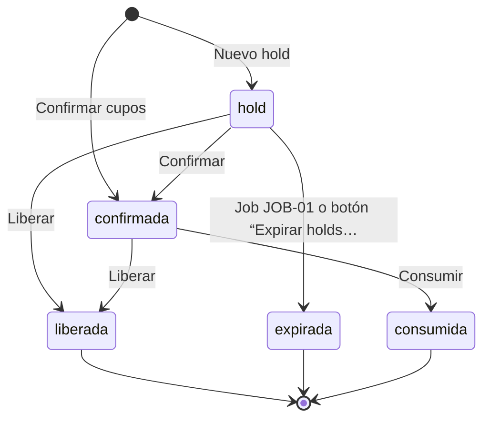

<a id="m-catalog-availability-holds-status"></a>
### 9. Hold de disponibilidad — `catalog_availability_holds.status`

| Tabla | Columna | Fase | Nulo | Default |
|---|---|---|---|---|
| `catalog_availability_holds` | `status` | Fase 1 · MVP (`20_fase1.sql`) | no | `'hold'::character varying` |

**Valores válidos (CHECK):** `hold`, `confirmada`, `liberada`, `expirada`, `consumida`

**Estados iniciales:** `hold`, `confirmada`  
**Estados terminales:** `liberada`, `expirada`, `consumida`  
**Fuentes:** spec 02 §4.5 Hold de disponibilidad (`02-catalogo.md`); spec 15 §4.3 Hold de carrito (`15-sitio-web-publico.md`)

| Desde | Hacia | Acción / endpoint | Permiso / quién | Guardas | Efectos | Ref. |
|---|---|---|---|---|---|---|
| — (alta) <br>_spec: «(disponible)»_ | `hold` | Nuevo hold |  | CAT-BR-21 | resta de disponibles (no de `sold`) | 02 §4.5 |
| — (alta) <br>_spec: «(disponible)»_ | `confirmada` | Confirmar cupos (venta directa) |  | CAT-BR-23 | `sold += qty`; completa si llena | 02 §4.5 |
| `hold` | `confirmada` | Confirmar |  | CAT-BR-22 | `sold += qty`; completa si llena; notificación `disponibilidad.confirmada` al creador del hold | 02 §4.5 |
| `hold` | `liberada` | Liberar (motivo) |  | — | devuelve cupos retenidos | 02 §4.5 |
| `confirmada` | `liberada` | Liberar (motivo; cancelación) |  | — | `sold -= qty`; completa → abierta | 02 §4.5 |
| `hold` | `expirada` | Job JOB-01 (cada 5 min) o botón “Expirar holds vencidos” |  | `expires_at < now` | devuelve cupos | 02 §4.5 |
| `confirmada` | `consumida` | Consumir (servicio ejecutado) |  | — | `sold` no cambia | 02 §4.5 |

**Notas:**

- El hold de carrito del sitio web (15 §4.3) usa esta misma tabla: 30 min; «Volver a bloquear» crea un hold nuevo.

<details><summary>Endpoints de escritura del contrato sobre <code>catalog_availability_holds</code> (5, de <code>api/openapi.yaml</code>)</summary>

| Método | Ruta | Permiso (`x-permission`) | Spec | Idempotente |
|---|---|---|---|---|
| POST | `/api/v1/catalog/holds` | catalog.products.manage_availability | 02-catalogo.md §6.3 Salidas y holds (globales) | sí |
| POST | `/api/v1/catalog/holds/{id}/confirm` | catalog.products.manage_availability | 02-catalogo.md §6.3 Salidas y holds (globales) |  |
| POST | `/api/v1/catalog/holds/{id}/release` | catalog.products.manage_availability | 02-catalogo.md §6.3 Salidas y holds (globales) |  |
| POST | `/api/v1/catalog/holds/{id}/consume` | catalog.products.manage_availability | 02-catalogo.md §6.3 Salidas y holds (globales) |  |
| POST | `/api/v1/catalog/holds/expire` | catalog.products.manage_availability | 02-catalogo.md §6.3 Salidas y holds (globales) |  |

</details>

```mermaid
stateDiagram-v2
  [*] --> hold : Nuevo hold
  [*] --> confirmada : Confirmar cupos
  hold --> confirmada : Confirmar
  hold --> liberada : Liberar
  confirmada --> liberada : Liberar
  hold --> expirada : Job JOB-01 o botón “Expirar holds…
  confirmada --> consumida : Consumir
  liberada --> [*]
  expirada --> [*]
  consumida --> [*]
```

<a id="m-catalog-price-rules-status"></a>
### 10. Regla de pricing — `catalog_price_rules.status`

| Tabla | Columna | Fase | Nulo | Default |
|---|---|---|---|---|
| `catalog_price_rules` | `status` | Fase 1 · MVP (`20_fase1.sql`) | no | `'activa'::character varying` |

**Valores válidos (CHECK):** `activa`, `inactiva`

**Estados iniciales:** `activa` (default SQL; la spec no documenta el alta)  
**Estados terminales:** no declarados en la spec  
**Fuentes:** spec 02 §4.8 Temporada, promoción, regla de pricing, publicación (`02-catalogo.md`)

| Desde | Hacia | Acción / endpoint | Permiso / quién | Guardas | Efectos | Ref. |
|---|---|---|---|---|---|---|
| `activa` | `inactiva` | Switch | `manage_rates` |  |  | 02 §4.8 (prosa) |
| `inactiva` | `activa` | Switch | `manage_rates` |  |  | 02 §4.8 (prosa) |

<details><summary>Texto de la especificación (prosa transcrita arriba)</summary>

_spec 02 §4.8 Temporada, promoción, regla de pricing, publicación:_

> ### 4.8 Temporada, promoción, regla de pricing, publicación
> | Entidad | Estados | Transición |
> |---|---|---|
> | Temporada | activa ⇄ inactiva | Formulario de edición o “Inactivar” desde el modal de borrado bloqueado |
> | Promoción | activa ⇄ inactiva (Pausar/Activar); `vencida` efectiva si `date_to < hoy` (no se puede alternar) | `update` |
> | Regla de pricing | activa ⇄ inactiva (switch) | `manage_rates` |
> | Canal del producto | no publicado → publicado (solo si producto ACTIVE) → no publicado. Si está publicado y el producto deja de estar ACTIVE, se muestra “Pendiente de activación” | `publish` |
> 
> ---

</details>

<details><summary>Endpoints de escritura del contrato sobre <code>catalog_price_rules</code> (3, de <code>api/openapi.yaml</code>)</summary>

| Método | Ruta | Permiso (`x-permission`) | Spec | Idempotente |
|---|---|---|---|---|
| POST | `/api/v1/catalog/price-rules` | catalog.products.manage_rates | 02-catalogo.md §6.4 Tarifas, temporadas y pricing (tenant) |  |
| POST | `/api/v1/catalog/price-rules/{id}/activate` | catalog.products.manage_rates | 02-catalogo.md §6.4 Tarifas, temporadas y pricing (tenant) |  |
| POST | `/api/v1/catalog/price-rules/{id}/deactivate` | catalog.products.manage_rates | 02-catalogo.md §6.4 Tarifas, temporadas y pricing (tenant) |  |

</details>

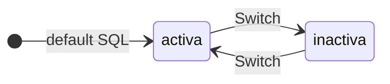

<a id="m-catalog-product-departures-status"></a>
### 11. Salida — `catalog_product_departures.status`

| Tabla | Columna | Fase | Nulo | Default |
|---|---|---|---|---|
| `catalog_product_departures` | `status` | Fase 1 · MVP (`20_fase1.sql`) | no | `'abierta'::character varying` |

**Valores válidos (CHECK):** `abierta`, `completa`, `cerrada`, `cancelada`

**Estados iniciales:** `abierta`, `cerrada`, `cancelada`  
**Estados terminales:** no declarados en la spec  
**Fuentes:** spec 02 §4.4 Salida (`02-catalogo.md`); spec 08 §4.6 Salida (`08-canales-portales.md`)

| Desde | Hacia | Acción / endpoint | Permiso / quién | Guardas | Efectos | Ref. |
|---|---|---|---|---|---|---|
| — (alta) <br>_spec: «(nueva)»_ | `abierta`, `cerrada`, `cancelada` | Nueva salida (`manage_availability`) |  |  | audit `Salida.crear` | 02 §4.4 |
| `abierta` | `completa` | Automático cuando `sold >= capacity` (al confirmar cupos o editar) |  |  | — | 02 §4.4 |
| `completa` | `abierta` | Automático al liberar cupos confirmados; o al editar (el formulario no ofrece “completa”) |  |  | — | 02 §4.4 |
| `abierta`, `completa` | `cerrada`, `cancelada` | Editar salida |  |  | Si pasa a `cancelada` con `sold > 0`: notificación `salida.cancelada` (Email → Operaciones) “reprogramar pasajeros” | 02 §4.4 |
| `cerrada`, `cancelada` | `abierta` | Editar salida (el prototipo lo permite) |  |  | ver §12 | 02 §4.4 |

<details><summary>Endpoints de escritura del contrato sobre <code>catalog_product_departures</code> (4, de <code>api/openapi.yaml</code>)</summary>

| Método | Ruta | Permiso (`x-permission`) | Spec | Idempotente |
|---|---|---|---|---|
| POST | `/api/v1/catalog/products/{id}/departures` | catalog.products.manage_availability | 02-catalogo.md §6.2 Sub-recursos del producto |  |
| PATCH | `/api/v1/catalog/products/{id}/departures/{departureId}` | catalog.products.manage_availability | 02-catalogo.md §6.2 Sub-recursos del producto |  |
| POST | `/api/v1/catalog/departures` | catalog.products.manage_availability | 02-catalogo.md §6.3 Salidas y holds (globales) | sí |
| POST | `/api/v1/catalog/departures/{id}/confirm-seats` | catalog.products.manage_availability | 02-catalogo.md §6.3 Salidas y holds (globales) | sí |

</details>

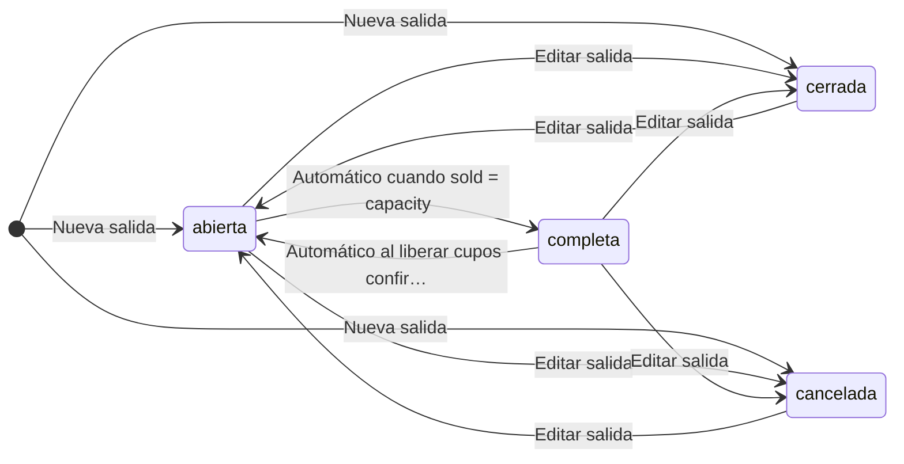

<a id="m-catalog-product-promotions-status"></a>
### 12. Promoción de producto — `catalog_product_promotions.status`

| Tabla | Columna | Fase | Nulo | Default |
|---|---|---|---|---|
| `catalog_product_promotions` | `status` | Fase 1 · MVP (`20_fase1.sql`) | no | `'activa'::character varying` |

**Valores válidos (CHECK):** `activa`, `inactiva`

**Estados iniciales:** `activa` (default SQL; la spec no documenta el alta)  
**Estados terminales:** no declarados en la spec  
**Fuentes:** spec 02 §4.8 Temporada, promoción, regla de pricing, publicación (`02-catalogo.md`); spec 08 §4.7 Otros (`08-canales-portales.md`)

| Desde | Hacia | Acción / endpoint | Permiso / quién | Guardas | Efectos | Ref. |
|---|---|---|---|---|---|---|
| `activa` | `inactiva` | Pausar | `update` |  |  | 02 §4.8 (prosa) |
| `inactiva` | `activa` | Activar | `update` | No vencida (`date_to ≥ hoy`) |  | 02 §4.8 (prosa) |

**Notas:**

- `vencida` es efectiva si `date_to < hoy` y no se puede alternar.

<details><summary>Texto de la especificación (prosa transcrita arriba)</summary>

_spec 02 §4.8 Temporada, promoción, regla de pricing, publicación:_

> ### 4.8 Temporada, promoción, regla de pricing, publicación
> | Entidad | Estados | Transición |
> |---|---|---|
> | Temporada | activa ⇄ inactiva | Formulario de edición o “Inactivar” desde el modal de borrado bloqueado |
> | Promoción | activa ⇄ inactiva (Pausar/Activar); `vencida` efectiva si `date_to < hoy` (no se puede alternar) | `update` |
> | Regla de pricing | activa ⇄ inactiva (switch) | `manage_rates` |
> | Canal del producto | no publicado → publicado (solo si producto ACTIVE) → no publicado. Si está publicado y el producto deja de estar ACTIVE, se muestra “Pendiente de activación” | `publish` |
> 
> ---

_spec 08 §4.7 Otros:_

> ### 4.7 Otros
> - **Pago informado por agencia**: se crea `fin_payments.status='pendiente'` (se muestra "Por validar"); la validación/aplicación la hace Finanzas (PROC-042/049).
> - **Pago en portal cliente**: `rechazado` o `aplicado` directo; CxC → `pagada` si `paid >= amount`, `vencida` si `due < hoy`, si no `parcial`.
> - **Promoción**: `activa` ⇄ `inactiva` (botón); `vencida` derivada si `valid_to < hoy`.
> - **Tarifa B2B por agencia**: asignada ⇄ quitada (soft delete); vencida derivada por `valid_to`.
> - **Ticket**: prototipo solo `abierta` (resto agregado).
> - **Alerta pasajero**: no leída → leída (`ops_incident_pax_acks`).
> 
> ---

</details>

<details><summary>Endpoints de escritura del contrato sobre <code>catalog_product_promotions</code> (6, de <code>api/openapi.yaml</code>)</summary>

| Método | Ruta | Permiso (`x-permission`) | Spec | Idempotente |
|---|---|---|---|---|
| POST | `/api/v1/catalog/products/{id}/promotions` | catalog.products.update \| channels.ecommerce.manage \| catalog.products.manage_promotions | 02-catalogo.md §6.2 Sub-recursos del producto |  |
| DELETE | `/api/v1/catalog/products/{id}/promotions/{promoId}` | catalog.products.update | 02-catalogo.md §6.2 Sub-recursos del producto |  |
| POST | `/api/v1/catalog/products/{id}/promotions/{promoId}/pause` | catalog.products.update | 02-catalogo.md §6.2 Sub-recursos del producto |  |
| POST | `/api/v1/catalog/products/{id}/promotions/{promoId}/activate` | catalog.products.update | 02-catalogo.md §6.2 Sub-recursos del producto |  |
| POST | `/api/v1/catalog/promotions/{id}/activate` | channels.ecommerce.manage \| catalog.products.manage_promotions | 08-canales-portales.md §6.3 E-commerce |  |
| POST | `/api/v1/catalog/promotions/{id}/deactivate` | channels.ecommerce.manage \| catalog.products.manage_promotions | 08-canales-portales.md §6.3 E-commerce |  |

</details>

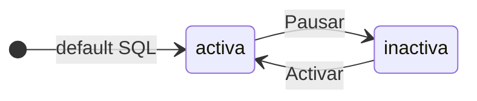

<a id="m-catalog-product-versions-status"></a>
### 13. Versión de producto — `catalog_product_versions.status`

| Tabla | Columna | Fase | Nulo | Default |
|---|---|---|---|---|
| `catalog_product_versions` | `status` | Fase 1 · MVP (`20_fase1.sql`) | no | `'borrador'::character varying` |

**Valores válidos (CHECK):** `borrador`, `en_revision`, `vigente`, `historica`

**Estados iniciales:** `borrador`, `en_revision`, `vigente`  
**Estados terminales:** `historica`  
**Fuentes:** spec 02 §4.2 Versión de producto (`02-catalogo.md`)

| Desde | Hacia | Acción / endpoint | Permiso / quién | Guardas | Efectos | Ref. |
|---|---|---|---|---|---|---|
| — (alta) | `borrador`, `en_revision`, `vigente` | Nueva versión |  |  | Nace `vigente` si el producto está ACTIVE/APPROVED/SUSPENDED/INACTIVE, `en_revision` si REVIEW, `borrador` si DRAFT | 02 §4.2 (prosa) |
| `borrador` | `en_revision` | Producto pasa a REVIEW (Enviar a revisión) |  |  |  | 02 §4.2 (prosa) |
| `borrador`, `en_revision` | `vigente` | Producto pasa a ACTIVE (Activar) |  |  |  | 02 §4.2 (prosa) |
| `borrador`, `en_revision`, `vigente` | `historica` | Se crea una nueva versión |  |  | Todas las no históricas pasan a `historica` | 02 §4.2 (prosa) |

**Notas:**

- Las versiones históricas son inmutables (PRD-BR-017).

<details><summary>Texto de la especificación (prosa transcrita arriba)</summary>

_spec 02 §4.2 Versión de producto:_

> ### 4.2 Versión de producto (`catalog_product_versions.status`)
> `borrador` → `en_revision` (producto pasa a REVIEW) → `vigente` (producto pasa a ACTIVE) → `historica` (al crear una nueva versión, todas las no históricas pasan a `historica`). La nueva versión nace `vigente` si el producto está ACTIVE/APPROVED/SUSPENDED/INACTIVE, `en_revision` si REVIEW, `borrador` si DRAFT. Las históricas son inmutables y consultables (PRD-BR-017).

</details>

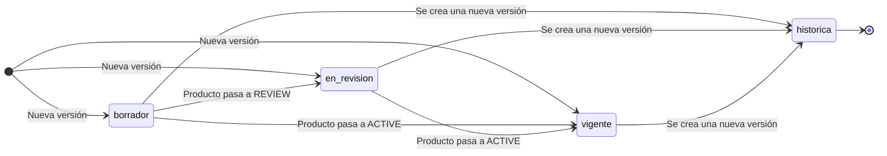

<a id="m-catalog-products-status"></a>
### 14. Producto — `catalog_products.status`

| Tabla | Columna | Fase | Nulo | Default |
|---|---|---|---|---|
| `catalog_products` | `status` | Fase 1 · MVP (`20_fase1.sql`) | no | `'DRAFT'::character varying` |

**Valores válidos (CHECK):** `DRAFT`, `REVIEW`, `APPROVED`, `ACTIVE`, `SUSPENDED`, `INACTIVE`, `ARCHIVED`

**Estados iniciales:** `DRAFT`  
**Estados terminales:** `ARCHIVED`  
**Fuentes:** spec 02 §4.1 Producto (`02-catalogo.md`)

| Desde | Hacia | Acción / endpoint | Permiso / quién | Guardas | Efectos | Ref. |
|---|---|---|---|---|---|---|
| — (alta) <br>_spec: «(nuevo)»_ | `DRAFT` | Asistente “Crear producto en borrador” / Duplicar | `create` | CAT-BR-01..04 | versión `0.1 borrador` con snapshot; canal ERP publicado; audit `crear` | 02 §4.1 |
| `DRAFT` | `REVIEW` | Enviar a revisión | `update` | name, type, destination, category presentes (CAT-BR-05) | versiones `borrador` → `en_revision`; notificación `producto.revision` (Portal → Manager); audit `cambio_estado` | 02 §4.1 |
| `DRAFT`, `REVIEW` | `ACTIVE` | Activar (el botón se muestra) | `activate` | Checklist §42: el ítem **Estado** exige APPROVED/SUSPENDED/INACTIVE/ACTIVE → **siempre rechazado** | 422 + audit `activacion_rechazada` con ítems fallidos; estado no cambia | 02 §4.1 |
| `REVIEW` | `DRAFT` | Devolver | `activate` | motivo obligatorio | audit `cambio_estado` con motivo | 02 §4.1 |
| `REVIEW` | `APPROVED` | Aprobar | `activate` | confirmación | audit | 02 §4.1 |
| `APPROVED`, `SUSPENDED`, `INACTIVE` | `ACTIVE` | Activar | `activate` | Checklist §42 completo (12/12, CAT-BR-06) | versiones `borrador`/`en_revision` → `vigente`; notificación `producto.activado` (Email → equipo de ventas); audit | 02 §4.1 |
| `ACTIVE` | `SUSPENDED` | Suspender | `activate` | motivo | notificación `producto.no_vendible` (Push → ventas); audit | 02 §4.1 |
| `ACTIVE`, `SUSPENDED` | `INACTIVE` | Inactivar | `activate` | motivo | ídem `producto.no_vendible` | 02 §4.1 |
| `INACTIVE` | `ARCHIVED` | Archivar | `activate` | motivo | audit | 02 §4.1 |
| `DRAFT`, `REVIEW`, `APPROVED`, `ACTIVE`, `SUSPENDED`, `INACTIVE` <br>_spec: «cualquiera ≠ ARCHIVED»_ | `ARCHIVED` | Más acciones › Archivar; también desde el modal “Eliminación física bloqueada” | `activate` | motivo | audit | 02 §4.1 |

**Acciones documentadas que no cambian este estado:**

- ARCHIVED → —: (terminal) · — · — · — (02 §4.1)

**Notas:**

- La fila DRAFT/REVIEW → ACTIVE existe en la UI pero el checklist la rechaza siempre (422 + audit `activacion_rechazada`); no se dibuja.
- «Comercializable» = `status = ACTIVE AND is_bookable`.

<details><summary>Endpoints de escritura del contrato sobre <code>catalog_products</code> (32, de <code>api/openapi.yaml</code>)</summary>

| Método | Ruta | Permiso (`x-permission`) | Spec | Idempotente |
|---|---|---|---|---|
| POST | `/api/v1/catalog/products` | catalog.products.create | 02-catalogo.md §6.1 Productos y ciclo de vida | sí |
| PATCH | `/api/v1/catalog/products/{id}` | catalog.products.update | 02-catalogo.md §6.1 Productos y ciclo de vida |  |
| DELETE | `/api/v1/catalog/products/{id}` | catalog.products.activate | 02-catalogo.md §6.1 Productos y ciclo de vida |  |
| POST | `/api/v1/catalog/products/{id}/duplicate` | catalog.products.create | 02-catalogo.md §6.1 Productos y ciclo de vida | sí |
| POST | `/api/v1/catalog/products/{id}/submit-review` | catalog.products.update | 02-catalogo.md §6.1 Productos y ciclo de vida |  |
| POST | `/api/v1/catalog/products/{id}/approve` | catalog.products.activate | 02-catalogo.md §6.1 Productos y ciclo de vida |  |
| POST | `/api/v1/catalog/products/{id}/return-to-draft` | catalog.products.activate | 02-catalogo.md §6.1 Productos y ciclo de vida |  |
| POST | `/api/v1/catalog/products/{id}/activate` | catalog.products.activate | 02-catalogo.md §6.1 Productos y ciclo de vida |  |
| POST | `/api/v1/catalog/products/{id}/suspend` | catalog.products.activate | 02-catalogo.md §6.1 Productos y ciclo de vida |  |
| POST | `/api/v1/catalog/products/{id}/deactivate` | catalog.products.activate | 02-catalogo.md §6.1 Productos y ciclo de vida |  |
| POST | `/api/v1/catalog/products/{id}/archive` | catalog.products.activate | 02-catalogo.md §6.1 Productos y ciclo de vida |  |
| POST | `/api/v1/catalog/products/{id}/sheet` | catalog.products.view | 02-catalogo.md §6.1 Productos y ciclo de vida | sí |
| POST | `/api/v1/catalog/products/{id}/requirements` | catalog.products.update | 02-catalogo.md §6.2 Sub-recursos del producto |  |
| POST | `/api/v1/catalog/products/{id}/components` | catalog.products.update | 02-catalogo.md §6.2 Sub-recursos del producto |  |
| POST | `/api/v1/catalog/products/{id}/components/reorder` | catalog.products.update | 02-catalogo.md §6.2 Sub-recursos del producto |  |
| PUT | `/api/v1/catalog/products/{id}/availability` | catalog.products.manage_availability | 02-catalogo.md §6.2 Sub-recursos del producto |  |
| PUT | `/api/v1/catalog/products/{id}/main-provider` | catalog.products.update | 02-catalogo.md §6.2 Sub-recursos del producto |  |
| PUT | `/api/v1/catalog/products/{id}/policies` | catalog.products.update | 02-catalogo.md §6.2 Sub-recursos del producto |  |
| POST | `/api/v1/catalog/products/{id}/inclusions` | catalog.products.update | 02-catalogo.md §6.2 Sub-recursos del producto |  |
| POST | `/api/v1/catalog/products/{id}/related` | catalog.products.update | 02-catalogo.md §6.2 Sub-recursos del producto |  |
| PUT | `/api/v1/catalog/products/{id}/markup` | catalog.products.manage_rates | 02-catalogo.md §6.2 Sub-recursos del producto |  |
| POST | `/api/v1/catalog/products/{id}/config-groups` | catalog.products.update | 02-catalogo.md §6.2 Sub-recursos del producto |  |
| POST | `/api/v1/catalog/products/{id}/price-quote` | catalog.products.view | 02-catalogo.md §6.2 Sub-recursos del producto |  |
| PUT | `/api/v1/catalog/products/{id}/content` | catalog.products.update | 02-catalogo.md §6.2 Sub-recursos del producto |  |
| POST | `/api/v1/catalog/products/{id}/media` | catalog.products.update | 02-catalogo.md §6.2 Sub-recursos del producto |  |
| POST | `/api/v1/catalog/products/{id}/faqs` | catalog.products.update | 02-catalogo.md §6.2 Sub-recursos del producto |  |
| POST | `/api/v1/catalog/products/{id}/versions` | catalog.products.update | 02-catalogo.md §6.2 Sub-recursos del producto |  |
| POST | `/api/v1/channels/ecommerce/products/{id}/publish` | channels.ecommerce.manage | 08-canales-portales.md §6.3 E-commerce |  |
| POST | `/api/v1/channels/ecommerce/products/{id}/unpublish` | channels.ecommerce.manage | 08-canales-portales.md §6.3 E-commerce |  |
| PUT | `/api/v1/catalog/products/{id}/operation` | catalog.products.manage_availability | 16-motor-de-reservas-y-reglas.md §6.2 Internas (back-office) |  |
| PUT | `/api/v1/catalog/products/{id}/accommodation` | catalog.products.manage_rates | 16-motor-de-reservas-y-reglas.md §6.2 Internas (back-office) |  |
| PUT | `/api/v1/catalog/products/{id}/pickup` | catalog.products.update ∨ catalog.products.manage_availability | 16-motor-de-reservas-y-reglas.md §6.2 Internas (back-office) |  |

</details>

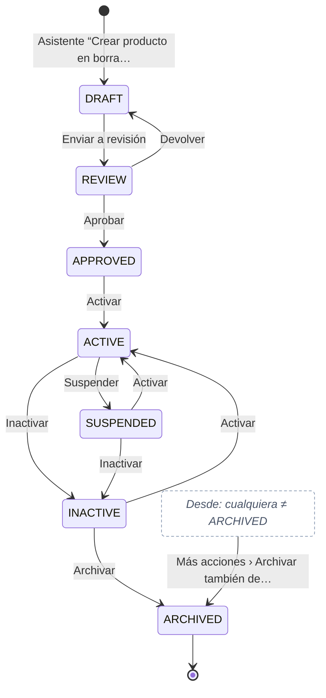

<a id="m-catalog-providers-status"></a>
### 15. Proveedor — `catalog_providers.status`

| Tabla | Columna | Fase | Nulo | Default |
|---|---|---|---|---|
| `catalog_providers` | `status` | Fase 1 · MVP (`20_fase1.sql`) | no | `'inactivo'::character varying` |

**Valores válidos (CHECK):** `activo`, `inactivo`, `vencido`

**Estados iniciales:** `inactivo`  
**Estados terminales:** no declarados en la spec  
**Fuentes:** spec 02 §4.6 Proveedor (`02-catalogo.md`)

| Desde | Hacia | Acción / endpoint | Permiso / quién | Guardas | Efectos | Ref. |
|---|---|---|---|---|---|---|
| — (alta) | `inactivo` | Crear proveedor |  |  |  | 02 §4.6 (prosa) |
| `inactivo` | `activo` | Activar |  | Contrato no vencido y RUC de 11 dígitos |  | 02 §4.6 (prosa) |
| `activo` | `inactivo` | Desactivar |  | Motivo obligatorio |  | 02 §4.6 (prosa) |
| `activo` | `vencido` | Contrato vencido | Job diario / cálculo |  |  | 02 §4.6 (prosa) |
| `vencido` | `inactivo` | Renovar contrato con fecha futura o editar fin de contrato ≥ hoy |  |  |  | 02 §4.6 (prosa) |

<details><summary>Texto de la especificación (prosa transcrita arriba)</summary>

_spec 02 §4.6 Proveedor:_

> ### 4.6 Proveedor
> `inactivo` (al crear) → `activo` (Activar: contrato no vencido y RUC de 11 dígitos) → `inactivo` (Desactivar con motivo). `activo` → `vencido` (contrato vencido; job diario / cálculo). `vencido` → `inactivo` (Renovar contrato con fecha futura, o editar fin de contrato ≥ hoy) → `activo`.

</details>

<details><summary>Endpoints de escritura del contrato sobre <code>catalog_providers</code> (9, de <code>api/openapi.yaml</code>)</summary>

| Método | Ruta | Permiso (`x-permission`) | Spec | Idempotente |
|---|---|---|---|---|
| POST | `/api/v1/catalog/providers` | catalog.providers.manage | 02-catalogo.md §6.5 Tipos, categorías, destinos, servicios, proveedores |  |
| PATCH | `/api/v1/catalog/providers/{id}` | catalog.providers.manage | 02-catalogo.md §6.5 Tipos, categorías, destinos, servicios, proveedores |  |
| POST | `/api/v1/catalog/providers/{id}/activate` | catalog.providers.manage | 02-catalogo.md §6.5 Tipos, categorías, destinos, servicios, proveedores |  |
| POST | `/api/v1/catalog/providers/{id}/deactivate` | catalog.providers.manage | 02-catalogo.md §6.5 Tipos, categorías, destinos, servicios, proveedores |  |
| POST | `/api/v1/catalog/providers/{id}/renew-contract` | catalog.providers.manage | 02-catalogo.md §6.5 Tipos, categorías, destinos, servicios, proveedores |  |
| POST | `/api/v1/catalog/providers/{id}/rating` | catalog.providers.manage | 02-catalogo.md §6.5 Tipos, categorías, destinos, servicios, proveedores |  |
| POST | `/api/v1/catalog/providers/{id}/contacts` | catalog.providers.manage | 02-catalogo.md §6.5 Tipos, categorías, destinos, servicios, proveedores |  |
| POST | `/api/v1/catalog/providers/{id}/users` | catalog.providers.manage + admin.users.manage | 06-extranet-proveedores.md §6 |  |
| POST | `/api/v1/webhooks/providers/{provider}` | firma del proveedor | 17-reglas-comunicaciones-monedas-resenas-integracion-web.md §6 | sí |

</details>

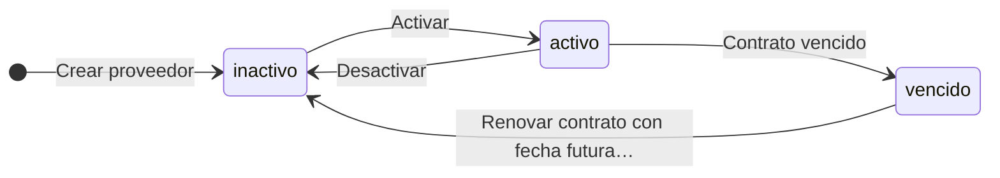

<a id="m-catalog-rates-status"></a>
### 16. Tarifa — `catalog_rates.status`

| Tabla | Columna | Fase | Nulo | Default |
|---|---|---|---|---|
| `catalog_rates` | `status` | Fase 1 · MVP (`20_fase1.sql`) | no | `'vigente'::character varying` |

**Valores válidos (CHECK):** `vigente`, `inactiva`

**Estados iniciales:** `vigente` (default SQL; la spec no documenta el alta)  
**Estados terminales:** no declarados en la spec  
**Fuentes:** spec 02 §4.3 Tarifa (`02-catalogo.md`)

| Desde | Hacia | Acción / endpoint | Permiso / quién | Guardas | Efectos | Ref. |
|---|---|---|---|---|---|---|
| `vigente` | `inactiva` | Desactivar | `manage_rates` |  |  | 02 §4.3 (prosa) |
| `inactiva` | `vigente` | Activar | `manage_rates` | No permitido si está vencida (`valid_to < hoy`) |  | 02 §4.3 (prosa) |

**Notas:**

- `vencida` y `programada` son estados efectivos calculados por fechas, no se persisten.

<details><summary>Texto de la especificación (prosa transcrita arriba)</summary>

_spec 02 §4.3 Tarifa:_

> ### 4.3 Tarifa
> Almacenado: `vigente` ⇄ `inactiva` (Activar/Desactivar, permiso `manage_rates`, no permitido si está vencida). Efectivo calculado: `inactiva` | `vencida` (valid_to < hoy) | `programada` (valid_from > hoy) | `vigente`. Solo `vigente` es seleccionable (PRD-BR-005). Cambio de precio solo si no está vencida ni inactiva.

</details>

<details><summary>Endpoints de escritura del contrato sobre <code>catalog_rates</code> (4, de <code>api/openapi.yaml</code>)</summary>

| Método | Ruta | Permiso (`x-permission`) | Spec | Idempotente |
|---|---|---|---|---|
| POST | `/api/v1/catalog/products/{id}/rates` | catalog.products.manage_rates | 02-catalogo.md §6.2 Sub-recursos del producto |  |
| PATCH | `/api/v1/catalog/products/{id}/rates/{rateId}/price` | catalog.products.manage_rates | 02-catalogo.md §6.2 Sub-recursos del producto |  |
| POST | `/api/v1/catalog/products/{id}/rates/{rateId}/activate` | catalog.products.manage_rates | 02-catalogo.md §6.2 Sub-recursos del producto |  |
| POST | `/api/v1/catalog/products/{id}/rates/{rateId}/deactivate` | catalog.products.manage_rates | 02-catalogo.md §6.2 Sub-recursos del producto |  |

</details>

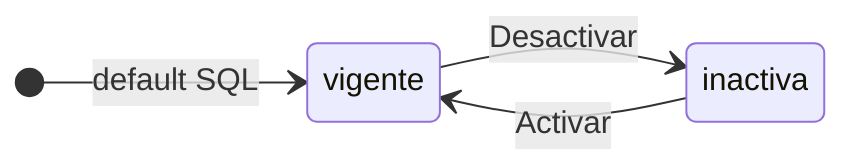

<a id="m-catalog-seasons-status"></a>
### 17. Temporada — `catalog_seasons.status`

| Tabla | Columna | Fase | Nulo | Default |
|---|---|---|---|---|
| `catalog_seasons` | `status` | Fase 1 · MVP (`20_fase1.sql`) | no | `'activa'::character varying` |

**Valores válidos (CHECK):** `activa`, `inactiva`

**Estados iniciales:** `activa` (default SQL; la spec no documenta el alta)  
**Estados terminales:** no declarados en la spec  
**Fuentes:** spec 02 §4.8 Temporada, promoción, regla de pricing, publicación (`02-catalogo.md`)

| Desde | Hacia | Acción / endpoint | Permiso / quién | Guardas | Efectos | Ref. |
|---|---|---|---|---|---|---|
| `activa` | `inactiva` | Formulario de edición o «Inactivar» desde el modal de borrado bloqueado |  |  |  | 02 §4.8 (prosa) |
| `inactiva` | `activa` | Formulario de edición |  |  |  | 02 §4.8 (prosa) |

<details><summary>Texto de la especificación (prosa transcrita arriba)</summary>

_spec 02 §4.8 Temporada, promoción, regla de pricing, publicación:_

> ### 4.8 Temporada, promoción, regla de pricing, publicación
> | Entidad | Estados | Transición |
> |---|---|---|
> | Temporada | activa ⇄ inactiva | Formulario de edición o “Inactivar” desde el modal de borrado bloqueado |
> | Promoción | activa ⇄ inactiva (Pausar/Activar); `vencida` efectiva si `date_to < hoy` (no se puede alternar) | `update` |
> | Regla de pricing | activa ⇄ inactiva (switch) | `manage_rates` |
> | Canal del producto | no publicado → publicado (solo si producto ACTIVE) → no publicado. Si está publicado y el producto deja de estar ACTIVE, se muestra “Pendiente de activación” | `publish` |
> 
> ---

</details>

<details><summary>Endpoints de escritura del contrato sobre <code>catalog_seasons</code> (5, de <code>api/openapi.yaml</code>)</summary>

| Método | Ruta | Permiso (`x-permission`) | Spec | Idempotente |
|---|---|---|---|---|
| POST | `/api/v1/catalog/products/{id}/seasons` | catalog.products.manage_rates | 02-catalogo.md §6.2 Sub-recursos del producto |  |
| DELETE | `/api/v1/catalog/products/{id}/seasons/{seasonId}` | catalog.products.manage_rates | 02-catalogo.md §6.2 Sub-recursos del producto |  |
| POST | `/api/v1/catalog/seasons` | catalog.products.manage_rates | 02-catalogo.md §6.4 Tarifas, temporadas y pricing (tenant) |  |
| PATCH | `/api/v1/catalog/seasons/{id}` | catalog.products.manage_rates | 02-catalogo.md §6.4 Tarifas, temporadas y pricing (tenant) |  |
| DELETE | `/api/v1/catalog/seasons/{id}` | catalog.products.manage_rates | 02-catalogo.md §6.4 Tarifas, temporadas y pricing (tenant) |  |

</details>

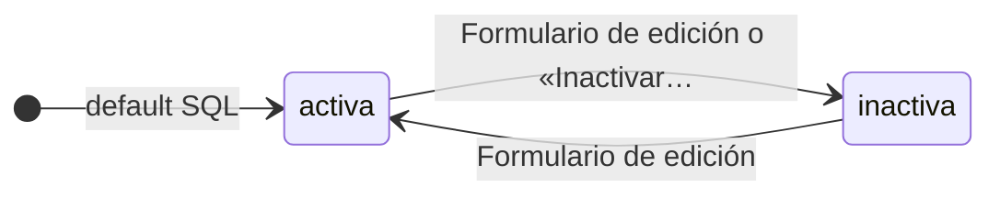

<a id="m-catalog-services-status"></a>
### 18. Servicio — `catalog_services.status`

| Tabla | Columna | Fase | Nulo | Default |
|---|---|---|---|---|
| `catalog_services` | `status` | Fase 1 · MVP (`20_fase1.sql`) | no | `'activo'::character varying` |

**Valores válidos (CHECK):** `activo`, `inactivo`, `vencido`

**Estados iniciales:** `activo` (default SQL; la spec no documenta el alta)  
**Estados terminales:** no declarados en la spec  
**Valores del CHECK sin transiciones documentadas:** `vencido` (Por definir)  
**Fuentes:** spec 02 §4.7 Servicio (`02-catalogo.md`)

| Desde | Hacia | Acción / endpoint | Permiso / quién | Guardas | Efectos | Ref. |
|---|---|---|---|---|---|---|
| `inactivo` | `activo` | Activar |  | Proveedor activo y `valid_to ≥ hoy` |  | 02 §4.7 (prosa) |
| `activo` | `inactivo` | Desactivar |  | Motivo obligatorio |  | 02 §4.7 (prosa) |
| `activo` | `inactivo` | Guardar con proveedor no activo | Sistema |  | Se fuerza `inactivo` | 02 §4.7 (prosa) |

**Notas:**

- `vencido` es efectivo cuando `valid_to < hoy` (02 §4.7). Supuesto: si se persiste, lo asigna el mismo cálculo/job que en proveedores.

<details><summary>Texto de la especificación (prosa transcrita arriba)</summary>

_spec 02 §4.7 Servicio:_

> ### 4.7 Servicio
> `activo` ⇄ `inactivo` (Activar: proveedor activo y `valid_to ≥ hoy`; Desactivar: motivo). `vencido` efectivo cuando `valid_to < hoy`. Al guardar con proveedor no activo, se fuerza `inactivo`.

</details>

<details><summary>Endpoints de escritura del contrato sobre <code>catalog_services</code> (4, de <code>api/openapi.yaml</code>)</summary>

| Método | Ruta | Permiso (`x-permission`) | Spec | Idempotente |
|---|---|---|---|---|
| POST | `/api/v1/catalog/services` | catalog.providers.manage | 02-catalogo.md §6.5 Tipos, categorías, destinos, servicios, proveedores |  |
| PATCH | `/api/v1/catalog/services/{id}` | catalog.providers.manage | 02-catalogo.md §6.5 Tipos, categorías, destinos, servicios, proveedores |  |
| POST | `/api/v1/catalog/services/{id}/activate` | catalog.providers.manage | 02-catalogo.md §6.5 Tipos, categorías, destinos, servicios, proveedores |  |
| POST | `/api/v1/catalog/services/{id}/deactivate` | catalog.providers.manage | 02-catalogo.md §6.5 Tipos, categorías, destinos, servicios, proveedores |  |

</details>

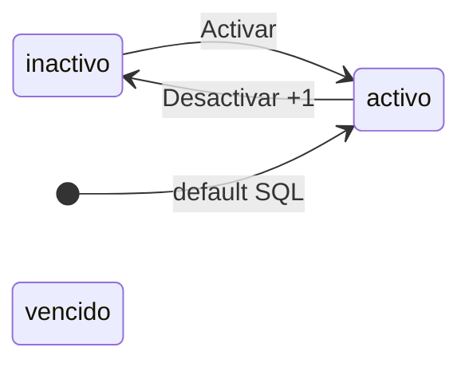

<a id="m-quote-internal-approvals-status"></a>
### 19. Aprobación interna de cotización — `quote_internal_approvals.status`

| Tabla | Columna | Fase | Nulo | Default |
|---|---|---|---|---|
| `quote_internal_approvals` | `status` | Fase 1 · MVP (`20_fase1.sql`) | no | `'pendiente'::character varying` |

**Valores válidos (CHECK):** `pendiente`, `aprobada`, `rechazada`, `anulada`

**Estados iniciales:** `pendiente`, `aprobada`, `rechazada`  
**Estados terminales:** `aprobada`, `rechazada`, `anulada`  
**Fuentes:** spec 03 §4.2 Solicitud de aprobación interna (`03-cotizaciones.md`)

| Desde | Hacia | Acción / endpoint | Permiso / quién | Guardas | Efectos | Ref. |
|---|---|---|---|---|---|---|
| — (alta) | `pendiente` |  | Dueño de la cotización con `quotes.create` o `quotes.send` |  | Notifica (Portal) a todos los usuarios `manager` activos | 03 §4.2 |
| — (alta), `pendiente` | `aprobada` |  | `quotes.approve_internal` (+ `quotes.discount_override` si descuento > 10 %) |  | `internal_approval` de la versión; justificación obligatoria; notifica al dueño si decide otro usuario | 03 §4.2 |
| — (alta), `pendiente` | `rechazada` |  | `quotes.approve_internal` |  | Motivo obligatorio; notifica al dueño. Si no había solicitud se crea una ya rechazada | 03 §4.2 |
| `pendiente` | `anulada` |  | Sistema al editar el borrador |  | La edición también elimina la aprobación interna ya otorgada (se debe volver a evaluar) | 03 §4.2 |

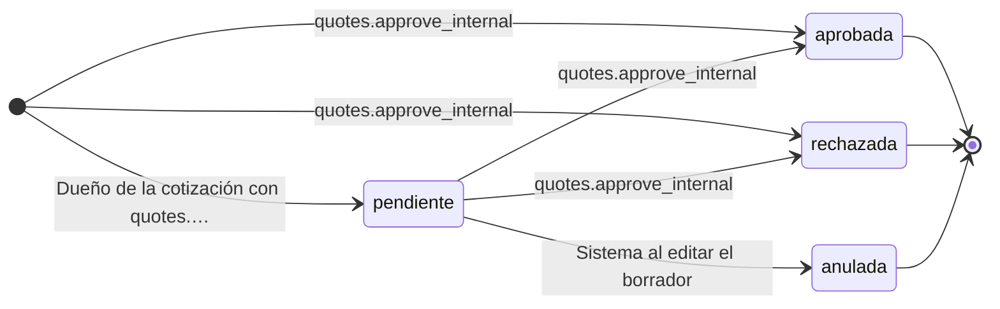

<a id="m-quote-quotes-status"></a>
### 20. Cotización — `quote_quotes.status`

| Tabla | Columna | Fase | Nulo | Default |
|---|---|---|---|---|
| `quote_quotes` | `status` | Fase 1 · MVP (`20_fase1.sql`) | no | `'borrador'::character varying` |

**Valores válidos (CHECK):** `borrador`, `enviada`, `vista`, `negociacion`, `aprobada`, `rechazada`, `vencida`, `convertida`, `cancelada`

**Estados iniciales:** `borrador`  
**Estados terminales:** `convertida`  
**Fuentes:** spec 03 §4.1 Cotización (`03-cotizaciones.md`); spec 08 §4.4 Cotización desde el portal del cliente (`08-canales-portales.md`)

| Desde | Hacia | Acción / endpoint | Permiso / quién | Guardas | Efectos | Ref. |
|---|---|---|---|---|---|---|
| — (alta) | `borrador` | Guardar en constructor · `quotes.create` | `quotes.create` | Validaciones QTE-BR-01…10 | Crea v1 `borrador`; si la oportunidad está en `calificacion`/`descubrimiento` → `cotizacion`, probabilidad 55; audita `crear` (y `descuento_sobre_tope` si > 10 %) | 03 §4.1 |
| `borrador` | `enviada` | Enviar · `quotes.send` | `quotes.send` | Versión con ítems; sin aprobación interna pendiente (QTE-BR-12); al menos un canal | Genera token si no existe; `v.status='enviada'`; si `valid_until` < hoy la renueva a hoy + 10 d; 1 registro en `quote_sends` y 1 notificación por canal; congela la versión | 03 §4.1 |
| `enviada`, `vista`, `negociacion` | (mismo estado) | Reenviar · `quotes.send` | `quotes.send` | No vencida; no `aprobada/convertida/rechazada` | Solo registra envío y notificación | 03 §4.1 |
| `enviada` | `vista` | Cliente abre el enlace (portal) o "Registrar vista" · `quotes.send` | `quotes.send` | Debe tener token y no ser `borrador`. Desde `vista`/`negociacion` solo actualiza `viewed_at` | `viewed_at`; notifica al vendedor | 03 §4.1 |
| `enviada`, `vista`, `negociacion` | `negociacion` | Registrar negociación · `quotes.send` | `quotes.send` | Nota obligatoria (botón solo si no vencida) | Oportunidad → `negociacion` (prob. 70) si no está ganada/perdida/negociación; opcional crear nueva versión | 03 §4.1 |
| `enviada`, `vista`, `negociacion` | `aprobada` | Registrar aprobación del cliente · `reservations.create`; o el cliente desde el portal | `reservations.create` | No vencida (QTE-BR-16); aprobación interna resuelta o registrada en el mismo paso por quien tiene `quotes.approve_internal` (QTE-BR-13) | `v.status='aprobada'` (inmutable); `approved_at`, `approved_by_name`, evidencia; notifica Push vendedor + Email cliente | 03 §4.1 |
| `enviada`, `vista`, `negociacion`, `vencida` | `rechazada` | Rechazar · `quotes.send`; o el cliente desde el portal | `quotes.send` | Motivo obligatorio | `v.status='rechazada'`; notifica al vendedor | 03 §4.1 |
| `borrador`, `enviada`, `vista`, `negociacion`, `aprobada`, `rechazada`, `vencida`, `cancelada` <br>_spec: «cualquier estado salvo convertida»_ | `borrador` | Crear nueva versión · `quotes.create` | `quotes.create` | QTE-BR-18 | Copia la versión vigente → v(n+1) `borrador`; la anterior → `reemplazada`; borra aprobación del cliente y aprobación interna; recalcula snapshot y políticas; renueva validez si quedan < 10 d | 03 §4.1 |
| `borrador`, `enviada`, `vista`, `negociacion` | `vencida` | Job JOB-02 (scheduler) cuando `valid_until < hoy` |  | — | Audita `vencer` (actor Sistema). La UI además trata como vencida cualquier `enviada/vista/negociacion` con validez pasada aunque el job no haya corrido | 03 §4.1 |
| `aprobada` | `convertida` | Convertir en reserva · `reservations.create` | `reservations.create` | Ver `04-reservas.md §4.3` | `reservation_id`, oportunidad `ganada` | 03 §4.1 |
| — (alta) | `cancelada` | No implementado en el prototipo (estado existe en `STATUS`) |  | — | Ver §12 | 03 §4.1 |
| `enviada` | `vista` | Cliente abre el detalle |  | No vencida | `viewed_at`; audit `vista_portal`; notifica al asesor (`cotizacion.vista`) | 08 §4.4 |
| `enviada`, `vista`, `negociacion` | `aprobada` | "Aprobar propuesta" |  | No vencida (PCL-BR-03), nombre, aceptación de condiciones | Versión vigente `aprobada` (inmutable, RT-7), `quote_approvals` con evidencia; notifica asesor y email al cliente | 08 §4.4 |
| `enviada`, `vista`, `negociacion` | `rechazada` | "Rechazar" |  | Motivo + comentario | Versión `rechazada`; notifica asesor | 08 §4.4 |

**Acciones documentadas que no cambian este estado:**

- vencida (derivada) → —: "Solicitar actualización" · — · Crea ticket categoría Cotizaciones (08 §4.4)

**Notas:**

- `cancelada` existe en el CHECK pero no está implementada en el prototipo (03 §12).
- La UI trata como vencida cualquier `enviada`/`vista`/`negociacion` con validez pasada aunque el job no haya corrido.
- Plantilla de prueba: `kit-ia/tests/pest/Unit/Quotes/QuoteStateMachineTest.php`.

<details><summary>Endpoints de escritura del contrato sobre <code>quote_quotes</code> (15, de <code>api/openapi.yaml</code>)</summary>

| Método | Ruta | Permiso (`x-permission`) | Spec | Idempotente |
|---|---|---|---|---|
| POST | `/api/v1/quotes` | quotes.create | 03-cotizaciones.md §6 | sí |
| POST | `/api/v1/quotes/{id}/duplicate` | quotes.create | 03-cotizaciones.md §6 | sí |
| POST | `/api/v1/quotes/{id}/internal-approval-requests` | quotes.create o quotes.send (+ dueño) | 03-cotizaciones.md §6 |  |
| POST | `/api/v1/quotes/{id}/token` | quotes.send | 03-cotizaciones.md §6 |  |
| POST | `/api/v1/quotes/{id}/send` | quotes.send | 03-cotizaciones.md §6 | sí |
| POST | `/api/v1/public/quotes/{token}/approve` | público (token) + login cliente | 03-cotizaciones.md §6 | sí |
| POST | `/api/v1/public/quotes/{token}/reject` | público (token) + login cliente | 03-cotizaciones.md §6 | sí |
| POST | `/api/v1/quotes/{id}/approve` | reservations.create | 03-cotizaciones.md §6 | sí |
| POST | `/api/v1/quotes/{id}/reject` | quotes.send | 03-cotizaciones.md §6 |  |
| POST | `/api/v1/quotes/{id}/convert` | reservations.create | 03-cotizaciones.md §6 | sí |
| POST | `/api/v1/quotes/{id}/reassign` | quotes.reassign (nuevo) | 03-cotizaciones.md §6 |  |
| POST | `/api/v1/portal/client/quotes/{code}/view` | customer | 08-canales-portales.md §6.5 Portal del cliente (rol `customer`; interno con previsualización) |  |
| POST | `/api/v1/portal/client/quotes/{code}/approve` | customer | 08-canales-portales.md §6.5 Portal del cliente (rol `customer`; interno con previsualización) | sí |
| POST | `/api/v1/portal/client/quotes/{code}/reject` | customer | 08-canales-portales.md §6.5 Portal del cliente (rol `customer`; interno con previsualización) |  |
| POST | `/api/v1/portal/client/quotes/{code}/update-request` | customer | 08-canales-portales.md §6.5 Portal del cliente (rol `customer`; interno con previsualización) |  |

</details>

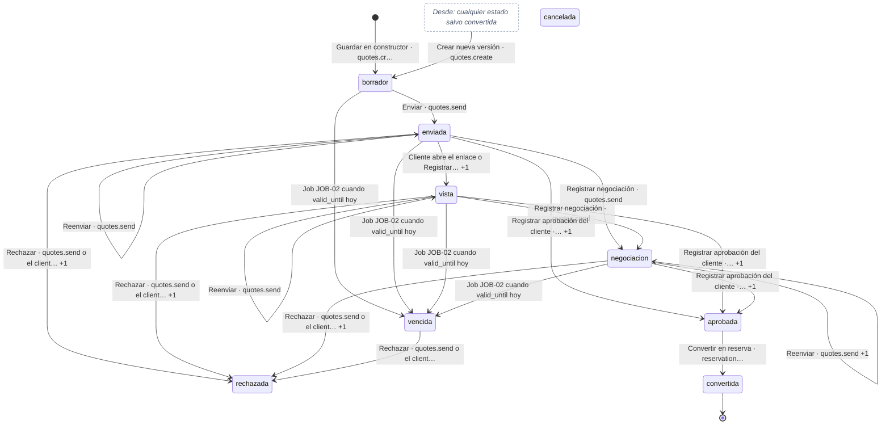

<a id="m-quote-versions-status"></a>
### 21. Versión de cotización — `quote_versions.status`

| Tabla | Columna | Fase | Nulo | Default |
|---|---|---|---|---|
| `quote_versions` | `status` | Fase 1 · MVP (`20_fase1.sql`) | no | `'borrador'::character varying` |

**Valores válidos (CHECK):** `borrador`, `enviada`, `aprobada`, `rechazada`, `reemplazada`, `vencida`

**Estados iniciales:** `borrador`  
**Estados terminales:** `reemplazada`  
**Fuentes:** spec 03 §4.1 Cotización (`03-cotizaciones.md`)

| Desde | Hacia | Acción / endpoint | Permiso / quién | Guardas | Efectos | Ref. |
|---|---|---|---|---|---|---|
| — (alta) | `borrador` | Crear cotización o nueva versión | `quotes.create` |  |  | 03 §4.1 (prosa) |
| `borrador` | `enviada` | Enviar | `quotes.send` |  | Congela la versión | 03 §4.1 (prosa) |
| `enviada` | `aprobada` | Registrar aprobación del cliente / portal | `reservations.create` |  | Inmutable (candado) | 03 §4.1 (prosa) |
| `enviada` | `rechazada` | Rechazar | `quotes.send` |  |  | 03 §4.1 (prosa) |
| `enviada` | `vencida` | Vencimiento | Sistema |  | Según la spec solo aparece en datos semilla | 03 §4.1 (prosa) |
| `borrador`, `enviada`, `aprobada`, `rechazada`, `vencida` | `reemplazada` | Crear nueva versión | `quotes.create` |  | La versión anterior deja de ser vigente | 03 §4.1 (prosa) |

**Notas:**

- Una versión en `negociacion` (cabecera) conserva `enviada`.

<details><summary>Texto de la especificación (prosa transcrita arriba)</summary>

_spec 03 §4.1 Cotización:_

> ### 4.1 Cotización (`quote_quotes.status`)
> 
> | Desde | Hacia | Acción / quién | Guardas (el prototipo las aplica) | Efectos |
> |---|---|---|---|---|
> | — | `borrador` | Guardar en constructor · `quotes.create` | Validaciones QTE-BR-01…10 | Crea v1 `borrador`; si la oportunidad está en `calificacion`/`descubrimiento` → `cotizacion`, probabilidad 55; audita `crear` (y `descuento_sobre_tope` si > 10 %) |
> | `borrador` | `enviada` | Enviar · `quotes.send` | Versión con ítems; sin aprobación interna pendiente (QTE-BR-12); al menos un canal | Genera token si no existe; `v.status='enviada'`; si `valid_until` < hoy la renueva a hoy + 10 d; 1 registro en `quote_sends` y 1 notificación por canal; congela la versión |
> | `enviada`/`vista`/`negociacion` | (mismo) | Reenviar · `quotes.send` | No vencida; no `aprobada/convertida/rechazada` | Solo registra envío y notificación |
> | `enviada` | `vista` | Cliente abre el enlace (portal) o "Registrar vista" · `quotes.send` | Debe tener token y no ser `borrador`. Desde `vista`/`negociacion` solo actualiza `viewed_at` | `viewed_at`; notifica al vendedor |
> | `enviada`/`vista`/`negociacion` | `negociacion` | Registrar negociación · `quotes.send` | Nota obligatoria (botón solo si no vencida) | Oportunidad → `negociacion` (prob. 70) si no está ganada/perdida/negociación; opcional crear nueva versión |
> | `enviada`/`vista`/`negociacion` | `aprobada` | Registrar aprobación del cliente · `reservations.create`; o el cliente desde el portal | No vencida (QTE-BR-16); aprobación interna resuelta o registrada en el mismo paso por quien tiene `quotes.approve_internal` (QTE-BR-13) | `v.status='aprobada'` (inmutable); `approved_at`, `approved_by_name`, evidencia; notifica Push vendedor + Email cliente |
> | `enviada`/`vista`/`negociacion`/`vencida` | `rechazada` | Rechazar · `quotes.send`; o el cliente desde el portal | Motivo obligatorio | `v.status='rechazada'`; notifica al vendedor |
> | cualquier estado salvo `convertida` | `borrador` | Crear nueva versión · `quotes.create` | QTE-BR-18 | Copia la versión vigente → v(n+1) `borrador`; la anterior → `reemplazada`; borra aprobación del cliente y aprobación interna; recalcula snapshot y políticas; renueva validez si quedan < 10 d |
> | `borrador`/`enviada`/`vista`/`negociacion` | `vencida` | Job JOB-02 (scheduler) cuando `valid_until < hoy` | — | Audita `vencer` (actor Sistema). La UI además trata como vencida cualquier `enviada/vista/negociacion` con validez pasada aunque el job no haya corrido |
> | `apr …

</details>

<details><summary>Endpoints de escritura del contrato sobre <code>quote_versions</code> (4, de <code>api/openapi.yaml</code>)</summary>

| Método | Ruta | Permiso (`x-permission`) | Spec | Idempotente |
|---|---|---|---|---|
| PUT | `/api/v1/quotes/{id}/versions/{v}` | quotes.create | 03-cotizaciones.md §6 |  |
| POST | `/api/v1/quotes/{id}/versions` | quotes.create | 03-cotizaciones.md §6 |  |
| POST | `/api/v1/quotes/{id}/versions/{v}/internal-approval` | quotes.approve_internal (+ quotes.discount_override si > 10 %) \| quotes.approve_internal | 03-cotizaciones.md §6 |  |
| POST | `/api/v1/quotes/{id}/versions/{v}/pdf` | quotes.view | 03-cotizaciones.md §6 |  |

</details>

```mermaid
stateDiagram-v2
  [*] --> borrador : Crear cotización o nueva versión
  borrador --> enviada : Enviar
  enviada --> aprobada : Registrar aprobación del cliente /…
  enviada --> rechazada : Rechazar
  enviada --> vencida : Vencimiento
  borrador --> reemplazada : Crear nueva versión
  enviada --> reemplazada : Crear nueva versión
  aprobada --> reemplazada : Crear nueva versión
  rechazada --> reemplazada : Crear nueva versión
  vencida --> reemplazada : Crear nueva versión
  reemplazada --> [*]
```

<a id="m-booking-cancel-requests-status"></a>
### 22. Solicitud de anulación — `booking_cancel_requests.status`

| Tabla | Columna | Fase | Nulo | Default |
|---|---|---|---|---|
| `booking_cancel_requests` | `status` | Fase 1 · MVP (`20_fase1.sql`) | no | `'pendiente'::character varying` |

**Valores válidos (CHECK):** `pendiente`, `aprobada`, `rechazada`, `retirada`

**Estados iniciales:** `pendiente`  
**Estados terminales:** `aprobada`, `rechazada`, `retirada`  
**Fuentes:** spec 04 §4.6 Cancelación y cálculo de penalidad (`04-reservas.md`); spec 10 §4.1 Solicitud de aprobación (`10-aprobaciones-inbox.md`); spec 10 §4.3 Efecto por tipo (`10-aprobaciones-inbox.md`)

| Desde | Hacia | Acción / endpoint | Permiso / quién | Guardas | Efectos | Ref. |
|---|---|---|---|---|---|---|
| — (alta) | `pendiente` | Solicitar anulación | `reservations.create` sin `reservations.cancel` (dueño) | Reserva no cerrada; sin otra pendiente; motivo + detalle | Notifica a managers; la reserva sigue vigente | 04 §4.6 (prosa) |
| `pendiente` | `aprobada` | Procesar cancelación / aprobar en bandeja | `reservations.cancel` |  | Efecto completo de la cancelación (04 §4.6); notifica al solicitante | 04 §4.6 · 10 §4.3 (prosa) |
| `pendiente` | `rechazada` | Rechazar solicitud | `reservations.cancel` | Motivo obligatorio | Notifica al solicitante; la reserva sigue vigente | 04 §4.6 · 10 §4.3 (prosa) |
| `pendiente` | `retirada` | Retirar la solicitud de aprobación | Solicitante |  | La solicitud de aprobación pasa a `anulada` | 10 §4.1 (prosa) |

<details><summary>Texto de la especificación (prosa transcrita arriba)</summary>

_spec 04 §4.6 Cancelación y cálculo de penalidad:_

> ### 4.6 Cancelación y cálculo de penalidad (PROC-028 · E2E-09)
> 
> **Tramos por política** (`tiersFor(texto de policies_snapshot[p].cancel)`, tramos `[díasMínimos, %]` en orden descendente):
> | Texto de la política contiene | Tramos |
> |---|---|
> | "48 h" y "sin penalidad" | `[[2,0],[0,100]]` |
> | "24 h" y "sin penalidad" | `[[1,0],[0,100]]` |
> | "Tren:" | `[[15,0],[7,50],[2,50],[0,100]]` |
> | cualquier otro (estándar "Sin penalidad hasta 15 días antes. 50% entre 14 y 7 días. 100% dentro de 7 días o no-show.") | `[[15,0],[7,50],[0,100]]` |
> 
> `penaltyPct(tiers, d)` = % del primer tramo con `d ≥ díasMínimos`; si ninguno, 100.
> 
> **Fórmula exacta** (`cancelModal`):
> ```
> paid     = Σ pagos de la reserva con status ∈ {aplicado, confirmado}
> svcs     = servicios con status ∉ {cancelado, completado, rechazado}
> used     = servicios con status = completado
> por s ∈ svcs: d_s = días calendario (service_date − hoy)
>               pct_s = penaltyPct(tiersFor(policy(s.product).cancel), d_s)
>               pen_s = round2(s.price × pct_s / 100)
> penSvc   = Σ pen_s
> consumed = Σ price(used)                     (servicios ya ejecutados, no reembolsables)
> allTot   = Σ price(svcs ∪ used)  (si 0 → 1)
> k        = total_amount / allTot             (lleva precios de servicio —netos, sin IGV— al total con IGV)
> penalty  = round2( min(total_amount, (penSvc + consumed) × k) )
> refund   = round2( max(0, paid − penalty) )
> owed     = round2( max(0, penalty − paid) )
> ```
> Ejemplo RES-2026-000348 (hoy 2026-09-29; total 58 610; pagado 23 444): traslados PRD-005 (24 h) 2 d y 6 d → 0 %; Humantay PRD-004 (48 h) 5 d → 0 %; 5 servicios PRD-002 (estándar) a 2–4 d → 100 % = 23 900 + 1 660 + 5 120 + 17 930 + 4 870 = 53 480; allTot 58 610 → k = 1; **penalidad 53 480; reembolso 0; penalidad por cobrar 30 036**.
> 
> **Efectos al confirmar** (motivo de lista + detalle obligatorio; transacción + `If-Match` + locks de salidas):
> 1. Liberar cupos: por salida única (máx. pax por salida) `sold −= pax`, estado recalculado, holds → `liberada`; audita `Disponibilidad · liberar`.
> 2. Servicios de `svcs` → `cancelado`.
> 3. Vouchers `emitido` → `anulado` (audita).
> 4. CxC no `pagada`/`cancelada` → `cancelada` (audita cada una).
> 5. `owed > 0` → CxC "Penalidad por cancelación — RES-…" vence hoy + 7.
> 6. `refund > 0` → Nota de crédito (monto = refund; detalle "Anulación por cancelación … (penalidad …)") y pago `kind='reembolso'`, `status='pendiente'`, método "Reembolso (mismo medio de pago)", ref "Reembolso {NC} · 7–15 días hábiles".
> 7. Orden  …

_spec 10 §4.1 Solicitud de aprobación:_

> ### 4.1 Solicitud de aprobación
> 
> | Desde | Evento | Hacia | Quién | Efectos |
> |---|---|---|---|---|
> | — | Origen emite evento (o «Nueva solicitud») | `pendiente` (nivel 1) | Sistema / solicitante | Calcula niveles por regla y `amount_base`; `due_at = now + sla_hours(N1)`; notifica aprobadores N1 |
> | `pendiente` | Aprobar (no último nivel) | `pendiente` (nivel+1) | Usuario con permiso del nivel, ≠ solicitante, ≠ aprobador previo | Step; nuevo `due_at`; limpia delegación; notifica N+1 y solicitante |
> | `pendiente` | Aprobar (último nivel) | `aprobada` | Idem | **Ejecuta efecto de origen** (4.3) en la misma transacción; notifica |
> | `pendiente` | Rechazar (motivo obligatorio) | `rechazada` | Idem | Efecto de rechazo en origen; notifica |
> | `pendiente` | Pedir información | `info` | Idem | `paused_at`; notifica al solicitante (o al proveedor) |
> | `info` | Responder | `pendiente` | Solicitante (o Manager/Admin) | `due_at += now − paused_at` |
> | `pendiente` | Delegar | `pendiente` | Aprobador del nivel | `delegated_to` = usuario con el permiso del nivel |
> | `pendiente`/`info` | Retirar | `anulada` | Solicitante (tipos quote/cancel/reversal/genéricos) | Marca la solicitud de origen `anulada/retirada` |
> | `pendiente`/`info` | Resuelto en el módulo de origen | `aprobada`/`rechazada`/`anulada` | Listener | `closed_in_origin = true` |
> | `rechazada` (payable/commission) | Reenviar | nueva solicitud `pendiente` (ronda+1) | Solicitante o `finance.payables`/`finance.commissions` | Limpia observación del registro |
> 
> Flujo visible: `Solicitud → Nivel 1 → [Nivel 2] → Efecto en origen`.

_spec 10 §4.3 Efecto por tipo:_

> ### 4.3 Efecto por tipo (idéntico al módulo de origen)
> 
> | Tipo | Aprobar (último nivel) | Rechazar |
> |---|---|---|
> | `quote` | `internalApproval {by, ts, reason, override, overCap}` en la versión; `approvalRequest.status = aprobada`; audita `Cotización/aprobacion_interna`; notifica al asesor. Habilita envío. | `approvalRequest.status = rechazada` (se crea si no existía); audita `rechazar_aprobacion_interna`; notifica |
> | `cancel` | Pantalla de impacto PROC-028 y efecto completo de `cancelModal`: libera cupos por salida, servicios `cancelado`, vouchers `anulado`, CxC abiertas `cancelada`, CxC de penalidad o nota de crédito + pago de reembolso `pendiente`, orden operativa `cancelada`, `cancelRequest.aprobada`, notificaciones cliente/operaciones/finanzas | `cancelRequest.rechazada` + notificación (reserva sigue vigente) |
> | `reversal` | Pago `revertido` (+`revertReason/At/By`, historial), crédito B2B devuelto si método «Crédito B2B», `recalcCxC` y auditoría de saldo, email al cliente | Solicitud a `reversalHistory`, se elimina la solicitud viva; historial del pago |
> | `payable` | `approved = true`, `approvedBy/At`, estado recalculado; si costo adicional audita impacto en rentabilidad | `observation` + `approvalRejected` (queda «observada», reenvío genera ronda 2) |
> | `commission` | `calculada → aprobada` (+historial) | `observation`, sigue `calculada` hasta reenvío |
> | `provider_rate` | Solicitud `aprobada`; costo del servicio actualizado si la vigencia ya empezó o `scheduledCost` con fecha; historial de costos; notificación al proveedor (extranet) | Solicitud `rechazada` + notificación al proveedor |
> | `credit_b2b` | Línea de crédito += monto; reactiva agencia bloqueada por consumo; historial de excepciones; email a la agencia | Sin efecto |
> | `refund` | Crea pago `reembolso` en `pendiente` (Finanzas lo procesa) | Sin efecto |
> | `other` | Solo registro/evidencia | Sin efecto |

</details>

<details><summary>Endpoints de escritura del contrato sobre <code>booking_cancel_requests</code> (3, de <code>api/openapi.yaml</code>)</summary>

| Método | Ruta | Permiso (`x-permission`) | Spec | Idempotente |
|---|---|---|---|---|
| POST | `/api/v1/reservations/{id}/cancel-requests` | reservations.create (dueño) | 04-reservas.md §6 |  |
| POST | `/api/v1/reservations/{id}/cancel-requests/{rid}/reject` | reservations.cancel | 04-reservas.md §6 |  |
| POST | `/api/v1/reservations/{id}/travel-docs/requests` | operations.travel_docs \| asesor dueño | 11-cupos-documentos-viaje.md §6 | sí |

</details>

```mermaid
stateDiagram-v2
  direction LR
  [*] --> pendiente : Solicitar anulación
  pendiente --> aprobada : Procesar cancelación / aprobar en…
  pendiente --> rechazada : Rechazar solicitud
  pendiente --> retirada : Retirar la solicitud de aprobación
  aprobada --> [*]
  rechazada --> [*]
  retirada --> [*]
```

<a id="m-booking-changes-status"></a>
### 23. Modificación / reprogramación de reserva — `booking_changes.status`

| Tabla | Columna | Fase | Nulo | Default |
|---|---|---|---|---|
| `booking_changes` | `status` | Fase 1 · MVP (`20_fase1.sql`) | no | `'pendiente'::character varying` |

**Valores válidos (CHECK):** `pendiente`, `aplicada`, `rechazada`

**Estados iniciales:** `pendiente`, `aplicada`  
**Estados terminales:** `aplicada`, `rechazada`  
**Fuentes:** spec 04 §4.4 Modificación (`04-reservas.md`); spec 04 §4.5 Reprogramación (`04-reservas.md`)

| Desde | Hacia | Acción / endpoint | Permiso / quién | Guardas | Efectos | Ref. |
|---|---|---|---|---|---|---|
| — (alta) | `pendiente` | Solicitar modificación | `reservations.modify` |  | Audita `solicitar_modificacion`; notifica a gerencia | 04 §4.4 (prosa) |
| — (alta) | `aplicada` | «Aprobar como supervisor y aplicar ahora» / reprogramación aplicada | `quotes.approve_internal` · `reservations.modify` |  | Reprogramación: `type='reprogramacion'`, `approved_by` = actor | 04 §4.4 (prosa) |
| `pendiente` | `aplicada` | Aprobar | `quotes.approve_internal` |  | Aplica el cambio; audita `modificar`; email `reserva.modificada` | 04 §4.4 (prosa) |
| `pendiente` | `rechazada` | Rechazar | `quotes.approve_internal` |  | Audita `rechazar_modificacion` | 04 §4.4 (prosa) |

<details><summary>Texto de la especificación (prosa transcrita arriba)</summary>

_spec 04 §4.4 Modificación:_

> ### 4.4 Modificación (PROC-027)
> 1. Solicitud (`reservations.modify`): tipo `pax` (n ≥ 1), `servicio` (producto `ACTIVE` y `bookable`, fecha), `upgrade`, `otro`; impacto sugerido: pax → `total/pax_actuales × n`; servicio → precio sugerido de la tarifa por defecto × pasajeros; editable (positivo cargo, negativo saldo a favor); descripción obligatoria.
> 2. Disponibilidad: `pax` → cada salida retenida debe tener `capacity − sold ≥ n` (si no: "Sin disponibilidad: la salida SAL-… no tiene n cupo(s) libre(s) (PRD-BR-012)"); `servicio` → `availFor(producto, fecha, pax)`.
> 3. Registro `booking_changes(status='pendiente')`, audita `solicitar_modificacion`. Si el usuario tiene `quotes.approve_internal` y marca "Aprobar como supervisor y aplicar ahora" → aplica; si no, notifica Push a gerencia (prototipo: U02 fijo) y muestra alerta "Modificación pendiente de aprobación" con Aprobar/Rechazar para quien tiene `quotes.approve_internal`.
> 4. Aplicar: `pax` → n fichas ADT placeholder, `sold += n` en cada salida retenida, `pax += n` en servicios activos con pax; `servicio` → nuevo(s) servicio(s) vía `servicesFromItem` (precio unitario = delta / pax, costo = costo sugerido de tarifa), hold si POR_SALIDA, amplía `travel_from/to`; `upgrade/otro` → solo monto. `total += delta`. `delta > 0` → CxC "Ajuste por modificación — …" vence `max(hoy, travel_from − 7)`. `delta < 0` → reduce CxC abiertas en orden (las que quedan cubiertas pasan a `pagada`); resto → `credit_amount`. Estado `aplicada`, audita `modificar`, Email al cliente `reserva.modificada`.
> 5. Rechazar (`quotes.approve_internal`): `rechazada`, audita `rechazar_modificacion`.

_spec 04 §4.5 Reprogramación:_

> ### 4.5 Reprogramación (PROC-029)
> - Bloqueada si algún servicio está `completado` ("use Modificar").
> - Fecha propuesta: próxima salida con cupo del primer servicio con salida; si no, `travel_from + 7`. `shift = días(nueva − travel_from)`; 0 → error.
> - Por servicio activo: `nueva = service_date + shift`. POR_SALIDA → `availFor(p, nueva, pax, salida_actual)` (los pax de la salida actual cuentan como libres si es la misma); producto no `ACTIVE` → bloqueado; resto → OK "Hold con proveedor". Cualquier bloqueo impide aplicar (RT-4).
> - Diferencia tarifaria por servicio: `fo = factor temporada(fecha actual)`, `fn = factor temporada(nueva)` (1 si no hay); `dp = round2(price × (fn/fo − 1))`; `diff = round2(Σ dp)`. Ej.: servicio de 1 000 del 28-nov (media ×1.00) al 05-dic (baja ×0.88) → −120.00.
> - Aplicar: libera todas las salidas retenidas (`sold −= pax` máx. por salida), retiene la salida de la nueva fecha una vez por salida y renombra `SAL-xxxx` en el nombre; `price = round2(price×fn/fo)`, `cost = round2(cost×fn/fo)`; servicios → `pendiente` sin código; fechas de la reserva desplazadas; `total += diff`; `status='reprogramada'`, `rescheduled_at`; `booking_changes(type='reprogramacion', status='aplicada', approved_by=actor)`; orden operativa: fechas, asignaciones no canceladas → `pendiente`, orden → `pendiente_asignacion`; vouchers `emitido` → `anulado` (auditado "requiere reemisión"); `diff > 0` → CxC "Diferencia tarifaria por reprogramación" vence `max(hoy, nuevo travel_from − 7)`; `diff < 0` → no genera crédito (ver §12). Notifica `cambio.horario` Email cliente y Push coordinador (o U05).

</details>

<details><summary>Endpoints de escritura del contrato sobre <code>booking_changes</code> (4, de <code>api/openapi.yaml</code>)</summary>

| Método | Ruta | Permiso (`x-permission`) | Spec | Idempotente |
|---|---|---|---|---|
| POST | `/api/v1/reservations/{id}/changes/preview` | reservations.modify | 04-reservas.md §6 |  |
| POST | `/api/v1/reservations/{id}/changes` | reservations.modify | 04-reservas.md §6 |  |
| POST | `/api/v1/reservations/{id}/changes/{cid}/approve` | quotes.approve_internal (propuesto reservations.approve_changes) | 04-reservas.md §6 |  |
| POST | `/api/v1/reservations/{id}/changes/{cid}/reject` | quotes.approve_internal (propuesto reservations.approve_changes) | 04-reservas.md §6 |  |

</details>

```mermaid
stateDiagram-v2
  direction LR
  [*] --> pendiente : Solicitar modificación
  [*] --> aplicada : «Aprobar como supervisor y aplicar…
  pendiente --> aplicada : Aprobar
  pendiente --> rechazada : Rechazar
  aplicada --> [*]
  rechazada --> [*]
```

<a id="m-booking-reservation-services-status"></a>
### 24. Servicio de reserva — `booking_reservation_services.status`

| Tabla | Columna | Fase | Nulo | Default |
|---|---|---|---|---|
| `booking_reservation_services` | `status` | Fase 1 · MVP (`20_fase1.sql`) | no | `'pendiente'::character varying` |

**Valores válidos (CHECK):** `pendiente`, `solicitado`, `confirmado`, `rechazado`, `en_curso`, `completado`, `cancelado`

**Estados iniciales:** `pendiente`  
**Estados terminales:** `completado`, `cancelado`  
**Fuentes:** spec 04 §4.2 Servicio de reserva (`04-reservas.md`); spec 05 §4.3 Servicio de reserva — estado de proveedor (`05-operaciones-movil.md`); spec 06 §4.1 Solicitud vista por el proveedor (`06-extranet-proveedores.md`)

| Desde | Hacia | Acción / endpoint | Permiso / quién | Guardas | Efectos | Ref. |
|---|---|---|---|---|---|---|
| `pendiente` | `solicitado` |  | "Enviar solicitud al proveedor" (`operations.assign`) |  | Email al proveedor; crea `ops_supplier_requests`; audit `solicitar_proveedor` | 05 §4.3 |
| `pendiente`, `solicitado`, `rechazado` | `confirmado` |  | "Registrar confirmación del proveedor" (`operations.assign`) o extranet |  | Código de confirmación obligatorio (extranet: ≥ 4 caracteres, mayúsculas); audit `confirmacion_proveedor` / `proveedor_confirma` | 05 §4.3 |
| `solicitado` | `rechazado` |  | "Registrar rechazo" (`operations.assign`, motivo obligatorio) o extranet |  | Email al coordinador; toast "Busque alternativa" | 05 §4.3 |
| `confirmado` | `en_curso` |  | Móvil `start` |  | — | 05 §4.3 |
| `confirmado`, `en_curso` | `completado` |  | Web (fecha ≤ hoy) o móvil `finish` |  | — | 05 §4.3 |
| `pendiente`, `solicitado`, `confirmado`, `rechazado`, `en_curso` <br>_spec: «cualquiera»_ | `cancelado` |  | Reservas |  | Fuera de este módulo | 05 §4.3 |
| `pendiente`, `solicitado` <br>_spec: «Por responder / Alternativa propuesta»_ | `confirmado` |  | Proveedor "Confirmar" | Pertenece al proveedor; código ≥ 4 caracteres | `confirmation_code` en mayúsculas; respuesta `confirmacion`; notifica a Operaciones (portal); audit `proveedor_confirma`; habilita voucher | 06 §4.1 |
| `pendiente`, `solicitado` <br>_spec: «Por responder / Alternativa propuesta»_ | `rechazado` |  | Proveedor "Rechazar" | Motivo + detalle | Respuesta `rechazo`; notifica a Operaciones; audit `proveedor_rechaza` | 06 §4.1 |
| — (alta) | `pendiente` | Conversión / reserva directa / modificación | Sistema |  |  | 04 §4.3 paso 10 (prosa) |
| `pendiente` | `solicitado` | Solicitar | `operations.assign` | Proveedor `activo` (PRD-BR-007) |  | 04 §4.2 (prosa) |
| `solicitado` | `confirmado` | Confirmar |  | Código obligatorio; hora y «confirmado por» opcionales |  | 04 §4.2 (prosa) |
| `confirmado` | `completado` | Operaciones completa el servicio |  |  |  | 04 §4.2 (prosa) |
| `solicitado`, `confirmado` | `rechazado` | Rechazar |  | Motivo + detalle obligatorios | Alternativa opcional → nuevo servicio `pendiente` con `alt_of`; el rechazado queda con `replaced_by` | 04 §4.2 (prosa) |
| `pendiente`, `solicitado`, `confirmado`, `rechazado`, `en_curso` | `cancelado` | Cancelación de la reserva | `reservations.cancel` |  |  | 04 §4.2 · §4.6 (prosa) |
| `solicitado`, `confirmado` | `pendiente` | Reprogramación | `reservations.modify` |  | Todos los activos vuelven a `pendiente` sin código | 04 §4.5 (prosa) |

**Acciones documentadas que no cambian este estado:**

- pendiente/solicitado → (sin cambio) + respuesta alternativa: Extranet · Queda "Alternativa propuesta"; Operaciones decide (§12) (05 §4.3)
- Por responder → Alternativa propuesta: Proveedor "Alternativa" · Tipo + detalle · Respuesta `alternativa` (`review_status=pendiente`); notifica a Operaciones; audit `proveedor_alternativa` (06 §4.1)
- Alternativa propuesta → confirmado / Por responder: Operaciones acepta / rechaza la alternativa · **No implementado en el prototipo** (§12) · — (06 §4.1)
- confirmado/rechazado/… → —: Proveedor · Bloqueado: "La solicitud ya fue respondida (…). Para cambios contacte a Operaciones." · — (06 §4.1)

**Notas:**

- La spec 04 lo nombra `booking_services`; en SQL es `booking_reservation_services`.
- En la extranet (06 §4.1) «Por responder» y «Alternativa propuesta» son etiquetas sobre `pendiente`/`solicitado` según la última respuesta; la alternativa vive en `supplier_request_responses.review_status`.

<details><summary>Texto de la especificación (prosa transcrita arriba)</summary>

_spec 04 §4.2 Servicio de reserva:_

> ### 4.2 Servicio de reserva (`booking_services.status`)
> `pendiente` → `solicitado` (Solicitar; proveedor debe estar `activo`, PRD-BR-007) → `confirmado` (código obligatorio, hora y "confirmado por" opcionales) → `completado` (operaciones). `solicitado`/`confirmado` → `rechazado` (motivo + detalle obligatorios; alternativa opcional: otro proveedor activo del mismo tipo o "mismo proveedor, otra fecha" → nuevo servicio `pendiente` con `alt_of`, el rechazado queda con `replaced_by`). Cualquier no completado → `cancelado` (cancelación de reserva). Reprogramación → todos los activos vuelven a `pendiente` sin código.

</details>

```mermaid
stateDiagram-v2
  pendiente --> solicitado : Enviar solicitud al proveedor +1
  pendiente --> confirmado : Registrar confirmación del proveed… +1
  solicitado --> confirmado : Registrar confirmación del proveed… +2
  rechazado --> confirmado : Registrar confirmación del proveed…
  solicitado --> rechazado : Registrar rechazo o extranet +2
  confirmado --> en_curso : Móvil start
  confirmado --> completado : Web o móvil finish +1
  en_curso --> completado : Web o móvil finish
  state "Desde: cualquiera" as g1
  g1 --> cancelado : Reservas
  pendiente --> rechazado : Proveedor Rechazar
  [*] --> pendiente : Conversión / reserva directa / mod…
  confirmado --> rechazado : Rechazar
  pendiente --> cancelado : Cancelación de la reserva
  solicitado --> cancelado : Cancelación de la reserva
  confirmado --> cancelado : Cancelación de la reserva
  rechazado --> cancelado : Cancelación de la reserva
  en_curso --> cancelado : Cancelación de la reserva
  solicitado --> pendiente : Reprogramación
  confirmado --> pendiente : Reprogramación
  completado --> [*]
  cancelado --> [*]
  classDef grupo fill:#FFFFFF,stroke:#8A9BB3,stroke-dasharray:4 3,color:#4A5568,font-style:italic
  class g1 grupo
```

<a id="m-booking-reservations-status"></a>
### 25. Reserva — `booking_reservations.status`

| Tabla | Columna | Fase | Nulo | Default |
|---|---|---|---|---|
| `booking_reservations` | `status` | Fase 1 · MVP (`20_fase1.sql`) | no | `'borrador'::character varying` |

**Valores válidos (CHECK):** `borrador`, `pendiente_disponibilidad`, `confirmada`, `pendiente_pago`, `pendiente_proveedor`, `reprogramada`, `parcial`, `incidencia`, `en_operacion`, `completada`, `cancelada`

**Estados iniciales:** `confirmada`, `borrador`, `pendiente_disponibilidad`, `pendiente_pago`, `pendiente_proveedor`  
**Estados terminales:** `completada`, `cancelada`  
**Fuentes:** spec 04 §4.1 Reserva (`04-reservas.md`); spec 07 §4.9 Reserva (`07-finanzas.md`); spec 08 §4.5 Reserva creada por canales (`08-canales-portales.md`); spec 15 §4.4 Reserva creada por el sitio (`15-sitio-web-publico.md`)

| Desde | Hacia | Acción / endpoint | Permiso / quién | Guardas | Efectos | Ref. |
|---|---|---|---|---|---|---|
| — (alta) | `confirmada` | Convertir cotización · `reservations.create` | `reservations.create` | §4.3 | Servicios `pendiente`, CxC 40/60, cotización `convertida` | 04 §4.1 |
| — (alta) | `confirmada` | Reserva directa "Crear y confirmar" · `reservations.create` | `reservations.create` | Disponibilidad OK (RES-BR-05) | Hold de salida, CxC 40/60 | 04 §4.1 |
| — (alta) | `borrador` | Reserva directa "Guardar borrador" con disponibilidad OK |  | — | **Retiene cupo igualmente** y crea CxC (ver §12) | 04 §4.1 |
| — (alta) | `pendiente_disponibilidad` | Reserva directa "Guardar borrador" sin disponibilidad |  | — | Sin hold; CxC creadas | 04 §4.1 |
| `borrador`, `pendiente_disponibilidad`, `pendiente_proveedor`, `reprogramada` | `confirmada` | Confirmar reserva · `reservations.modify` | `reservations.modify` | Todos los servicios activos **requeridos** con disponibilidad (`svcAvailability`) y ≥ 1 pasajero | Retiene cupo de servicios POR_SALIDA sin salida (por fecha); crea CxC si no existen | 04 §4.1 |
| `pendiente_proveedor` | `pendiente_proveedor` | Confirmar reserva con servicios `pendiente/solicitado` |  | — | Solo audita `verificar_disponibilidad` | 04 §4.1 |
| `confirmada` | `pendiente_proveedor` | Registrar rechazo de proveedor en un servicio |  | — | Crea alternativa opcional | 04 §4.1 |
| `pendiente_proveedor` | `confirmada` | Confirmar el último servicio pendiente (automático) |  | Todos los activos `confirmado/completado` | Audita | 04 §4.1 |
| `pendiente_pago` | `confirmada` | Registrar pago que deja saldo ≤ 0.50 (automático) |  | — | Audita | 04 §4.1 |
| `confirmada`, `reprogramada`, `pendiente_pago`, `pendiente_proveedor` | `en_operacion` | "Iniciar operación" · `reservations.modify` | `reservations.modify` | `travel_from ≤ hoy + 1` | — | 04 §4.1 |
| `en_operacion` | `completada` | "Completar viaje" · `reservations.modify` | `reservations.modify` | — | — | 04 §4.1 |
| `borrador`, `pendiente_disponibilidad`, `confirmada`, `pendiente_pago`, `pendiente_proveedor`, `reprogramada`, `parcial`, `incidencia`, `en_operacion` <br>_spec: «no cerrada (≠ cancelada,completada)»_ | `reprogramada` | Reprogramar · `reservations.modify` | `reservations.modify` | §5 RES-BR-20…24 | §4.5 | 04 §4.1 |
| `borrador`, `pendiente_disponibilidad`, `confirmada`, `pendiente_pago`, `pendiente_proveedor`, `reprogramada`, `parcial`, `incidencia`, `en_operacion` <br>_spec: «no cerrada»_ | `cancelada` | Cancelar · `reservations.cancel` | `reservations.cancel` | — | §4.6 | 04 §4.1 |
| — (alta) | `pendiente_pago` | Reserva B2B prepago o pedido e-commerce / sitio web | Canales (sistema) |  |  | 08 §4.5 · 15 §4.4 (prosa) |
| — (alta) | `pendiente_proveedor` | Reserva B2B crédito con producto bajo solicitud | Canales (sistema) |  |  | 08 §4.5 (prosa) |
| `pendiente_pago` | `confirmada` | Todas las CxC no canceladas pagadas (Finanzas o pago rápido) / tarjeta aprobada | Sistema |  |  | 07 §4.9 · 15 §4.4 (prosa) |
| `pendiente_pago` | `pendiente_proveedor` | Pago aprobado con servicios bajo solicitud | Sistema |  |  | 08 §4.5 · 15 §4.4 (prosa) |
| `pendiente_pago` | `cancelada` | Anular o expirar el pedido web | Sistema / `channels.ecommerce.manage` |  |  | 08 §4.2 (prosa) |

**Acciones documentadas que no cambian este estado:**

- cualquiera → (sin cambio): Modificar · `reservations.modify` · `reservations.modify` · — · §4.4 (04 §4.1)

**Notas:**

- `parcial` e `incidencia` existen en el CHECK pero ningún módulo documenta cuándo se asignan (04 §4.1): Por definir.
- La reversión de un pago no devuelve la reserva a `pendiente_pago` (07 §4.9, P-09).

<details><summary>Texto de la especificación (prosa transcrita arriba)</summary>

_spec 07 §4.9 Reserva:_

> ### 4.9 Reserva (efecto lateral)
> `pendiente_pago → confirmada` cuando existe al menos una CxC no cancelada y todas están pagadas (aplicación desde Finanzas o pago rápido en la reserva). La reversión posterior **no** devuelve la reserva a `pendiente_pago` (§12 P-09).
> 
> ---

_spec 08 §4.5 Reserva creada por canales:_

> ### 4.5 Reserva creada por canales
> 
> | Origen | Estado inicial | Transición en este módulo |
> |---|---|---|
> | B2B crédito + producto con salida | `confirmada` (servicio `confirmado`, código `AH-xxxxxx`, voucher v1) | — |
> | B2B crédito + bajo solicitud | `pendiente_proveedor` (servicio `solicitado`) | — |
> | B2B prepago | `pendiente_pago` (servicio `solicitado`) | Confirmación posterior en Reservas/Finanzas |
> | E-commerce | `pendiente_pago` | → `confirmada` / `pendiente_proveedor` al aprobar pago; → `cancelada` al anular/expirar pedido |

_spec 15 §4.4 Reserva creada por el sitio:_

> ### 4.4 Reserva creada por el sitio
> `pendiente_pago` → `confirmada` | `pendiente_proveedor` (tarjeta aprobada) → flujo normal de 04. Con anticipo: `confirmada` con CxC de saldo `abierta`; al pagar el saldo en Mi cuenta y quedar todas las CxC `pagada` → emisión de vouchers.

</details>

<details><summary>Endpoints de escritura del contrato sobre <code>booking_reservations</code> (17, de <code>api/openapi.yaml</code>)</summary>

| Método | Ruta | Permiso (`x-permission`) | Spec | Idempotente |
|---|---|---|---|---|
| POST | `/api/v1/reservations` | reservations.create | 04-reservas.md §6 | sí |
| POST | `/api/v1/reservations/availability-check` | reservations.create | 04-reservas.md §6 |  |
| POST | `/api/v1/reservations/{id}/confirm` | reservations.modify | 04-reservas.md §6 |  |
| POST | `/api/v1/reservations/{id}/start-operation` | reservations.modify | 04-reservas.md §6 |  |
| POST | `/api/v1/reservations/{id}/complete` | reservations.modify | 04-reservas.md §6 |  |
| POST | `/api/v1/reservations/{id}/reschedule/preview` | reservations.modify | 04-reservas.md §6 |  |
| POST | `/api/v1/reservations/{id}/reschedule` | reservations.modify | 04-reservas.md §6 | sí |
| POST | `/api/v1/reservations/{id}/cancellation/preview` | reservations.cancel | 04-reservas.md §6 |  |
| POST | `/api/v1/reservations/{id}/cancel` | reservations.cancel | 04-reservas.md §6 | sí |
| POST | `/api/v1/reservations/{id}/operation-order` | operations.view | 04-reservas.md §6 | sí |
| POST | `/api/v1/reservations/{id}/reassign` | reservations.reassign (propuesto) | 04-reservas.md §6 |  |
| POST | `/api/v1/finance/reservations/{code}/settlement` | finance.profitability + finance.payments.register | 07-finanzas.md §6.5 Rentabilidad y liquidación | sí |
| POST | `/api/v1/finance/reservations/{code}/account-statement` | finance.payments.register | 07-finanzas.md §6.5 Rentabilidad y liquidación | sí |
| POST | `/api/v1/b2b/reservations/quote-price` | rol b2b | 08-canales-portales.md §6.2 Portal B2B (usuario `b2b`; agencia del token) |  |
| POST | `/api/v1/b2b/reservations` | rol b2b | 08-canales-portales.md §6.2 Portal B2B (usuario `b2b`; agencia del token) | sí |
| PUT | `/api/v1/portal/customer/reservations/{code}/companions` | customer \| cliente dueño | 08-canales-portales.md §6.7 v2.1 — Endpoints de portales |  |
| POST | `/api/v1/reservations/{id}/review-invitations` | channels.ecommerce.manage \| crm.clients.manage | 17-reglas-comunicaciones-monedas-resenas-integracion-web.md §6 | sí |

</details>

```mermaid
stateDiagram-v2
  [*] --> confirmada : Convertir cotización · reservation… +1
  [*] --> borrador : Reserva directa Guardar borrador c…
  [*] --> pendiente_disponibilidad : Reserva directa Guardar borrador s…
  borrador --> confirmada : Confirmar reserva · reservations.m…
  pendiente_disponibilidad --> confirmada : Confirmar reserva · reservations.m…
  pendiente_proveedor --> confirmada : Confirmar reserva · reservations.m… +1
  reprogramada --> confirmada : Confirmar reserva · reservations.m…
  pendiente_proveedor --> pendiente_proveedor : Confirmar reserva con servicios pe…
  confirmada --> pendiente_proveedor : Registrar rechazo de proveedor en…
  pendiente_pago --> confirmada : Registrar pago que deja saldo ≤ 0.… +1
  confirmada --> en_operacion : Iniciar operación · reservations.m…
  reprogramada --> en_operacion : Iniciar operación · reservations.m…
  pendiente_pago --> en_operacion : Iniciar operación · reservations.m…
  pendiente_proveedor --> en_operacion : Iniciar operación · reservations.m…
  en_operacion --> completada : Completar viaje · reservations.mod…
  state "Desde: no cerrada (≠ cancelada,completada)" as g1
  g1 --> reprogramada : Reprogramar · reservations.modify
  state "Desde: no cerrada" as g2
  g2 --> cancelada : Cancelar · reservations.cancel
  [*] --> pendiente_pago : Reserva B2B prepago o pedido e-com…
  [*] --> pendiente_proveedor : Reserva B2B crédito con producto b…
  pendiente_pago --> pendiente_proveedor : Pago aprobado con servicios bajo s…
  pendiente_pago --> cancelada : Anular o expirar el pedido web
  completada --> [*]
  cancelada --> [*]
  parcial
  incidencia
  classDef grupo fill:#FFFFFF,stroke:#8A9BB3,stroke-dasharray:4 3,color:#4A5568,font-style:italic
  class g1 grupo
  class g2 grupo
```

<a id="m-channel-pax-feedback-status"></a>
### 26. Comentario del pasajero — `channel_pax_feedback.status`

| Tabla | Columna | Fase | Nulo | Default |
|---|---|---|---|---|
| `channel_pax_feedback` | `status` | Fase 2 · Canales y campo (`30_fase2.sql`) | no | `'nuevo'::character varying` |

**Valores válidos (CHECK):** `nuevo`, `leido`, `respondido`, `derivado`

**Estados iniciales:** `nuevo`  
**Estados terminales:** `derivado`  
**Fuentes:** spec 04 v2.1 — Snapshot de la reserva web y datos de pasajeros (`04-reservas.md`)

| Desde | Hacia | Acción / endpoint | Permiso / quién | Guardas | Efectos | Ref. |
|---|---|---|---|---|---|---|
| — (alta) | `nuevo` | Pasajero envía comentario |  |  |  | 04 §v2.1 (prosa) |
| `nuevo` | `leido` | Marcar leído / Responder «En seguimiento» | Back-office |  |  | 04 §v2.1 (prosa) |
| `leido` | `respondido` | Responder con estado «Respondido» | Back-office |  | Mensaje saliente `notif_pax_messages`; resuelve la conversación si existe | 04 §v2.1 (prosa) |
| `leido` | `leido` | Responder «En seguimiento» | Back-office |  |  | 04 §v2.1 (prosa) |
| `nuevo`, `leido`, `respondido` | `derivado` | Derivar a incidencia | Back-office |  | Crea `ops_incidents` con `feedback_id` | 04 §v2.1 (prosa) |

**Notas:**

- La spec 04 v2.1 la nombra `booking_pax_feedback`; en SQL es `channel_pax_feedback`.
- La spec escribe «nuevo → leido → respondido»; Supuesto: `respondido` se alcanza desde `leido` y también directamente desde `nuevo` al responder.

<details><summary>Texto de la especificación (prosa transcrita arriba)</summary>

_spec 04 v2.1 — Snapshot de la reserva web y datos de pasajeros:_

> ### v2.1 — Comentario del pasajero (`booking_pax_feedback.status`)
> `nuevo` → `leido` (Marcar leído, back-office) → `respondido` (Responder con estado «Respondido») · `nuevo|leido` → `leido` (Responder «En seguimiento») · `nuevo|leido|respondido` → `derivado` (Derivar a incidencia; crea `ops_incidents` con `feedback_id`). Responder genera siempre un `notif_pax_messages` saliente; si existe `conversation_id` agrega el mensaje, marca `first_response_at` y, si queda «respondido», resuelve la conversación.

</details>

```mermaid
stateDiagram-v2
  direction LR
  [*] --> nuevo : Pasajero envía comentario
  nuevo --> leido : Marcar leído / Responder «En segui…
  leido --> respondido : Responder con estado «Respondido»
  leido --> leido : Responder «En seguimiento»
  nuevo --> derivado : Derivar a incidencia
  leido --> derivado : Derivar a incidencia
  respondido --> derivado : Derivar a incidencia
  derivado --> [*]
```

<a id="m-ops-assignments-status"></a>
### 27. Asignación de recurso — `ops_assignments.status`

| Tabla | Columna | Fase | Nulo | Default |
|---|---|---|---|---|
| `ops_assignments` | `status` | Fase 1 · MVP (`20_fase1.sql`) | no | `'pendiente'::character varying` |

**Valores válidos (CHECK):** `pendiente`, `asignada`, `confirmada`, `en_curso`, `completada`

**Estados iniciales:** `pendiente` (default SQL; la spec no documenta el alta)  
**Estados terminales:** `completada`  
**Fuentes:** spec 05 §4.2 Asignación (`05-operaciones-movil.md`); spec 04 §4.6 Cancelación y cálculo de penalidad (`04-reservas.md`)

| Desde | Hacia | Acción / endpoint | Permiso / quién | Guardas | Efectos | Ref. |
|---|---|---|---|---|---|---|
| `pendiente`, `asignada`, `confirmada` | `asignada` |  | Web "Asignar / Reasignar" (`operations.assign`) | Validación PROC-033 sin bloqueos; advertencias asumidas con casilla | Push y/o WhatsApp al guía/conductor (opcionales); audit `asignar` con antes/después y nº advertencias; recalcula orden | 05 §4.2 |
| `asignada`, `pendiente` <br>_spec: «asignada (o pendiente con recurso)»_ | `confirmada` |  | Web "Registrar confirmación del recurso" (`operations.assign`) **o** móvil `confirm` (recurso asignado) | — | Push al coordinador (móvil); audit | 05 §4.2 |
| `confirmada` | `en_curso` |  | Móvil `start` | Solo el recurso asignado | `started_at`; servicio → `en_curso`; orden → `en_ejecucion`; reserva → `en_operacion`; push coordinador | 05 §4.2 |
| `en_curso` | `completada` |  | Móvil `finish` | ≥1 check-in y ≥1 evidencia del servicio | `finished_at`; servicio → `completado`; pasajeros sin check-in = no-show; push coordinador | 05 §4.2 |
| `en_curso` <br>_spec: «confirmado/en_curso (servicio)»_ | `completada` |  | Web "Marcar servicio completado" (`operations.assign`) | Fecha del servicio ≤ hoy | Servicio → `completado` | 05 §4.2 |
| `asignada`, `confirmada`, `en_curso` <br>_spec: «≠ pendiente,completada»_ | `pendiente` |  | Web "Liberar recursos" (`operations.assign`) | Confirmación | Quita guía/conductor/vehículo; WhatsApp "Asignación liberada" a cada recurso; audit `liberar`; recalcula orden | 05 §4.2 |

**Notas:**

- La fila «`confirmado`/`en_curso` (servicio) → `completada`» se refiere al estado del servicio de la reserva; la asignación pasa a `completada`.
- La cancelación de la reserva (04 §4.6 paso 7) pasa las asignaciones no completadas a «cancelada», pero ese valor no está en el CHECK de `ops_assignments.status`: Por definir (agregar el valor o liberar la asignación).

<details><summary>Endpoints de escritura del contrato sobre <code>ops_assignments</code> (5, de <code>api/openapi.yaml</code>)</summary>

| Método | Ruta | Permiso (`x-permission`) | Spec | Idempotente |
|---|---|---|---|---|
| POST | `/api/v1/ops/orders/{id}/assignments` | operations.assign | 05-operaciones-movil.md §6.3 Asignaciones y recursos |  |
| POST | `/api/v1/ops/assignments/{id}/validate` | operations.assign | 05-operaciones-movil.md §6.3 Asignaciones y recursos |  |
| PUT | `/api/v1/ops/assignments/{id}/resources` | operations.assign | 05-operaciones-movil.md §6.3 Asignaciones y recursos |  |
| POST | `/api/v1/ops/assignments/{id}/confirm` | operations.assign | 05-operaciones-movil.md §6.3 Asignaciones y recursos |  |
| POST | `/api/v1/ops/assignments/{id}/release` | operations.assign | 05-operaciones-movil.md §6.3 Asignaciones y recursos |  |

</details>

```mermaid
stateDiagram-v2
  pendiente --> asignada : Web Asignar / Reasignar
  asignada --> asignada : Web Asignar / Reasignar
  confirmada --> asignada : Web Asignar / Reasignar
  asignada --> confirmada : Web Registrar confirmación del rec…
  pendiente --> confirmada : Web Registrar confirmación del rec…
  confirmada --> en_curso : Móvil start
  en_curso --> completada : Móvil finish +1
  asignada --> pendiente : Web Liberar recursos
  confirmada --> pendiente : Web Liberar recursos
  en_curso --> pendiente : Web Liberar recursos
  [*] --> pendiente : default SQL
  completada --> [*]
```

<a id="m-ops-drivers-status"></a>
### 28. Conductor (recurso) — `ops_drivers.status`

| Tabla | Columna | Fase | Nulo | Default |
|---|---|---|---|---|
| `ops_drivers` | `status` | Fase 1 · MVP (`20_fase1.sql`) | no | `'disponible'::character varying` |

**Valores válidos (CHECK):** `disponible`, `asignado`, `descanso`, `vacaciones`

**Estados iniciales:** `disponible` (default SQL; la spec no documenta el alta)  
**Estados terminales:** no declarados en la spec  
**Fuentes:** spec 05 §4.7 Recurso (`05-operaciones-movil.md`)

| Desde | Hacia | Acción / endpoint | Permiso / quién | Guardas | Efectos | Ref. |
|---|---|---|---|---|---|---|
| `disponible`, `asignado`, `descanso`, `vacaciones` | `disponible`, `asignado`, `descanso`, `vacaciones` | Cambio manual en «Asignaciones y recursos» | `operations.assign` |  | Audit `cambio_estado` | 05 §4.7 (prosa) |

**Notas:**

- Supuesto: cambio manual libre entre estados (misma lectura que guías).

<details><summary>Texto de la especificación (prosa transcrita arriba)</summary>

_spec 05 §4.7 Recurso:_

> ### 4.7 Recurso (guía/conductor/vehículo)
> 
> Cambio manual desde "Asignaciones y recursos" (`operations.assign`): guía/conductor `disponible ↔ asignado ↔ descanso ↔ vacaciones`; vehículo `disponible ↔ asignado ↔ mantenimiento`. Audit `cambio_estado`. Ver §12 (derivar `asignado`).

</details>

```mermaid
stateDiagram-v2
  direction LR
  disponible --> asignado : Cambio manual en «Asignaciones y r…
  disponible --> descanso : Cambio manual en «Asignaciones y r…
  disponible --> vacaciones : Cambio manual en «Asignaciones y r…
  asignado --> disponible : Cambio manual en «Asignaciones y r…
  asignado --> descanso : Cambio manual en «Asignaciones y r…
  asignado --> vacaciones : Cambio manual en «Asignaciones y r…
  descanso --> disponible : Cambio manual en «Asignaciones y r…
  descanso --> asignado : Cambio manual en «Asignaciones y r…
  descanso --> vacaciones : Cambio manual en «Asignaciones y r…
  vacaciones --> disponible : Cambio manual en «Asignaciones y r…
  vacaciones --> asignado : Cambio manual en «Asignaciones y r…
  vacaciones --> descanso : Cambio manual en «Asignaciones y r…
  [*] --> disponible : default SQL
```

<a id="m-ops-guides-status"></a>
### 29. Guía (recurso) — `ops_guides.status`

| Tabla | Columna | Fase | Nulo | Default |
|---|---|---|---|---|
| `ops_guides` | `status` | Fase 1 · MVP (`20_fase1.sql`) | no | `'disponible'::character varying` |

**Valores válidos (CHECK):** `disponible`, `asignado`, `descanso`, `vacaciones`

**Estados iniciales:** `disponible` (default SQL; la spec no documenta el alta)  
**Estados terminales:** no declarados en la spec  
**Fuentes:** spec 05 §4.7 Recurso (`05-operaciones-movil.md`)

| Desde | Hacia | Acción / endpoint | Permiso / quién | Guardas | Efectos | Ref. |
|---|---|---|---|---|---|---|
| `disponible`, `asignado`, `descanso`, `vacaciones` | `disponible`, `asignado`, `descanso`, `vacaciones` | Cambio manual en «Asignaciones y recursos» | `operations.assign` |  | Audit `cambio_estado` | 05 §4.7 (prosa) |

**Notas:**

- Supuesto: la notación «disponible ↔ asignado ↔ descanso ↔ vacaciones» se interpreta como cambio manual libre entre estados. 05 §12 propone derivar `asignado` de las asignaciones.

<details><summary>Texto de la especificación (prosa transcrita arriba)</summary>

_spec 05 §4.7 Recurso:_

> ### 4.7 Recurso (guía/conductor/vehículo)
> 
> Cambio manual desde "Asignaciones y recursos" (`operations.assign`): guía/conductor `disponible ↔ asignado ↔ descanso ↔ vacaciones`; vehículo `disponible ↔ asignado ↔ mantenimiento`. Audit `cambio_estado`. Ver §12 (derivar `asignado`).

</details>

```mermaid
stateDiagram-v2
  direction LR
  disponible --> asignado : Cambio manual en «Asignaciones y r…
  disponible --> descanso : Cambio manual en «Asignaciones y r…
  disponible --> vacaciones : Cambio manual en «Asignaciones y r…
  asignado --> disponible : Cambio manual en «Asignaciones y r…
  asignado --> descanso : Cambio manual en «Asignaciones y r…
  asignado --> vacaciones : Cambio manual en «Asignaciones y r…
  descanso --> disponible : Cambio manual en «Asignaciones y r…
  descanso --> asignado : Cambio manual en «Asignaciones y r…
  descanso --> vacaciones : Cambio manual en «Asignaciones y r…
  vacaciones --> disponible : Cambio manual en «Asignaciones y r…
  vacaciones --> asignado : Cambio manual en «Asignaciones y r…
  vacaciones --> descanso : Cambio manual en «Asignaciones y r…
  [*] --> disponible : default SQL
```

<a id="m-ops-incidents-status"></a>
### 30. Incidencia — `ops_incidents.status`

| Tabla | Columna | Fase | Nulo | Default |
|---|---|---|---|---|
| `ops_incidents` | `status` | Fase 1 · MVP (`20_fase1.sql`) | no | `'abierta'::character varying` |

**Valores válidos (CHECK):** `abierta`, `en_proceso`, `resuelta`, `cerrada`

**Estados iniciales:** `abierta`  
**Estados terminales:** no declarados en la spec  
**Fuentes:** spec 05 §4.5 Incidencia (`05-operaciones-movil.md`); spec 06 §4.5 Incidencia (`06-extranet-proveedores.md`)

| Desde | Hacia | Acción / endpoint | Permiso / quién | Guardas | Efectos | Ref. |
|---|---|---|---|---|---|---|
| — (alta) | `abierta` |  | Web, app operador (guía/conductor), extranet · `operations.incidents` |  | Email al coordinador; si `critica`: push + WhatsApp al Manager y log "Alerta crítica enviada…" | 05 §4.5 |
| `abierta` | `en_proceso` |  | "Pasar a en proceso" · `operations.incidents` |  | Si no tiene responsable, se asigna al usuario actual | 05 §4.5 |
| `abierta`, `en_proceso` | `resuelta` |  | "Registrar resolución" (texto obligatorio) · `operations.incidents` |  | `resolution`, `resolved_at` | 05 §4.5 |
| `abierta`, `en_proceso`, `resuelta` <br>_spec: «≠ cerrada»_ | `cerrada` |  | "Cerrar incidencia" · `operations.incidents` |  | `alta`/`critica` exigen resolución; `critica` exige ≥1 evidencia; `baja`/`media` sin resolución exigen comentario de cierre (se guarda como resolución); si `critica`: push al Manager | 05 §4.5 |
| `cerrada` | `en_proceso` |  | "Reabrir" (motivo obligatorio) · `operations.incidents` |  | `closed_at = null`; audit `reabrir` | 05 §4.5 |
| `abierta`, `en_proceso` | (mismo estado) |  | Asignar, Reclasificar, Comentar, Adjuntar evidencia · `operations.incidents` |  | Escalar a `critica` dispara alerta a gerencia; Asignar/Reclasificar deshabilitados si resuelta o cerrada | 05 §4.5 |

<details><summary>Endpoints de escritura del contrato sobre <code>ops_incidents</code> (11, de <code>api/openapi.yaml</code>)</summary>

| Método | Ruta | Permiso (`x-permission`) | Spec | Idempotente |
|---|---|---|---|---|
| POST | `/api/v1/ops/incidents` | operations.incidents | 05-operaciones-movil.md §6.6 Incidencias y evidencias | sí |
| POST | `/api/v1/ops/incidents/{id}/take` | operations.incidents | 05-operaciones-movil.md §6.6 Incidencias y evidencias |  |
| PATCH | `/api/v1/ops/incidents/{id}/assignee` | operations.incidents | 05-operaciones-movil.md §6.6 Incidencias y evidencias |  |
| PATCH | `/api/v1/ops/incidents/{id}/classification` | operations.incidents | 05-operaciones-movil.md §6.6 Incidencias y evidencias |  |
| POST | `/api/v1/ops/incidents/{id}/resolve` | operations.incidents | 05-operaciones-movil.md §6.6 Incidencias y evidencias |  |
| POST | `/api/v1/ops/incidents/{id}/close` | operations.incidents | 05-operaciones-movil.md §6.6 Incidencias y evidencias |  |
| POST | `/api/v1/ops/incidents/{id}/reopen` | operations.incidents | 05-operaciones-movil.md §6.6 Incidencias y evidencias |  |
| POST | `/api/v1/ops/incidents/{id}/comments` | operations.incidents | 05-operaciones-movil.md §6.6 Incidencias y evidencias |  |
| POST | `/api/v1/mobile/operator/incidents` | operations.incidents + vínculo | 05-operaciones-movil.md §6.7 App operador (`/mobile/operator`, token Sanctum de guía/conductor; Policy por recurso) | sí |
| POST | `/api/v1/supplier/incidents` | supplier.incidents.report | 06-extranet-proveedores.md §6 | sí |
| POST | `/api/v1/supplier/incidents/{id}/comments` | supplier.incidents.report | 06-extranet-proveedores.md §6 |  |

</details>

```mermaid
stateDiagram-v2
  direction LR
  [*] --> abierta : Web, app operador, extranet · oper…
  abierta --> en_proceso : Pasar a en proceso · operations.in…
  abierta --> resuelta : Registrar resolución · operations.…
  en_proceso --> resuelta : Registrar resolución · operations.…
  abierta --> cerrada : Cerrar incidencia · operations.inc…
  en_proceso --> cerrada : Cerrar incidencia · operations.inc…
  resuelta --> cerrada : Cerrar incidencia · operations.inc…
  cerrada --> en_proceso : Reabrir · operations.incidents
  abierta --> abierta : Asignar, Reclasificar, Comentar, A…
  en_proceso --> en_proceso : Asignar, Reclasificar, Comentar, A…
```

<a id="m-ops-orders-status"></a>
### 31. Orden operativa — `ops_orders.status`

| Tabla | Columna | Fase | Nulo | Default |
|---|---|---|---|---|
| `ops_orders` | `status` | Fase 1 · MVP (`20_fase1.sql`) | no | `'pendiente_asignacion'::character varying` |

**Valores válidos (CHECK):** `planificada`, `pendiente_asignacion`, `asignada`, `confirmada`, `en_ejecucion`, `completada`, `cancelada`

**Estados iniciales:** `pendiente_asignacion`, `planificada`  
**Estados terminales:** `completada`, `cancelada`  
**Fuentes:** spec 05 §4.1 Orden operativa (`05-operaciones-movil.md`)

| Desde | Hacia | Acción / endpoint | Permiso / quién | Guardas | Efectos | Ref. |
|---|---|---|---|---|---|---|
| — (alta) | `pendiente_asignacion` | Crear orden (`operations.assign`) | `operations.assign` | Reserva `confirmada` o `en_operacion`; sin orden previa | Replica servicios que requieren asignación; 5 tareas; email al coordinador; audit `crear` | 05 §4.1 |
| — (alta) | `planificada` | Crear orden |  | Igual; ningún servicio requiere asignación | Igual | 05 §4.1 |
| `planificada` | `pendiente_asignacion` | Botón "Pasar a asignación" (`operations.assign`) | `operations.assign` | — | Audit `cambio_estado` | 05 §4.1 |
| `pendiente_asignacion` | `asignada` | Botón "Marcar como asignada" |  | Ninguna asignación en `pendiente` (toast "Hay N servicio(s) sin recursos…") | Audit | 05 §4.1 |
| `asignada` | `confirmada` | Botón "Confirmar operación" |  | Todas las asignaciones en `confirmada`/`en_curso`/`completada` **y** ningún servicio en `pendiente`/`solicitado` | Audit | 05 §4.1 |
| `confirmada` | `en_ejecucion` | Botón "Iniciar ejecución" **o** acción móvil `start` |  | — | Reserva `confirmada → en_operacion`; audit | 05 §4.1 |
| `planificada`, `pendiente_asignacion`, `asignada`, `confirmada` <br>_spec: «cualquiera ≠ en_ejecucion,completada,cancelada»_ | `pendiente_asignacion`, `asignada`, `confirmada` <br>_spec: «recalculado»_ | Automático tras asignar, confirmar recurso o liberar (`recomputeOp`) |  | Si hay alguna `pendiente` → `pendiente_asignacion`; si todas `confirmada/en_curso/completada` → `confirmada`; si no → `asignada` | — | 05 §4.1 |
| `en_ejecucion` | `completada` | "Cerrar operación" (`operations.close`) | `operations.close` | 4 precondiciones PROC-039 (§5) | `closed_at/by`; reserva → `completada`; email coordinador + notificación portal cliente; audit orden y reserva; evento `OperationClosed` | 05 §4.1 |
| `planificada`, `pendiente_asignacion`, `asignada`, `confirmada`, `en_ejecucion` <br>_spec: «activo»_ | `cancelada` | Cancelación de la reserva (Reservas) |  | — | Libera recursos; ver §12 | 05 §4.1 |

**Notas:**

- Hallazgo H-16: el cierre exige `en_ejecucion` además de las 4 precondiciones PROC-039.
- Reprogramación de la reserva (04 §4.5): la orden vuelve a `pendiente_asignacion`.

<details><summary>Endpoints de escritura del contrato sobre <code>ops_orders</code> (7, de <code>api/openapi.yaml</code>)</summary>

| Método | Ruta | Permiso (`x-permission`) | Spec | Idempotente |
|---|---|---|---|---|
| POST | `/api/v1/ops/orders` | operations.assign | 05-operaciones-movil.md §6.1 Órdenes y tareas | sí |
| PATCH | `/api/v1/ops/orders/{id}/coordinator` | operations.assign | 05-operaciones-movil.md §6.1 Órdenes y tareas |  |
| POST | `/api/v1/ops/orders/{id}/to-assignment` | operations.assign | 05-operaciones-movil.md §6.1 Órdenes y tareas |  |
| POST | `/api/v1/ops/orders/{id}/mark-assigned` | operations.assign | 05-operaciones-movil.md §6.1 Órdenes y tareas |  |
| POST | `/api/v1/ops/orders/{id}/confirm` | operations.assign | 05-operaciones-movil.md §6.1 Órdenes y tareas |  |
| POST | `/api/v1/ops/orders/{id}/start` | operations.assign | 05-operaciones-movil.md §6.1 Órdenes y tareas |  |
| POST | `/api/v1/ops/orders/{id}/close` | operations.close | 05-operaciones-movil.md §6.1 Órdenes y tareas | sí |

</details>

```mermaid
stateDiagram-v2
  [*] --> pendiente_asignacion : Crear orden
  [*] --> planificada : Crear orden
  planificada --> pendiente_asignacion : Botón Pasar a asignación
  pendiente_asignacion --> asignada : Botón Marcar como asignada
  asignada --> confirmada : Botón Confirmar operación
  confirmada --> en_ejecucion : Botón Iniciar ejecución o acción m…
  state "Desde: cualquiera ≠ en_ejecucion,completada,cancelada" as g1
  g1 --> pendiente_asignacion : Automático tras asignar, confirmar…
  g1 --> asignada : Automático tras asignar, confirmar…
  g1 --> confirmada : Automático tras asignar, confirmar…
  en_ejecucion --> completada : Cerrar operación
  state "Desde: activo" as g2
  g2 --> cancelada : Cancelación de la reserva
  completada --> [*]
  cancelada --> [*]
  classDef grupo fill:#FFFFFF,stroke:#8A9BB3,stroke-dasharray:4 3,color:#4A5568,font-style:italic
  class g1 grupo
  class g2 grupo
```

<a id="m-ops-rooming-lists-status"></a>
### 32. Rooming list — `ops_rooming_lists.status`

| Tabla | Columna | Fase | Nulo | Default |
|---|---|---|---|---|
| `ops_rooming_lists` | `status` | Fase 1 · MVP (`20_fase1.sql`) | no | `'borrador'::character varying` |

**Valores válidos (CHECK):** `borrador`, `confirmada`, `modificada`, `enviada`

**Estados iniciales:** `borrador`  
**Estados terminales:** no declarados en la spec  
**Fuentes:** spec 05 §4.6 Rooming list (`ops_rooming_lists.status`) y habitación (`05-operaciones-movil.md`); spec 06 §4.2 Rooming list (`06-extranet-proveedores.md`)

| Desde | Hacia | Acción / endpoint | Permiso / quién | Guardas | Efectos | Ref. |
|---|---|---|---|---|---|---|
| — (alta) | `borrador` |  | "Nueva rooming list" · `reservations.modify` |  | Reserva sin rooming, no cancelada/completada; hotel activo tipo Hotel; check-out > check-in | 05 §4.6 |
| `borrador` | `borrador` |  | Agregar/editar habitación · `reservations.modify` |  | Sin conflictos bloqueantes | 05 §4.6 |
| `confirmada`, `enviada` | `modificada` |  | Agregar/editar/eliminar habitación · `reservations.modify` |  | Toast "Reconfirme y reenvíe al hotel" | 05 §4.6 |
| `borrador`, `confirmada`, `modificada`, `enviada` <br>_spec: «cualquiera»_ | `confirmada` |  | "Confirmar rooming" · `reservations.modify` |  | Sin conflictos | 05 §4.6 |
| `confirmada`, `enviada` | `enviada` |  | "Enviar al hotel" · `reservations.modify` |  | Sin conflictos; si está en `borrador`/`modificada` → aviso "Confirme… antes de enviarla"; email al hotel con PDF; `sent_at` | 05 §4.6 |

**Acciones documentadas que no cambian este estado:**

- enviada → (ack): Extranet "Acusar recibo" · `reservations.modify` · `hotel_ack_at` (05 §4.6)
- enviada → (confirmada por hotel): Extranet "Confirmar habitaciones" · `reservations.modify` · Habitaciones no observadas → `confirmada`; `hotel_confirmed_at` (05 §4.6)

**Notas:**

- El acuse y la confirmación del hotel no cambian `status`: registran `hotel_ack_at` y `hotel_confirmed_at` (06 §4.2).

<details><summary>Endpoints de escritura del contrato sobre <code>ops_rooming_lists</code> (6, de <code>api/openapi.yaml</code>)</summary>

| Método | Ruta | Permiso (`x-permission`) | Spec | Idempotente |
|---|---|---|---|---|
| POST | `/api/v1/ops/rooming-lists` | reservations.modify | 05-operaciones-movil.md §6.4 Rooming |  |
| POST | `/api/v1/ops/rooming-lists/{id}/validate` | reservations.modify | 05-operaciones-movil.md §6.4 Rooming |  |
| POST | `/api/v1/ops/rooming-lists/{id}/confirm` | reservations.modify | 05-operaciones-movil.md §6.4 Rooming |  |
| POST | `/api/v1/ops/rooming-lists/{id}/send` | reservations.modify | 05-operaciones-movil.md §6.4 Rooming | sí |
| POST | `/api/v1/supplier/rooming-lists/{id}/acknowledge` | supplier.rooming.manage | 06-extranet-proveedores.md §6 | sí |
| POST | `/api/v1/supplier/rooming-lists/{id}/confirm` | supplier.rooming.manage | 06-extranet-proveedores.md §6 | sí |

</details>

```mermaid
stateDiagram-v2
  direction LR
  [*] --> borrador : Nueva rooming list · reservations.…
  borrador --> borrador : Agregar/editar habitación · reserv…
  confirmada --> modificada : Agregar/editar/eliminar habitación…
  enviada --> modificada : Agregar/editar/eliminar habitación…
  state "Desde: cualquiera" as g1
  g1 --> confirmada : Confirmar rooming · reservations.m…
  confirmada --> enviada : Enviar al hotel · reservations.mod…
  enviada --> enviada : Enviar al hotel · reservations.mod…
  classDef grupo fill:#FFFFFF,stroke:#8A9BB3,stroke-dasharray:4 3,color:#4A5568,font-style:italic
  class g1 grupo
```

<a id="m-ops-rooming-rooms-status"></a>
### 33. Habitación de rooming list — `ops_rooming_rooms.status`

| Tabla | Columna | Fase | Nulo | Default |
|---|---|---|---|---|
| `ops_rooming_rooms` | `status` | Fase 1 · MVP (`20_fase1.sql`) | no | `'pendiente'::character varying` |

**Valores válidos (CHECK):** `confirmada`, `pendiente`, `observada`

**Estados iniciales:** `pendiente`  
**Estados terminales:** no declarados en la spec  
**Fuentes:** spec 05 §4.6 Rooming list (`ops_rooming_lists.status`) y habitación (`05-operaciones-movil.md`); spec 06 §4.2 Rooming list (`06-extranet-proveedores.md`)

| Desde | Hacia | Acción / endpoint | Permiso / quién | Guardas | Efectos | Ref. |
|---|---|---|---|---|---|---|
| — (alta) | `pendiente` | Agregar habitación | `reservations.modify` |  |  | 05 §4.6 (prosa) |
| `pendiente`, `confirmada`, `observada` | `pendiente`, `confirmada`, `observada` | Edición en web | `reservations.modify` |  |  | 05 §4.6 (prosa) |
| `pendiente` | `confirmada` | Extranet «Confirmar habitaciones» (habitaciones no observadas) | Hotel |  | `hotel_confirmed_at` en la lista | 05 §4.6 (prosa) |
| `pendiente`, `confirmada` | `observada` | Extranet «Reportar observación» | Hotel |  | `hotel_note`; crea incidencia `Proveedor` | 05 §4.6 (prosa) |

<details><summary>Texto de la especificación (prosa transcrita arriba)</summary>

_spec 05 §4.6 Rooming list (`ops_rooming_lists.status`) y habitación:_

> ### 4.6 Rooming list (`ops_rooming_lists.status`) y habitación
> 
> | Desde | Hacia | Quién (`reservations.modify`) | Condición / efectos |
> |---|---|---|---|
> | — | `borrador` | "Nueva rooming list" | Reserva sin rooming, no cancelada/completada; hotel activo tipo Hotel; check-out > check-in |
> | `borrador` | `borrador` | Agregar/editar habitación | Sin conflictos bloqueantes |
> | `confirmada`/`enviada` | `modificada` | Agregar/editar/eliminar habitación | Toast "Reconfirme y reenvíe al hotel" |
> | cualquiera | `confirmada` | "Confirmar rooming" | Sin conflictos |
> | `confirmada`/`enviada` | `enviada` | "Enviar al hotel" | Sin conflictos; si está en `borrador`/`modificada` → aviso "Confirme… antes de enviarla"; email al hotel con PDF; `sent_at` |
> | `enviada` | (ack) | Extranet "Acusar recibo" | `hotel_ack_at` |
> | `enviada` | (confirmada por hotel) | Extranet "Confirmar habitaciones" | Habitaciones no observadas → `confirmada`; `hotel_confirmed_at` |
> 
> Habitación: `pendiente`/`confirmada`/`observada` (editable en web; extranet pasa a `observada` al reportar observación y crea incidencia).

_spec 06 §4.2 Rooming list:_

> ### 4.2 Rooming list (lado hotel)
> 
> | Estado mostrado | Condición |
> |---|---|
> | Por acusar recibo | `hotel_ack_at IS NULL` |
> | Recibida | `hotel_ack_at` y no `hotel_confirmed_at` |
> | Confirmada por el hotel | `hotel_confirmed_at` |
> 
> | Acción | Efectos |
> |---|---|
> | Acusar recibo | `hotel_ack_at/by`; notifica a Operaciones; audit `acuse_recibo_hotel` |
> | Confirmar habitaciones | Habitaciones no observadas → `confirmada`; si no había acuse, lo registra; `hotel_confirmed_at`; notifica; audit `confirmacion_hotel` |
> | Reportar observación (habitación no observada) | Crea incidencia `Proveedor` (`source=extranet`, `provider_id`), habitación → `observada` + `hotel_note`; notifica; audit incidencia `crear` + rooming `observacion_hotel` |
> 
> Si Operaciones modifica la lista después de la confirmación del hotel, la lista pasa a `modificada` y se reenvía (doc 05); el hotel debe volver a acusar/confirmar (ver §12).

</details>

<details><summary>Endpoints de escritura del contrato sobre <code>ops_rooming_rooms</code> (4, de <code>api/openapi.yaml</code>)</summary>

| Método | Ruta | Permiso (`x-permission`) | Spec | Idempotente |
|---|---|---|---|---|
| POST | `/api/v1/ops/rooming-lists/{id}/rooms` | reservations.modify | 05-operaciones-movil.md §6.4 Rooming |  |
| PUT | `/api/v1/ops/rooming-rooms/{id}` | reservations.modify | 05-operaciones-movil.md §6.4 Rooming |  |
| DELETE | `/api/v1/ops/rooming-rooms/{id}` | reservations.modify | 05-operaciones-movil.md §6.4 Rooming |  |
| POST | `/api/v1/supplier/rooming-rooms/{id}/observations` | supplier.rooming.manage | 06-extranet-proveedores.md §6 | sí |

</details>

```mermaid
stateDiagram-v2
  direction LR
  [*] --> pendiente : Agregar habitación
  pendiente --> confirmada : Edición en web +1
  pendiente --> observada : Edición en web +1
  confirmada --> pendiente : Edición en web
  confirmada --> observada : Edición en web +1
  observada --> pendiente : Edición en web
  observada --> confirmada : Edición en web
```

<a id="m-ops-supplier-requests-status"></a>
### 34. Solicitud al proveedor (PROC-032) — `ops_supplier_requests.status`

| Tabla | Columna | Fase | Nulo | Default |
|---|---|---|---|---|
| `ops_supplier_requests` | `status` | Fase 1 · MVP (`20_fase1.sql`) | no | `'solicitado'::character varying` |

**Valores válidos (CHECK):** `solicitado`, `confirmado`, `rechazado`, `alternativa_propuesta`, `anulada`

**Transiciones por definir (solo valores en SQL).** Ninguna especificación documenta las transiciones de esta columna en su §4.

**Estado inicial:** `solicitado` (default SQL).

**Fuentes revisadas:** spec 05 §4.3 Servicio de reserva — estado de proveedor (`05-operaciones-movil.md`); spec 06 §4.1 Solicitud vista por el proveedor (`06-extranet-proveedores.md`)

- 05 §4.3 y 06 §4.1 documentan el ciclo sobre `booking_reservation_services.status` (solicitado → confirmado/rechazado, alternativa propuesta); no fijan cuándo cambia `ops_supplier_requests.status` ni cuándo pasa a `anulada`. Supuesto razonable a validar: reflejar la respuesta del proveedor (`confirmado`, `rechazado`, `alternativa_propuesta`) y `anulada` al cancelar el servicio.

<details><summary>Endpoints de escritura del contrato sobre <code>ops_supplier_requests</code> (3, de <code>api/openapi.yaml</code>)</summary>

| Método | Ruta | Permiso (`x-permission`) | Spec | Idempotente |
|---|---|---|---|---|
| POST | `/api/v1/supplier/requests/{serviceId}/confirm` | supplier.requests.respond | 06-extranet-proveedores.md §6 | sí |
| POST | `/api/v1/supplier/requests/{serviceId}/reject` | supplier.requests.respond | 06-extranet-proveedores.md §6 | sí |
| POST | `/api/v1/supplier/requests/{serviceId}/alternative` | supplier.requests.respond | 06-extranet-proveedores.md §6 | sí |

</details>

```mermaid
stateDiagram-v2
  [*] --> solicitado : default SQL
  confirmado
  rechazado
  alternativa_propuesta
  anulada
```

<a id="m-ops-vehicles-status"></a>
### 35. Vehículo (recurso) — `ops_vehicles.status`

| Tabla | Columna | Fase | Nulo | Default |
|---|---|---|---|---|
| `ops_vehicles` | `status` | Fase 1 · MVP (`20_fase1.sql`) | no | `'disponible'::character varying` |

**Valores válidos (CHECK):** `disponible`, `asignado`, `mantenimiento`

**Estados iniciales:** `disponible` (default SQL; la spec no documenta el alta)  
**Estados terminales:** no declarados en la spec  
**Fuentes:** spec 05 §4.7 Recurso (`05-operaciones-movil.md`)

| Desde | Hacia | Acción / endpoint | Permiso / quién | Guardas | Efectos | Ref. |
|---|---|---|---|---|---|---|
| `disponible`, `asignado`, `mantenimiento` | `disponible`, `asignado`, `mantenimiento` | Cambio manual en «Asignaciones y recursos» | `operations.assign` |  | Audit `cambio_estado` | 05 §4.7 (prosa) |

**Notas:**

- Supuesto: cambio manual libre entre estados.

<details><summary>Texto de la especificación (prosa transcrita arriba)</summary>

_spec 05 §4.7 Recurso:_

> ### 4.7 Recurso (guía/conductor/vehículo)
> 
> Cambio manual desde "Asignaciones y recursos" (`operations.assign`): guía/conductor `disponible ↔ asignado ↔ descanso ↔ vacaciones`; vehículo `disponible ↔ asignado ↔ mantenimiento`. Audit `cambio_estado`. Ver §12 (derivar `asignado`).

</details>

```mermaid
stateDiagram-v2
  direction LR
  disponible --> asignado : Cambio manual en «Asignaciones y r…
  disponible --> mantenimiento : Cambio manual en «Asignaciones y r…
  asignado --> disponible : Cambio manual en «Asignaciones y r…
  asignado --> mantenimiento : Cambio manual en «Asignaciones y r…
  mantenimiento --> disponible : Cambio manual en «Asignaciones y r…
  mantenimiento --> asignado : Cambio manual en «Asignaciones y r…
  [*] --> disponible : default SQL
```

<a id="m-ops-vouchers-status"></a>
### 36. Voucher — `ops_vouchers.status`

| Tabla | Columna | Fase | Nulo | Default |
|---|---|---|---|---|
| `ops_vouchers` | `status` | Fase 1 · MVP (`20_fase1.sql`) | no | `'emitido'::character varying` |

**Valores válidos (CHECK):** `emitido`, `utilizado`, `anulado`

**Estados iniciales:** `emitido`  
**Estados terminales:** `utilizado`, `anulado`  
**Fuentes:** spec 05 §4.4 Voucher (`05-operaciones-movil.md`); spec 06 §4.3 Voucher (`06-extranet-proveedores.md`)

| Desde | Hacia | Acción / endpoint | Permiso / quién | Guardas | Efectos | Ref. |
|---|---|---|---|---|---|---|
| — (alta) | `emitido` <br>_spec: «emitido v1»_ |  | "Emitir y publicar" · `operations.vouchers` |  | OPS-BR-40..43; email cliente, push pasajeros, email proveedor; audit `emitir`; PDF por job | 05 §4.4 |
| `emitido` <br>_spec: «emitido vN»_ | `emitido` <br>_spec: «emitido vN+1»_ |  | "Nueva versión" (motivo obligatorio) · `operations.vouchers` |  | Servicio aún `confirmado`/`completado`; versión anterior reemplazada; email cliente + push pasajeros; audit `versionar` | 05 §4.4 |
| `emitido` | `emitido` |  | "Reenviar" · `operations.vouchers` |  | Email al cliente; audit `reenviar` | 05 §4.4 |
| `emitido` | `utilizado` |  | Web "Marcar utilizado" o extranet (validación de código) · `operations.vouchers` |  | `used_at/by/via`; notificación a Operaciones si viene de extranet | 05 §4.4 |
| `emitido` | `anulado` |  | "Anular" (motivo obligatorio) · `operations.vouchers` |  | Email al proveedor; audit `anular`; deja de mostrarse en app pasajero | 05 §4.4 |

**Acciones documentadas que no cambian este estado:**

- utilizado/anulado → —: — · `operations.vouchers` · Estados finales; acciones deshabilitadas ("Solo vouchers vigentes (emitidos)") (05 §4.4)

**Notas:**

- Las versiones viven en `ops_voucher_versions`; «emitido vN → emitido vN+1» no cambia el estado.

<details><summary>Endpoints de escritura del contrato sobre <code>ops_vouchers</code> (7, de <code>api/openapi.yaml</code>)</summary>

| Método | Ruta | Permiso (`x-permission`) | Spec | Idempotente |
|---|---|---|---|---|
| POST | `/api/v1/ops/vouchers` | operations.vouchers | 05-operaciones-movil.md §6.5 Vouchers | sí |
| POST | `/api/v1/ops/vouchers/check` | operations.vouchers | 05-operaciones-movil.md §6.5 Vouchers |  |
| POST | `/api/v1/ops/vouchers/{id}/resend` | operations.vouchers | 05-operaciones-movil.md §6.5 Vouchers | sí |
| POST | `/api/v1/ops/vouchers/{id}/versions` | operations.vouchers | 05-operaciones-movil.md §6.5 Vouchers | sí |
| POST | `/api/v1/ops/vouchers/{id}/redeem` | operations.vouchers | 05-operaciones-movil.md §6.5 Vouchers | sí |
| POST | `/api/v1/ops/vouchers/{id}/void` | operations.vouchers | 05-operaciones-movil.md §6.5 Vouchers | sí |
| POST | `/api/v1/supplier/vouchers/redeem` | supplier.vouchers.redeem | 06-extranet-proveedores.md §6 | sí |

</details>

```mermaid
stateDiagram-v2
  direction LR
  [*] --> emitido : Emitir y publicar · operations.vou…
  emitido --> emitido : Nueva versión · operations.vouchers +1
  emitido --> utilizado : Web Marcar utilizado o extranet ·…
  emitido --> anulado : Anular · operations.vouchers
  utilizado --> [*]
  anulado --> [*]
```

<a id="m-supplier-invoices-status"></a>
### 37. Factura del proveedor — `supplier_invoices.status`

| Tabla | Columna | Fase | Nulo | Default |
|---|---|---|---|---|
| `supplier_invoices` | `status` | Fase 2 · Canales y campo (`30_fase2.sql`) | no | `'registrada'::character varying` |

**Valores válidos (CHECK):** `registrada`, `validada`, `observada`, `rechazada`

**Estados iniciales:** `registrada`  
**Estados terminales:** no declarados en la spec  
**Sin transiciones de salida documentadas:** `validada`, `observada`, `rechazada`  
**Fuentes:** spec 06 §4.4 Cuenta por pagar (`06-extranet-proveedores.md`)

| Desde | Hacia | Acción / endpoint | Permiso / quién | Guardas | Efectos | Ref. |
|---|---|---|---|---|---|---|
| — (alta) | `registrada` | Proveedor agrega la factura en la extranet | Proveedor |  |  | 06 §4.4 (prosa) |
| `registrada` | `validada` | Validar | Finanzas |  |  | 06 §4.4 (prosa) |
| `registrada` | `observada` | Observar | Finanzas |  |  | 06 §4.4 (prosa) |
| `registrada` | `rechazada` | Rechazar | Finanzas |  |  | 06 §4.4 (prosa) |

<details><summary>Texto de la especificación (prosa transcrita arriba)</summary>

_spec 06 §4.4 Cuenta por pagar:_

> ### 4.4 Cuenta por pagar (vista del proveedor)
> 
> Etiquetas sobre `fin_payables.status`: `abierta` = "En revisión", `aprobada` = "Programado", `parcial` = "Pago parcial", `pagada` = "Pagado", `vencida` = "Vencido". La extranet no cambia el estado de la CxP; solo agrega la factura (`supplier_invoices.status`: `registrada → validada | observada | rechazada` por Finanzas).

</details>

<details><summary>Endpoints de escritura del contrato sobre <code>supplier_invoices</code> (4, de <code>api/openapi.yaml</code>)</summary>

| Método | Ruta | Permiso (`x-permission`) | Spec | Idempotente |
|---|---|---|---|---|
| POST | `/api/v1/supplier/payables/{id}/invoices` | supplier.invoices.upload | 06-extranet-proveedores.md §6 | sí |
| POST | `/api/v1/finance/supplier-invoices/{id}/validate` | finance.payables | 06-extranet-proveedores.md §6 |  |
| POST | `/api/v1/finance/supplier-invoices/{id}/observe` | finance.payables | 06-extranet-proveedores.md §6 |  |
| POST | `/api/v1/finance/supplier-invoices/{id}/reject` | finance.payables | 06-extranet-proveedores.md §6 |  |

</details>

```mermaid
stateDiagram-v2
  direction LR
  [*] --> registrada : Proveedor agrega la factura en la…
  registrada --> validada : Validar
  registrada --> observada : Observar
  registrada --> rechazada : Rechazar
```

<a id="m-supplier-rate-requests-status"></a>
### 38. Solicitud de tarifa del proveedor — `supplier_rate_requests.status`

| Tabla | Columna | Fase | Nulo | Default |
|---|---|---|---|---|
| `supplier_rate_requests` | `status` | Fase 2 · Canales y campo (`30_fase2.sql`) | no | `'pendiente'::character varying` |

**Valores válidos (CHECK):** `pendiente`, `aprobada`, `rechazada`, `retirada`

**Estados iniciales:** `pendiente`  
**Estados terminales:** `aprobada`, `rechazada`, `retirada`  
**Fuentes:** spec 06 §4.6 Solicitud de tarifa (`06-extranet-proveedores.md`); spec 10 §4.3 Efecto por tipo (`10-aprobaciones-inbox.md`)

| Desde | Hacia | Acción / endpoint | Permiso / quién | Guardas | Efectos | Ref. |
|---|---|---|---|---|---|---|
| — (alta) | `pendiente` | Proveedor solicita cambio de tarifa | Proveedor |  |  | 06 §4.6 (prosa) |
| `pendiente` | `aprobada` | Aprobar (bandeja de aprobaciones, tipo `provider_rate`) | Compras/Operaciones |  | Actualiza el costo del servicio o `scheduled_cost`; historial; notifica al proveedor | 06 §4.6 · 10 §4.3 (prosa) |
| `pendiente` | `rechazada` | Rechazar | Compras/Operaciones |  | Notifica al proveedor | 06 §4.6 · 10 §4.3 (prosa) |
| `pendiente` | `retirada` | Retirar | Proveedor | Propuesto en la spec |  | 06 §4.6 (prosa) |

<details><summary>Texto de la especificación (prosa transcrita arriba)</summary>

_spec 06 §4.6 Solicitud de tarifa:_

> ### 4.6 Solicitud de tarifa
> 
> `pendiente → aprobada | rechazada` (Compras/Operaciones, no implementado) · `pendiente → retirada` (proveedor, propuesto).
> 
> ---

_spec 10 §4.3 Efecto por tipo:_

> ### 4.3 Efecto por tipo (idéntico al módulo de origen)
> 
> | Tipo | Aprobar (último nivel) | Rechazar |
> |---|---|---|
> | `quote` | `internalApproval {by, ts, reason, override, overCap}` en la versión; `approvalRequest.status = aprobada`; audita `Cotización/aprobacion_interna`; notifica al asesor. Habilita envío. | `approvalRequest.status = rechazada` (se crea si no existía); audita `rechazar_aprobacion_interna`; notifica |
> | `cancel` | Pantalla de impacto PROC-028 y efecto completo de `cancelModal`: libera cupos por salida, servicios `cancelado`, vouchers `anulado`, CxC abiertas `cancelada`, CxC de penalidad o nota de crédito + pago de reembolso `pendiente`, orden operativa `cancelada`, `cancelRequest.aprobada`, notificaciones cliente/operaciones/finanzas | `cancelRequest.rechazada` + notificación (reserva sigue vigente) |
> | `reversal` | Pago `revertido` (+`revertReason/At/By`, historial), crédito B2B devuelto si método «Crédito B2B», `recalcCxC` y auditoría de saldo, email al cliente | Solicitud a `reversalHistory`, se elimina la solicitud viva; historial del pago |
> | `payable` | `approved = true`, `approvedBy/At`, estado recalculado; si costo adicional audita impacto en rentabilidad | `observation` + `approvalRejected` (queda «observada», reenvío genera ronda 2) |
> | `commission` | `calculada → aprobada` (+historial) | `observation`, sigue `calculada` hasta reenvío |
> | `provider_rate` | Solicitud `aprobada`; costo del servicio actualizado si la vigencia ya empezó o `scheduledCost` con fecha; historial de costos; notificación al proveedor (extranet) | Solicitud `rechazada` + notificación al proveedor |
> | `credit_b2b` | Línea de crédito += monto; reactiva agencia bloqueada por consumo; historial de excepciones; email a la agencia | Sin efecto |
> | `refund` | Crea pago `reembolso` en `pendiente` (Finanzas lo procesa) | Sin efecto |
> | `other` | Solo registro/evidencia | Sin efecto |

</details>

<details><summary>Endpoints de escritura del contrato sobre <code>supplier_rate_requests</code> (4, de <code>api/openapi.yaml</code>)</summary>

| Método | Ruta | Permiso (`x-permission`) | Spec | Idempotente |
|---|---|---|---|---|
| POST | `/api/v1/supplier/rate-requests` | supplier.rates.request | 06-extranet-proveedores.md §6 | sí |
| POST | `/api/v1/supplier/rate-requests/{id}/withdraw` | supplier.rates.request | 06-extranet-proveedores.md §6 |  |
| POST | `/api/v1/catalog/rate-requests/{id}/approve` | catalog.products.manage_rates | 06-extranet-proveedores.md §6 |  |
| POST | `/api/v1/catalog/rate-requests/{id}/reject` | catalog.products.manage_rates | 06-extranet-proveedores.md §6 |  |

</details>

```mermaid
stateDiagram-v2
  direction LR
  [*] --> pendiente : Proveedor solicita cambio de tarifa
  pendiente --> aprobada : Aprobar
  pendiente --> rechazada : Rechazar
  pendiente --> retirada : Retirar
  aprobada --> [*]
  rechazada --> [*]
  retirada --> [*]
```

<a id="m-supplier-request-responses-review-status"></a>
### 39. Revisión de alternativa del proveedor — `supplier_request_responses.review_status`

| Tabla | Columna | Fase | Nulo | Default |
|---|---|---|---|---|
| `supplier_request_responses` | `review_status` | Fase 2 · Canales y campo (`30_fase2.sql`) | sí | — |

**Valores válidos (CHECK):** `pendiente`, `aceptada`, `rechazada`, `expirada`

**Estados iniciales:** `pendiente`  
**Estados terminales:** no declarados en la spec  
**Sin transiciones de salida documentadas:** `aceptada`, `rechazada`  
**Valores del CHECK sin transiciones documentadas:** `expirada` (Por definir)  
**Fuentes:** spec 06 §4.1 Solicitud vista por el proveedor (`06-extranet-proveedores.md`)

| Desde | Hacia | Acción / endpoint | Permiso / quién | Guardas | Efectos | Ref. |
|---|---|---|---|---|---|---|
| — (alta) | `pendiente` | Proveedor propone «Alternativa» | Proveedor | Tipo + detalle | Notifica a Operaciones; audit `proveedor_alternativa` | 06 §4.1 (prosa) |
| `pendiente` | `aceptada` | Operaciones acepta la alternativa | Operaciones | No implementado en el prototipo (06 §12) | Servicio → `confirmado` | 06 §4.1 (prosa) |
| `pendiente` | `rechazada` | Operaciones rechaza la alternativa | Operaciones | No implementado en el prototipo (06 §12) | Servicio vuelve a «Por responder» | 06 §4.1 (prosa) |

**Notas:**

- `expirada` no tiene disparador documentado: Por definir.

<details><summary>Texto de la especificación (prosa transcrita arriba)</summary>

_spec 06 §4.1 Solicitud vista por el proveedor:_

> ### 4.1 Solicitud vista por el proveedor
> 
> Etiquetas de la extranet sobre `booking_reservation_services.status` + última respuesta:
> 
> | Estado mostrado | Condición |
> |---|---|
> | Por responder | status ∈ (`solicitado`,`pendiente`) sin respuesta `alternativa` |
> | Alternativa propuesta | status ∈ (`solicitado`,`pendiente`) con respuesta `alternativa` |
> | Confirmado / Rechazado / Completado / Cancelado / En curso | status del servicio |
> 
> | Desde | Hacia | Quién | Condición | Efectos |
> |---|---|---|---|---|
> | Por responder / Alternativa propuesta | `confirmado` | Proveedor "Confirmar" | Pertenece al proveedor; código ≥ 4 caracteres | `confirmation_code` en mayúsculas; respuesta `confirmacion`; notifica a Operaciones (portal); audit `proveedor_confirma`; habilita voucher |
> | Por responder / Alternativa propuesta | `rechazado` | Proveedor "Rechazar" | Motivo + detalle | Respuesta `rechazo`; notifica a Operaciones; audit `proveedor_rechaza` |
> | Por responder | Alternativa propuesta | Proveedor "Alternativa" | Tipo + detalle | Respuesta `alternativa` (`review_status=pendiente`); notifica a Operaciones; audit `proveedor_alternativa` |
> | Alternativa propuesta | `confirmado` / Por responder | Operaciones acepta / rechaza la alternativa | **No implementado en el prototipo** (§12) | — |
> | `confirmado`/`rechazado`/… | — | Proveedor | Bloqueado: "La solicitud ya fue respondida (…). Para cambios contacte a Operaciones." | — |

</details>

<details><summary>Endpoints de escritura del contrato sobre <code>supplier_request_responses</code> (2, de <code>api/openapi.yaml</code>)</summary>

| Método | Ruta | Permiso (`x-permission`) | Spec | Idempotente |
|---|---|---|---|---|
| POST | `/api/v1/ops/supplier-responses/{id}/accept` | operations.assign | 06-extranet-proveedores.md §6 |  |
| POST | `/api/v1/ops/supplier-responses/{id}/reject` | operations.assign | 06-extranet-proveedores.md §6 |  |

</details>

```mermaid
stateDiagram-v2
  direction LR
  [*] --> pendiente : Proveedor propone «Alternativa»
  pendiente --> aceptada : Operaciones acepta la alternativa
  pendiente --> rechazada : Operaciones rechaza la alternativa
  expirada
```

<a id="m-fin-bank-lines-status"></a>
### 40. Línea de extracto bancario — `fin_bank_lines.status`

| Tabla | Columna | Fase | Nulo | Default |
|---|---|---|---|---|
| `fin_bank_lines` | `status` | Fase 2 · Canales y campo (`30_fase2.sql`) | no | `'pendiente'::character varying` |

**Valores válidos (CHECK):** `pendiente`, `sugerido`, `excepcion`, `conciliado`

**Estados iniciales:** `pendiente`  
**Estados terminales:** no declarados en la spec  
**Sin transiciones de salida documentadas:** `conciliado`  
**Fuentes:** spec 07 §4.7 Línea de extracto bancario (`07-finanzas.md`)

| Desde | Hacia | Acción / endpoint | Permiso / quién | Guardas | Efectos | Ref. |
|---|---|---|---|---|---|---|
| — (alta) | `pendiente` | **Importar extracto** |  |  | 3 líneas normalizadas (simulación) | 07 §4.7 |
| `pendiente` | `sugerido`, `excepcion` | **Ejecutar matching** |  |  | `matching` con conteos | 07 §4.7 |
| `sugerido` | `conciliado` | **Confirmar** |  |  | Efecto sobre pago/CxP (§4.2, §4.3); `confirmar_match` | 07 §4.7 |
| `sugerido` | `excepcion` | **Rechazar** |  |  | `rechazar_match` | 07 §4.7 |
| `excepcion` | `conciliado` | **Resolver** (asignar pago/CxP u "otro ingreso"/"gasto bancario", sustento obligatorio) |  |  | `resolver_excepcion` | 07 §4.7 |

**Acciones documentadas que no cambian este estado:**

- conciliado → cerrada (closure_id): **Cerrar conciliación** (todas las líneas abiertas conciliadas) · `cerrar`; líneas bloqueadas (07 §4.7)

**Notas:**

- «Cerrar conciliación» no cambia `status`: asigna `closure_id` y bloquea las líneas (`cerrada` no es un valor del CHECK).

<details><summary>Endpoints de escritura del contrato sobre <code>fin_bank_lines</code> (3, de <code>api/openapi.yaml</code>)</summary>

| Método | Ruta | Permiso (`x-permission`) | Spec | Idempotente |
|---|---|---|---|---|
| POST | `/api/v1/finance/bank-lines/{code}/confirm` | finance.payments.register | 07-finanzas.md §6.7 Conciliación |  |
| POST | `/api/v1/finance/bank-lines/{code}/reject` | finance.payments.register | 07-finanzas.md §6.7 Conciliación |  |
| POST | `/api/v1/finance/bank-lines/{code}/resolve` | finance.payments.register | 07-finanzas.md §6.7 Conciliación |  |

</details>

```mermaid
stateDiagram-v2
  direction LR
  [*] --> pendiente : Importar extracto
  pendiente --> sugerido : Ejecutar matching
  pendiente --> excepcion : Ejecutar matching
  sugerido --> conciliado : Confirmar
  sugerido --> excepcion : Rechazar
  excepcion --> conciliado : Resolver
```

<a id="m-fin-commissions-status"></a>
### 41. Comisión — `fin_commissions.status`

| Tabla | Columna | Fase | Nulo | Default |
|---|---|---|---|---|
| `fin_commissions` | `status` | Fase 1 · MVP (`20_fase1.sql`) | no | `'calculada'::character varying` |

**Valores válidos (CHECK):** `calculada`, `aprobada`, `pagada`

**Estados iniciales:** `calculada`  
**Estados terminales:** `pagada`  
**Fuentes:** spec 07 §4.4 Comisión (`07-finanzas.md`); spec 10 §4.3 Efecto por tipo (`10-aprobaciones-inbox.md`); spec 14 §4.5 Meta comercial (`14-marketing-metas.md`)

| Desde | Hacia | Acción / endpoint | Permiso / quién | Guardas | Efectos | Ref. |
|---|---|---|---|---|---|---|
| — (alta) | `calculada` | **Calcular comisiones pendientes** (una por reserva y tipo) o reserva B2B (Canales) | `finance.commissions` + `OP` |  | `calcular` | 07 §4.4 |
| `calculada` | `aprobada` | **Aprobar** | `finance.commissions` |  | `aprobar` | 07 §4.4 |
| `aprobada` | `pagada` | **Registrar pago** (forma + referencia) | `finance.commissions` + `OP` |  | `pagar`; `comision.pagada` (email) | 07 §4.4 |
| `calculada`, `aprobada` | `calculada` | **Recalcular** (regla vigente) | `finance.commissions` + `OP` |  | `recalcular`; desde aprobada "vuelve a revisión" | 07 §4.4 |

**Acciones documentadas que no cambian este estado:**

- pagada → —: Recalcular bloqueado: "Registre un ajuste en el siguiente periodo" · — · — (07 §4.4)

**Notas:**

- El cierre de una meta con bono alcanzado crea la comisión «Bono por meta» en `calculada` (14 §4.5).
- Rechazo en la bandeja (tipo `commission`): guarda `observation` y sigue `calculada` hasta el reenvío.

<details><summary>Endpoints de escritura del contrato sobre <code>fin_commissions</code> (4, de <code>api/openapi.yaml</code>)</summary>

| Método | Ruta | Permiso (`x-permission`) | Spec | Idempotente |
|---|---|---|---|---|
| POST | `/api/v1/finance/commissions/calculate` | finance.commissions + finance.payments.register | 07-finanzas.md §6.4 Comisiones | sí |
| POST | `/api/v1/finance/commissions/{code}/approve` | finance.commissions | 07-finanzas.md §6.4 Comisiones |  |
| POST | `/api/v1/finance/commissions/{code}/recalculate` | finance.commissions + finance.payments.register | 07-finanzas.md §6.4 Comisiones |  |
| POST | `/api/v1/finance/commissions/{code}/pay` | finance.commissions + finance.payments.register | 07-finanzas.md §6.4 Comisiones | sí |

</details>

```mermaid
stateDiagram-v2
  direction LR
  [*] --> calculada : Calcular comisiones pendientes o r…
  calculada --> aprobada : Aprobar
  aprobada --> pagada : Registrar pago
  calculada --> calculada : Recalcular
  aprobada --> calculada : Recalcular
  pagada --> [*]
```

<a id="m-fin-invoices-status"></a>
### 42. Comprobante electrónico — `fin_invoices.status`

| Tabla | Columna | Fase | Nulo | Default |
|---|---|---|---|---|
| `fin_invoices` | `status` | Fase 2 · Canales y campo (`30_fase2.sql`) | no | `'pendiente_envio'::character varying` |

**Valores válidos (CHECK):** `pendiente_envio`, `emitido`, `aceptado`, `observado`, `rechazado`, `anulado`

**Estados iniciales:** `emitido`, `pendiente_envio`  
**Estados terminales:** `rechazado`, `anulado`  
**Fuentes:** spec 07 §4.6 Comprobante electrónico (`07-finanzas.md`)

| Desde | Hacia | Acción / endpoint | Permiso / quién | Guardas | Efectos | Ref. |
|---|---|---|---|---|---|---|
| — (alta) | `emitido` | **Validar y emitir** (validación fiscal OK) | `finance.invoicing` |  | Número de serie; `emitir`; envío al OSE (simulado) | 07 §4.6 |
| `emitido` | `aceptado` | Respuesta OSE (simulada a 1,4 s) o **Consultar respuesta OSE** | Sistema / `finance.invoicing` |  | `respuesta_ose` | 07 §4.6 |
| `emitido` | `observado` | Respuesta OSE con observación | Sistema |  | Alerta en listado y panel Contabilidad | 07 §4.6 |
| `observado` | `emitido` | **Corregir y reenviar** (TC y/o descripción) | `finance.invoicing` |  | `reenviar` → nueva respuesta | 07 §4.6 |
| `aceptado` | `aceptado` <br>_spec: «aceptado (entregado)»_ | **Entregar / Reenviar al cliente** | `finance.invoicing` |  | `delivered_at`; `comprobante.emitido` (email + portal) | 07 §4.6 |
| — (alta) | `anulado` | No implementado (el flujo lo dibuja) | — |  | — | 07 §4.6 |
| — (alta) | `pendiente_envio` | Validar y emitir: queda en outbox antes de la respuesta de envío | `finance.invoicing` |  |  | 07 §4.6 [Decisión] (prosa) |
| `pendiente_envio` | `emitido` | Enviado al OSE (ticket) | Sistema |  |  | 07 §4.6 [Decisión] (prosa) |
| `emitido` | `rechazado` | Respuesta OSE: inválido (numeración consumida) | Sistema |  | Nunca se entrega | 07 §4.6 [Decisión] (prosa) |
| `aceptado`, `observado` | `anulado` | Nota de crédito total o comunicación de baja/resumen | `finance.invoicing` |  |  | 07 §4.6 [Decisión] · Supuesto (prosa) |

**Acciones documentadas que no cambian este estado:**

- aceptado (no NC) → —: **Nota de crédito** → nuevo comprobante `07` que referencia · `finance.invoicing` · NC sigue su propio ciclo (07 §4.6)

**Notas:**

- [Decisión] estados de producción: `pendiente_envio` → `emitido` → `aceptado` | `observado` | `rechazado` → `anulado`. En SUNAT un comprobante `observado` ya es válido; el «corregir y reenviar» del prototipo debe revisarse con el OSE (07 §12 P-03).
- Supuesto: `anulado` se alcanza desde comprobantes válidos (`aceptado`, `observado`); la spec no precisa el origen.

<details><summary>Endpoints de escritura del contrato sobre <code>fin_invoices</code> (6, de <code>api/openapi.yaml</code>)</summary>

| Método | Ruta | Permiso (`x-permission`) | Spec | Idempotente |
|---|---|---|---|---|
| POST | `/api/v1/finance/invoices` | finance.invoicing | 07-finanzas.md §6.6 Facturación | sí |
| POST | `/api/v1/finance/invoices/validate` | finance.invoicing | 07-finanzas.md §6.6 Facturación |  |
| POST | `/api/v1/finance/invoices/{number}/status-check` | finance.invoicing | 07-finanzas.md §6.6 Facturación |  |
| POST | `/api/v1/finance/invoices/{number}/resend` | finance.invoicing | 07-finanzas.md §6.6 Facturación | sí |
| POST | `/api/v1/finance/invoices/{number}/deliver` | finance.invoicing | 07-finanzas.md §6.6 Facturación | sí |
| POST | `/api/v1/finance/invoices/{number}/void` | finance.invoicing | 07-finanzas.md §6.6 Facturación | sí |

</details>

```mermaid
stateDiagram-v2
  [*] --> emitido : Validar y emitir
  emitido --> aceptado : Respuesta OSE o Consultar respuest…
  emitido --> observado : Respuesta OSE con observación
  observado --> emitido : Corregir y reenviar
  aceptado --> aceptado : Entregar / Reenviar al cliente
  [*] --> pendiente_envio : Validar y emitir queda en outbox a…
  pendiente_envio --> emitido : Enviado al OSE
  emitido --> rechazado : Respuesta OSE inválido
  aceptado --> anulado : Nota de crédito total o comunicaci…
  observado --> anulado : Nota de crédito total o comunicaci…
  rechazado --> [*]
  anulado --> [*]
```

<a id="m-fin-payables-status"></a>
### 43. Cuenta por pagar (CxP) — `fin_payables.status`

| Tabla | Columna | Fase | Nulo | Default |
|---|---|---|---|---|
| `fin_payables` | `status` | Fase 1 · MVP (`20_fase1.sql`) | no | `'abierta'::character varying` |

**Valores válidos (CHECK):** `abierta`, `aprobada`, `parcial`, `pagada`, `vencida`, `cancelada`

**Estados iniciales:** `abierta`  
**Estados terminales:** `pagada`, `cancelada`  
**Fuentes:** spec 07 §4.3 Cuenta por pagar / costo (`07-finanzas.md`); spec 10 §4.3 Efecto por tipo (`10-aprobaciones-inbox.md`)

| Desde | Hacia | Acción / endpoint | Permiso / quién | Guardas | Efectos | Ref. |
|---|---|---|---|---|---|---|
| — (alta) | `abierta` | Generación por servicio de reserva (Reservas/Operaciones) o **Registrar costo** (`kind=costo_adicional`) | `finance.payables` + `OP` (costo) |  | `Costo · registrar`; costo sin impacto en rentabilidad | 07 §4.3 |
| `abierta`, `vencida`, `aprobada` <br>_spec: «abierta / vencida (no aprobada)»_ | `aprobada` <br>_spec: «aprobada (o vencida con approved_at)»_ | **Aprobar** (confirmación con advertencias no bloqueantes) | `finance.payables` |  | `aprobar`; si costo: `Rentabilidad · impacto_costo` | 07 §4.3 |
| `aprobada` | `aprobada` <br>_spec: «aprobada (programada)»_ | **Programar pago** (fecha ≥ hoy, cuenta de la moneda) | `finance.payables` + `OP` |  | `programar_pago` (no cambia estado) | 07 §4.3 |
| `aprobada`, `vencida` | `aprobada`, `pagada` <br>_spec: «aprobada (saldo > 0) o pagada»_ | **Registrar pago** (payout) | `finance.payables` + `OP` |  | `pagar`; `pago.proveedor` (email proveedor); si pagada limpia programación | 07 §4.3 |
| `aprobada` | `pagada` <br>_spec: «pagada/…»_ | **Confirmar match** de cargo bancario | `OP` |  | Payout `cargo_bancario` por `min( | 07 §4.3 |
| `aprobada` | `parcial` | Registrar pago (payout) con saldo > 0 | `finance.payables` + `OP` |  |  | 07 §4.3 [Decisión] · Supuesto (prosa) |
| `parcial` | `pagada` | Registrar pago que deja saldo 0 | `finance.payables` + `OP` |  |  | 07 §4.3 [Decisión] · Supuesto (prosa) |
| `abierta`, `aprobada`, `parcial`, `vencida` | `cancelada` | Cancelación del servicio o de la reserva | Sistema |  |  | 07 §4.3 [Decisión] · Supuesto (prosa) |

**Notas:**

- Estado derivado en el prototipo (`cxpStatus`): `pagada` si saldo ≤ 0 → `vencida` si `due < hoy` → `aprobada` si `approved` → `abierta`.
- «Aprobar» una CxP `vencida` la deja `vencida` con `approved_at` (el estado derivado prioriza el vencimiento).
- [Decisión] 07 §4.3 agrega `parcial` y `cancelada`; los pares desde/hacia de esas transiciones son Supuesto.
- El rechazo en la bandeja (tipo `payable`) no cambia el estado: guarda `observation` y la deja «observada» para la ronda 2 (10 §4.3).

<details><summary>Texto de la especificación (prosa transcrita arriba)</summary>

_spec 10 §4.3 Efecto por tipo:_

> ### 4.3 Efecto por tipo (idéntico al módulo de origen)
> 
> | Tipo | Aprobar (último nivel) | Rechazar |
> |---|---|---|
> | `quote` | `internalApproval {by, ts, reason, override, overCap}` en la versión; `approvalRequest.status = aprobada`; audita `Cotización/aprobacion_interna`; notifica al asesor. Habilita envío. | `approvalRequest.status = rechazada` (se crea si no existía); audita `rechazar_aprobacion_interna`; notifica |
> | `cancel` | Pantalla de impacto PROC-028 y efecto completo de `cancelModal`: libera cupos por salida, servicios `cancelado`, vouchers `anulado`, CxC abiertas `cancelada`, CxC de penalidad o nota de crédito + pago de reembolso `pendiente`, orden operativa `cancelada`, `cancelRequest.aprobada`, notificaciones cliente/operaciones/finanzas | `cancelRequest.rechazada` + notificación (reserva sigue vigente) |
> | `reversal` | Pago `revertido` (+`revertReason/At/By`, historial), crédito B2B devuelto si método «Crédito B2B», `recalcCxC` y auditoría de saldo, email al cliente | Solicitud a `reversalHistory`, se elimina la solicitud viva; historial del pago |
> | `payable` | `approved = true`, `approvedBy/At`, estado recalculado; si costo adicional audita impacto en rentabilidad | `observation` + `approvalRejected` (queda «observada», reenvío genera ronda 2) |
> | `commission` | `calculada → aprobada` (+historial) | `observation`, sigue `calculada` hasta reenvío |
> | `provider_rate` | Solicitud `aprobada`; costo del servicio actualizado si la vigencia ya empezó o `scheduledCost` con fecha; historial de costos; notificación al proveedor (extranet) | Solicitud `rechazada` + notificación al proveedor |
> | `credit_b2b` | Línea de crédito += monto; reactiva agencia bloqueada por consumo; historial de excepciones; email a la agencia | Sin efecto |
> | `refund` | Crea pago `reembolso` en `pendiente` (Finanzas lo procesa) | Sin efecto |
> | `other` | Solo registro/evidencia | Sin efecto |

</details>

<details><summary>Endpoints de escritura del contrato sobre <code>fin_payables</code> (4, de <code>api/openapi.yaml</code>)</summary>

| Método | Ruta | Permiso (`x-permission`) | Spec | Idempotente |
|---|---|---|---|---|
| POST | `/api/v1/finance/costs/preview` | finance.payables | 07-finanzas.md §6.3 Cuentas por pagar y costos |  |
| POST | `/api/v1/finance/costs` | finance.payables + finance.payments.register | 07-finanzas.md §6.3 Cuentas por pagar y costos | sí |
| POST | `/api/v1/finance/payables/{code}/approve` | finance.payables | 07-finanzas.md §6.3 Cuentas por pagar y costos |  |
| POST | `/api/v1/finance/payables/{code}/schedule` | finance.payables + finance.payments.register | 07-finanzas.md §6.3 Cuentas por pagar y costos |  |

</details>

```mermaid
stateDiagram-v2
  [*] --> abierta : Generación por servicio de reserva…
  abierta --> aprobada : Aprobar
  vencida --> aprobada : Aprobar +1
  aprobada --> aprobada : Aprobar +1
  aprobada --> pagada : Registrar pago +1
  vencida --> pagada : Registrar pago
  aprobada --> parcial : Registrar pago con saldo 0
  parcial --> pagada : Registrar pago que deja saldo 0
  abierta --> cancelada : Cancelación del servicio o de la r…
  aprobada --> cancelada : Cancelación del servicio o de la r…
  parcial --> cancelada : Cancelación del servicio o de la r…
  vencida --> cancelada : Cancelación del servicio o de la r…
  pagada --> [*]
  cancelada --> [*]
```

<a id="m-fin-payments-status"></a>
### 44. Pago — `fin_payments.status`

| Tabla | Columna | Fase | Nulo | Default |
|---|---|---|---|---|
| `fin_payments` | `status` | Fase 1 · MVP (`20_fase1.sql`) | no | `'pendiente'::character varying` |

**Valores válidos (CHECK):** `pendiente`, `confirmado`, `aplicado`, `rechazado`, `revertido`

**Estados iniciales:** `confirmado`, `pendiente`  
**Estados terminales:** `revertido`  
**Fuentes:** spec 07 §4.2 Pago (`07-finanzas.md`); spec 10 §4.3 Efecto por tipo (`10-aprobaciones-inbox.md`)

| Desde | Hacia | Acción / endpoint | Permiso / quién | Guardas | Efectos | Ref. |
|---|---|---|---|---|---|---|
| — (alta) | `confirmado`, `aplicado` <br>_spec: «confirmado → aplicado»_ | **Registrar pago** (back-office): se crea confirmado y se aplica en la misma operación | `OP` |  | Historial 2 estados; auditoría `registrar` + `aplicar`; CxC recalculada; reserva sincronizada; `pago.recibido` (email cliente); si Crédito B2B: `credit_used += monto PEN` | 07 §4.2 |
| — (alta) | `pendiente` | Pago reportado por asesor/cliente/portal, reembolso generado por cancelación | Otros módulos |  | — | 07 §4.2 |
| `pendiente` | `confirmado` | **Validar → Confirmar** | `OP` |  | `validar`; queda por aplicar | 07 §4.2 |
| `pendiente` | `aplicado` | **Validar → Confirmar y aplicar** | `OP` |  | `validar` + flujo de aplicación | 07 §4.2 |
| `pendiente` | `confirmado` | **Confirmar match** en conciliación | `OP` |  | `validar` "confirmado (conciliación BNK-x)" (no aplica) | 07 §4.2 |
| `pendiente` | `rechazado` | **Rechazar** (motivo obligatorio) | `OP` |  | CxC se mantiene; `pago.rechazado` (email) | 07 §4.2 |
| `rechazado` | `pendiente` | **Reintentar validación** | `OP` |  | `retries += 1`; `reintentar` | 07 §4.2 |
| `confirmado` | `aplicado` | **Aplicar a CxC** (elige CxC de la misma reserva y moneda con saldo) | `OP` |  | `aplicar`, `actualizar_saldo`, `pago.recibido` | 07 §4.2 |
| `confirmado`, `aplicado` | `revertido` | **Revertir** (motivo obligatorio) | `finance.payments.revert` |  | Desaplica, recalcula CxC, devuelve crédito B2B, `pago.revertido` (email). Estado final, sin salida | 07 §4.2 |

**Notas:**

- La reversión puede requerir aprobación (tipo `reversal`, 10 §4.3).

<details><summary>Endpoints de escritura del contrato sobre <code>fin_payments</code> (8, de <code>api/openapi.yaml</code>)</summary>

| Método | Ruta | Permiso (`x-permission`) | Spec | Idempotente |
|---|---|---|---|---|
| POST | `/api/v1/finance/payments` | finance.payments.register | 07-finanzas.md §6.2 Pagos | sí |
| POST | `/api/v1/finance/payments/{code}/validate` | finance.payments.register | 07-finanzas.md §6.2 Pagos | sí |
| POST | `/api/v1/finance/payments/{code}/reject` | finance.payments.register | 07-finanzas.md §6.2 Pagos |  |
| POST | `/api/v1/finance/payments/{code}/retry` | finance.payments.register | 07-finanzas.md §6.2 Pagos |  |
| POST | `/api/v1/finance/payments/{code}/apply` | finance.payments.register | 07-finanzas.md §6.2 Pagos | sí |
| POST | `/api/v1/finance/payments/{code}/revert` | finance.payments.revert | 07-finanzas.md §6.2 Pagos | sí |
| POST | `/api/v1/portal/client/receivables/{id}/payments` | customer | 08-canales-portales.md §6.5 Portal del cliente (rol `customer`; interno con previsualización) | sí |
| POST | `/api/v1/public/me/receivables/{id}/payments` | customer | 15-sitio-web-publico.md §6.5 Cuenta del cliente (Sanctum, `abilities: customer`) | sí |

</details>

```mermaid
stateDiagram-v2
  [*] --> confirmado : Registrar pago se crea confirmado…
  confirmado --> aplicado : Registrar pago se crea confirmado… +1
  [*] --> pendiente : Pago reportado por asesor/cliente/…
  pendiente --> confirmado : Validar → Confirmar +1
  pendiente --> aplicado : Validar → Confirmar y aplicar
  pendiente --> rechazado : Rechazar
  rechazado --> pendiente : Reintentar validación
  confirmado --> revertido : Revertir
  aplicado --> revertido : Revertir
  revertido --> [*]
```

<a id="m-fin-period-closes-status"></a>
### 45. Periodo contable — `fin_period_closes.status`

| Tabla | Columna | Fase | Nulo | Default |
|---|---|---|---|---|
| `fin_period_closes` | `status` | Fase 2 · Canales y campo (`30_fase2.sql`) | no | `'abierto'::character varying` |

**Valores válidos (CHECK):** `abierto`, `cerrado`

**Estados iniciales:** `abierto`  
**Estados terminales:** `cerrado`  
**Fuentes:** spec 07 §4.8 Periodo contable (`07-finanzas.md`)

| Desde | Hacia | Acción / endpoint | Permiso / quién | Guardas | Efectos | Ref. |
|---|---|---|---|---|---|---|
| — (alta) | `abierto` | Apertura del periodo |  |  |  | 07 §4.8 (prosa) |
| `abierto` | `cerrado` | Cerrar periodo | `finance.invoicing` | Todos los controles OK |  | 07 §4.8 (prosa) |

**Notas:**

- Sin reapertura.

<details><summary>Texto de la especificación (prosa transcrita arriba)</summary>

_spec 07 §4.8 Periodo contable:_

> ### 4.8 Periodo contable
> `abierto → cerrado` por **Cerrar periodo** (`finance.invoicing`, todos los controles OK). Los controles manuales se marcan/desmarcan solo con periodo abierto. Sin reapertura.

</details>

```mermaid
stateDiagram-v2
  direction LR
  [*] --> abierto : Apertura del periodo
  abierto --> cerrado : Cerrar periodo
  cerrado --> [*]
```

<a id="m-fin-receivables-status"></a>
### 46. Cuenta por cobrar (CxC) — `fin_receivables.status`

| Tabla | Columna | Fase | Nulo | Default |
|---|---|---|---|---|
| `fin_receivables` | `status` | Fase 1 · MVP (`20_fase1.sql`) | no | `'abierta'::character varying` |

**Valores válidos (CHECK):** `abierta`, `parcial`, `vencida`, `pagada`, `cancelada`

**Estados iniciales:** `abierta`  
**Estados terminales:** `cancelada`  
**Fuentes:** spec 07 §4.1 Cuenta por cobrar (`07-finanzas.md`); spec 15 §4.5 CxC del pedido (`15-sitio-web-publico.md`)

| Desde | Hacia | Acción / endpoint | Permiso / quién | Guardas | Efectos | Ref. |
|---|---|---|---|---|---|---|
| — (alta) | `abierta` | Conversión cotización→reserva (40 %/60 %), reserva B2B, modificación/reprogramación (ajuste), cancelación (penalidad), **Solicitar anticipo** | Reservas/Canales (sistema); Finanzas (`OP`) |  | Auditoría `crear`/`crear_anticipo`; notificación `pago.solicitud` (email + portal) si se marca | 07 §4.1 |
| `abierta`, `vencida` | `parcial` | Aplicación de pago < saldo | Finanzas |  | `actualizar_saldo` | 07 §4.1 |
| `abierta`, `parcial`, `vencida` | `pagada` | Aplicación que deja saldo 0 | Finanzas / sistema (e-commerce) |  | `actualizar_saldo`; sincroniza reserva `pendiente_pago → confirmada` si todas pagadas | 07 §4.1 |
| `abierta`, `parcial` | `vencida` | Fecha (`due < hoy`) | Scheduler diario **[Decisión]** (prototipo: cálculo al vuelo) |  | Alerta en listados y panel | 07 §4.1 |
| `pagada`, `parcial` | `parcial`, `abierta`, `vencida` | Reversión de un pago aplicado | Finanzas (`finance.payments.revert`) |  | `recalcular_saldo` | 07 §4.1 |
| `abierta`, `parcial`, `vencida` | `cancelada` | Cancelación de reserva | Reservas |  | `cancelar` (las pagadas no se cancelan) | 07 §4.1 |

**Notas:**

- En el prototipo el estado es derivado (`cxcStatus`); orden de evaluación: `cancelada` → `pagada` si saldo ≤ 0 → `vencida` si `due < hoy` → `parcial` si pagado > 0 → `abierta`.
- [Decisión] `vencida` la asigna un scheduler diario.

<details><summary>Endpoints de escritura del contrato sobre <code>fin_receivables</code> (4, de <code>api/openapi.yaml</code>)</summary>

| Método | Ruta | Permiso (`x-permission`) | Spec | Idempotente |
|---|---|---|---|---|
| POST | `/api/v1/reservations/{id}/receivables/generate` | finance.receivables | 04-reservas.md §6 | sí |
| POST | `/api/v1/finance/receivables/advances` | finance.payments.register | 07-finanzas.md §6.1 Cuentas por cobrar | sí |
| POST | `/api/v1/b2b/receivables/{id}/payment-reports` | rol b2b | 08-canales-portales.md §6.2 Portal B2B (usuario `b2b`; agencia del token) | sí |
| POST | `/api/v1/portal/customer/receivables/{code}/pay` | customer | 08-canales-portales.md §6.7 v2.1 — Endpoints de portales | sí |

</details>

```mermaid
stateDiagram-v2
  [*] --> abierta : Conversión cotización→reserva, res…
  abierta --> parcial : Aplicación de pago saldo
  vencida --> parcial : Aplicación de pago saldo
  abierta --> pagada : Aplicación que deja saldo 0
  parcial --> pagada : Aplicación que deja saldo 0
  vencida --> pagada : Aplicación que deja saldo 0
  abierta --> vencida : Fecha
  parcial --> vencida : Fecha +1
  pagada --> parcial : Reversión de un pago aplicado
  pagada --> abierta : Reversión de un pago aplicado
  pagada --> vencida : Reversión de un pago aplicado
  parcial --> abierta : Reversión de un pago aplicado
  abierta --> cancelada : Cancelación de reserva
  parcial --> cancelada : Cancelación de reserva
  vencida --> cancelada : Cancelación de reserva
  cancelada --> [*]
```

<a id="m-channel-b2b-agencies-status"></a>
### 47. Agencia B2B — `channel_b2b_agencies.status`

| Tabla | Columna | Fase | Nulo | Default |
|---|---|---|---|---|
| `channel_b2b_agencies` | `status` | Fase 2 · Canales y campo (`30_fase2.sql`) | no | `'activa'::character varying` |

**Valores válidos (CHECK):** `activa`, `bloqueada`, `inactiva`

**Estados iniciales:** `activa`, `bloqueada`, `inactiva`  
**Estados terminales:** no declarados en la spec  
**Fuentes:** spec 08 §4.1 Agencia B2B (`08-canales-portales.md`); spec 10 §4.3 Efecto por tipo (`10-aprobaciones-inbox.md`)

| Desde | Hacia | Acción / endpoint | Permiso / quién | Guardas | Efectos | Ref. |
|---|---|---|---|---|---|---|
| — (alta) | `activa`, `bloqueada`, `inactiva` | Alta (`channels.b2b.manage`) |  | RUC 11 díg., vigencia válida | Si `credit_used > credit_limit > 0` → `bloqueada` automático. Audit `crear` | 08 §4.1 |
| `activa`, `bloqueada`, `inactiva` <br>_spec: «cualquiera»_ | `activa`, `bloqueada`, `inactiva` <br>_spec: «cualquiera»_ | Editar (select Estado) |  | Idem | Audit `editar`; bloqueo automático si excede | 08 §4.1 |
| `activa` <br>_spec: «activa (efectivo)»_ | `bloqueada` | "Bloquear" |  | Motivo obligatorio | Audit `bloquear`; email a la agencia (`b2b.estado`) | 08 §4.1 |
| `bloqueada` | `activa` | "Desbloquear" |  | **Prohibido** si `credit_used > credit_limit` (B2B-BR-07) | Audit `desbloquear`; email | 08 §4.1 |

**Acciones documentadas que no cambian este estado:**

- — → bloqueada (efectivo): Sistema · `credit_used > credit_limit` · Crédito deshabilitado, prepago permitido (08 §4.1)
- — → vencido (efectivo): Tiempo · `valid_to < hoy` · No puede reservar (ni prepago) (08 §4.1)

**Notas:**

- Estado efectivo (`agStatus`): `vencido` si `valid_to < hoy` (no se persiste); si no, `bloqueada` si `credit_limit > 0 AND credit_used > credit_limit`; si no, `status`.
- La aprobación de una excepción de crédito (`credit_b2b`, 10 §4.3) reactiva la agencia bloqueada por consumo.

<details><summary>Endpoints de escritura del contrato sobre <code>channel_b2b_agencies</code> (5, de <code>api/openapi.yaml</code>)</summary>

| Método | Ruta | Permiso (`x-permission`) | Spec | Idempotente |
|---|---|---|---|---|
| POST | `/api/v1/channels/b2b/agencies` | channels.b2b.manage | 08-canales-portales.md §6.1 Back-office B2B |  |
| PATCH | `/api/v1/channels/b2b/agencies/{id}` | channels.b2b.manage | 08-canales-portales.md §6.1 Back-office B2B |  |
| POST | `/api/v1/channels/b2b/agencies/{id}/block` | channels.b2b.manage | 08-canales-portales.md §6.1 Back-office B2B |  |
| POST | `/api/v1/channels/b2b/agencies/{id}/unblock` | channels.b2b.manage | 08-canales-portales.md §6.1 Back-office B2B |  |
| POST | `/api/v1/channels/b2b/agencies/{id}/impersonation` | channels.b2b.manage | 08-canales-portales.md §6.1 Back-office B2B |  |

</details>

```mermaid
stateDiagram-v2
  direction LR
  [*] --> activa : Alta
  [*] --> bloqueada : Alta
  [*] --> inactiva : Alta
  activa --> bloqueada : Editar +1
  activa --> inactiva : Editar
  bloqueada --> activa : Editar +1
  bloqueada --> inactiva : Editar
  inactiva --> activa : Editar
  inactiva --> bloqueada : Editar
```

<a id="m-channel-ecom-orders-status"></a>
### 48. Pedido web (e-commerce) — `channel_ecom_orders.status`

| Tabla | Columna | Fase | Nulo | Default |
|---|---|---|---|---|
| `channel_ecom_orders` | `status` | Fase 2 · Canales y campo (`30_fase2.sql`) | no | `'pago_pendiente'::character varying` |

**Valores válidos (CHECK):** `pago_pendiente`, `pago_por_validar`, `pago_rechazado`, `confirmado`, `cancelado`, `expirado`

**Estados iniciales:** `pago_pendiente`  
**Estados terminales:** `confirmado`, `cancelado`, `expirado`  
**Fuentes:** spec 08 §4.2 Pedido web (`08-canales-portales.md`); spec 15 §4.2 Pedido web (`15-sitio-web-publico.md`)

| Desde | Hacia | Acción / endpoint | Permiso / quién | Guardas | Efectos | Ref. |
|---|---|---|---|---|---|---|
| — (alta) | `pago_pendiente` | Primer "Pagar" del checkout (pedido se crea justo antes del cargo) |  |  | Crea/reutiliza cliente, crea reserva `pendiente_pago`, consume cupos (hold), CxC con vencimiento hoy. Audit `crear`, `crear_ecommerce`, `retener_cupos` | 08 §4.2 |
| `pago_pendiente`, `pago_rechazado` | `pago_rechazado` | Cargo rechazado |  |  | Intento `rechazado`, `fin_payments` `rechazado`; cupos y obligación se mantienen; email `pago.rechazado` | 08 §4.2 |
| `pago_pendiente`, `pago_rechazado` | `confirmado` | Cargo aprobado (webhook) |  |  | Pago `aplicado`, CxC `pagada`, reserva `confirmada` (con salida) o `pendiente_proveedor` (bajo solicitud), servicios `confirmado`+código / `solicitado`, voucher v1 si confirmada; emails | 08 §4.2 |
| `pago_pendiente`, `pago_rechazado` | `cancelado` | "Anular pedido" (`channels.ecommerce.manage`, motivo) | `channels.ecommerce.manage` |  | Libera cupos, reserva `cancelada` + servicios `cancelado`, CxC sin pagos → `cancelada`. Audit `anular` | 08 §4.2 |
| `pago_pendiente`, `pago_rechazado` | `expirado` | **Agregado**: job al vencer `hold_expires_at` |  |  | Igual que anular con motivo "Hold expirado" | 08 §4.2 |
| — (alta) | `pago_pendiente` | Primer “Pagar/Registrar pago” |  |  | Cliente (reutiliza por email o sesión), reserva `pendiente_pago` con N servicios `solicitado`, CxC (total o anticipo + saldo), pedido y líneas; Audit `crear`, `crear_ecommerce` | 15 §4.2 |
| `pago_pendiente`, `pago_rechazado` | `pago_rechazado` | Tarjeta rechazada |  |  | Intento `rechazado`; `fin_payments` `rechazado`; **holds se mantienen hasta su vencimiento**; email `pago.rechazado` | 15 §4.2 |
| `pago_pendiente`, `pago_rechazado` | `confirmado` | Tarjeta aprobada (webhook) |  |  | Pago `aplicado` a la CxC del día; **consume cupos** (hold → `confirmada`, `sold += pax`); servicios con salida y seguro → `confirmado` + código; reserva `confirmada` si todos confirmados, si no `pendiente_proveedor`; vouchers solo si `pay_mode='total'` | 15 §4.2 |
| `pago_pendiente` | `pago_por_validar` <br>_spec: «pago_pendiente (sub-estado por_validar)»_ | Transferencia / Yape registrado |  |  | Pago `pendiente` (ref. operación); **consume cupos** (retenidos para la reserva); reserva `pendiente_pago`; notifica Finanzas | 15 §4.2 |
| `pago_por_validar` <br>_spec: «por_validar»_ | `confirmado` | Finanzas valida el abono (Conciliación, 07) |  |  | Pago `aplicado`; igual que aprobado con tarjeta | 15 §4.2 |
| `pago_por_validar` <br>_spec: «por_validar»_ | `cancelado` | Finanzas rechaza el abono o vence plazo de validación (4 h hábiles, **propuesto**) |  |  | Libera cupos, reserva `cancelada` | 15 §4.2 |
| `pago_pendiente`, `pago_rechazado` | `expirado` | Job al vencer el hold sin pago (ECO-BR-11) |  |  | Libera, cancela reserva y CxC | 15 §4.2 |

**Acciones documentadas que no cambian este estado:**

- confirmado, cancelado, expirado → —: Terminales en este módulo (cancelación posterior = PROC-028 en Reservas) · — (08 §4.2)

**Notas:**

- Supuesto: el sub-estado `por_validar` de 15 §4.2 se persiste como `pago_por_validar` (valor del CHECK).
- El vencimiento de validación de 4 h hábiles está marcado como propuesto en la spec.

<details><summary>Endpoints de escritura del contrato sobre <code>channel_ecom_orders</code> (8, de <code>api/openapi.yaml</code>)</summary>

| Método | Ruta | Permiso (`x-permission`) | Spec | Idempotente |
|---|---|---|---|---|
| POST | `/api/v1/channels/ecommerce/orders/{code}/payment-link` | channels.ecommerce.manage | 08-canales-portales.md §6.3 E-commerce | sí |
| POST | `/api/v1/channels/ecommerce/orders/{code}/cancel` | channels.ecommerce.manage | 08-canales-portales.md §6.3 E-commerce |  |
| POST | `/api/v1/public/shop/orders` | público | 08-canales-portales.md §6.3 E-commerce | sí |
| POST | `/api/v1/public/shop/orders/{code}/payments` | público (token del pedido) | 08-canales-portales.md §6.3 E-commerce | sí |
| POST | `/api/v1/public/checkout/orders` | token carrito | 15-sitio-web-publico.md §6.3 Checkout y pago | sí |
| POST | `/api/v1/public/orders/{code}/payments` | token del pedido | 15-sitio-web-publico.md §6.3 Checkout y pago | sí |
| POST | `/api/v1/public/orders/{code}/payment-session` | token del pedido | 15-sitio-web-publico.md §6.3 Checkout y pago | sí |
| POST | `/api/v1/public/orders/lookup` | público | 15-sitio-web-publico.md §6.3 Checkout y pago |  |

</details>

```mermaid
stateDiagram-v2
  [*] --> pago_pendiente : Primer Pagar del checkout +1
  pago_pendiente --> pago_rechazado : Cargo rechazado +1
  pago_rechazado --> pago_rechazado : Cargo rechazado +1
  pago_pendiente --> confirmado : Cargo aprobado +1
  pago_rechazado --> confirmado : Cargo aprobado +1
  pago_pendiente --> cancelado : Anular pedido
  pago_rechazado --> cancelado : Anular pedido
  pago_pendiente --> expirado : Agregado job al vencer hold_expire… +1
  pago_rechazado --> expirado : Agregado job al vencer hold_expire… +1
  pago_pendiente --> pago_por_validar : Transferencia / Yape registrado
  pago_por_validar --> confirmado : Finanzas valida el abono
  pago_por_validar --> cancelado : Finanzas rechaza el abono o vence…
  confirmado --> [*]
  cancelado --> [*]
  expirado --> [*]
```

<a id="m-channel-support-tickets-status"></a>
### 49. Ticket de soporte — `channel_support_tickets.status`

| Tabla | Columna | Fase | Nulo | Default |
|---|---|---|---|---|
| `channel_support_tickets` | `status` | Fase 1 · MVP (`20_fase1.sql`) | no | `'abierta'::character varying` |

**Valores válidos (CHECK):** `abierta`, `en_proceso`, `resuelta`, `cerrada`

**Estados iniciales:** `abierta`  
**Estados terminales:** no declarados en la spec  
**Valores del CHECK sin transiciones documentadas:** `cerrada` (Por definir)  
**Fuentes:** spec 08 §4.7 Otros (`08-canales-portales.md`); spec 10 §4.2 Conversación (`10-aprobaciones-inbox.md`)

| Desde | Hacia | Acción / endpoint | Permiso / quién | Guardas | Efectos | Ref. |
|---|---|---|---|---|---|---|
| — (alta) | `abierta` | Cliente crea el ticket desde el portal | Cliente |  |  | 08 §4.7 (prosa) |
| `abierta`, `en_proceso` | `resuelta` | La conversación asociada se resuelve | Sistema |  |  | 10 §4.2 (prosa) |
| `resuelta` | `en_proceso` | Reabrir la conversación | Agente |  |  | 10 §4.2 (prosa) |

**Notas:**

- El prototipo solo usa `abierta`; `abierta → en_proceso` y el paso a `cerrada` no están documentados: Por definir.

<details><summary>Texto de la especificación (prosa transcrita arriba)</summary>

_spec 08 §4.7 Otros:_

> ### 4.7 Otros
> - **Pago informado por agencia**: se crea `fin_payments.status='pendiente'` (se muestra "Por validar"); la validación/aplicación la hace Finanzas (PROC-042/049).
> - **Pago en portal cliente**: `rechazado` o `aplicado` directo; CxC → `pagada` si `paid >= amount`, `vencida` si `due < hoy`, si no `parcial`.
> - **Promoción**: `activa` ⇄ `inactiva` (botón); `vencida` derivada si `valid_to < hoy`.
> - **Tarifa B2B por agencia**: asignada ⇄ quitada (soft delete); vencida derivada por `valid_to`.
> - **Ticket**: prototipo solo `abierta` (resto agregado).
> - **Alerta pasajero**: no leída → leída (`ops_incident_pax_acks`).
> 
> ---

_spec 10 §4.2 Conversación:_

> ### 4.2 Conversación
> 
> | Desde | Evento | Hacia | Efectos |
> |---|---|---|---|
> | — | Mensaje entrante (webhook / formulario / ticket) | `abierta` | `first_response_due_at`; reconoce cliente por email/teléfono; sin asignar |
> | `abierta` | Respuesta del agente | `pendiente` (espera cliente) | 1.ª respuesta registra `first_response_at`; si no tenía responsable se asigna al que responde |
> | `abierta`/`pendiente` | Enviar y resolver / Resolver | `resuelta` | Ticket del portal → `resuelta` |
> | `pendiente`/`resuelta` | Mensaje entrante | `abierta` | Reapertura automática + evento de sistema |
> | `resuelta` | Reabrir | `abierta` | Ticket → `en_proceso` |
> | cualquiera | Nota interna | sin cambio | No se envía al cliente |

</details>

<details><summary>Endpoints de escritura del contrato sobre <code>channel_support_tickets</code> (1, de <code>api/openapi.yaml</code>)</summary>

| Método | Ruta | Permiso (`x-permission`) | Spec | Idempotente |
|---|---|---|---|---|
| POST | `/api/v1/portal/client/tickets` | customer | 08-canales-portales.md §6.5 Portal del cliente (rol `customer`; interno con previsualización) |  |

</details>

```mermaid
stateDiagram-v2
  direction LR
  [*] --> abierta : Cliente crea el ticket desde el po…
  abierta --> resuelta : La conversación asociada se resuel…
  en_proceso --> resuelta : La conversación asociada se resuel…
  resuelta --> en_proceso : Reabrir la conversación
  cerrada
```

<a id="m-cms-contents-status"></a>
### 50. Contenido CMS — `cms_contents.status`

| Tabla | Columna | Fase | Nulo | Default |
|---|---|---|---|---|
| `cms_contents` | `status` | Fase 2 · Canales y campo (`30_fase2.sql`) | no | `'borrador'::character varying` |

**Valores válidos (CHECK):** `borrador`, `en_revision`, `aprobado`, `publicado`, `despublicado`

**Estados iniciales:** `borrador`, `en_revision`  
**Estados terminales:** no declarados en la spec  
**Fuentes:** spec 08 §4.3 Contenido CMS (`08-canales-portales.md`)

| Desde | Hacia | Acción / endpoint | Permiso / quién | Guardas | Efectos | Ref. |
|---|---|---|---|---|---|---|
| — (alta) <br>_spec: «— (nuevo)»_ | `borrador` |  | "Guardar" | Título; slug único | Evento "Contenido creado"; audit `crear` | 08 §4.3 |
| — (alta), `borrador`, `despublicado` <br>_spec: «— (nuevo) \| borrador \| despublicado»_ | `en_revision` |  | "Enviar a revisión" (cualquier usuario con acceso) | Título; slug único | Guarda cambios; notifica a gerente (`cms.revision`) | 08 §4.3 |
| `en_revision` | `borrador` |  | "Devolver a borrador" (`channels.cms.publish`) | Motivo obligatorio | Notifica al autor (`cms.devuelto`); **no guarda** ediciones pendientes del formulario | 08 §4.3 |
| `en_revision` | `aprobado` |  | "Aprobar" (`channels.cms.publish`) | — | Guarda cambios | 08 §4.3 |
| `aprobado` | `publicado` |  | "Publicar" (`channels.cms.publish`) | `seo_title` no vacío | Notifica al autor (`cms.publicado`); visible en el canal | 08 §4.3 |
| `publicado` | `despublicado` |  | "Despublicar" (`channels.cms.publish`) | Motivo obligatorio | Deja de mostrarse | 08 §4.3 |

**Acciones documentadas que no cambian este estado:**

- misma → misma: "Guardar" (edición) · Permitido si `canPub` o estado ∈ {borrador, despublicado}. En `publicado` sin `canPub` → bloqueo · Audit `editar`; en `publicado` el cambio es inmediato (08 §4.3)

**Notas:**

- No hay transición `aprobado → borrador` ni `aprobado → en_revision` en el prototipo (08 §12).

<details><summary>Endpoints de escritura del contrato sobre <code>cms_contents</code> (8, de <code>api/openapi.yaml</code>)</summary>

| Método | Ruta | Permiso (`x-permission`) | Spec | Idempotente |
|---|---|---|---|---|
| POST | `/api/v1/cms/contents` | channels.cms.publish (+ channels.cms.edit propuesto) | 08-canales-portales.md §6.4 CMS |  |
| PATCH | `/api/v1/cms/contents/{id}` | channels.cms.publish (+ channels.cms.edit propuesto) (publicado → publish) | 08-canales-portales.md §6.4 CMS |  |
| POST | `/api/v1/cms/contents/{id}/submit` | channels.cms.publish (+ channels.cms.edit propuesto) (publicado → publish) | 08-canales-portales.md §6.4 CMS |  |
| POST | `/api/v1/cms/contents/{id}/return` | channels.cms.publish | 08-canales-portales.md §6.4 CMS |  |
| POST | `/api/v1/cms/contents/{id}/approve` | channels.cms.publish | 08-canales-portales.md §6.4 CMS |  |
| POST | `/api/v1/cms/contents/{id}/publish` | channels.cms.publish | 08-canales-portales.md §6.4 CMS |  |
| POST | `/api/v1/cms/contents/{id}/unpublish` | channels.cms.publish | 08-canales-portales.md §6.4 CMS |  |
| POST | `/api/v1/cms/contents/{id}/preview` | channels.cms.publish | 08-canales-portales.md §6.4 CMS |  |

</details>

```mermaid
stateDiagram-v2
  [*] --> borrador : Guardar
  [*] --> en_revision : Enviar a revisión
  borrador --> en_revision : Enviar a revisión
  despublicado --> en_revision : Enviar a revisión
  en_revision --> borrador : Devolver a borrador
  en_revision --> aprobado : Aprobar
  aprobado --> publicado : Publicar
  publicado --> despublicado : Despublicar
```

<a id="m-iam-sedes-status"></a>
### 51. Sede — `iam_sedes.status`

| Tabla | Columna | Fase | Nulo | Default |
|---|---|---|---|---|
| `iam_sedes` | `status` | Fase 0 · Fundaciones (`10_fase0.sql`) | no | `'activa'::character varying` |

**Valores válidos (CHECK):** `activa`, `inactiva`

**Estados iniciales:** `activa`  
**Estados terminales:** no declarados en la spec  
**Fuentes:** spec 09 §4.3 Sede (`09-administracion-reportes.md`)

| Desde | Hacia | Acción / endpoint | Permiso / quién | Guardas | Efectos | Ref. |
|---|---|---|---|---|---|---|
| — (alta) <br>_spec: «crear (activa)»_ | `activa` | crear (`activa`) |  | nombre único; sedes activas < límite del plan | audita `crear` | 09 §4.3 |
| `activa` | `inactiva` | `activa` → `inactiva` |  | sin usuarios activos en la sede; no es la última activa | audita `desactivar` | 09 §4.3 |
| `inactiva` | `activa` | `inactiva` → `activa` |  | (el prototipo no valida límite de plan al reactivar; ver §12) | audita `activar` | 09 §4.3 |

**Acciones documentadas que no cambian este estado:**

- eliminar: 0 usuarios y 0 reservas referencian la sede · audita `eliminar` (09 §4.3)

<details><summary>Endpoints de escritura del contrato sobre <code>iam_sedes</code> (5, de <code>api/openapi.yaml</code>)</summary>

| Método | Ruta | Permiso (`x-permission`) | Spec | Idempotente |
|---|---|---|---|---|
| POST | `/api/v1/iam/sedes` | admin.users.manage | 09-administracion-reportes.md §6.2 Usuarios y sedes (PROC-002) |  |
| PATCH | `/api/v1/iam/sedes/{id}` | admin.users.manage | 09-administracion-reportes.md §6.2 Usuarios y sedes (PROC-002) |  |
| DELETE | `/api/v1/iam/sedes/{id}` | admin.users.manage | 09-administracion-reportes.md §6.2 Usuarios y sedes (PROC-002) |  |
| POST | `/api/v1/iam/sedes/{id}/activate` | admin.users.manage | 09-administracion-reportes.md §6.2 Usuarios y sedes (PROC-002) |  |
| POST | `/api/v1/iam/sedes/{id}/deactivate` | admin.users.manage | 09-administracion-reportes.md §6.2 Usuarios y sedes (PROC-002) |  |

</details>

```mermaid
stateDiagram-v2
  direction LR
  [*] --> activa : crear
  activa --> inactiva : activa → inactiva
  inactiva --> activa : inactiva → activa
```

<a id="m-iam-users-status"></a>
### 52. Usuario del tenant — `iam_users.status`

| Tabla | Columna | Fase | Nulo | Default |
|---|---|---|---|---|
| `iam_users` | `status` | Fase 0 · Fundaciones (`10_fase0.sql`) | no | `'pendiente'::character varying` |

**Valores válidos (CHECK):** `pendiente`, `activo`, `inactivo`

**Estados iniciales:** `pendiente`  
**Estados terminales:** no declarados en la spec  
**Fuentes:** spec 09 §4.2 Usuario (`09-administracion-reportes.md`); spec 00 §4 · Usuario (`00-transversal-seguridad-rbac.md`)

| Desde | Hacia | Acción / endpoint | Permiso / quién | Guardas | Efectos | Ref. |
|---|---|---|---|---|---|---|
| — (alta) <br>_spec: «invitar»_ | `pendiente` | invitar → `pendiente` | Tenant Admin | email válido y único en tenant; límite de usuarios del plan (cuenta los no inactivos) | Crea invitación 72 h; `mfa_required` según switch; audita `crear`; notifica `usuario.invitado` | 09 §4.2 |
| `pendiente` | `activo` | `pendiente` → `activo` | El invitado (backend) | token válido y no expirado; enrolamiento MFA si `mfa_required` | `accepted_at`; audita `activar` | 09 §4.2 |
| `activo`, `pendiente` | `inactivo` | `activo`/`pendiente` → `inactivo` | Tenant Admin | no a sí mismo; no al último Tenant Admin activo; motivo obligatorio. Aviso (no bloqueo) si tiene oportunidades/actividades abiertas | Revoca tokens; `deactivated_at`, `deactivated_reason`; audita `desactivar` | 09 §4.2 |
| `inactivo` | `activo` | `inactivo` → `activo` | Tenant Admin | límite del plan (ver §12) | audita `activar` | 09 §4.2 |

**Acciones documentadas que no cambian este estado:**

- reenviar invitación: Tenant Admin · estado `pendiente` · nuevo token (invalida el anterior); audita `reenviar_invitacion` (09 §4.2)
- cambio de rol/sede: Tenant Admin · no cambiar su propio rol; no quitar el último Tenant Admin · Revalida sesiones con el nuevo rol (flush de caché de permisos); audita `cambio_rol` o `editar` (09 §4.2)
- resetear MFA: Tenant Admin · motivo obligatorio · `mfa=false`, `mfa_required=true`; elimina factor; audita `resetear_mfa`; notifica `seguridad.mfa_reset` (09 §4.2)

<details><summary>Endpoints de escritura del contrato sobre <code>iam_users</code> (6, de <code>api/openapi.yaml</code>)</summary>

| Método | Ruta | Permiso (`x-permission`) | Spec | Idempotente |
|---|---|---|---|---|
| POST | `/api/v1/iam/users` | admin.users.manage | 09-administracion-reportes.md §6.2 Usuarios y sedes (PROC-002) | sí |
| PATCH | `/api/v1/iam/users/{id}` | admin.users.manage | 09-administracion-reportes.md §6.2 Usuarios y sedes (PROC-002) |  |
| POST | `/api/v1/iam/users/{id}/deactivate` | admin.users.manage | 09-administracion-reportes.md §6.2 Usuarios y sedes (PROC-002) |  |
| POST | `/api/v1/iam/users/{id}/activate` | admin.users.manage | 09-administracion-reportes.md §6.2 Usuarios y sedes (PROC-002) |  |
| POST | `/api/v1/iam/users/{id}/reset-mfa` | admin.users.manage | 09-administracion-reportes.md §6.2 Usuarios y sedes (PROC-002) |  |
| POST | `/api/v1/iam/users/{id}/resend-invitation` | admin.users.manage | 09-administracion-reportes.md §6.2 Usuarios y sedes (PROC-002) |  |

</details>

```mermaid
stateDiagram-v2
  direction LR
  [*] --> pendiente : invitar → pendiente
  pendiente --> activo : pendiente → activo
  activo --> inactivo : activo/pendiente → inactivo
  pendiente --> inactivo : activo/pendiente → inactivo
  inactivo --> activo : inactivo → activo
```

<a id="m-integration-adapters-status"></a>
### 53. Adaptador de integración — `integration_adapters.status`

| Tabla | Columna | Fase | Nulo | Default |
|---|---|---|---|---|
| `integration_adapters` | `status` | Fase 0 · Fundaciones (`10_fase0.sql`) | no | `'por_validar'::character varying` |

**Valores válidos (CHECK):** `activo`, `por_validar`, `sandbox`, `parcial`, `futuro`

**Transiciones por definir (solo valores en SQL).** Ninguna especificación documenta las transiciones de esta columna en su §4.

**Estado inicial:** `por_validar` (default SQL).

**Fuentes revisadas:** spec 09 §4.9 Integración (`09-administracion-reportes.md`)

- Estados de gestión de plataforma, no transicionables desde la UI del tenant. Solo cambia `environment` (`sandbox → production` bloqueado si `status IN (por_validar, futuro)` o `sandbox`). Transiciones de plataforma: Por definir.

<details><summary>Endpoints de escritura del contrato sobre <code>integration_adapters</code> (2, de <code>api/openapi.yaml</code>)</summary>

| Método | Ruta | Permiso (`x-permission`) | Spec | Idempotente |
|---|---|---|---|---|
| POST | `/api/v1/integrations/{id}/test` | admin.settings.manage \| SA | 09-administracion-reportes.md §6.6 Integraciones, jobs y errores (PROC-064/065) |  |
| PATCH | `/api/v1/integrations/{id}/config` | admin.settings.manage \| SA | 09-administracion-reportes.md §6.6 Integraciones, jobs y errores (PROC-064/065) |  |

</details>

```mermaid
stateDiagram-v2
  [*] --> por_validar : default SQL
  activo
  sandbox
  parcial
  futuro
```

<a id="m-integration-errors-status"></a>
### 54. Error de integración — `integration_errors.status`

| Tabla | Columna | Fase | Nulo | Default |
|---|---|---|---|---|
| `integration_errors` | `status` | Fase 0 · Fundaciones (`10_fase0.sql`) | no | `'reintentando'::character varying` |

**Valores válidos (CHECK):** `reintentando`, `fallo_definitivo`, `resuelto`

**Estados iniciales:** `reintentando`  
**Estados terminales:** `resuelto`  
**Fuentes:** spec 09 §4.6 Error de integración (`09-administracion-reportes.md`)

| Desde | Hacia | Acción / endpoint | Permiso / quién | Guardas | Efectos | Ref. |
|---|---|---|---|---|---|---|
| — (alta) | `reintentando` | Falla una integración | Sistema |  |  | 09 §4.6 (prosa) |
| `reintentando` | `resuelto` | Reintento OK | Sistema |  |  | 09 §4.6 (prosa) |
| `reintentando` | `fallo_definitivo` | `attempt ≥ max` | Sistema |  | Alerta | 09 §4.6 (prosa) |
| `fallo_definitivo` | `reintentando` | Reintentar (JOB-07) | Admin |  | `attempt = 0` | 09 §4.6 (prosa) |
| `reintentando`, `fallo_definitivo` | `resuelto` | Resolver con motivo | Admin |  |  | 09 §4.6 (prosa) |

**Notas:**

- Error permanente: el reintento solo incrementa `attempt` (INT-BR-05).

<details><summary>Texto de la especificación (prosa transcrita arriba)</summary>

_spec 09 §4.6 Error de integración:_

> ### 4.6 Error de integración (`integration_errors`)
> `reintentando` → (reintento OK) `resuelto`; `reintentando` → (attempt ≥ max) `fallo_definitivo` + alerta; `fallo_definitivo` → (reintentar JOB-07) `reintentando` con attempt 0; cualquiera no resuelto → (resolver con motivo) `resuelto`. Permanente: reintento solo incrementa `attempt` (INT-BR-05).

</details>

<details><summary>Endpoints de escritura del contrato sobre <code>integration_errors</code> (2, de <code>api/openapi.yaml</code>)</summary>

| Método | Ruta | Permiso (`x-permission`) | Spec | Idempotente |
|---|---|---|---|---|
| POST | `/api/v1/integration-errors/{id}/retry` | admin.settings.manage \| SA o dueño con reports.export | 09-administracion-reportes.md §6.6 Integraciones, jobs y errores (PROC-064/065) |  |
| POST | `/api/v1/integration-errors/{id}/resolve` | admin.settings.manage \| SA o dueño con reports.export | 09-administracion-reportes.md §6.6 Integraciones, jobs y errores (PROC-064/065) |  |

</details>

```mermaid
stateDiagram-v2
  direction LR
  [*] --> reintentando : Falla una integración
  reintentando --> resuelto : Reintento OK +1
  reintentando --> fallo_definitivo : attempt ≥ max
  fallo_definitivo --> reintentando : Reintentar
  fallo_definitivo --> resuelto : Resolver con motivo
  resuelto --> [*]
```

<a id="m-notif-messages-status"></a>
### 55. Notificación — `notif_messages.status`

| Tabla | Columna | Fase | Nulo | Default |
|---|---|---|---|---|
| `notif_messages` | `status` | Fase 0 · Fundaciones (`10_fase0.sql`) | no | `'pendiente'::character varying` |

**Valores válidos (CHECK):** `pendiente`, `enviado`, `fallido`

**Estados iniciales:** `pendiente`  
**Estados terminales:** no declarados en la spec  
**Sin transiciones de salida documentadas:** `enviado`  
**Fuentes:** spec 09 §4.5 Notificación (`09-administracion-reportes.md`)

| Desde | Hacia | Acción / endpoint | Permiso / quién | Guardas | Efectos | Ref. |
|---|---|---|---|---|---|---|
| — (alta) | `pendiente` | Se genera la notificación | Sistema |  |  | 09 §4.5 (prosa) |
| `pendiente` | `enviado` | Envío OK | Sistema |  |  | 09 §4.5 (prosa) |
| `pendiente` | `fallido` | Envío con error | Sistema |  |  | 09 §4.5 (prosa) |
| `fallido` | `enviado` | Reintentar | Sistema / Admin |  | `retries + 1` | 09 §4.5 (prosa) |
| `fallido` | `fallido` | Reintentar sin éxito / error permanente | Sistema / Admin |  | `retries + 1`; error permanente genera `integration_errors` `fallo_definitivo` | 09 §4.5 (prosa) |

**Notas:**

- Canal alterno: desde `fallido` se crea un mensaje Email nuevo con `is_fallback` (no cambia el estado del original).

<details><summary>Texto de la especificación (prosa transcrita arriba)</summary>

_spec 09 §4.5 Notificación:_

> ### 4.5 Notificación (`notif_messages`)
> `pendiente` → `enviado` | `fallido`; `fallido` → (reintentar) → `enviado` | `fallido` (retries+1); `fallido` → (canal alterno) crea un nuevo mensaje Email con `is_fallback`. Error permanente (p. ej. WhatsApp sandbox 131026) no cambia con reintento y genera `integration_errors` `fallo_definitivo`.

</details>

<details><summary>Endpoints de escritura del contrato sobre <code>notif_messages</code> (3, de <code>api/openapi.yaml</code>)</summary>

| Método | Ruta | Permiso (`x-permission`) | Spec | Idempotente |
|---|---|---|---|---|
| POST | `/api/v1/notifications/messages/{id}/retry` | admin.settings.manage | 09-administracion-reportes.md §6.5 Notificaciones (PROC-059) |  |
| POST | `/api/v1/notifications/messages/retry-failed` | admin.settings.manage | 09-administracion-reportes.md §6.5 Notificaciones (PROC-059) |  |
| POST | `/api/v1/notifications/messages/{id}/fallback` | admin.settings.manage | 09-administracion-reportes.md §6.5 Notificaciones (PROC-059) |  |

</details>

```mermaid
stateDiagram-v2
  direction LR
  [*] --> pendiente : Se genera la notificación
  pendiente --> enviado : Envío OK
  pendiente --> fallido : Envío con error
  fallido --> enviado : Reintentar
  fallido --> fallido : Reintentar sin éxito / error perma…
```

<a id="m-report-exports-status"></a>
### 56. Exportación de reporte — `report_exports.status`

| Tabla | Columna | Fase | Nulo | Default |
|---|---|---|---|---|
| `report_exports` | `status` | Fase 1 · MVP (`20_fase1.sql`) | no | `'en_cola'::character varying` |

**Valores válidos (CHECK):** `en_cola`, `procesando`, `disponible`, `fallido`, `expirado`

**Estados iniciales:** `en_cola`  
**Estados terminales:** `fallido`, `expirado`  
**Fuentes:** spec 09 §4.8 Exportación (`09-administracion-reportes.md`)

| Desde | Hacia | Acción / endpoint | Permiso / quién | Guardas | Efectos | Ref. |
|---|---|---|---|---|---|---|
| — (alta) | `en_cola` | Solicitar exportación | Usuario con permiso del reporte | Sin permiso no se crea (audita `exportar_denegado`, 403) |  | 09 §4.8 (prosa) |
| `en_cola` | `procesando` | El job toma la exportación | Sistema |  |  | 09 §4.8 (prosa) |
| `procesando` | `disponible` | Archivo generado | Sistema |  |  | 09 §4.8 (prosa) |
| `procesando` | `fallido` | Error del job | Sistema |  |  | 09 §4.8 (prosa) |
| `disponible` | `expirado` | Vence `expires_at` | Sistema |  |  | 09 §4.8 (prosa) |

<details><summary>Texto de la especificación (prosa transcrita arriba)</summary>

_spec 09 §4.8 Exportación:_

> ### 4.8 Exportación (`report_exports`)
> `en_cola` → `procesando` → `disponible` → (`expires_at`) `expirado`; `procesando` → `fallido`. Sin permiso: no se crea el job; se audita `exportar_denegado` (403).

</details>

<details><summary>Endpoints de escritura del contrato sobre <code>report_exports</code> (1, de <code>api/openapi.yaml</code>)</summary>

| Método | Ruta | Permiso (`x-permission`) | Spec | Idempotente |
|---|---|---|---|---|
| POST | `/api/v1/reports/exports` | reports.export (o admin.audit.view para auditoría) | 09-administracion-reportes.md §6.7 Auditoría, reportes, exportación y dashboard | sí |

</details>

```mermaid
stateDiagram-v2
  [*] --> en_cola : Solicitar exportación
  en_cola --> procesando : El job toma la exportación
  procesando --> disponible : Archivo generado
  procesando --> fallido : Error del job
  disponible --> expirado : Vence expires_at
  fallido --> [*]
  expirado --> [*]
```

<a id="m-sys-job-runs-status"></a>
### 57. Ejecución de job — `sys_job_runs.status`

| Tabla | Columna | Fase | Nulo | Default |
|---|---|---|---|---|
| `sys_job_runs` | `status` | Fase 0 · Fundaciones (`10_fase0.sql`) | no | `'en_curso'::character varying` |

**Valores válidos (CHECK):** `en_curso`, `ok`, `advertencia`, `error`

**Estados iniciales:** `en_curso`  
**Estados terminales:** `ok`, `advertencia`, `error`  
**Fuentes:** spec 09 §4.7 Job programado (`09-administracion-reportes.md`)

| Desde | Hacia | Acción / endpoint | Permiso / quién | Guardas | Efectos | Ref. |
|---|---|---|---|---|---|---|
| — (alta) | `en_curso` | Inicia la ejecución | Scheduler / Admin |  |  | 09 §4.7 (prosa) |
| `en_curso` | `ok`, `advertencia`, `error` | Termina la ejecución | Sistema |  |  | 09 §4.7 (prosa) |

<details><summary>Texto de la especificación (prosa transcrita arriba)</summary>

_spec 09 §4.7 Job programado:_

> ### 4.7 Job programado
> `ok|advertencia|error` → (ejecutar ahora) `en_curso` → `ok|advertencia|error`; `paused` es bandera independiente (pausar → `next_run_at = null`; reanudar → recalcula). Solo los jobs de reportes programados se eliminan.

</details>

```mermaid
stateDiagram-v2
  direction LR
  [*] --> en_curso : Inicia la ejecución
  en_curso --> ok : Termina la ejecución
  en_curso --> advertencia : Termina la ejecución
  en_curso --> error : Termina la ejecución
  ok --> [*]
  advertencia --> [*]
  error --> [*]
```

<a id="m-sys-scheduled-jobs-last-status"></a>
### 58. Job programado (último resultado) — `sys_scheduled_jobs.last_status`

| Tabla | Columna | Fase | Nulo | Default |
|---|---|---|---|---|
| `sys_scheduled_jobs` | `last_status` | Fase 0 · Fundaciones (`10_fase0.sql`) | sí | — |

**Valores válidos (CHECK):** `ok`, `advertencia`, `error`, `en_curso`

**Estados iniciales:** no documentados  
**Estados terminales:** no declarados en la spec  
**Fuentes:** spec 09 §4.7 Job programado (`09-administracion-reportes.md`)

| Desde | Hacia | Acción / endpoint | Permiso / quién | Guardas | Efectos | Ref. |
|---|---|---|---|---|---|---|
| `ok`, `advertencia`, `error` | `en_curso` | Ejecutar ahora / disparo del scheduler | Admin / Scheduler |  |  | 09 §4.7 (prosa) |
| `en_curso` | `ok`, `advertencia`, `error` | Termina la ejecución | Sistema |  |  | 09 §4.7 (prosa) |

**Notas:**

- `last_status` es NULL hasta la primera ejecución. `paused` es una bandera independiente (pausar → `next_run_at = null`).

<details><summary>Texto de la especificación (prosa transcrita arriba)</summary>

_spec 09 §4.7 Job programado:_

> ### 4.7 Job programado
> `ok|advertencia|error` → (ejecutar ahora) `en_curso` → `ok|advertencia|error`; `paused` es bandera independiente (pausar → `next_run_at = null`; reanudar → recalcula). Solo los jobs de reportes programados se eliminan.

</details>

<details><summary>Endpoints de escritura del contrato sobre <code>sys_scheduled_jobs</code> (6, de <code>api/openapi.yaml</code>)</summary>

| Método | Ruta | Permiso (`x-permission`) | Spec | Idempotente |
|---|---|---|---|---|
| POST | `/api/v1/jobs/{id}/run` | admin.settings.manage \| SA | 09-administracion-reportes.md §6.6 Integraciones, jobs y errores (PROC-064/065) | sí |
| POST | `/api/v1/jobs/{id}/pause` | admin.settings.manage \| SA | 09-administracion-reportes.md §6.6 Integraciones, jobs y errores (PROC-064/065) |  |
| POST | `/api/v1/jobs/{id}/resume` | admin.settings.manage \| SA | 09-administracion-reportes.md §6.6 Integraciones, jobs y errores (PROC-064/065) |  |
| DELETE | `/api/v1/jobs/{id}` | admin.settings.manage \| SA o dueño con reports.export | 09-administracion-reportes.md §6.6 Integraciones, jobs y errores (PROC-064/065) |  |
| POST | `/api/v1/catalog/allotments/jobs/release` | catalog.allotments.manage | 11-cupos-documentos-viaje.md §6 |  |
| POST | `/api/v1/ops/travel-docs/jobs/reminders` | operations.travel_docs | 11-cupos-documentos-viaje.md §6 |  |

</details>

```mermaid
stateDiagram-v2
  direction LR
  ok --> en_curso : Ejecutar ahora / disparo del sched…
  advertencia --> en_curso : Ejecutar ahora / disparo del sched…
  error --> en_curso : Ejecutar ahora / disparo del sched…
  en_curso --> ok : Termina la ejecución
  en_curso --> advertencia : Termina la ejecución
  en_curso --> error : Termina la ejecución
```

<a id="m-tenants-status"></a>
### 59. Tenant — `tenants.status`

| Tabla | Columna | Fase | Nulo | Default |
|---|---|---|---|---|
| `tenants` | `status` | Plataforma (`01_platform.sql`) | no | `'prueba'::character varying` |

**Valores válidos (CHECK):** `prueba`, `activo`, `suspendido`

**Estados iniciales:** `prueba`, `activo`  
**Estados terminales:** no declarados en la spec  
**Fuentes:** spec 09 §4.1 Tenant (`09-administracion-reportes.md`); spec 13 §4.1 Suscripción (`13-plataforma-saas-api.md`)

| Desde | Hacia | Acción / endpoint | Permiso / quién | Guardas | Efectos | Ref. |
|---|---|---|---|---|---|---|
| — (alta) <br>_spec: «alta»_ | `prueba`, `activo` | alta → `prueba` \| `activo` | Super Admin | Asistente completo (§5 TEN-BR) | `mrr` = precio si `activo`, 0 si `prueba`; `modules` según plan; crea sede, administrador (invitación), roles y permisos desde plantilla, settings; audita `alta`; notifica `tenant.activado` al administrador | 09 §4.1 |
| `prueba`, `activo` | `suspendido` | `prueba`/`activo` → `suspendido` | Super Admin | Motivo obligatorio; no se puede suspender el tenant de la sesión activa (TEN-BR-07) | Bloquea login de todos sus usuarios y revoca tokens; datos intactos; jobs del tenant pausados; audita `suspender`; notifica `tenant.suspendido` | 09 §4.1 |
| `suspendido` | `activo` | `suspendido` → `activo` | Super Admin | Motivo obligatorio | `mrr` = precio del plan si era 0; audita `reactivar`; notifica `tenant.reactivado` | 09 §4.1 |
| `prueba` | `activo` | `prueba` → `activo` | **No existe en el prototipo** (ver §12) |  |  | 09 §4.1 |

**Acciones documentadas que no cambian este estado:**

- cambio de plan (cualquier estado): Super Admin · usuarios ≤ límite y almacenamiento ≤ límite del plan destino · `modules`, `mrr` (si `activo`); vigencia “Inmediata (prorrateo)” o “Próximo ciclo”; audita `cambio_plan` (09 §4.1)

**Notas:**

- `prueba → activo` no existe en el prototipo (09 §12).
- 13 §4.1 indica `tenants.status = suspended` cuando la suscripción pasa a `suspended`; el valor del CHECK es `suspendido`.

<details><summary>Endpoints de escritura del contrato sobre <code>tenants</code> (5, de <code>api/openapi.yaml</code>)</summary>

| Método | Ruta | Permiso (`x-permission`) | Spec | Idempotente |
|---|---|---|---|---|
| POST | `/api/v1/platform/tenants` | admin.tenant.manage | 09-administracion-reportes.md §6.1 Plataforma (PROC-001) | sí |
| POST | `/api/v1/platform/tenants/validate-step` | admin.tenant.manage | 09-administracion-reportes.md §6.1 Plataforma (PROC-001) |  |
| POST | `/api/v1/platform/tenants/{id}/suspend` | admin.tenant.manage \| super_admin | 09-administracion-reportes.md §6.1 Plataforma (PROC-001) |  |
| POST | `/api/v1/platform/tenants/{id}/reactivate` | admin.tenant.manage \| super_admin | 09-administracion-reportes.md §6.1 Plataforma (PROC-001) |  |
| POST | `/api/v1/platform/tenants/{id}/change-plan` | admin.tenant.manage | 09-administracion-reportes.md §6.1 Plataforma (PROC-001) |  |

</details>

```mermaid
stateDiagram-v2
  direction LR
  [*] --> prueba : alta → prueba activo
  [*] --> activo : alta → prueba activo
  prueba --> suspendido : prueba/activo → suspendido
  activo --> suspendido : prueba/activo → suspendido
  suspendido --> activo : suspendido → activo
```

<a id="m-collab-approval-requests-status"></a>
### 60. Solicitud de aprobación — `collab_approval_requests.status`

| Tabla | Columna | Fase | Nulo | Default |
|---|---|---|---|---|
| `collab_approval_requests` | `status` | Fase 2 · Canales y campo (`30_fase2.sql`) | no | `'pendiente'::character varying` |

**Valores válidos (CHECK):** `pendiente`, `info`, `aprobada`, `rechazada`, `anulada`

**Estados iniciales:** `pendiente`  
**Estados terminales:** `aprobada`, `anulada`  
**Sin transiciones de salida documentadas:** `rechazada`  
**Fuentes:** spec 10 §4.1 Solicitud de aprobación (`10-aprobaciones-inbox.md`); spec 10 §4.3 Efecto por tipo (`10-aprobaciones-inbox.md`)

| Desde | Hacia | Acción / endpoint | Permiso / quién | Guardas | Efectos | Ref. |
|---|---|---|---|---|---|---|
| — (alta) | `pendiente` <br>_spec: «pendiente (nivel 1)»_ | Origen emite evento (o «Nueva solicitud») | Sistema / solicitante |  | Calcula niveles por regla y `amount_base`; `due_at = now + sla_hours(N1)`; notifica aprobadores N1 | 10 §4.1 |
| `pendiente` | `pendiente` <br>_spec: «pendiente (nivel+1)»_ | Aprobar (no último nivel) | Usuario con permiso del nivel, ≠ solicitante, ≠ aprobador previo |  | Step; nuevo `due_at`; limpia delegación; notifica N+1 y solicitante | 10 §4.1 |
| `pendiente` | `aprobada` | Aprobar (último nivel) | Idem |  | **Ejecuta efecto de origen** (4.3) en la misma transacción; notifica | 10 §4.1 |
| `pendiente` | `rechazada` | Rechazar (motivo obligatorio) | Idem |  | Efecto de rechazo en origen; notifica | 10 §4.1 |
| `pendiente` | `info` | Pedir información | Idem |  | `paused_at`; notifica al solicitante (o al proveedor) | 10 §4.1 |
| `info` | `pendiente` | Responder | Solicitante (o Manager/Admin) |  | `due_at += now − paused_at` | 10 §4.1 |
| `pendiente` | `pendiente` | Delegar | Aprobador del nivel |  | `delegated_to` = usuario con el permiso del nivel | 10 §4.1 |
| `pendiente`, `info` | `anulada` | Retirar | Solicitante (tipos quote/cancel/reversal/genéricos) |  | Marca la solicitud de origen `anulada/retirada` | 10 §4.1 |
| `pendiente`, `info` | `aprobada`, `rechazada`, `anulada` | Resuelto en el módulo de origen | Listener |  | `closed_in_origin = true` | 10 §4.1 |
| — (alta) <br>_spec: «rechazada (payable/commission)»_ | `pendiente` <br>_spec: «nueva solicitud pendiente (ronda+1)»_ | Reenviar | Solicitante o `finance.payables`/`finance.commissions` |  | Limpia observación del registro | 10 §4.1 |

**Notas:**

- Reenviar una solicitud `rechazada` (payable/commission) crea una **nueva** solicitud `pendiente` (ronda + 1); la rechazada no cambia.

<details><summary>Endpoints de escritura del contrato sobre <code>collab_approval_requests</code> (6, de <code>api/openapi.yaml</code>)</summary>

| Método | Ruta | Permiso (`x-permission`) | Spec | Idempotente |
|---|---|---|---|---|
| POST | `/api/v1/approvals` | approvals.view | 10-aprobaciones-inbox.md §6 | sí |
| POST | `/api/v1/approvals/{code}/approve` | Regla del nivel | 10-aprobaciones-inbox.md §6 | sí |
| POST | `/api/v1/approvals/{code}/reject` | Regla del nivel | 10-aprobaciones-inbox.md §6 | sí |
| POST | `/api/v1/approvals/{code}/delegate` | Regla del nivel | 10-aprobaciones-inbox.md §6 |  |
| POST | `/api/v1/approvals/{code}/withdraw` | Solicitante | 10-aprobaciones-inbox.md §6 |  |
| POST | `/api/v1/approvals/{code}/resubmit` | Solicitante / finance.payables / finance.commissions | 10-aprobaciones-inbox.md §6 | sí |

</details>

```mermaid
stateDiagram-v2
  [*] --> pendiente : Origen emite evento +1
  pendiente --> pendiente : Aprobar +1
  pendiente --> aprobada : Aprobar +1
  pendiente --> rechazada : Rechazar +1
  pendiente --> info : Pedir información
  info --> pendiente : Responder
  pendiente --> anulada : Retirar +1
  info --> anulada : Retirar +1
  info --> aprobada : Resuelto en el módulo de origen
  info --> rechazada : Resuelto en el módulo de origen
  aprobada --> [*]
  anulada --> [*]
```

<a id="m-collab-conversations-status"></a>
### 61. Conversación (inbox) — `collab_conversations.status`

| Tabla | Columna | Fase | Nulo | Default |
|---|---|---|---|---|
| `collab_conversations` | `status` | Fase 2 · Canales y campo (`30_fase2.sql`) | no | `'abierta'::character varying` |

**Valores válidos (CHECK):** `abierta`, `pendiente`, `resuelta`

**Estados iniciales:** `abierta`  
**Estados terminales:** no declarados en la spec  
**Fuentes:** spec 10 §4.2 Conversación (`10-aprobaciones-inbox.md`); spec 15 §4.6 Lead web, conversación, hoja de reclamación, suscriptor (`15-sitio-web-publico.md`)

| Desde | Hacia | Acción / endpoint | Permiso / quién | Guardas | Efectos | Ref. |
|---|---|---|---|---|---|---|
| — (alta) | `abierta` | Mensaje entrante (webhook / formulario / ticket) |  |  | `first_response_due_at`; reconoce cliente por email/teléfono; sin asignar | 10 §4.2 |
| `abierta` | `pendiente` <br>_spec: «pendiente (espera cliente)»_ | Respuesta del agente |  |  | 1.ª respuesta registra `first_response_at`; si no tenía responsable se asigna al que responde | 10 §4.2 |
| `abierta`, `pendiente` | `resuelta` | Enviar y resolver / Resolver |  |  | Ticket del portal → `resuelta` | 10 §4.2 |
| `pendiente`, `resuelta` | `abierta` | Mensaje entrante |  |  | Reapertura automática + evento de sistema | 10 §4.2 |
| `resuelta` | `abierta` | Reabrir |  |  | Ticket → `en_proceso` | 10 §4.2 |

**Acciones documentadas que no cambian este estado:**

- cualquiera → sin cambio: Nota interna · No se envía al cliente (10 §4.2)

<details><summary>Endpoints de escritura del contrato sobre <code>collab_conversations</code> (7, de <code>api/openapi.yaml</code>)</summary>

| Método | Ruta | Permiso (`x-permission`) | Spec | Idempotente |
|---|---|---|---|---|
| PATCH | `/api/v1/inbox/conversations/{code}` | inbox.manage | 10-aprobaciones-inbox.md §6 |  |
| POST | `/api/v1/inbox/conversations/{code}/notes` | inbox.manage | 10-aprobaciones-inbox.md §6 |  |
| POST | `/api/v1/inbox/conversations/{code}/assign` | inbox.manage (Ventas solo me) | 10-aprobaciones-inbox.md §6 |  |
| POST | `/api/v1/inbox/conversations/{code}/resolve` | inbox.manage | 10-aprobaciones-inbox.md §6 |  |
| POST | `/api/v1/inbox/conversations/{code}/reopen` | inbox.manage | 10-aprobaciones-inbox.md §6 |  |
| POST | `/api/v1/inbox/conversations/{code}/link` | inbox.manage + crm.clients.manage | 10-aprobaciones-inbox.md §6 |  |
| POST | `/api/v1/inbox/conversations/{code}/lead` | crm.leads.manage | 10-aprobaciones-inbox.md §6 | sí |

</details>

```mermaid
stateDiagram-v2
  direction LR
  [*] --> abierta : Mensaje entrante
  abierta --> pendiente : Respuesta del agente
  abierta --> resuelta : Enviar y resolver / Resolver
  pendiente --> resuelta : Enviar y resolver / Resolver
  pendiente --> abierta : Mensaje entrante
  resuelta --> abierta : Mensaje entrante +1
```

<a id="m-catalog-allotment-requests-status"></a>
### 62. Ampliación de cupo — `catalog_allotment_requests.status`

| Tabla | Columna | Fase | Nulo | Default |
|---|---|---|---|---|
| `catalog_allotment_requests` | `status` | Fase 2 · Canales y campo (`30_fase2.sql`) | no | `'solicitada'::character varying` |

**Valores válidos (CHECK):** `solicitada`, `aceptada`, `rechazada`

**Estados iniciales:** `solicitada`  
**Estados terminales:** `aceptada`, `rechazada`  
**Fuentes:** spec 11 §4.3 Ampliación (`11-cupos-documentos-viaje.md`)

| Desde | Hacia | Acción / endpoint | Permiso / quién | Guardas | Efectos | Ref. |
|---|---|---|---|---|---|---|
| — (alta) | `solicitada` | Solicitar ampliación |  |  |  | 11 §4.3 (prosa) |
| `solicitada` | `aceptada` | Aceptar |  | Respuesta obligatoria | Suma `extra_qty` a `blocked_qty` de cada fecha | 11 §4.3 (prosa) |
| `solicitada` | `rechazada` | Rechazar |  | Respuesta obligatoria |  | 11 §4.3 (prosa) |

<details><summary>Texto de la especificación (prosa transcrita arriba)</summary>

_spec 11 §4.3 Ampliación:_

> ### 4.3 Ampliación
> `solicitada → aceptada` (suma `extra_qty` a `blocked_qty` de cada fecha) · `solicitada → rechazada`. Ambos con respuesta obligatoria.

</details>

<details><summary>Endpoints de escritura del contrato sobre <code>catalog_allotment_requests</code> (2, de <code>api/openapi.yaml</code>)</summary>

| Método | Ruta | Permiso (`x-permission`) | Spec | Idempotente |
|---|---|---|---|---|
| POST | `/api/v1/catalog/allotments/{id}/requests` | catalog.allotments.manage | 11-cupos-documentos-viaje.md §6 | sí |
| POST | `/api/v1/catalog/allotments/{id}/requests/{rid}/respond` | catalog.allotments.manage | 11-cupos-documentos-viaje.md §6 |  |

</details>

```mermaid
stateDiagram-v2
  direction LR
  [*] --> solicitada : Solicitar ampliación
  solicitada --> aceptada : Aceptar
  solicitada --> rechazada : Rechazar
  aceptada --> [*]
  rechazada --> [*]
```

<a id="m-catalog-allotments-status"></a>
### 63. Contrato de cupo — `catalog_allotments.status`

| Tabla | Columna | Fase | Nulo | Default |
|---|---|---|---|---|
| `catalog_allotments` | `status` | Fase 2 · Canales y campo (`30_fase2.sql`) | no | `'activo'::character varying` |

**Valores válidos (CHECK):** `activo`, `en_release`, `liberado`, `vencido`

**Estados iniciales:** `activo`  
**Estados terminales:** no declarados en la spec  
**Fuentes:** spec 11 §4.1 Contrato de cupo (`11-cupos-documentos-viaje.md`)

| Desde | Hacia | Acción / endpoint | Permiso / quién | Guardas | Efectos | Ref. |
|---|---|---|---|---|---|---|
| — (alta) <br>_spec: «(nuevo)»_ | `activo` | Operaciones "Registrar contrato" |  |  | Genera `catalog_allotment_days` | 11 §4.1 |
| `activo` | `en_release` | Automático (servicio `AllotmentStatusResolver`, tras cada cambio o job): existe ≥ 1 fecha futura con `release_deadline <= hoy`, disponible > 0 y sin retención |  |  | Alerta en tablero | 11 §4.1 |
| `en_release` | `activo` | Job `ReleaseAllotments` o liberación manual resuelve las fechas pendientes |  |  | Notifica proveedor | 11 §4.1 |
| `activo`, `en_release` | `liberado` | Operaciones "Liberar contrato" (motivo obligatorio) |  |  | Libera todo lo disponible futuro, borra retenciones, deja de aceptar consumo nuevo; notifica proveedor | 11 §4.1 |
| `activo`, `en_release`, `liberado`, `vencido` <br>_spec: «cualquiera»_ | `vencido` | Job al superar `valid_to` |  |  | Cierre; las penalidades pendientes se calculan | 11 §4.1 |
| `vencido` | `activo` | Edición que extiende `valid_to` a futuro |  |  | Regenera días | 11 §4.1 |

<details><summary>Endpoints de escritura del contrato sobre <code>catalog_allotments</code> (3, de <code>api/openapi.yaml</code>)</summary>

| Método | Ruta | Permiso (`x-permission`) | Spec | Idempotente |
|---|---|---|---|---|
| POST | `/api/v1/catalog/allotments` | catalog.allotments.manage | 11-cupos-documentos-viaje.md §6 | sí |
| PATCH | `/api/v1/catalog/allotments/{id}` | catalog.allotments.manage | 11-cupos-documentos-viaje.md §6 |  |
| POST | `/api/v1/catalog/allotments/{id}/release` | catalog.allotments.manage | 11-cupos-documentos-viaje.md §6 | sí |

</details>

```mermaid
stateDiagram-v2
  direction LR
  [*] --> activo : Operaciones Registrar contrato
  activo --> en_release : Automático existe ≥ 1 fecha futura…
  en_release --> activo : Job ReleaseAllotments o liberación…
  activo --> liberado : Operaciones Liberar contrato
  en_release --> liberado : Operaciones Liberar contrato
  state "Desde: cualquiera" as g1
  g1 --> vencido : Job al superar valid_to
  vencido --> activo : Edición que extiende valid_to a fu…
  classDef grupo fill:#FFFFFF,stroke:#8A9BB3,stroke-dasharray:4 3,color:#4A5568,font-style:italic
  class g1 grupo
```

<a id="m-ops-travel-doc-items-status"></a>
### 64. Ítem documental de viaje — `ops_travel_doc_items.status`

| Tabla | Columna | Fase | Nulo | Default |
|---|---|---|---|---|
| `ops_travel_doc_items` | `status` | Fase 2 · Canales y campo (`30_fase2.sql`) | no | `'pendiente'::character varying` |

**Valores válidos (CHECK):** `pendiente`, `recibido`, `completo`, `observado`

**Estados iniciales:** `pendiente` (default SQL; la spec no documenta el alta)  
**Estados terminales:** no declarados en la spec  
**Fuentes:** spec 11 §4.4 Ítem documental (`11-cupos-documentos-viaje.md`)

| Desde | Hacia | Acción / endpoint | Permiso / quién | Guardas | Efectos | Ref. |
|---|---|---|---|---|---|---|
| `pendiente`, `observado`, `completo` | `recibido` |  | Operaciones (carga) o cliente/agencia desde portal |  | Guarda archivo, limpia validación | 11 §4.4 |
| `recibido`, `pendiente`, `observado` | `completo` |  | Operaciones "Validar" |  | Requiere archivo; `id_doc` requiere vencimiento y cumplir DOC-BR-001/002; puede habilitar MAPI | 11 §4.4 |
| `pendiente`, `recibido`, `completo` <br>_spec: «cualquiera (≠ observado)»_ | `observado` |  | Operaciones "Observar" (motivo) |  | Notifica al cliente | 11 §4.4 |

**Acciones documentadas que no cambian este estado:**

- vencido (calculado): — · `id_doc` con `expiry_date` < mínimo exigido (11 §4.4)
- no_aplica (calculado): — · Regla de aplicabilidad no se cumple (11 §4.4)

**Notas:**

- `vencido` y `no_aplica` son estados calculados (no están en el CHECK).
- Estado por pasajero y por reserva = peor estado de sus ítems: vencido > observado > pendiente (incluye recibido) > completo.

```mermaid
stateDiagram-v2
  direction LR
  pendiente --> recibido : Operaciones o cliente/agencia desd…
  observado --> recibido : Operaciones o cliente/agencia desd…
  completo --> recibido : Operaciones o cliente/agencia desd…
  recibido --> completo : Operaciones Validar
  pendiente --> completo : Operaciones Validar
  observado --> completo : Operaciones Validar
  pendiente --> observado : Operaciones Observar
  recibido --> observado : Operaciones Observar
  completo --> observado : Operaciones Observar
  [*] --> pendiente : default SQL
```

<a id="m-crm-cases-book-status"></a>
### 65. Hoja de reclamación (Libro de Reclamaciones) — `crm_cases.book_status`

| Tabla | Columna | Fase | Nulo | Default |
|---|---|---|---|---|
| `crm_cases` | `book_status` | Fase 1 · MVP (`20_fase1.sql`) | sí | — |

**Valores válidos (CHECK):** `received`, `in_review`, `answered`, `closed`

**Estados iniciales:** `received`  
**Estados terminales:** `closed`  
**Fuentes:** spec 12 §4 · Hoja de reclamación (`12-tesoreria-reclamaciones.md`); spec 15 §4.6 Lead web, conversación, hoja de reclamación, suscriptor (`15-sitio-web-publico.md`)

| Desde | Hacia | Acción / endpoint | Permiso / quién | Guardas | Efectos | Ref. |
|---|---|---|---|---|---|---|
| — (alta) | `received` | Alta de la hoja | Consumidor (portal/web) o personal (presencial) |  | Correlativo por sede, `due_date`, constancia por email, notificación al responsable | 12 §4 (prosa) |
| `received` | `in_review` | Asignar responsable | `crm.claims.manage` |  | Notificación | 12 §4 (prosa) |
| `received`, `in_review` | `answered` | Responder | `crm.claims.manage` |  | Email al consumidor; marca «fuera de plazo» si `sent_at > due_date` | 12 §4 (prosa) |
| `answered` | `answered` | Reenviar respuesta | `crm.claims.manage` |  | Nuevo envío registrado | 12 §4 (prosa) |
| `answered` | `closed` | Cerrar | `crm.claims.manage` | Motivo de cierre | Sincroniza `resolution` y estado cerrado en Postventa | 12 §4 (prosa) |

**Notas:**

- Estado de plazo derivado: `en_plazo`, `por_vencer`, `vencido`, `respondido_en_plazo`, `respondido_fuera_de_plazo`.
- 15 §4.6 usa etiquetas en español (recibido → en_evaluacion → respondido → cerrado) para los mismos estados.

<details><summary>Texto de la especificación (prosa transcrita arriba)</summary>

_spec 12 §4 · Hoja de reclamación:_

> **Hoja de reclamación:** `received → in_review → answered → closed`, además de `received → answered` directo.
> | Transición | Quién | Efectos |
> |---|---|---|
> | alta (received) | Consumidor (portal/web) o personal (presencial) | Correlativo por sede, `due_date`, constancia por email, notificación al responsable, auditoría |
> | → in_review | `crm.claims.manage` | Asignación del responsable y notificación |
> | → answered | `crm.claims.manage` | Registra decisión, respuesta y acciones; envía un email al consumidor (o al apoderado); marca "fuera de plazo" si `sent_at > due_date` |
> | reenviar | `crm.claims.manage` | Nuevo envío registrado |
> | → closed | `crm.claims.manage` | Motivo de cierre; sincroniza `resolution` y `status=closed` para Postventa |

_spec 15 §4.6 Lead web, conversación, hoja de reclamación, suscriptor:_

> ### 4.6 Lead web, conversación, hoja de reclamación, suscriptor
> - Lead: `nuevo` (o `duplicado` si ya hay un lead abierto con el mismo email, con `duplicateOf`) → flujo CRM (01).
> - Conversación: `abierta` → flujo inbox (10). Canal `Web chat` (SLA 15 min) o `Formulario` (SLA 120 min).
> - Hoja: `recibido` → `en_evaluacion` → `respondido` → `cerrado` (12).
> - Suscriptor: `activo` (con doble opt-in pendiente) ↔ `baja` (desde Mi cuenta o enlace); consentimiento `otorgado` ↔ `revocado` (14).
> 
> ---

</details>

<details><summary>Endpoints de escritura del contrato sobre <code>crm_cases</code> (5, de <code>api/openapi.yaml</code>)</summary>

| Método | Ruta | Permiso (`x-permission`) | Spec | Idempotente |
|---|---|---|---|---|
| POST | `/api/v1/crm/cases` | crm.clients.manage | 01-crm.md §6.5 Postventa y fidelización | sí |
| POST | `/api/v1/crm/cases/{code}/start` | crm.clients.manage + CRM-BR-44 | 01-crm.md §6.5 Postventa y fidelización |  |
| POST | `/api/v1/crm/cases/{code}/follow-ups` | crm.clients.manage | 01-crm.md §6.5 Postventa y fidelización |  |
| POST | `/api/v1/crm/cases/{code}/resolve` | crm.clients.manage | 01-crm.md §6.5 Postventa y fidelización |  |
| POST | `/api/v1/crm/cases/{code}/close` | crm.clients.manage | 01-crm.md §6.5 Postventa y fidelización |  |

</details>

```mermaid
stateDiagram-v2
  direction LR
  [*] --> received : Alta de la hoja
  received --> in_review : Asignar responsable
  received --> answered : Responder
  in_review --> answered : Responder
  answered --> answered : Reenviar respuesta
  answered --> closed : Cerrar
  closed --> [*]
```

<a id="m-fin-cash-counts-status"></a>
### 66. Arqueo de caja — `fin_cash_counts.status`

| Tabla | Columna | Fase | Nulo | Default |
|---|---|---|---|---|
| `fin_cash_counts` | `status` | Fase 2 · Canales y campo (`30_fase2.sql`) | no | `'signed'::character varying` |

**Valores válidos (CHECK):** `signed`, `pending_approval`, `approved`, `validated`

**Estados iniciales:** `signed`  
**Estados terminales:** `validated`  
**Fuentes:** spec 12 §4 · Arqueo (`12-tesoreria-reclamaciones.md`)

| Desde | Hacia | Acción / endpoint | Permiso / quién | Guardas | Efectos | Ref. |
|---|---|---|---|---|---|---|
| — (alta) | `signed` | Firmar arqueo | Firmante |  | Diferencia dentro de tolerancia → ajuste `count_adjustment` al firmar | 12 §4 (prosa) |
| `signed` | `validated` | Validar | Contabilidad | `\|diferencia\| ≤ tolerancia` |  | 12 §4 (prosa) |
| `signed` | `pending_approval` | Diferencia mayor a la tolerancia | Sistema |  |  | 12 §4 (prosa) |
| `pending_approval` | `approved` | Aprobar | Manager o Finanzas distinto del firmante |  | Genera el ajuste; si es de cierre, cierra la sesión | 12 §4 (prosa) |
| `approved` | `validated` | Validar | Contabilidad |  |  | 12 §4 (prosa) |

**Notas:**

- Supuesto: el paso a `pending_approval` ocurre al firmar cuando la diferencia supera la tolerancia.

<details><summary>Texto de la especificación (prosa transcrita arriba)</summary>

_spec 12 §4 · Arqueo:_

> **Arqueo:** `signed` → `validated` (Contabilidad). Si `|diferencia| > tolerancia`: `pending_approval → approved` (Manager o Finanzas distinto del firmante) `→ validated`.
> Efectos: una diferencia dentro de la tolerancia genera el ajuste `count_adjustment` al firmar. Una diferencia mayor genera el ajuste recién al aprobarse. Si es de cierre, cierra la sesión.

</details>

<details><summary>Endpoints de escritura del contrato sobre <code>fin_cash_counts</code> (3, de <code>api/openapi.yaml</code>)</summary>

| Método | Ruta | Permiso (`x-permission`) | Spec | Idempotente |
|---|---|---|---|---|
| POST | `/api/v1/treasury/petty-cash/{account}/counts` | finance.payments.register | 12-tesoreria-reclamaciones.md §6 |  |
| POST | `/api/v1/treasury/counts/{id}/approve` | finance.profitability + approvals.view | 12-tesoreria-reclamaciones.md §6 |  |
| POST | `/api/v1/treasury/counts/{id}/validate` | finance.invoicing | 12-tesoreria-reclamaciones.md §6 |  |

</details>

```mermaid
stateDiagram-v2
  direction LR
  [*] --> signed : Firmar arqueo
  signed --> validated : Validar
  signed --> pending_approval : Diferencia mayor a la tolerancia
  pending_approval --> approved : Aprobar
  approved --> validated : Validar
  validated --> [*]
```

<a id="m-fin-cash-replenishments-status"></a>
### 67. Reposición de caja — `fin_cash_replenishments.status`

| Tabla | Columna | Fase | Nulo | Default |
|---|---|---|---|---|
| `fin_cash_replenishments` | `status` | Fase 2 · Canales y campo (`30_fase2.sql`) | no | `'requested'::character varying` |

**Valores válidos (CHECK):** `requested`, `approved`, `paid`, `rejected`

**Estados iniciales:** `requested`  
**Estados terminales:** `rejected`  
**Fuentes:** spec 12 §4 · Reposición (`12-tesoreria-reclamaciones.md`)

| Desde | Hacia | Acción / endpoint | Permiso / quién | Guardas | Efectos | Ref. |
|---|---|---|---|---|---|---|
| — (alta) | `requested` | Solicitar reposición | Finanzas / Tenant Admin |  | Marca los gastos pendientes con `replenishment_id` | 12 §4 (prosa) |
| `requested` | `approved` | Aprobar | Manager, Finanzas o Tenant Admin (≠ solicitante) |  |  | 12 §4 (prosa) |
| `requested` | `rejected` | Rechazar | Manager, Finanzas o Tenant Admin (≠ solicitante) |  | Libera los gastos | 12 §4 (prosa) |
| `approved` | `paid` | Pagar | Finanzas / Tenant Admin |  | Transferencia `replenishment` banco → caja | 12 §4 (prosa) |
| `paid` | `approved` | Se anula la transferencia de reposición | Sistema |  |  | 12 §4 (prosa) |

<details><summary>Texto de la especificación (prosa transcrita arriba)</summary>

_spec 12 §4 · Reposición:_

> **Reposición:** `requested → approved → paid`, o `requested → rejected`.
> - `requested`: Finanzas o Tenant Admin. Marca los gastos pendientes con `replenishment_id`.
> - `approved` / `rejected`: Manager, Finanzas o Tenant Admin, siempre distinto del solicitante. El rechazo libera los gastos.
> - `paid`: Finanzas o Tenant Admin. Crea la transferencia `replenishment` banco→caja. Si se anula esa transferencia, la reposición vuelve a `approved`.

</details>

<details><summary>Endpoints de escritura del contrato sobre <code>fin_cash_replenishments</code> (4, de <code>api/openapi.yaml</code>)</summary>

| Método | Ruta | Permiso (`x-permission`) | Spec | Idempotente |
|---|---|---|---|---|
| POST | `/api/v1/treasury/petty-cash/{account}/replenishments` | finance.payments.register | 12-tesoreria-reclamaciones.md §6 |  |
| POST | `/api/v1/treasury/replenishments/{id}/approve` | finance.profitability + approvals.view | 12-tesoreria-reclamaciones.md §6 |  |
| POST | `/api/v1/treasury/replenishments/{id}/reject` | finance.profitability + approvals.view | 12-tesoreria-reclamaciones.md §6 |  |
| POST | `/api/v1/treasury/replenishments/{id}/pay` | finance.payments.register | 12-tesoreria-reclamaciones.md §6 | sí |

</details>

```mermaid
stateDiagram-v2
  direction LR
  [*] --> requested : Solicitar reposición
  requested --> approved : Aprobar
  requested --> rejected : Rechazar
  approved --> paid : Pagar
  paid --> approved : Se anula la transferencia de repos…
  rejected --> [*]
```

<a id="m-fin-cash-sessions-status"></a>
### 68. Sesión de caja — `fin_cash_sessions.status`

| Tabla | Columna | Fase | Nulo | Default |
|---|---|---|---|---|
| `fin_cash_sessions` | `status` | Fase 2 · Canales y campo (`30_fase2.sql`) | no | `'open'::character varying` |

**Valores válidos (CHECK):** `open`, `closed`

**Estados iniciales:** `open`  
**Estados terminales:** `closed`  
**Fuentes:** spec 12 §4 · Sesión de caja (`12-tesoreria-reclamaciones.md`)

| Desde | Hacia | Acción / endpoint | Permiso / quién | Guardas | Efectos | Ref. |
|---|---|---|---|---|---|---|
| — (alta) | `open` | Abrir sesión (`POST …/sessions`) | Finanzas / Tenant Admin | No puede haber dos sesiones abiertas por caja |  | 12 §4 (prosa) |
| `open` | `closed` | Acta de arqueo de tipo `closing` | Finanzas / Tenant Admin |  |  | 12 §4 (prosa) |

<details><summary>Texto de la especificación (prosa transcrita arriba)</summary>

_spec 12 §4 · Sesión de caja:_

> **Sesión de caja:** `open → closed`. La abre Finanzas o el Tenant Admin (`POST …/sessions`) y la cierra el acta de arqueo de tipo `closing`. No puede haber dos sesiones abiertas por caja.

</details>

<details><summary>Endpoints de escritura del contrato sobre <code>fin_cash_sessions</code> (1, de <code>api/openapi.yaml</code>)</summary>

| Método | Ruta | Permiso (`x-permission`) | Spec | Idempotente |
|---|---|---|---|---|
| POST | `/api/v1/treasury/petty-cash/{account}/sessions` | finance.payments.register | 12-tesoreria-reclamaciones.md §6 |  |

</details>

```mermaid
stateDiagram-v2
  direction LR
  [*] --> open : Abrir sesión
  open --> closed : Acta de arqueo de tipo closing
  closed --> [*]
```

<a id="m-fin-treasury-movements-status"></a>
### 69. Movimiento de tesorería — `fin_treasury_movements.status`

| Tabla | Columna | Fase | Nulo | Default |
|---|---|---|---|---|
| `fin_treasury_movements` | `status` | Fase 2 · Canales y campo (`30_fase2.sql`) | no | `'posted'::character varying` |

**Valores válidos (CHECK):** `posted`, `voided`

**Estados iniciales:** `posted`  
**Estados terminales:** `voided`  
**Fuentes:** spec 12 §4 · Movimiento (`12-tesoreria-reclamaciones.md`)

| Desde | Hacia | Acción / endpoint | Permiso / quién | Guardas | Efectos | Ref. |
|---|---|---|---|---|---|---|
| — (alta) | `posted` | Registrar movimiento |  |  |  | 12 §4 (prosa) |
| `posted` | `voided` | Anular |  | Solo manuales, transferencias (todas sus partidas), gastos no rendidos y liquidaciones; los sincronizados se corrigen en el origen |  | 12 §4 (prosa) |

<details><summary>Texto de la especificación (prosa transcrita arriba)</summary>

_spec 12 §4 · Movimiento:_

> **Movimiento:** `posted → voided`. Solo se anulan los movimientos manuales, las transferencias (todas sus partidas), los gastos no rendidos y las liquidaciones. Los movimientos sincronizados se corrigen en el documento de origen.

</details>

<details><summary>Endpoints de escritura del contrato sobre <code>fin_treasury_movements</code> (2, de <code>api/openapi.yaml</code>)</summary>

| Método | Ruta | Permiso (`x-permission`) | Spec | Idempotente |
|---|---|---|---|---|
| POST | `/api/v1/treasury/movements` | finance.payments.register | 12-tesoreria-reclamaciones.md §6 | sí |
| POST | `/api/v1/treasury/movements/{id}/void` | finance.payments.register | 12-tesoreria-reclamaciones.md §6 |  |

</details>

```mermaid
stateDiagram-v2
  direction LR
  [*] --> posted : Registrar movimiento
  posted --> voided : Anular
  voided --> [*]
```

<a id="m-integration-api-keys-status"></a>
### 70. API key — `integration_api_keys.status`

| Tabla | Columna | Fase | Nulo | Default |
|---|---|---|---|---|
| `integration_api_keys` | `status` | Fase 3 · SaaS y crecimiento (`40_fase3.sql`) | no | `'active'::character varying` |

**Valores válidos (CHECK):** `active`, `revoked`, `expired`

**Estados iniciales:** `active`  
**Estados terminales:** `revoked`, `expired`  
**Fuentes:** spec 13 §4.4 API key (`13-plataforma-saas-api.md`)

| Desde | Hacia | Acción / endpoint | Permiso / quién | Guardas | Efectos | Ref. |
|---|---|---|---|---|---|---|
| — (alta) | `active` | Crear API key | Tenant Admin |  |  | 13 §4.4 (prosa) |
| `active` | `revoked` | Revocar (manual, irreversible) | Tenant Admin |  | 401 inmediato (se invalida la caché de autenticación) | 13 §4.4 (prosa) |
| `active` | `expired` | Vencimiento | Job diario |  |  | 13 §4.4 (prosa) |

<details><summary>Texto de la especificación (prosa transcrita arriba)</summary>

_spec 13 §4.4 API key:_

> ### 4.4 API key
> `active → revoked` (manual, irreversible). `active → expired` (job diario). Una key revocada responde 401 de inmediato, porque la caché de autenticación se invalida.

</details>

<details><summary>Endpoints de escritura del contrato sobre <code>integration_api_keys</code> (2, de <code>api/openapi.yaml</code>)</summary>

| Método | Ruta | Permiso (`x-permission`) | Spec | Idempotente |
|---|---|---|---|---|
| POST | `/api/v1/integrations/api-keys` | admin.api.manage | 13-plataforma-saas-api.md §6 |  |
| DELETE | `/api/v1/integrations/api-keys/{id}` | admin.api.manage | 13-plataforma-saas-api.md §6 |  |

</details>

```mermaid
stateDiagram-v2
  direction LR
  [*] --> active : Crear API key
  active --> revoked : Revocar
  active --> expired : Vencimiento
  revoked --> [*]
  expired --> [*]
```

<a id="m-integration-webhook-deliveries-status"></a>
### 71. Entrega de webhook — `integration_webhook_deliveries.status`

| Tabla | Columna | Fase | Nulo | Default |
|---|---|---|---|---|
| `integration_webhook_deliveries` | `status` | Fase 3 · SaaS y crecimiento (`40_fase3.sql`) | no | `'pending'::character varying` |

**Valores válidos (CHECK):** `pending`, `delivered`, `retrying`, `failed`

**Estados iniciales:** `pending`  
**Estados terminales:** `delivered`, `failed`  
**Fuentes:** spec 13 §4.5 Webhook y entrega (`13-plataforma-saas-api.md`)

| Desde | Hacia | Acción / endpoint | Permiso / quién | Guardas | Efectos | Ref. |
|---|---|---|---|---|---|---|
| — (alta) | `pending` | Evento a entregar |  |  |  | 13 §4.5 (prosa) |
| `pending` | `delivered` | 2xx en menos de 10 s |  |  |  | 13 §4.5 (prosa) |
| `pending`, `retrying` | `retrying` | Fallo; backoff 1 min, 5 min, 30 min, 2 h, 6 h, 24 h |  |  |  | 13 §4.5 (prosa) |
| `retrying` | `delivered` | Reintento con 2xx |  |  |  | 13 §4.5 · Supuesto (prosa) |
| `retrying` | `failed` | Se agotan los 6 intentos |  |  |  | 13 §4.5 (prosa) |

**Notas:**

- Un reenvío manual crea una entrega nueva con `manual = true`.
- Supuesto: un reintento exitoso pasa a `delivered`.

<details><summary>Texto de la especificación (prosa transcrita arriba)</summary>

_spec 13 §4.5 Webhook y entrega:_

> ### 4.5 Webhook y entrega
> Webhook:
> - `active ⇄ paused` (manual).
> - `active → disabled` automático con `consecutive_failures ≥ 10`, con email al Tenant Admin.
> - `disabled → active` (manual, pone el contador en 0).
> - Cualquier estado → `deleted`.
> 
> Cambiar la URL resetea el contador de fallos.
> 
> Entrega:
> - `pending → delivered` (2xx en menos de 10 s).
> - `pending/retrying → retrying` con backoff 1 min, 5 min, 30 min, 2 h, 6 h, 24 h.
> - Al agotar los 6 intentos → `failed`.
> 
> Un reenvío manual crea una nueva entrega con `manual=true`.

</details>

```mermaid
stateDiagram-v2
  direction LR
  [*] --> pending : Evento a entregar
  pending --> delivered : 2xx en menos de 10 s
  pending --> retrying : Fallo backoff 1 min, 5 min, 30 min…
  retrying --> retrying : Fallo backoff 1 min, 5 min, 30 min…
  retrying --> delivered : Reintento con 2xx
  retrying --> failed : Se agotan los 6 intentos
  delivered --> [*]
  failed --> [*]
```

<a id="m-integration-webhooks-status"></a>
### 72. Webhook — `integration_webhooks.status`

| Tabla | Columna | Fase | Nulo | Default |
|---|---|---|---|---|
| `integration_webhooks` | `status` | Fase 3 · SaaS y crecimiento (`40_fase3.sql`) | no | `'active'::character varying` |

**Valores válidos (CHECK):** `active`, `paused`, `disabled`, `deleted`

**Estados iniciales:** `active`  
**Estados terminales:** `deleted`  
**Fuentes:** spec 13 §4.5 Webhook y entrega (`13-plataforma-saas-api.md`)

| Desde | Hacia | Acción / endpoint | Permiso / quién | Guardas | Efectos | Ref. |
|---|---|---|---|---|---|---|
| — (alta) | `active` | Crear webhook |  |  |  | 13 §4.5 (prosa) |
| `active` | `paused` | Pausar (manual) |  |  |  | 13 §4.5 (prosa) |
| `paused` | `active` | Reanudar (manual) |  |  |  | 13 §4.5 (prosa) |
| `active` | `disabled` | `consecutive_failures ≥ 10` | Sistema |  | Email al Tenant Admin | 13 §4.5 (prosa) |
| `disabled` | `active` | Reactivar (manual) |  |  | Contador de fallos a 0 | 13 §4.5 (prosa) |
| `active`, `paused`, `disabled` | `deleted` | Eliminar |  |  |  | 13 §4.5 (prosa) |

**Notas:**

- Cambiar la URL resetea el contador de fallos.

<details><summary>Texto de la especificación (prosa transcrita arriba)</summary>

_spec 13 §4.5 Webhook y entrega:_

> ### 4.5 Webhook y entrega
> Webhook:
> - `active ⇄ paused` (manual).
> - `active → disabled` automático con `consecutive_failures ≥ 10`, con email al Tenant Admin.
> - `disabled → active` (manual, pone el contador en 0).
> - Cualquier estado → `deleted`.
> 
> Cambiar la URL resetea el contador de fallos.
> 
> Entrega:
> - `pending → delivered` (2xx en menos de 10 s).
> - `pending/retrying → retrying` con backoff 1 min, 5 min, 30 min, 2 h, 6 h, 24 h.
> - Al agotar los 6 intentos → `failed`.
> 
> Un reenvío manual crea una nueva entrega con `manual=true`.

</details>

<details><summary>Endpoints de escritura del contrato sobre <code>integration_webhooks</code> (8, de <code>api/openapi.yaml</code>)</summary>

| Método | Ruta | Permiso (`x-permission`) | Spec | Idempotente |
|---|---|---|---|---|
| POST | `/api/v1/integrations/webhooks` | admin.api.manage o scope webhooks:manage | 13-plataforma-saas-api.md §6 |  |
| PATCH | `/api/v1/integrations/webhooks/{id}` | admin.api.manage | 13-plataforma-saas-api.md §6 |  |
| DELETE | `/api/v1/integrations/webhooks/{id}` | admin.api.manage | 13-plataforma-saas-api.md §6 |  |
| POST | `/api/v1/integrations/webhooks/{id}/rotate-secret` | admin.api.manage | 13-plataforma-saas-api.md §6 |  |
| POST | `/api/v1/integrations/webhooks/{id}/ping` | admin.api.manage | 13-plataforma-saas-api.md §6 |  |
| POST | `/api/v1/integrations/whatsapp/webhooks/templates` | firma Meta | 14-marketing-metas.md §6 | sí |
| POST | `/api/v1/integrations/email/webhooks` | firma proveedor | 14-marketing-metas.md §6 | sí |
| POST | `/api/v1/integrations/whatsapp/webhooks/messages` | firma proveedor | 14-marketing-metas.md §6 | sí |

</details>

```mermaid
stateDiagram-v2
  direction LR
  [*] --> active : Crear webhook
  active --> paused : Pausar
  paused --> active : Reanudar
  active --> disabled : consecutive_failures ≥ 10
  disabled --> active : Reactivar
  active --> deleted : Eliminar
  paused --> deleted : Eliminar
  disabled --> deleted : Eliminar
  deleted --> [*]
```

<a id="m-platform-invoices-status"></a>
### 73. Factura de plataforma — `platform_invoices.status`

| Tabla | Columna | Fase | Nulo | Default |
|---|---|---|---|---|
| `platform_invoices` | `status` | Plataforma (`01_platform.sql`) | no | `'draft'::character varying` |

**Valores válidos (CHECK):** `draft`, `open`, `paid`, `failed`, `uncollectible`, `void`

**Estados iniciales:** `draft`  
**Estados terminales:** `void`  
**Fuentes:** spec 13 §4.2 Factura de plataforma (`13-plataforma-saas-api.md`); spec 13 §4.3 Dunning (`13-plataforma-saas-api.md`)

| Desde | Hacia | Acción / endpoint | Permiso / quién | Guardas | Efectos | Ref. |
|---|---|---|---|---|---|---|
| — (alta) | `draft` | Generar factura |  |  |  | 13 §4.2 (prosa) |
| `draft` | `open` | Emitir |  |  |  | 13 §4.2 (prosa) |
| `open` | `paid` | Cobro aprobado |  |  |  | 13 §4.2 (prosa) |
| `open` | `failed` | Cobro rechazado (D0) |  |  | Inicia el dunning | 13 §4.2 (prosa) |
| `failed` | `paid` | Reintento aprobado / pago manual |  |  |  | 13 §4.2 (prosa) |
| `failed` | `uncollectible` | Último reintento rechazado |  |  | Suscripción → `suspended` | 13 §4.2 (prosa) |
| `draft`, `open`, `failed`, `uncollectible` | `void` | Nota de crédito |  |  |  | 13 §4.2 (prosa) |
| `paid` | `void` | Nota de crédito |  |  | Reembolso a la pasarela | 13 §4.2 (prosa) |

<details><summary>Texto de la especificación (prosa transcrita arriba)</summary>

_spec 13 §4.2 Factura de plataforma:_

> ### 4.2 Factura de plataforma
> `draft → open → paid`. Desde `open` también: `failed → (reintentos) → paid | uncollectible`. Desde cualquier estado distinto de `void`: `void` (nota de crédito). `paid → void` genera un reembolso a la pasarela.

_spec 13 §4.3 Dunning:_

> ### 4.3 Dunning (por factura)
> D0 = fallo inicial. Los reintentos se programan en `failed_at + retry_days[i]` (por defecto 1, 3, 7) a las 10:00, y la prórroga se suma al último. Tras cada rechazo se registra un `payment_attempt`, se agenda el siguiente reintento y se envía email. Tras el último rechazo: la factura pasa a `uncollectible` y la suscripción a `suspended`.
> 
> Un reintento manual no mueve el calendario.

</details>

<details><summary>Endpoints de escritura del contrato sobre <code>platform_invoices</code> (5, de <code>api/openapi.yaml</code>)</summary>

| Método | Ruta | Permiso (`x-permission`) | Spec | Idempotente |
|---|---|---|---|---|
| POST | `/api/v1/billing/invoices/{number}/pay` | admin.billing.manage | 13-plataforma-saas-api.md §6 | sí |
| POST | `/api/v1/platform/invoices/{id}/retry` | super_admin | 13-plataforma-saas-api.md §6 | sí |
| POST | `/api/v1/platform/invoices/{id}/manual-payment` | super_admin | 13-plataforma-saas-api.md §6 | sí |
| POST | `/api/v1/platform/invoices/{id}/void` | super_admin | 13-plataforma-saas-api.md §6 | sí |
| POST | `/api/v1/platform/invoices/{id}/dunning/extend` | super_admin | 13-plataforma-saas-api.md §6 |  |

</details>

```mermaid
stateDiagram-v2
  [*] --> draft : Generar factura
  draft --> open : Emitir
  open --> paid : Cobro aprobado
  open --> failed : Cobro rechazado
  failed --> paid : Reintento aprobado / pago manual
  failed --> uncollectible : Último reintento rechazado
  draft --> void : Nota de crédito
  open --> void : Nota de crédito
  failed --> void : Nota de crédito
  uncollectible --> void : Nota de crédito
  paid --> void : Nota de crédito
  void --> [*]
```

<a id="m-subscription-changes-status"></a>
### 74. Cambio programado de suscripción — `subscription_changes.status`

| Tabla | Columna | Fase | Nulo | Default |
|---|---|---|---|---|
| `subscription_changes` | `status` | Plataforma (`01_platform.sql`) | no | `'scheduled'::character varying` |

**Valores válidos (CHECK):** `scheduled`, `applied`, `voided`

**Estados iniciales:** `scheduled`  
**Estados terminales:** no declarados en la spec  
**Sin transiciones de salida documentadas:** `applied`  
**Valores del CHECK sin transiciones documentadas:** `voided` (Por definir)  
**Fuentes:** spec 13 §4.1 Suscripción (`13-plataforma-saas-api.md`)

| Desde | Hacia | Acción / endpoint | Permiso / quién | Guardas | Efectos | Ref. |
|---|---|---|---|---|---|---|
| — (alta) | `scheduled` | Downgrade válido | Tenant Admin / Super Admin |  |  | 13 §4.1 (prosa) |
| `scheduled` | `applied` | Renovación de la suscripción | Job de renovación |  |  | 13 §4.1 (prosa) |

**Notas:**

- `voided` no tiene disparador documentado: Por definir.

<details><summary>Texto de la especificación (prosa transcrita arriba)</summary>

_spec 13 §4.1 Suscripción:_

> ### 4.1 Suscripción
> | Desde | Hacia | Disparador | Efectos |
> |---|---|---|---|
> | — | trialing | Alta de tenant (PROC-001) | trial_ends_at = hoy + plan.trial_days. Avisos a 7, 3 y 1 día. |
> | trialing | trialing | Super Admin extiende 7 días (máx. 14) | Auditoría y email. |
> | trialing | active | Conversión (tenant registra tarjeta o Super Admin convierte) | Primera factura `open` (vence en 7 días) o cobro inmediato. |
> | trialing | suspended | Job `billing:trials` al vencer sin método de pago | Solo lectura 7 días. Luego pasa a `canceled`. |
> | active | active | Upgrade / add-on / cupón | Factura de prorrateo cobrada al instante. |
> | active | active (cambio programado) | Downgrade válido | `subscription_changes.scheduled`. Se aplica en la renovación. |
> | active | past_due | Cobro de renovación rechazado | Inicia el dunning. Banner en el portal. |
> | past_due | active | Reintento aprobado, pago manual o pago en el portal | Limpia el dunning. |
> | past_due | suspended | Último reintento fallido (D+7 + prórroga) y `suspend_after_last` | `tenants.status = suspended`. Login bloqueado. Datos intactos. |
> | suspended | active | Pago de toda la deuda | Reactivación automática. |
> | active | cancel_scheduled | Tenant Admin cancela (encuesta obligatoria) | auto_renew = false. cancel_at = fin de periodo. |
> | cancel_scheduled | active | Reanudar antes de cancel_at | |
> | cancel_scheduled | canceled | Job de renovación en cancel_at | Solo lectura 30 días, exportación y purga según retención. |

</details>

```mermaid
stateDiagram-v2
  direction LR
  [*] --> scheduled : Downgrade válido
  scheduled --> applied : Renovación de la suscripción
  voided
```

<a id="m-subscriptions-status"></a>
### 75. Suscripción — `subscriptions.status`

| Tabla | Columna | Fase | Nulo | Default |
|---|---|---|---|---|
| `subscriptions` | `status` | Plataforma (`01_platform.sql`) | no | `'trialing'::character varying` |

**Valores válidos (CHECK):** `trialing`, `active`, `past_due`, `cancel_scheduled`, `suspended`, `canceled`

**Estados iniciales:** `trialing`  
**Estados terminales:** `canceled`  
**Fuentes:** spec 13 §4.1 Suscripción (`13-plataforma-saas-api.md`)

| Desde | Hacia | Acción / endpoint | Permiso / quién | Guardas | Efectos | Ref. |
|---|---|---|---|---|---|---|
| — (alta) | `trialing` | Alta de tenant (PROC-001) |  |  | trial_ends_at = hoy + plan.trial_days. Avisos a 7, 3 y 1 día. | 13 §4.1 |
| `trialing` | `trialing` | Super Admin extiende 7 días (máx. 14) |  |  | Auditoría y email. | 13 §4.1 |
| `trialing` | `active` | Conversión (tenant registra tarjeta o Super Admin convierte) |  |  | Primera factura `open` (vence en 7 días) o cobro inmediato. | 13 §4.1 |
| `trialing` | `suspended` | Job `billing:trials` al vencer sin método de pago |  |  | Solo lectura 7 días. Luego pasa a `canceled`. | 13 §4.1 |
| `active` | `active` | Upgrade / add-on / cupón |  |  | Factura de prorrateo cobrada al instante. | 13 §4.1 |
| `active` | `active` <br>_spec: «active (cambio programado)»_ | Downgrade válido |  |  | `subscription_changes.scheduled`. Se aplica en la renovación. | 13 §4.1 |
| `active` | `past_due` | Cobro de renovación rechazado |  |  | Inicia el dunning. Banner en el portal. | 13 §4.1 |
| `past_due` | `active` | Reintento aprobado, pago manual o pago en el portal |  |  | Limpia el dunning. | 13 §4.1 |
| `past_due` | `suspended` | Último reintento fallido (D+7 + prórroga) y `suspend_after_last` |  |  | `tenants.status = suspended`. Login bloqueado. Datos intactos. | 13 §4.1 |
| `suspended` | `active` | Pago de toda la deuda |  |  | Reactivación automática. | 13 §4.1 |
| `active` | `cancel_scheduled` | Tenant Admin cancela (encuesta obligatoria) |  |  | auto_renew = false. cancel_at = fin de periodo. | 13 §4.1 |
| `cancel_scheduled` | `active` | Reanudar antes de cancel_at |  |  |  | 13 §4.1 |
| `cancel_scheduled` | `canceled` | Job de renovación en cancel_at |  |  | Solo lectura 30 días, exportación y purga según retención. | 13 §4.1 |
| `suspended` | `canceled` | Fin del periodo de solo lectura (7 días) tras el trial vencido | Job |  |  | 13 §4.1 (prosa) |

<details><summary>Endpoints de escritura del contrato sobre <code>subscriptions</code> (6, de <code>api/openapi.yaml</code>)</summary>

| Método | Ruta | Permiso (`x-permission`) | Spec | Idempotente |
|---|---|---|---|---|
| PATCH | `/api/v1/billing/subscription` | admin.billing.manage | 13-plataforma-saas-api.md §6 |  |
| POST | `/api/v1/billing/subscription/preview-change` | admin.billing.manage | 13-plataforma-saas-api.md §6 |  |
| POST | `/api/v1/billing/subscription/change` | admin.billing.manage | 13-plataforma-saas-api.md §6 | sí |
| DELETE | `/api/v1/billing/subscription/scheduled-change` | admin.billing.manage | 13-plataforma-saas-api.md §6 |  |
| POST | `/api/v1/billing/subscription/cancel` | admin.billing.manage | 13-plataforma-saas-api.md §6 |  |
| POST | `/api/v1/billing/subscription/resume` | admin.billing.manage | 13-plataforma-saas-api.md §6 |  |

</details>

```mermaid
stateDiagram-v2
  [*] --> trialing : Alta de tenant
  trialing --> trialing : Super Admin extiende 7 días
  trialing --> active : Conversión
  trialing --> suspended : Job billingtrials al vencer sin mé…
  active --> active : Upgrade / add-on / cupón +1
  active --> past_due : Cobro de renovación rechazado
  past_due --> active : Reintento aprobado, pago manual o…
  past_due --> suspended : Último reintento fallido y suspend…
  suspended --> active : Pago de toda la deuda
  active --> cancel_scheduled : Tenant Admin cancela
  cancel_scheduled --> active : Reanudar antes de cancel_at
  cancel_scheduled --> canceled : Job de renovación en cancel_at
  suspended --> canceled : Fin del periodo de solo lectura tr…
  canceled --> [*]
```

<a id="m-crm-sales-targets-status"></a>
### 76. Meta comercial — `crm_sales_targets.status`

| Tabla | Columna | Fase | Nulo | Default |
|---|---|---|---|---|
| `crm_sales_targets` | `status` | Fase 3 · SaaS y crecimiento (`40_fase3.sql`) | no | `'borrador'::character varying` |

**Valores válidos (CHECK):** `borrador`, `vigente`, `cerrada`, `anulada`

**Estados iniciales:** `borrador`, `vigente`  
**Estados terminales:** `cerrada`, `anulada`  
**Fuentes:** spec 14 §4.5 Meta comercial (`14-marketing-metas.md`)

| Desde | Hacia | Acción / endpoint | Permiso / quién | Guardas | Efectos | Ref. |
|---|---|---|---|---|---|---|
| — (alta) | `borrador`, `vigente` |  | Nueva meta (TM) | MET-BR-01, 02, 03; período no terminado | si vigente: notificación Portal + Email al asesor | 14 §4.5 |
| `borrador` | `vigente` |  | Activar (TM) | — | notificación al asesor | 14 §4.5 |
| `borrador` | `anulada` |  | Anular (TM) con motivo | — | auditoría | 14 §4.5 |
| `borrador`, `vigente` | (mismo estado) |  | Ajustar (TM) con motivo | MET-BR-04, 05 | historial antes/después; notificación si vigente | 14 §4.5 |
| `vigente` | `cerrada` |  | Cerrar período (TM) | MET-BR-06: `period_to < hoy` | congela `result`; si asesor con bono y tramo alcanzado → comisión «Bono por meta» `calculada`; notifica a Finanzas y al asesor | 14 §4.5 |

<details><summary>Endpoints de escritura del contrato sobre <code>crm_sales_targets</code> (5, de <code>api/openapi.yaml</code>)</summary>

| Método | Ruta | Permiso (`x-permission`) | Spec | Idempotente |
|---|---|---|---|---|
| POST | `/api/v1/crm/sales-targets` | crm.targets.manage | 14-marketing-metas.md §6 |  |
| POST | `/api/v1/crm/sales-targets/{code}/activate` | crm.targets.manage | 14-marketing-metas.md §6 |  |
| POST | `/api/v1/crm/sales-targets/{code}/adjust` | crm.targets.manage | 14-marketing-metas.md §6 |  |
| POST | `/api/v1/crm/sales-targets/{code}/void` | crm.targets.manage | 14-marketing-metas.md §6 |  |
| POST | `/api/v1/crm/sales-targets/{code}/close` | crm.targets.manage | 14-marketing-metas.md §6 | sí |

</details>

```mermaid
stateDiagram-v2
  direction LR
  [*] --> borrador : Nueva meta
  [*] --> vigente : Nueva meta
  borrador --> vigente : Activar
  borrador --> anulada : Anular con motivo
  borrador --> borrador : Ajustar con motivo
  vigente --> vigente : Ajustar con motivo
  vigente --> cerrada : Cerrar período
  cerrada --> [*]
  anulada --> [*]
```

<a id="m-mkt-automations-status"></a>
### 77. Automatización — `mkt_automations.status`

| Tabla | Columna | Fase | Nulo | Default |
|---|---|---|---|---|
| `mkt_automations` | `status` | Fase 3 · SaaS y crecimiento (`40_fase3.sql`) | no | `'pausada'::character varying` |

**Valores válidos (CHECK):** `activa`, `pausada`

**Estados iniciales:** `pausada` (default SQL; la spec no documenta el alta)  
**Estados terminales:** no declarados en la spec  
**Fuentes:** spec 14 §4.4 Automatización (`14-marketing-metas.md`)

| Desde | Hacia | Acción / endpoint | Permiso / quién | Guardas | Efectos | Ref. |
|---|---|---|---|---|---|---|
| `pausada` | `activa` | Activar | MK | Bloqueado si la plantilla WhatsApp no está aprobada |  | 14 §4.4 (prosa) |
| `activa` | `pausada` | Pausar | MK |  |  | 14 §4.4 (prosa) |

<details><summary>Texto de la especificación (prosa transcrita arriba)</summary>

_spec 14 §4.4 Automatización:_

> ### 4.4 Automatización
> `activa` ⇄ `pausada` (MK). Activar bloqueado si la plantilla WA no está aprobada.

</details>

<details><summary>Endpoints de escritura del contrato sobre <code>mkt_automations</code> (4, de <code>api/openapi.yaml</code>)</summary>

| Método | Ruta | Permiso (`x-permission`) | Spec | Idempotente |
|---|---|---|---|---|
| POST | `/api/v1/marketing/automations/{code}/activate` | marketing.campaigns.manage | 14-marketing-metas.md §6 |  |
| POST | `/api/v1/marketing/automations/{code}/pause` | marketing.campaigns.manage | 14-marketing-metas.md §6 |  |
| PUT | `/api/v1/marketing/automations/{code}` | marketing.campaigns.manage | 14-marketing-metas.md §6 |  |
| POST | `/api/v1/marketing/automations/{code}/run` | marketing.campaigns.manage | 14-marketing-metas.md §6 | sí |

</details>

```mermaid
stateDiagram-v2
  direction LR
  pausada --> activa : Activar
  activa --> pausada : Pausar
  [*] --> pausada : default SQL
```

<a id="m-mkt-campaigns-status"></a>
### 78. Campaña — `mkt_campaigns.status`

| Tabla | Columna | Fase | Nulo | Default |
|---|---|---|---|---|
| `mkt_campaigns` | `status` | Fase 3 · SaaS y crecimiento (`40_fase3.sql`) | no | `'borrador'::character varying` |

**Valores válidos (CHECK):** `borrador`, `programada`, `enviando`, `enviada`, `cancelada`

**Estados iniciales:** `borrador`  
**Estados terminales:** `enviada`, `cancelada`  
**Fuentes:** spec 14 §4.1 Campaña (`14-marketing-metas.md`)

| Desde | Hacia | Acción / endpoint | Permiso / quién | Guardas | Efectos | Ref. |
|---|---|---|---|---|---|---|
| — (alta) | `borrador` | Crear (MK) |  | nombre, segmento, plantilla; email: asunto + `{{enlace_baja}}` | historial, auditoría `crear` | 14 §4.1 |
| `borrador` | `borrador` | Editar (MK) |  | solo en borrador (MKT-BR-08) | invalida pruebas previas (MKT-BR-04) | 14 §4.1 |
| `borrador` | `programada` | Programar (MK) |  | MKT-BR-03, 04, 05, 07, 09 | notificación al responsable; auditoría | 14 §4.1 |
| `programada` | `borrador` | Desprogramar (MK) |  | — | auditoría | 14 §4.1 |
| `borrador`, `programada` | `enviando` | Enviar ahora (MK) o scheduler al llegar `scheduled_at` |  | MKT-BR-03, 04, 07, 09; audiencia recalculada con supresión | snapshot de audiencia, recipients `pendiente`, suppressions; job `SendCampaign` | 14 §4.1 |
| `enviando` | `enviada` | Job al procesar todos los lotes (prototipo: botón «Procesar envío (job)») |  | — | métricas por webhooks; notificación al responsable | 14 §4.1 |
| `borrador`, `programada` | `cancelada` | Cancelar (MK) con motivo |  | — | auditoría con motivo | 14 §4.1 |
| — (alta) <br>_spec: «cualquiera»_ | `borrador` <br>_spec: «(nueva) borrador»_ | Duplicar |  | — | copia sin pruebas ni destinatarios | 14 §4.1 |

<details><summary>Endpoints de escritura del contrato sobre <code>mkt_campaigns</code> (8, de <code>api/openapi.yaml</code>)</summary>

| Método | Ruta | Permiso (`x-permission`) | Spec | Idempotente |
|---|---|---|---|---|
| POST | `/api/v1/marketing/campaigns` | marketing.campaigns.manage | 14-marketing-metas.md §6 |  |
| PUT | `/api/v1/marketing/campaigns/{code}` | marketing.campaigns.manage | 14-marketing-metas.md §6 |  |
| POST | `/api/v1/marketing/campaigns/{code}/test-send` | marketing.campaigns.manage | 14-marketing-metas.md §6 | sí |
| POST | `/api/v1/marketing/campaigns/{code}/schedule` | marketing.campaigns.manage | 14-marketing-metas.md §6 |  |
| POST | `/api/v1/marketing/campaigns/{code}/unschedule` | marketing.campaigns.manage | 14-marketing-metas.md §6 |  |
| POST | `/api/v1/marketing/campaigns/{code}/send` | marketing.campaigns.manage | 14-marketing-metas.md §6 | sí |
| POST | `/api/v1/marketing/campaigns/{code}/cancel` | marketing.campaigns.manage | 14-marketing-metas.md §6 |  |
| POST | `/api/v1/marketing/campaigns/{code}/duplicate` | marketing.campaigns.manage | 14-marketing-metas.md §6 |  |

</details>

```mermaid
stateDiagram-v2
  [*] --> borrador : Crear +1
  borrador --> borrador : Editar
  borrador --> programada : Programar
  programada --> borrador : Desprogramar
  borrador --> enviando : Enviar ahora o scheduler al llegar…
  programada --> enviando : Enviar ahora o scheduler al llegar…
  enviando --> enviada : Job al procesar todos los lotes »)
  borrador --> cancelada : Cancelar con motivo
  programada --> cancelada : Cancelar con motivo
  enviada --> [*]
  cancelada --> [*]
```

<a id="m-mkt-consents-status"></a>
### 79. Consentimiento — `mkt_consents.status`

| Tabla | Columna | Fase | Nulo | Default |
|---|---|---|---|---|
| `mkt_consents` | `status` | Fase 3 · SaaS y crecimiento (`40_fase3.sql`) | no | `'otorgado'::character varying` |

**Valores válidos (CHECK):** `otorgado`, `revocado`

**Estados iniciales:** `otorgado`  
**Estados terminales:** no declarados en la spec  
**Fuentes:** spec 14 §4.2 Consentimiento (`14-marketing-metas.md`)

| Desde | Hacia | Acción / endpoint | Permiso / quién | Guardas | Efectos | Ref. |
|---|---|---|---|---|---|---|
| — (alta) <br>_spec: «(sin registro)»_ | `otorgado` | Formulario/checkout/newsletter con casilla, ficha firmada, llamada grabada, opt-in WhatsApp, portal, convenio; o registro manual con origen + evidencia |  |  |  | 14 §4.2 |
| `otorgado` | `revocado` | Enlace de baja, respuesta BAJA en WhatsApp, solicitud ARCO, portal, solicitud verbal; «Registrar baja» en destinatario de campaña |  |  |  | 14 §4.2 |
| `revocado` | `otorgado` | Solo con un **nuevo** consentimiento expreso (nuevo origen y evidencia) |  |  |  | 14 §4.2 |

**Notas:**

- Sin borrado: los eventos quedan en `mkt_consent_events` (append-only).

<details><summary>Endpoints de escritura del contrato sobre <code>mkt_consents</code> (2, de <code>api/openapi.yaml</code>)</summary>

| Método | Ruta | Permiso (`x-permission`) | Spec | Idempotente |
|---|---|---|---|---|
| POST | `/api/v1/marketing/consents` | marketing.campaigns.manage | 14-marketing-metas.md §6 |  |
| POST | `/api/v1/marketing/consents/{code}/revoke` | marketing.campaigns.manage | 14-marketing-metas.md §6 |  |

</details>

```mermaid
stateDiagram-v2
  direction LR
  [*] --> otorgado : Formulario/checkout/newsletter con…
  otorgado --> revocado : Enlace de baja, respuesta BAJA en…
  revocado --> otorgado : Solo con un nuevo consentimiento e…
```

<a id="m-mkt-templates-status"></a>
### 80. Plantilla de marketing — `mkt_templates.status`

| Tabla | Columna | Fase | Nulo | Default |
|---|---|---|---|---|
| `mkt_templates` | `status` | Fase 3 · SaaS y crecimiento (`40_fase3.sql`) | no | `'activa'::character varying` |

**Valores válidos (CHECK):** `activa`, `en_revision`, `aprobada`, `rechazada`

**Estados iniciales:** `en_revision`, `activa`  
**Estados terminales:** no declarados en la spec  
**Sin transiciones de salida documentadas:** `activa`, `rechazada`  
**Fuentes:** spec 14 §4.3 Plantilla WhatsApp (`14-marketing-metas.md`)

| Desde | Hacia | Acción / endpoint | Permiso / quién | Guardas | Efectos | Ref. |
|---|---|---|---|---|---|---|
| — (alta) | `en_revision` | Crear plantilla WhatsApp |  |  |  | 14 §4.3 (prosa) |
| — (alta) | `activa` | Crear plantilla Email |  |  | Email: siempre `activa` | 14 §4.3 (prosa) |
| `en_revision` | `aprobada` | Webhook de Meta (aprobada) | Sistema |  |  | 14 §4.3 (prosa) |
| `en_revision` | `rechazada` | Webhook de Meta (rechazada) | Sistema |  |  | 14 §4.3 (prosa) |
| `aprobada` | `en_revision` | Editar contenido/categoría | MK |  |  | 14 §4.3 (prosa) |

<details><summary>Texto de la especificación (prosa transcrita arriba)</summary>

_spec 14 §4.3 Plantilla WhatsApp:_

> ### 4.3 Plantilla WhatsApp
> `en_revision` → `aprobada` | `rechazada` (webhook de Meta; prototipo: «Registrar respuesta de Meta: aprobada»). Editar contenido/categoría de una `aprobada` → `en_revision`. Email: siempre `activa`.

</details>

<details><summary>Endpoints de escritura del contrato sobre <code>mkt_templates</code> (2, de <code>api/openapi.yaml</code>)</summary>

| Método | Ruta | Permiso (`x-permission`) | Spec | Idempotente |
|---|---|---|---|---|
| POST | `/api/v1/marketing/templates` | marketing.campaigns.manage | 14-marketing-metas.md §6 |  |
| PUT | `/api/v1/marketing/templates/{code}` | marketing.campaigns.manage | 14-marketing-metas.md §6 |  |

</details>

```mermaid
stateDiagram-v2
  direction LR
  [*] --> en_revision : Crear plantilla WhatsApp
  [*] --> activa : Crear plantilla Email
  en_revision --> aprobada : Webhook de Meta
  en_revision --> rechazada : Webhook de Meta
  aprobada --> en_revision : Editar contenido/categoría
```

<a id="m-channel-web-carts-status"></a>
### 81. Carrito web — `channel_web_carts.status`

| Tabla | Columna | Fase | Nulo | Default |
|---|---|---|---|---|
| `channel_web_carts` | `status` | Fase 2 · Canales y campo (`30_fase2.sql`) | no | `'activo'::character varying` |

**Valores válidos (CHECK):** `activo`, `convertido`, `abandonado`, `expirado`

**Estados iniciales:** `activo`  
**Estados terminales:** `convertido`, `abandonado`, `expirado`  
**Fuentes:** spec 15 §4.1 Carrito (`15-sitio-web-publico.md`)

| Desde | Hacia | Acción / endpoint | Permiso / quién | Guardas | Efectos | Ref. |
|---|---|---|---|---|---|---|
| — (alta) | `activo` | Primer “Añadir al carrito” |  |  | Token en cookie; evento `add_to_cart` | 15 §4.1 |
| `activo` | `activo` | Añadir/quitar línea, código, cambio de moneda |  |  | Quitar línea ⇒ hold `liberada` | 15 §4.1 |
| `activo` | `convertido` | Pedido creado y pago aprobado o registrado (transferencia/Yape) |  |  | `order_id`; cookie eliminada | 15 §4.1 |
| `activo` | `abandonado` | Job: sin actividad 24 h y con email conocido |  |  | Email de recuperación (con consentimiento de marketing) | 15 §4.1 |
| `activo` | `expirado` | Job: sin actividad 30 días |  |  | Holds ya expirados; se purga | 15 §4.1 |

<details><summary>Endpoints de escritura del contrato sobre <code>channel_web_carts</code> (1, de <code>api/openapi.yaml</code>)</summary>

| Método | Ruta | Permiso (`x-permission`) | Spec | Idempotente |
|---|---|---|---|---|
| POST | `/api/v1/public/carts` | público \| X-Qhapaq-Key + Origin verificado | 15-sitio-web-publico.md §6.2 Precio, disponibilidad, carrito | sí |

</details>

```mermaid
stateDiagram-v2
  direction LR
  [*] --> activo : Primer “Añadir al carrito”
  activo --> activo : Añadir/quitar línea, código, cambi…
  activo --> convertido : Pedido creado y pago aprobado o re…
  activo --> abandonado : Job sin actividad 24 h y con email…
  activo --> expirado : Job sin actividad 30 días
  convertido --> [*]
  abandonado --> [*]
  expirado --> [*]
```

<a id="m-catalog-availability-ranges-status"></a>
### 82. Rango de disponibilidad — `catalog_availability_ranges.status`

| Tabla | Columna | Fase | Nulo | Default |
|---|---|---|---|---|
| `catalog_availability_ranges` | `status` | Fase 1 · MVP (`20_fase1.sql`) | no | `'disponible'::character varying` |

**Valores válidos (CHECK):** `disponible`, `cerrado`, `agotado`

**Estados iniciales:** `disponible`, `cerrado`, `agotado`  
**Estados terminales:** no declarados en la spec  
**Fuentes:** spec 16 §4.2 Rango (`16-motor-de-reservas-y-reglas.md`)

| Desde | Hacia | Acción / endpoint | Permiso / quién | Guardas | Efectos | Ref. |
|---|---|---|---|---|---|---|
| — (alta) | `disponible`, `cerrado`, `agotado` | Crear rango (`POST /api/v1/catalog/products/{id}/availability-ranges`) | `catalog.products.manage_availability` | Sin solape (CAT-AV-01/03/04) |  | 16 §4.2 (prosa) |
| `disponible`, `cerrado`, `agotado` | `disponible`, `cerrado`, `agotado` | Editar rango (`PATCH …/availability-ranges/{rangeId}`, `If-Match`) | `catalog.products.manage_availability` | Validación de solape y ventas (CAT-AV-01/03/04) |  | 16 §4.2 (prosa) |

**Notas:**

- `activo → eliminado` de 16 §4.2 es el soft delete de la fila (`deleted_at`), no un valor de `status`.
- Supuesto: «disponible ↔ cerrado ↔ agotado por edición» se interpreta como cambio libre entre los tres valores, sujeto a las validaciones.
- Permiso y endpoints según `kit-ia/api/openapi.yaml` (16 §6.2).

<details><summary>Texto de la especificación (prosa transcrita arriba)</summary>

_spec 16 §4.2 Rango:_

> ### 4.2 Rango
> `activo` (fila viva) → `eliminado` (soft delete). Cambios de estado disponible ↔ cerrado ↔ agotado por edición, con validación de solape y ventas (CAT-AV-01/03/04).

</details>

<details><summary>Endpoints de escritura del contrato sobre <code>catalog_availability_ranges</code> (4, de <code>api/openapi.yaml</code>)</summary>

| Método | Ruta | Permiso (`x-permission`) | Spec | Idempotente |
|---|---|---|---|---|
| POST | `/api/v1/catalog/products/{id}/availability-ranges` | catalog.products.manage_availability | 16-motor-de-reservas-y-reglas.md §6.2 Internas (back-office) |  |
| PATCH | `/api/v1/catalog/products/{id}/availability-ranges/{rangeId}` | catalog.products.manage_availability | 16-motor-de-reservas-y-reglas.md §6.2 Internas (back-office) |  |
| DELETE | `/api/v1/catalog/products/{id}/availability-ranges/{rangeId}` | catalog.products.manage_availability | 16-motor-de-reservas-y-reglas.md §6.2 Internas (back-office) |  |
| POST | `/api/v1/catalog/products/{id}/availability-ranges/close-dates` | catalog.products.manage_availability | 16-motor-de-reservas-y-reglas.md §6.2 Internas (back-office) |  |

</details>

```mermaid
stateDiagram-v2
  direction LR
  [*] --> disponible : Crear rango
  [*] --> cerrado : Crear rango
  [*] --> agotado : Crear rango
  disponible --> cerrado : Editar rango
  disponible --> agotado : Editar rango
  cerrado --> disponible : Editar rango
  cerrado --> agotado : Editar rango
  agotado --> disponible : Editar rango
  agotado --> cerrado : Editar rango
```

<a id="m-channel-external-reviews-response-status"></a>
### 83. Respuesta a reseña externa — `channel_external_reviews.response_status`

| Tabla | Columna | Fase | Nulo | Default |
|---|---|---|---|---|
| `channel_external_reviews` | `response_status` | Fase 3 · SaaS y crecimiento (`40_fase3.sql`) | no | `'sin_responder'::character varying` |

**Valores válidos (CHECK):** `sin_responder`, `pendiente_publicar`, `publicada`, `no_admite`

**Estados iniciales:** `sin_responder`  
**Estados terminales:** `publicada`  
**Fuentes:** spec 17 §4 · Respuesta a reseña (`17-reglas-comunicaciones-monedas-resenas-integracion-web.md`)

| Desde | Hacia | Acción / endpoint | Permiso / quién | Guardas | Efectos | Ref. |
|---|---|---|---|---|---|---|
| — (alta) | `sin_responder` | Reseña importada | Job de sincronización |  |  | 17 §4 (prosa) |
| `sin_responder` | `pendiente_publicar` | Responder | Admin / Manager / Ventas |  |  | 17 §4 (prosa) |
| `pendiente_publicar` | `publicada` | Publicación por API (Google `updateReply`, Trustpilot `reply`) | Job de publicación |  |  | 17 §4 (prosa) |
| `sin_responder` | `no_admite` | La API es solo lectura | Sistema |  |  | 17 §4 (prosa) |
| `no_admite` | `publicada` | Publicación manual | Admin / Manager / Ventas |  |  | 17 §4 (prosa) |

<details><summary>Texto de la especificación (prosa transcrita arriba)</summary>

_spec 17 §4 · Respuesta a reseña:_

> | Entidad | Estados y transiciones | Quién | Efectos |
> |---|---|---|---|
> | Respuesta a reseña | `sin_responder → pendiente_publicar → publicada`; `sin_responder → no_admite → publicada` (manual) | Admin/Manager/Ventas; job de publicación | Llamada a la API (Google `updateReply`, Trustpilot `reply`); si la API es solo lectura se publica manualmente |

</details>

```mermaid
stateDiagram-v2
  direction LR
  [*] --> sin_responder : Reseña importada
  sin_responder --> pendiente_publicar : Responder
  pendiente_publicar --> publicada : Publicación por API
  sin_responder --> no_admite : La API es solo lectura
  no_admite --> publicada : Publicación manual
  publicada --> [*]
```

<a id="m-channel-widget-domains-status"></a>
### 84. Dominio del widget — `channel_widget_domains.status`

| Tabla | Columna | Fase | Nulo | Default |
|---|---|---|---|---|
| `channel_widget_domains` | `status` | Fase 2 · Canales y campo (`30_fase2.sql`) | no | `'pendiente'::character varying` |

**Valores válidos (CHECK):** `pendiente`, `verificado`

**Estados iniciales:** `pendiente`  
**Estados terminales:** no declarados en la spec  
**Sin transiciones de salida documentadas:** `verificado`  
**Fuentes:** spec 17 §4 · Dominio (`17-reglas-comunicaciones-monedas-resenas-integracion-web.md`)

| Desde | Hacia | Acción / endpoint | Permiso / quién | Guardas | Efectos | Ref. |
|---|---|---|---|---|---|---|
| — (alta) | `pendiente` | Agregar dominio | Admin / Manager |  |  | 17 §4 (prosa) |
| `pendiente` | `verificado` | Verificación DNS | Job DNS |  | Regenera CORS y CSP `frame-ancestors` | 17 §4 (prosa) |

**Notas:**

- Eliminar borra el dominio (no hay estado).

<details><summary>Texto de la especificación (prosa transcrita arriba)</summary>

_spec 17 §4 · Dominio:_

> | Entidad | Estados y transiciones | Quién | Efectos |
> |---|---|---|---|
> | Dominio | `pendiente → verificado`; eliminar | Admin/Manager; job DNS | Regenera CORS y CSP `frame-ancestors` |

</details>

```mermaid
stateDiagram-v2
  direction LR
  [*] --> pendiente : Agregar dominio
  pendiente --> verificado : Verificación DNS
```

<a id="m-channel-widget-handoffs-status"></a>
### 85. Traspaso del widget — `channel_widget_handoffs.status`

| Tabla | Columna | Fase | Nulo | Default |
|---|---|---|---|---|
| `channel_widget_handoffs` | `status` | Fase 2 · Canales y campo (`30_fase2.sql`) | no | `'pendiente'::character varying` |

**Valores válidos (CHECK):** `pendiente`, `en_carrito`, `convertido`, `expirado`

**Estados iniciales:** `pendiente`  
**Estados terminales:** `convertido`, `expirado`  
**Fuentes:** spec 17 §4 · Traspaso del widget (`17-reglas-comunicaciones-monedas-resenas-integracion-web.md`)

| Desde | Hacia | Acción / endpoint | Permiso / quién | Guardas | Efectos | Ref. |
|---|---|---|---|---|---|---|
| — (alta) | `pendiente` | El widget inicia el traspaso | Widget |  | Evento `widget.checkout_started` | 17 §4 (prosa) |
| `pendiente` | `en_carrito` | Llega al carrito | Checkout |  |  | 17 §4 (prosa) |
| `en_carrito` | `convertido` | Pedido creado | Checkout |  |  | 17 §4 (prosa) |
| `pendiente` | `expirado` | 24 h sin uso | Scheduler |  |  | 17 §4 (prosa) |

<details><summary>Texto de la especificación (prosa transcrita arriba)</summary>

_spec 17 §4 · Traspaso del widget:_

> | Entidad | Estados y transiciones | Quién | Efectos |
> |---|---|---|---|
> | Traspaso del widget | `pendiente → en_carrito → convertido`; `pendiente → expirado` (24 h) | Widget, checkout, scheduler | Evento `widget.checkout_started` |

</details>

```mermaid
stateDiagram-v2
  direction LR
  [*] --> pendiente : El widget inicia el traspaso
  pendiente --> en_carrito : Llega al carrito
  en_carrito --> convertido : Pedido creado
  pendiente --> expirado : 24 h sin uso
  convertido --> [*]
  expirado --> [*]
```

<a id="m-integration-review-sources-status"></a>
### 86. Conector de reseñas — `integration_review_sources.status`

| Tabla | Columna | Fase | Nulo | Default |
|---|---|---|---|---|
| `integration_review_sources` | `status` | Fase 3 · SaaS y crecimiento (`40_fase3.sql`) | no | `'no_conectado'::character varying` |

**Valores válidos (CHECK):** `no_conectado`, `pendiente`, `conectado`, `error`

**Estados iniciales:** `no_conectado` (default SQL; la spec no documenta el alta)  
**Estados terminales:** no declarados en la spec  
**Fuentes:** spec 17 §4 · Conector de reseñas (`17-reglas-comunicaciones-monedas-resenas-integracion-web.md`)

| Desde | Hacia | Acción / endpoint | Permiso / quién | Guardas | Efectos | Ref. |
|---|---|---|---|---|---|---|
| `no_conectado` | `conectado` | Conectar | Admin |  |  | 17 §4 (prosa) |
| `pendiente` | `conectado` | Completar conexión | Admin |  |  | 17 §4 (prosa) |
| `conectado` | `error` | Sincronización con 401/403 | Job de sincronización |  |  | 17 §4 (prosa) |
| `error` | `conectado` | Reconectar | Admin / Job |  |  | 17 §4 (prosa) |
| `conectado` | `no_conectado` | Desconectar | Admin |  | Revoca token y borra el secreto | 17 §4 (prosa) |

**Notas:**

- Cómo se llega a `pendiente` no está documentado: Por definir.

<details><summary>Texto de la especificación (prosa transcrita arriba)</summary>

_spec 17 §4 · Conector de reseñas:_

> | Entidad | Estados y transiciones | Quién | Efectos |
> |---|---|---|---|
> | Conector de reseñas | `no_conectado → conectado`; `pendiente → conectado`; `conectado → error → conectado`; `conectado → no_conectado` | Admin; job de sincronización (→ error si 401/403) | Revoca token y borra secreto al desconectar |

</details>

```mermaid
stateDiagram-v2
  direction LR
  no_conectado --> conectado : Conectar
  pendiente --> conectado : Completar conexión
  conectado --> error : Sincronización con 401/403
  error --> conectado : Reconectar
  conectado --> no_conectado : Desconectar
  [*] --> no_conectado : default SQL
```

<a id="m-notif-pax-messages-status"></a>
### 87. Mensaje al pasajero — `notif_pax_messages.status`

| Tabla | Columna | Fase | Nulo | Default |
|---|---|---|---|---|
| `notif_pax_messages` | `status` | Fase 2 · Canales y campo (`30_fase2.sql`) | no | `'programado'::character varying` |

**Valores válidos (CHECK):** `programado`, `enviado`, `entregado`, `leido`, `fallido`, `cancelado`

**Estados iniciales:** `programado`  
**Estados terminales:** `leido`, `cancelado`  
**Fuentes:** spec 17 §4 · Mensaje (`17-reglas-comunicaciones-monedas-resenas-integracion-web.md`)

| Desde | Hacia | Acción / endpoint | Permiso / quién | Guardas | Efectos | Ref. |
|---|---|---|---|---|---|---|
| — (alta) | `programado` | Programación por reglas | Scheduler |  |  | 17 §4 (prosa) |
| `programado` | `enviado` | Envío (auto o «enviar ahora») | Scheduler / Operaciones / Admin |  |  | 17 §4 (prosa) |
| `enviado` | `entregado` | Webhook del proveedor | Sistema |  |  | 17 §4 (prosa) |
| `entregado` | `leido` | Webhook del proveedor | Sistema |  |  | 17 §4 (prosa) |
| `enviado`, `programado` | `fallido` | Error de envío / webhook | Sistema |  |  | 17 §4 (prosa) |
| `fallido` | `enviado` | Reintento | Operaciones / Admin |  | `attempts++` | 17 §4 (prosa) |
| `programado` | `cancelado` | Cancelar | Operaciones / Admin |  |  | 17 §4 (prosa) |

<details><summary>Texto de la especificación (prosa transcrita arriba)</summary>

_spec 17 §4 · Mensaje:_

> | Entidad | Estados y transiciones | Quién | Efectos |
> |---|---|---|---|
> | Mensaje | `programado → enviado → entregado → leido`; `enviado/programado → fallido → (reintento) enviado`; `programado → cancelado` | Scheduler (auto), Operaciones/Admin (enviar ahora, cancelar, reintentar), webhooks del proveedor (entregado/leído/fallido) | Notificación, auditoría, `attempts++` |

</details>

<details><summary>Endpoints de escritura del contrato sobre <code>notif_pax_messages</code> (5, de <code>api/openapi.yaml</code>)</summary>

| Método | Ruta | Permiso (`x-permission`) | Spec | Idempotente |
|---|---|---|---|---|
| POST | `/api/v1/reservations/{id}/pax-messages` | admin.settings.manage \| operations.assign | 17-reglas-comunicaciones-monedas-resenas-integracion-web.md §6 | sí |
| POST | `/api/v1/notifications/pax-messages/{id}/send-now` | admin.settings.manage \| operations.assign | 17-reglas-comunicaciones-monedas-resenas-integracion-web.md §6 | sí |
| POST | `/api/v1/notifications/pax-messages/{id}/cancel` | admin.settings.manage \| operations.assign | 17-reglas-comunicaciones-monedas-resenas-integracion-web.md §6 | sí |
| POST | `/api/v1/notifications/pax-messages/{id}/retry` | admin.settings.manage \| operations.assign | 17-reglas-comunicaciones-monedas-resenas-integracion-web.md §6 | sí |
| POST | `/api/v1/notifications/pax-messages/reschedule` | admin.settings.manage \| operations.assign | 17-reglas-comunicaciones-monedas-resenas-integracion-web.md §6 |  |

</details>

```mermaid
stateDiagram-v2
  [*] --> programado : Programación por reglas
  programado --> enviado : Envío
  enviado --> entregado : Webhook del proveedor
  entregado --> leido : Webhook del proveedor
  enviado --> fallido : Error de envío / webhook
  programado --> fallido : Error de envío / webhook
  fallido --> enviado : Reintento
  programado --> cancelado : Cancelar
  leido --> [*]
  cancelado --> [*]
```

<a id="m-crm-own-reviews-status"></a>
### 88. Reseña propia — `crm_own_reviews.status`

| Tabla | Columna | Fase | Nulo | Default |
|---|---|---|---|---|
| `crm_own_reviews` | `status` | Fase 3 · SaaS y crecimiento (`40_fase3.sql`) | no | `'pendiente'::character varying` |

**Valores válidos (CHECK):** `pendiente`, `publicada`, `rechazada`, `oculta`

**Estados iniciales:** `pendiente`, `publicada`, `oculta`  
**Estados terminales:** no declarados en la spec  
**Fuentes:** spec 18 §4 (`18-resenas-propias.md`)

| Desde | Hacia | Acción / endpoint | Permiso / quién | Guardas | Efectos | Ref. |
|---|---|---|---|---|---|---|
| — (alta) <br>_spec: «(nuevo)»_ | `pendiente` |  | Pasajero (portal/app/enlace) |  | Por defecto; o si hay alertas (palabras prohibidas, datos personales) | 18 §4 |
| — (alta) <br>_spec: «(nuevo)»_ | `publicada` |  | Sistema |  | Autopublicación: consentimiento ∧ sin alertas ∧ `stars ≥ minStarsAutoPublish` ∧ (`moderation = false` ∨ `auto_publish = true`) | 18 §4 |
| — (alta) <br>_spec: «(nuevo)»_ | `oculta` |  | Sistema |  | Sin consentimiento de publicación (solo uso interno) | 18 §4 |
| `pendiente`, `oculta`, `rechazada` | `publicada` |  | Moderador |  | Requiere consentimiento; con alertas pide confirmación explícita | 18 §4 |
| `pendiente`, `publicada`, `oculta` | `rechazada` |  | Moderador |  | Motivo obligatorio | 18 §4 |
| `pendiente`, `publicada`, `rechazada` | `oculta` |  | Moderador |  | Motivo obligatorio; se conserva para reportes | 18 §4 |

**Notas:**

- Responder o editar la respuesta no cambia el estado.

<details><summary>Endpoints de escritura del contrato sobre <code>crm_own_reviews</code> (7, de <code>api/openapi.yaml</code>)</summary>

| Método | Ruta | Permiso (`x-permission`) | Spec | Idempotente |
|---|---|---|---|---|
| POST | `/api/v1/passenger/reviews` | passenger | 18-resenas-propias.md §6 | sí |
| POST | `/api/v1/public/reviews/by-token` | — | 15-sitio-web-publico.md §6.7 v2.2 — Reseñas públicas | sí |
| POST | `/api/v1/reviews/{code}/publish` | channels.ecommerce.manage | 18-resenas-propias.md §6 |  |
| POST | `/api/v1/reviews/{code}/reject` | channels.ecommerce.manage | 18-resenas-propias.md §6 |  |
| POST | `/api/v1/reviews/{code}/hide` | channels.ecommerce.manage | 18-resenas-propias.md §6 |  |
| PUT | `/api/v1/reviews/{code}/reply` | channels.ecommerce.manage | 18-resenas-propias.md §6 |  |
| POST | `/api/v1/reviews/export-feed` | channels.ecommerce.manage | 18-resenas-propias.md §6 | sí |

</details>

```mermaid
stateDiagram-v2
  direction LR
  [*] --> pendiente : Pasajero
  [*] --> publicada : Sistema
  [*] --> oculta : Sistema
  pendiente --> publicada : Moderador
  oculta --> publicada : Moderador
  rechazada --> publicada : Moderador
  pendiente --> rechazada : Moderador
  publicada --> rechazada : Moderador
  oculta --> rechazada : Moderador
  pendiente --> oculta : Moderador
  publicada --> oculta : Moderador
  rechazada --> oculta : Moderador
```

<a id="m-crm-review-requests-status"></a>
### 89. Solicitud de reseña — `crm_review_requests.status`

| Tabla | Columna | Fase | Nulo | Default |
|---|---|---|---|---|
| `crm_review_requests` | `status` | Fase 3 · SaaS y crecimiento (`40_fase3.sql`) | no | `'programada'::character varying` |

**Valores válidos (CHECK):** `programada`, `enviada`, `abierta`, `respondida`, `vencida`, `cancelada`

**Estados iniciales:** `programada`  
**Estados terminales:** `respondida`, `cancelada`  
**Fuentes:** spec 18 §4 · Responder / editar respuesta (`18-resenas-propias.md`)

| Desde | Hacia | Acción / endpoint | Permiso / quién | Guardas | Efectos | Ref. |
|---|---|---|---|---|---|---|
| — (alta) | `programada` | Programación tras el viaje | Sistema |  |  | 18 §4 (prosa) |
| `programada` | `enviada` | Envío | Sistema |  |  | 18 §4 (prosa) |
| `enviada` | `abierta` | El pasajero abre el enlace | Sistema |  |  | 18 §4 (prosa) |
| `abierta` | `respondida` | El pasajero envía la reseña | Pasajero |  |  | 18 §4 (prosa) |
| `programada` | `cancelada` | Cancelar | Admin |  |  | 18 §4 (prosa) |
| `enviada`, `abierta` | `vencida` | Job al `expires_at` | Sistema |  |  | 18 §4 (prosa) |
| `vencida`, `enviada` | `enviada` | Reenviar | Admin |  |  | 18 §4 (prosa) |

<details><summary>Texto de la especificación (prosa transcrita arriba)</summary>

_spec 18 §4 · Responder / editar respuesta:_

> Responder / editar respuesta no cambia el estado. Solicitud: `programada → enviada → abierta → respondida`; `programada → cancelada`; `enviada|abierta → vencida` (job al `expires_at`); `vencida|enviada → enviada` (reenviar).

</details>

<details><summary>Endpoints de escritura del contrato sobre <code>crm_review_requests</code> (3, de <code>api/openapi.yaml</code>)</summary>

| Método | Ruta | Permiso (`x-permission`) | Spec | Idempotente |
|---|---|---|---|---|
| POST | `/api/v1/review-requests/schedule-pending` | channels.ecommerce.manage | 18-resenas-propias.md §6 | sí |
| POST | `/api/v1/review-requests/{code}/send` | channels.ecommerce.manage | 18-resenas-propias.md §6 |  |
| POST | `/api/v1/review-requests/{code}/cancel` | channels.ecommerce.manage | 18-resenas-propias.md §6 |  |

</details>

```mermaid
stateDiagram-v2
  [*] --> programada : Programación tras el viaje
  programada --> enviada : Envío
  enviada --> abierta : El pasajero abre el enlace
  abierta --> respondida : El pasajero envía la reseña
  programada --> cancelada : Cancelar
  enviada --> vencida : Job al expires_at
  abierta --> vencida : Job al expires_at
  vencida --> enviada : Reenviar
  enviada --> enviada : Reenviar
  respondida --> [*]
  cancelada --> [*]
```

<a id="m-catalog-allotment-consumptions-state"></a>
### 90. Consumo de cupo por servicio de reserva (idempotente) — `catalog_allotment_consumptions.state`

| Tabla | Columna | Fase | Nulo | Default |
|---|---|---|---|---|
| `catalog_allotment_consumptions` | `state` | Fase 2 · Canales y campo (`30_fase2.sql`) | no | — |

**Valores válidos (CHECK):** `consumido`, `en_tramite`, `revertido`

**Transiciones por definir (solo valores en SQL).** Ninguna especificación documenta las transiciones de esta columna en su §4.

```mermaid
stateDiagram-v2
  direction LR
  consumido
  en_tramite
  revertido
```

<a id="m-channel-b2b-price-lists-status"></a>
### 91. Listas de precios B2B — `channel_b2b_price_lists.status`

| Tabla | Columna | Fase | Nulo | Default |
|---|---|---|---|---|
| `channel_b2b_price_lists` | `status` | Fase 2 · Canales y campo (`30_fase2.sql`) | no | `'activa'::character varying` |

**Valores válidos (CHECK):** `activa`, `inactiva`

**Transiciones por definir (solo valores en SQL).** Ninguna especificación documenta las transiciones de esta columna en su §4.

**Estado inicial:** `activa` (default SQL).

```mermaid
stateDiagram-v2
  direction LR
  [*] --> activa : default SQL
  inactiva
```

<a id="m-channel-b2b-settlement-requests-status"></a>
### 92. Solicitudes de liquidación de comisiones B2B — `channel_b2b_settlement_requests.status`

| Tabla | Columna | Fase | Nulo | Default |
|---|---|---|---|---|
| `channel_b2b_settlement_requests` | `status` | Fase 2 · Canales y campo (`30_fase2.sql`) | no | `'solicitada'::character varying` |

**Valores válidos (CHECK):** `solicitada`, `aprobada`, `rechazada`, `pagada`

**Transiciones por definir (solo valores en SQL).** Ninguna especificación documenta las transiciones de esta columna en su §4.

**Estado inicial:** `solicitada` (default SQL).

<details><summary>Endpoints de escritura del contrato sobre <code>channel_b2b_settlement_requests</code> (1, de <code>api/openapi.yaml</code>)</summary>

| Método | Ruta | Permiso (`x-permission`) | Spec | Idempotente |
|---|---|---|---|---|
| POST | `/api/v1/b2b/settlement-requests` | rol b2b | 08-canales-portales.md §6.2 Portal B2B (usuario `b2b`; agencia del token) | sí |

</details>

```mermaid
stateDiagram-v2
  direction LR
  [*] --> solicitada : default SQL
  aprobada
  rechazada
  pagada
```

<a id="m-collab-channel-accounts-status"></a>
### 93. Cuentas de canal del inbox (WhatsApp, email, webchat) — `collab_channel_accounts.status`

| Tabla | Columna | Fase | Nulo | Default |
|---|---|---|---|---|
| `collab_channel_accounts` | `status` | Fase 2 · Canales y campo (`30_fase2.sql`) | no | `'sandbox'::character varying` |

**Valores válidos (CHECK):** `activo`, `sandbox`, `inactivo`

**Transiciones por definir (solo valores en SQL).** Ninguna especificación documenta las transiciones de esta columna en su §4.

**Estado inicial:** `sandbox` (default SQL).

```mermaid
stateDiagram-v2
  direction LR
  [*] --> sandbox : default SQL
  activo
  inactivo
```

<a id="m-collab-inbound-events-status"></a>
### 94. Eventos entrantes de webhooks (idempotencia, retención 30 días) — `collab_inbound_events.status`

| Tabla | Columna | Fase | Nulo | Default |
|---|---|---|---|---|
| `collab_inbound_events` | `status` | Fase 2 · Canales y campo (`30_fase2.sql`) | no | `'recibido'::character varying` |

**Valores válidos (CHECK):** `recibido`, `procesado`, `duplicado`, `error`

**Transiciones por definir (solo valores en SQL).** Ninguna especificación documenta las transiciones de esta columna en su §4.

**Estado inicial:** `recibido` (default SQL).

```mermaid
stateDiagram-v2
  direction LR
  [*] --> recibido : default SQL
  procesado
  duplicado
  error
```

<a id="m-collab-message-attachments-scan-status"></a>
### 95. Adjuntos de mensajes — `collab_message_attachments.scan_status`

| Tabla | Columna | Fase | Nulo | Default |
|---|---|---|---|---|
| `collab_message_attachments` | `scan_status` | Fase 2 · Canales y campo (`30_fase2.sql`) | no | `'pendiente'::character varying` |

**Valores válidos (CHECK):** `pendiente`, `limpio`, `infectado`

**Transiciones por definir (solo valores en SQL).** Ninguna especificación documenta las transiciones de esta columna en su §4.

**Estado inicial:** `pendiente` (default SQL).

```mermaid
stateDiagram-v2
  direction LR
  [*] --> pendiente : default SQL
  limpio
  infectado
```

<a id="m-collab-messages-delivery-status"></a>
### 96. Mensajes de la conversación — `collab_messages.delivery_status`

| Tabla | Columna | Fase | Nulo | Default |
|---|---|---|---|---|
| `collab_messages` | `delivery_status` | Fase 2 · Canales y campo (`30_fase2.sql`) | sí | — |

**Valores válidos (CHECK):** `encolado`, `enviado`, `entregado`, `leido`, `fallido`

**Transiciones por definir (solo valores en SQL).** Ninguna especificación documenta las transiciones de esta columna en su §4.

<details><summary>Endpoints de escritura del contrato sobre <code>collab_messages</code> (1, de <code>api/openapi.yaml</code>)</summary>

| Método | Ruta | Permiso (`x-permission`) | Spec | Idempotente |
|---|---|---|---|---|
| POST | `/api/v1/inbox/conversations/{code}/messages` | inbox.manage | 10-aprobaciones-inbox.md §6 | sí |

</details>

```mermaid
stateDiagram-v2
  encolado
  enviado
  entregado
  leido
  fallido
```

<a id="m-coupons-status"></a>
### 97. Cupones de suscripción — `coupons.status`

| Tabla | Columna | Fase | Nulo | Default |
|---|---|---|---|---|
| `coupons` | `status` | Plataforma (`01_platform.sql`) | no | `'active'::character varying` |

**Valores válidos (CHECK):** `active`, `inactive`

**Transiciones por definir (solo valores en SQL).** Ninguna especificación documenta las transiciones de esta columna en su §4.

**Estado inicial:** `active` (default SQL).

```mermaid
stateDiagram-v2
  direction LR
  [*] --> active : default SQL
  inactive
```

<a id="m-fin-fiscal-events-status"></a>
### 98. Bitácora de integración fiscal OSE/PSE — `fin_fiscal_events.status`

| Tabla | Columna | Fase | Nulo | Default |
|---|---|---|---|---|
| `fin_fiscal_events` | `status` | Fase 2 · Canales y campo (`30_fase2.sql`) | no | — |

**Valores válidos (CHECK):** `ok`, `error_temporal`, `error_definitivo`

**Transiciones por definir (solo valores en SQL).** Ninguna especificación documenta las transiciones de esta columna en su §4.

```mermaid
stateDiagram-v2
  direction LR
  ok
  error_temporal
  error_definitivo
```

<a id="m-fin-treasury-accounts-status"></a>
### 99. Cuentas de tesorería (banco, caja chica, pasarela) — `fin_treasury_accounts.status`

| Tabla | Columna | Fase | Nulo | Default |
|---|---|---|---|---|
| `fin_treasury_accounts` | `status` | Fase 2 · Canales y campo (`30_fase2.sql`) | no | `'active'::character varying` |

**Valores válidos (CHECK):** `active`, `inactive`

**Transiciones por definir (solo valores en SQL).** Ninguna especificación documenta las transiciones de esta columna en su §4.

**Estado inicial:** `active` (default SQL).

<details><summary>Endpoints de escritura del contrato sobre <code>fin_treasury_accounts</code> (2, de <code>api/openapi.yaml</code>)</summary>

| Método | Ruta | Permiso (`x-permission`) | Spec | Idempotente |
|---|---|---|---|---|
| POST | `/api/v1/treasury/accounts` | admin.settings.manage | 12-tesoreria-reclamaciones.md §6 |  |
| PATCH | `/api/v1/treasury/accounts/{id}` | admin.settings.manage | 12-tesoreria-reclamaciones.md §6 |  |

</details>

```mermaid
stateDiagram-v2
  direction LR
  [*] --> active : default SQL
  inactive
```

<a id="m-fx-rate-providers-status"></a>
### 100. Proveedores de tipo de cambio — `fx_rate_providers.status`

| Tabla | Columna | Fase | Nulo | Default |
|---|---|---|---|---|
| `fx_rate_providers` | `status` | Fase 2 · Canales y campo (`30_fase2.sql`) | no | `'por_validar'::character varying` |

**Valores válidos (CHECK):** `activo`, `por_validar`, `inactivo`, `error`

**Transiciones por definir (solo valores en SQL).** Ninguna especificación documenta las transiciones de esta columna en su §4.

**Estado inicial:** `por_validar` (default SQL).

```mermaid
stateDiagram-v2
  direction LR
  [*] --> por_validar : default SQL
  activo
  inactivo
  error
```

<a id="m-integration-oauth-apps-status"></a>
### 101. Apps OAuth de terceros autorizadas (Authorization Code + PKCE) — `integration_oauth_apps.status`

| Tabla | Columna | Fase | Nulo | Default |
|---|---|---|---|---|
| `integration_oauth_apps` | `status` | Fase 3 · SaaS y crecimiento (`40_fase3.sql`) | no | `'active'::character varying` |

**Valores válidos (CHECK):** `active`, `revoked`

**Transiciones por definir (solo valores en SQL).** Ninguna especificación documenta las transiciones de esta columna en su §4.

**Estado inicial:** `active` (default SQL).

```mermaid
stateDiagram-v2
  direction LR
  [*] --> active : default SQL
  revoked
```

<a id="m-mkt-automation-enrollments-status"></a>
### 102. Disparos procesados por automatización (idempotencia) — `mkt_automation_enrollments.status`

| Tabla | Columna | Fase | Nulo | Default |
|---|---|---|---|---|
| `mkt_automation_enrollments` | `status` | Fase 3 · SaaS y crecimiento (`40_fase3.sql`) | no | — |

**Valores válidos (CHECK):** `enviado`, `suprimido`

**Transiciones por definir (solo valores en SQL).** Ninguna especificación documenta las transiciones de esta columna en su §4.

```mermaid
stateDiagram-v2
  direction LR
  enviado
  suprimido
```

<a id="m-mkt-campaign-recipients-status"></a>
### 103. Destinatarios de la campaña y métricas — `mkt_campaign_recipients.status`

| Tabla | Columna | Fase | Nulo | Default |
|---|---|---|---|---|
| `mkt_campaign_recipients` | `status` | Fase 3 · SaaS y crecimiento (`40_fase3.sql`) | no | `'pendiente'::character varying` |

**Valores válidos (CHECK):** `pendiente`, `enviado`, `entregado`, `rebotado`, `fallido`

**Transiciones por definir (solo valores en SQL).** Ninguna especificación documenta las transiciones de esta columna en su §4.

**Estado inicial:** `pendiente` (default SQL).

<details><summary>Endpoints de escritura del contrato sobre <code>mkt_campaign_recipients</code> (1, de <code>api/openapi.yaml</code>)</summary>

| Método | Ruta | Permiso (`x-permission`) | Spec | Idempotente |
|---|---|---|---|---|
| POST | `/api/v1/marketing/campaigns/{code}/recipients/{id}/unsubscribe` | marketing.campaigns.manage | 14-marketing-metas.md §6 |  |

</details>

```mermaid
stateDiagram-v2
  [*] --> pendiente : default SQL
  enviado
  entregado
  rebotado
  fallido
```

<a id="m-payment-methods-status"></a>
### 104. Medios de pago del tenant para la suscripción (solo token) — `payment_methods.status`

| Tabla | Columna | Fase | Nulo | Default |
|---|---|---|---|---|
| `payment_methods` | `status` | Plataforma (`01_platform.sql`) | no | `'active'::character varying` |

**Valores válidos (CHECK):** `active`, `expired`, `removed`

**Transiciones por definir (solo valores en SQL).** Ninguna especificación documenta las transiciones de esta columna en su §4.

**Estado inicial:** `active` (default SQL).

```mermaid
stateDiagram-v2
  direction LR
  [*] --> active : default SQL
  expired
  removed
```

<a id="m-plans-status"></a>
### 105. Planes comerciales (Starter/Professional/Enterprise) — `plans.status`

| Tabla | Columna | Fase | Nulo | Default |
|---|---|---|---|---|
| `plans` | `status` | Plataforma (`01_platform.sql`) | no | `'active'::character varying` |

**Valores válidos (CHECK):** `active`, `hidden`, `retired`

**Transiciones por definir (solo valores en SQL).** Ninguna especificación documenta las transiciones de esta columna en su §4.

**Estado inicial:** `active` (default SQL).

<details><summary>Endpoints de escritura del contrato sobre <code>plans</code> (1, de <code>api/openapi.yaml</code>)</summary>

| Método | Ruta | Permiso (`x-permission`) | Spec | Idempotente |
|---|---|---|---|---|
| PATCH | `/api/v1/platform/plans/{code}` | super_admin | 13-plataforma-saas-api.md §6 |  |

</details>

```mermaid
stateDiagram-v2
  direction LR
  [*] --> active : default SQL
  hidden
  retired
```

<a id="m-platform-credit-notes-sunat-status"></a>
### 106. Notas de crédito de plataforma (serie NQ01) — `platform_credit_notes.sunat_status`

| Tabla | Columna | Fase | Nulo | Default |
|---|---|---|---|---|
| `platform_credit_notes` | `sunat_status` | Plataforma (`01_platform.sql`) | no | `'pending'::character varying` |

**Valores válidos (CHECK):** `pending`, `accepted`, `observed`, `rejected`

**Transiciones por definir (solo valores en SQL).** Ninguna especificación documenta las transiciones de esta columna en su §4.

**Estado inicial:** `pending` (default SQL).

```mermaid
stateDiagram-v2
  direction LR
  [*] --> pending : default SQL
  accepted
  observed
  rejected
```

<a id="m-platform-invoices-sunat-status"></a>
### 107. Facturas de plataforma (emisor Qhapaq Cloud) — `platform_invoices.sunat_status`

| Tabla | Columna | Fase | Nulo | Default |
|---|---|---|---|---|
| `platform_invoices` | `sunat_status` | Plataforma (`01_platform.sql`) | no | `'pending'::character varying` |

**Valores válidos (CHECK):** `pending`, `accepted`, `observed`, `rejected`

**Transiciones por definir (solo valores en SQL).** Ninguna especificación documenta las transiciones de esta columna en su §4.

**Estado inicial:** `pending` (default SQL).

<details><summary>Endpoints de escritura del contrato sobre <code>platform_invoices</code> (5, de <code>api/openapi.yaml</code>)</summary>

| Método | Ruta | Permiso (`x-permission`) | Spec | Idempotente |
|---|---|---|---|---|
| POST | `/api/v1/billing/invoices/{number}/pay` | admin.billing.manage | 13-plataforma-saas-api.md §6 | sí |
| POST | `/api/v1/platform/invoices/{id}/retry` | super_admin | 13-plataforma-saas-api.md §6 | sí |
| POST | `/api/v1/platform/invoices/{id}/manual-payment` | super_admin | 13-plataforma-saas-api.md §6 | sí |
| POST | `/api/v1/platform/invoices/{id}/void` | super_admin | 13-plataforma-saas-api.md §6 | sí |
| POST | `/api/v1/platform/invoices/{id}/dunning/extend` | super_admin | 13-plataforma-saas-api.md §6 |  |

</details>

```mermaid
stateDiagram-v2
  direction LR
  [*] --> pending : default SQL
  accepted
  observed
  rejected
```

<a id="m-platform-users-status"></a>
### 108. Usuarios de plataforma (Super Admin) — `platform_users.status`

| Tabla | Columna | Fase | Nulo | Default |
|---|---|---|---|---|
| `platform_users` | `status` | Plataforma (`01_platform.sql`) | no | `'activo'::character varying` |

**Valores válidos (CHECK):** `activo`, `inactivo`

**Transiciones por definir (solo valores en SQL).** Ninguna especificación documenta las transiciones de esta columna en su §4.

**Estado inicial:** `activo` (default SQL).

```mermaid
stateDiagram-v2
  direction LR
  [*] --> activo : default SQL
  inactivo
```

