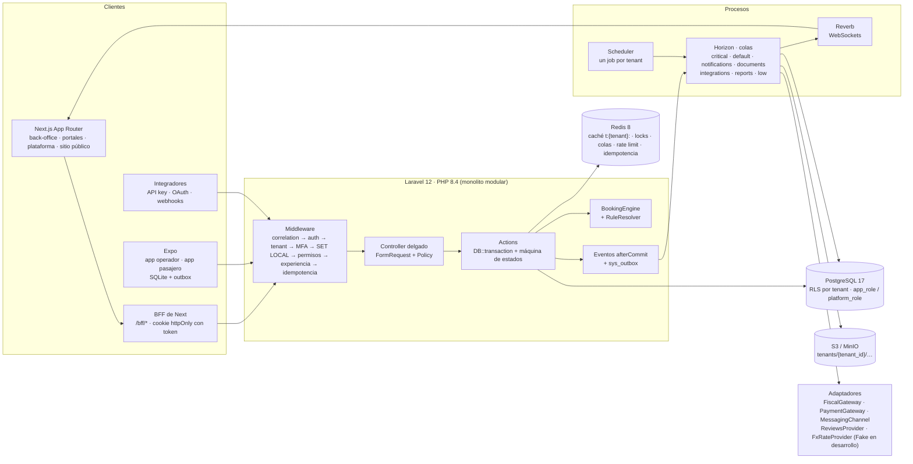
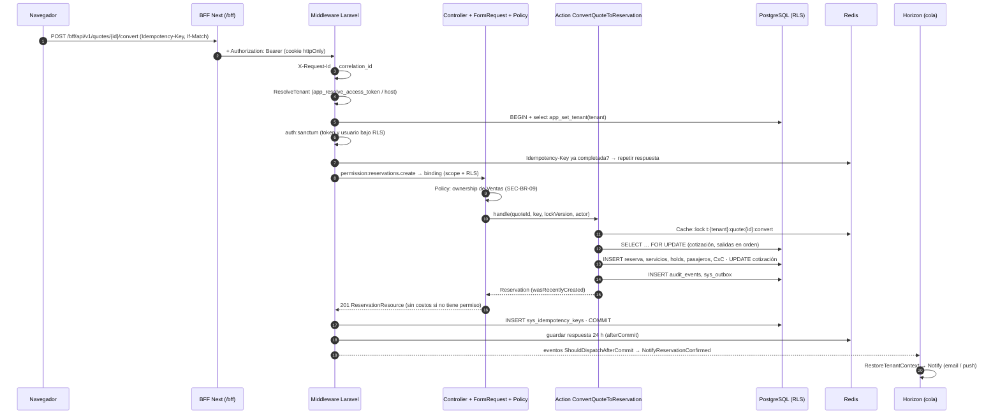
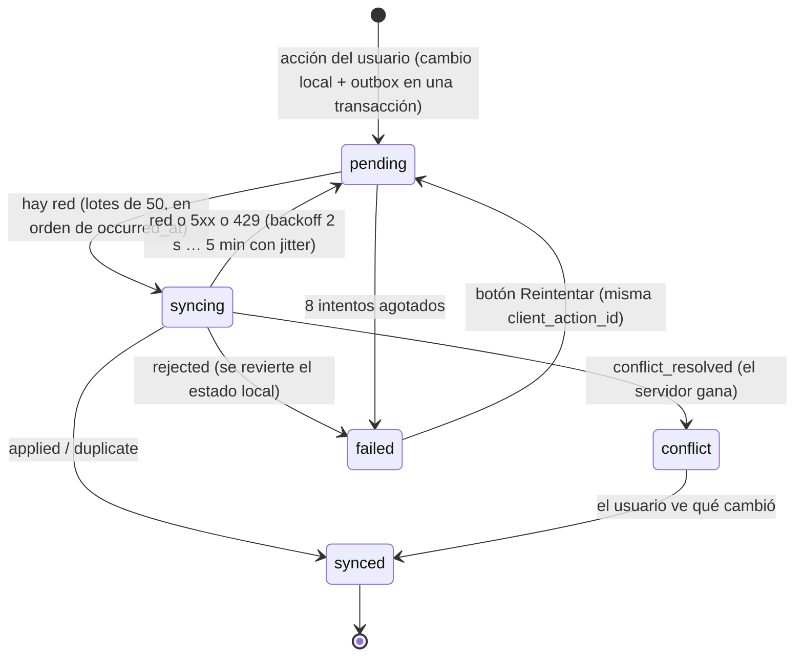

# Guía técnica de arranque — KipuControl

Guía para el programador que empieza a construir el SaaS con el kit. Explica **cómo encajan** las piezas (backend Laravel 12, PostgreSQL 17 con RLS, Redis 8, Next.js, Expo) y remite a los archivos que ya resuelven cada tema. No repite las especificaciones: las enlaza.

**Fuentes de verdad, en este orden** (si chocan, gana la de número menor y la diferencia se anota en la §11 de la spec y en `docs/CHANGELOG.md`):

1. [`database/*.sql`](database/README.md) — tablas, columnas, CHECK de estados, índices, RLS.
2. [`api/openapi.yaml`](api/README.md) — rutas, métodos, permiso (`x-permission`), `Idempotency-Key`, `If-Match`, fase.
3. `docs/especificaciones/NN-*.md` — comportamiento, reglas (`RES-BR-07`, `SEC-BR-16`…), permisos por rol, pruebas.
4. `docs/04-HALLAZGOS-Y-DECISIONES.md` — lo que el prototipo hace mal (H-01…H-21) y las decisiones (D-01…D-15).
5. Prototipo — referencia visual y de flujo.

Rutas de esta guía: relativas a la carpeta del kit (`docs/kit/` en el espacio de trabajo). Las especificaciones están en `docs/especificaciones/` (en el repositorio del kit: `proto/docs/especificaciones/`).

| Necesito… | Ir a |
|---|---|
| Esquema y cómo traducirlo a migraciones | [`database/README.md`](database/README.md) §5–6 · [`ejemplos/tools/generar_migracion.py`](ejemplos/tools/generar_migracion.py) |
| Endpoints, permisos e idempotencia | [`api/ENDPOINTS.md`](api/ENDPOINTS.md) · [`api/README.md`](api/README.md) |
| Máquinas de estado, reglas, permisos, errores, eventos (consolidados) | [`referencia/`](referencia/) — `MAQUINAS-DE-ESTADO.md`, `REGLAS-DE-NEGOCIO.md`, `PERMISOS.md`, `PERMISOS-ROL.csv`, `ACCESO-PANTALLAS.csv`, `CODIGOS-DE-ERROR.md`, `EVENTOS-JOBS-NOTIFICACIONES.md`, `GLOSARIO.md` |
| Código de referencia listo para copiar | [`ejemplos/README.md`](ejemplos/README.md) |
| Pruebas a escribir primero | [`tests/README.md`](tests/README.md) · [`tests/e2e/SELECTORES.md`](tests/e2e/SELECTORES.md) |
| Tokens, componentes y reglas de UI | [`design/COMPONENTES.md`](design/COMPONENTES.md) |
| Docker, variables de entorno y CI | [`infra/README.md`](infra/README.md) |
| Historias y orden de trabajo | [`backlog/README.md`](backlog/README.md) · [`claude/CLAUDE.md`](claude/CLAUDE.md) |

---

## 1. Arquitectura en una página

| Capa | Decisión | Dónde |
|---|---|---|
| Repositorios | `backend/` (Laravel), `web/` (Next.js, todas las experiencias y el sitio), `mobile/` (Expo, dos apps), `docs/` (specs + kit) | `02-ARQUITECTURA.md` §2 · [`00-LEEME-KIT.md`](00-LEEME-KIT.md) §2 |
| Backend | `app/Domain/{Shared,Iam,Platform,Crm,Catalog,Quotes,Bookings,Operations,Finance,Channels,Collaboration,Marketing,Supplier,Integrations}` con `Models/ Actions/ StateMachines/ Policies/ Http/ Events/ Listeners/ Jobs/ Data/` | [`claude/backend/CLAUDE.md`](claude/backend/CLAUDE.md) |
| Base de datos | Una base, esquema compartido, `tenant_id` + RLS con `FORCE` en 279 tablas; 327 tablas en total | [`database/README.md`](database/README.md) |
| Contrato | OpenAPI 3.1 generado desde las specs; el código se compara con él en CI (Scramble + `compare_contract.py`) | [`api/README.md`](api/README.md) §3 |
| Frontend | Next.js App Router; el navegador habla con un BFF; tipos generados del contrato | §11 de esta guía |
| Móvil | Expo + expo-sqlite + outbox idempotente | §12 |

---

## 2. Ciclo de vida de una petición

Ejemplo real del kit: `POST /api/v1/quotes/{id}/convert` (spec 04 §4.3). Archivos en [`ejemplos/backend`](ejemplos/backend).

| Paso | Componente | Archivo de ejemplo | Regla |
|---|---|---|---|
| 1 | Correlación | `app/Http/Middleware/AssignCorrelationId.php` | spec 00 §9 |
| 2 | Tenant | `ResolveTenant.php` → `SetPostgresTenant.php` → `TenantDatabase.php` | SEC-BR-01/02 |
| 3 | Idempotencia | `IdempotencyMiddleware.php` | SEC-BR-16 |
| 4 | Permiso | `->middleware('permission:reservations.create')` en `routes/api.php` | `x-permission` del contrato |
| 5 | Validación + alcance | `ConvertQuoteRequest.php` + `QuotePolicy.php` | SEC-BR-09/12 |
| 6 | Caso de uso | `Bookings/Actions/ConvertQuoteToReservation.php` | spec 04 §4.3 pasos 1–18 |
| 7 | Respuesta | `ReservationResource.php` (+ `ETag` = lock_version) | SEC-BR-13 |
| 8 | Error | `Exceptions/ApiExceptionRenderer.php` (formato estándar, 403/404 auditados) | spec 00 §6, SEC-BR-07 |
| 9 | Efectos asíncronos | `Events/*` (`ShouldDispatchAfterCommit`) + `Listeners/NotifyReservationConfirmed.php` | SEC-BR-22 |

Reglas de oro: **controladores delgados**; **una Action por caso de uso** (verbo + objeto); **estados solo por máquina de estados** (`StateMachine::transition()`, nunca `update(['status' => …])`); **todo efecto externo después del commit** (evento `afterCommit` o `sys_outbox`).

---

## 3. Tenancy y RLS paso a paso

Doble barrera: Eloquent filtra por tenant **y** PostgreSQL vuelve a filtrar con RLS. Si una se olvida, la otra protege; si faltan las dos, la consulta devuelve **cero filas** (falla cerrado), nunca datos de otro tenant.

| # | Qué hacer | Cómo | Archivo |
|---|---|---|---|
| 1 | Resolver el tenant | Del token Bearer con la función `app_resolve_access_token(hash)` (C-08 v2.5: `personal_access_tokens` tiene RLS, así que `ResolveTenant` y `SetPostgresTenant` van antes de `auth:sanctum`) o del host con `app_resolve_tenant_by_host()`. Nunca de `X-Tenant-Id`, `?tenant=` ni del cuerpo; si llegan distintos → 403 `TENANT_SCOPE_VIOLATION`. | `ResolveTenant.php` |
| 2 | Fijarlo en PostgreSQL | `BEGIN; select app_set_tenant('<uuid>')` (= `set_config('app.tenant_id', …, true)`, es decir `SET LOCAL`). Nunca `SET` sin `LOCAL`: el valor quedaría en la conexión y lo heredaría la siguiente solicitud (PgBouncer, Octane). | `SetPostgresTenant.php`, `TenantDatabase.php` |
| 3 | Modelos | `use BelongsToTenant;` en TODO modelo de negocio: global scope + `tenant_id` asignado en `creating` (y protegido contra asignación masiva). | `BelongsToTenant.php`, `TenantScope.php` |
| 4 | Validaciones `exists` | `Rule::exists(Model::class)` pasa por el global scope; desde v2.5 las FKs son compuestas `(tenant_id, col)` y la BD también rechaza apuntar al id de otro tenant (database/README §5), pero la validación debe dar 422 antes de llegar al 23503. | FormRequest |
| 5 | Jobs y listeners | `TenantAware::captureTenant()` al despachar; middleware `RestoreTenantContext` abre transacción y fija el tenant. Listeners en cola: pasar el tenant al construir el middleware. | `Tenancy/Jobs/*`, `NotifyReservationConfirmed.php` |
| 6 | Scheduler multi-tenant | Un job coordinador con la conexión `pgsql_platform` recorre `tenants` y despacha **un job por tenant**. | 02-ARQUITECTURA §4 |
| 7 | Caché, locks, contadores | Prefijo `t:{tenant_id}:` (`TenantContext::key()`). | `TenantContext.php` |
| 8 | Migraciones | La RLS va en la **misma** migración que la tabla: `select app_enable_tenant_rls('tabla', 'strict')`. | `ejemplos/backend/database/migrations/*` |
| 9 | Pruebas | Conectar como `kipucontrol_app` (sin `BYPASSRLS`); el superusuario ignora RLS y no prueba nada. Plantilla obligatoria por módulo: `TenantIsolationTest`. | [`tests/pest/Feature/Tenancy`](tests/pest/Feature/Tenancy/TenantIsolationTest.php) |

Conexiones de base de datos ([`infra/README.md`](infra/README.md)):

| Conexión Laravel | Usuario | Rol PostgreSQL | Uso |
|---|---|---|---|
| `pgsql` | `kipucontrol_app` | `app_role` | API, colas, Reverb. Siempre con `app.tenant_id`. |
| `pgsql_platform` | `kipucontrol_platform` | `platform_role` | Super Admin, facturación SaaS, scheduler coordinador, eventos de plataforma (`tenant_id` NULL). |
| `pgsql_owner` | `kipucontrol_owner` | dueño del esquema | Solo `php artisan migrate --database=pgsql_owner`. |
| `pgsql_audit` (supuesto) | `kipucontrol_app` | `app_role` | Segunda conexión para auditar `acceso_denegado` y registrar `sys_job_runs` fuera de la transacción que hace rollback. |

Tablas con `tenant_id` NULL = filas globales (`roles` plantilla, `notif_templates`, `integration_adapters`, `sys_holidays`): modo RLS `shared`, el tenant lee las globales y escribe solo las suyas.

**Errores típicos**: consultas que «no devuelven nada» en un job (faltó `TenantAware`); `SQLSTATE[42501] new row violates row-level security policy` (insert sin tenant en contexto o con otro `tenant_id`); datos de otro tenant en caché (clave sin prefijo `t:{tenant}`).

---

## 4. Modelo de permisos y experiencias

| Concepto | Implementación | Referencia |
|---|---|---|
| Permisos | spatie/laravel-permission con *teams* (`team_foreign_key = tenant_id`), ids uuid (C-05). Catálogo global en `permissions`; sin permisos directos a usuario (todo por rol). | spec 00 §3.5, §7.1 · [`referencia/PERMISOS.md`](referencia/PERMISOS.md) |
| Roles | 12 plantillas copiadas a cada tenant en el alta (matriz editable) + Super Admin en `platform_users` (guard `platform`). Un rol por usuario. | spec 00 §7.2–7.3 · [`referencia/PERMISOS-ROL.csv`](referencia/PERMISOS-ROL.csv) |
| Permiso por endpoint | `x-permission` del contrato → `->middleware('permission:…')`. 403 con `required_permissions`. | [`api/ENDPOINTS.md`](api/ENDPOINTS.md) |
| Alcance de datos | `own` (Ventas: `owner_id = yo`, filtro `owner=me` forzado, detalle ajeno 403 `SEC-BR-09`), `tenant` (resto de internos), `linked` (externos: `client_id`, `reservation_id`, `agency_id`, `provider_id`, `guide_id`/`driver_id`). | spec 00 §7.6–7.7 · `QuotePolicy.php` |
| Experiencia | `personal_access_tokens.experience` (`backoffice`, `portal`, `mobile`, `platform`) + abilities del token; middleware `EnsureExperience` (SEC-BR-05). | spec 00 §3.4, §7.4 |
| Pantallas | ACCESS (permiso por ruta, prefijo más largo, «cualquiera de») → `GET /api/v1/me/access`; la web solo refleja. | spec 00 §7.5 · [`referencia/ACCESO-PANTALLAS.csv`](referencia/ACCESO-PANTALLAS.csv) |
| Plan del tenant | Entitlements independientes del rol: `FEATURE_NOT_IN_PLAN` (403) y reglas del motor por plan (`RULE_NOT_IN_PLAN`). | spec 13 · `ForbiddenByRoleTest` |
| Datos sensibles | Costos, márgenes y utilidad **omitidos** del JSON según permiso (`finance.profitability`, `catalog.products.view_profitability`, `quotes.approve_internal`); Operaciones ve costos, no márgenes; externos nunca. | SEC-BR-13 · `RevealsSensitiveAmounts.php` |

En la web: `PermissionGate` oculta o deshabilita con «Requiere permiso `x.y`»; `middleware.ts` redirige por experiencia; la pantalla 403 (`forbidden-page`) ofrece «Solicitar acceso» (`POST /api/v1/access-requests`). Nada de esto es seguridad: la API valida todo.

---

## 5. Dinero y monedas

| Regla | Detalle |
|---|---|
| Tipos | `numeric(14,2)` + `currency char(3)` + `fx_rate numeric(12,6)` conservado en el documento. Nunca `float`. |
| PHP | `brick/money` / `BigDecimal`; cast `MoneyCast` (`'total_amount' => MoneyCast::class.':currency'`); redondeo `HALF_UP` a 2 decimales (= `round2` del prototipo). Ejemplos: `ejemplos/backend/app/Domain/Shared/Money/*`. |
| API | Montos como **string** decimal (`"243144.90"`) + `currency`; esquema `Money` del contrato. |
| Prorrateos | Reparto proporcional con el residuo en la **última** línea (`Decimal::allocate`): Σ partes = total exacto (spec 04 §4.3 paso 10; verificado con el ejemplo de la spec: 536.00 y 690.00). |
| Tipo de cambio | Se usa el `fx_rate` **guardado en el documento**, nunca el del día (regla transversal 15, H-12). Conversión PEN = USD × fx. Histórico append-only en `fin_fx_rates` (un valor vigente por día); proveedor por `FxRateProvider` (Fake con tasas demo, D-12). |
| Mostrar vs cobrar | El margen de conversión (`R-MULTICURRENCY.fxMarginPct`) se aplica solo a monedas que no son de cobro (FX-03); el cobro se hace en `chargeCurrencies` (PEN/USD). |
| IGV y bases | Margen, rentabilidad y comisiones sobre base **neta sin impuestos** (H-11). Un único servicio de cálculo de impuestos para todos los caminos (H-09). Exportación de servicios / boleta con pasaporte: validar con contador (H-01). |
| Frontend | Nunca calcula montos: formatea strings de la API con `Intl.NumberFormat` y expone `data-amount` sin separadores para las pruebas. |

---

## 6. Idempotencia y concurrencia

**Idempotencia** (spec 00 SEC-BR-16; operaciones con `x-idempotency.mode: required` en el contrato — lista generada en `ejemplos/web/src/lib/api/critical-ops.ts`):

| Caso | Respuesta |
|---|---|
| Sin `Idempotency-Key` | 422 `IDEMPOTENCY_KEY_REQUIRED` (supuesto del backlog F0-26) |
| Misma clave y mismo cuerpo | La respuesta original (mismo status, p. ej. 201), header `Idempotent-Replayed: true` |
| Misma clave, cuerpo distinto | 422 `IDEMPOTENCY_KEY_REUSED` |
| Misma clave en proceso | 409 `IDEMPOTENCY_IN_PROGRESS` |

Además de la idempotencia HTTP, cada Action tiene **idempotencia de negocio** (p. ej. cotización ya convertida → 200 con la reserva existente y auditoría `convertir_idempotente`) y una **restricción única** en BD como última red (`uq_booking_reservations_tenant_id_quote_id_p`). En el cliente, la clave se genera **una vez por intento del usuario** (`useIdempotencyKey`) y se reutiliza en reintentos; nunca en el `fetch`.

**Concurrencia**:

| Mecanismo | Cuándo | Cómo |
|---|---|---|
| Optimista `lock_version` + `If-Match` | Editar o cambiar estado de recursos con `lock_version` (39 tablas) | Leer `lock_version` (o `ETag`), enviarlo en `If-Match`; desfase → 409 `STALE_VERSION`. `HasLockVersion::assertLockVersion()` tras `lockForUpdate()`, o `saveWithLockVersion()` (UPDATE condicional). El trigger `app_bump_lock_version` incrementa si la app no lo hizo. |
| Lock distribuido Redis | Consumir inventario (salidas, holds, cupos, rangos), conversión | `Cache::lock("t:{tenant}:…", ttl)->block(5)`; varios recursos en **orden ascendente** de id. `InventoryLock::withLocks()`. |
| Bloqueo pesimista | Dentro de la transacción, siempre que se consuma inventario o se numere un documento | `SELECT … FOR UPDATE … ORDER BY id`; `SequenceService::next()` para correlativos. |
| Restricciones de BD | Siempre | `CHECK (sold <= capacity)`, UNIQUE parciales, EXCLUDE (temporadas, rooming, rangos). Convertir `23505` en 409 en el renderer. |

---

## 7. Motor de reservas y centro de reglas

`App\Domain\Bookings\BookingEngine` es la **única** fuente de disponibilidad, pasajeros, precio, alojamiento, adicionales, pago y moneda (spec 16; H-13). Lo usan el sitio y el widget (`/public/quote`, `/public/bookings`), el portal B2B, el cotizador, la reserva directa y el simulador del Product 360.

| Pieza | Responsabilidad | Ejemplo |
|---|---|---|
| `BookingEngine` (puro, sin BD) | `dayStatus` (11 pasos de spec 16 §8.1), `month`, `nextAvailable`, `validatePax`, `ageType`, `quote` (16 pasos) | `ejemplos/backend/app/Domain/Bookings/BookingEngine.php` (disponibilidad y pasajeros completos; precio: esqueleto) |
| `RuleSet` | Reglas efectivas: `enabled ∧ plan_allows ∧ ¬override del producto`; parámetros con override | `Bookings/Data/RuleSet.php` |
| `RuleResolver` | Lee `sys_booking_rules` + `plan_rule_entitlements` (fuente del plan mínimo) + plan del tenant; caché `t:{tenant}:rules:v{n}` | `Bookings/Rules/RuleResolver.php` |
| `InventoryReader` | Vendidos (servicios no cancelados de reservas vivas) y holds vigentes | `Bookings/Inventory/DatabaseInventoryReader.php`, `Bookings/Testing/InMemoryInventory.php` |
| DTOs | `ProductData`, `QuoteSelection`, `BookingQuote`, `QuoteLine`, `DayStatus`, `PaxValidation`, `FxTable`, `SeasonCalendar` | `Bookings/Data/*` |

Reglas que no se negocian:

- **Regla apagada o fuera del plan ⇒ sin efecto**, pero su configuración se conserva (PLN-R-01); activar una regla fuera del plan → 403 `RULE_NOT_IN_PLAN`.
- Un producto solo puede **desactivar** una regla del tenant o cambiar sus parámetros, nunca activarla (CAT-RL-02/CR-02; trigger `app_rule_override_guard`).
- Reglas personalizadas del tenant nacen inactivas y solo se evalúan si hay *handler* registrado (`RuleRegistry`).
- El navegador nunca es autoridad: al confirmar, el backend recalcula con `quote()` **dentro** de la transacción con locks (spec 16 §8.4) y responde 409 `QUOTE_CHANGED` / `AVAIL_CHANGED` si algo cambió.
- Caché de disponibilidad `avail:{tenant}:{product}:{yyyy-mm}:v{n}` con invalidación por `INCR` de versión (sin `KEYS`).
- Prueba de referencia: caso PRD-011 con valores obtenidos del prototipo ([`tests/pest/Unit/Booking/BookingEngineQuoteTest.php`](tests/pest/Unit/Booking/BookingEngineQuoteTest.php), `Datasets/prd011.php`).

---

## 8. Integraciones con adaptadores Fake

| Interfaz | Para | Fake (desarrollo / pruebas / demo) | Pendiente |
|---|---|---|---|
| `FiscalGateway` | Comprobantes electrónicos SUNAT vía OSE/PSE (`fin_invoices`) | Acepta todo; `customerDocNumber = 'TIMEOUT'` simula error transitorio; total ≤ 0 permanente | D-01 proveedor |
| `PaymentGateway` | Cobro en línea, reembolsos, webhooks firmados | Importe terminado en `.13` = rechazo; `transfer` = `pago_por_validar` | D-02 pasarela |
| `MessagingChannel` | WhatsApp / SMS (ventana de 24 h, plantillas) | No envía; registra solo los 4 últimos dígitos | D-03 proveedor |
| `ReviewsProvider` | Reseñas por API oficial (sin scraping) | Lee `seeds/externalReviews.json` (rotuladas como ejemplo) | D-15 contratos |
| `FxRateProvider` | Tipo de cambio diario | Tasas demo de `seeds/settings.json` | D-12 proveedor real |

- Selección por configuración (`FISCAL_GATEWAY=fake`…, [`infra/env/backend.env.example`](infra/env/backend.env.example)) en `IntegrationServiceProvider`; en producción `fake` está prohibido para fiscal y pagos.
- Cada llamada devuelve `AdapterResult` con `errorClass` `transitorio` (reintentar con backoff `base × 2^intento ± 20 %`, máx. 5) o `permanente` (alerta y resolución manual) — spec 09 INT-BR-04, tabla `integration_errors`.
- Las llamadas externas van en **jobs** (cola `integrations`) alimentados por `sys_outbox`; nunca dentro de la transacción de la solicitud.
- Webhooks entrantes: verificación de firma en tiempo constante, idempotencia por id de evento del proveedor, tenant por `app_resolve_channel_account()` / clave del recurso.
- Secretos: `integration_adapters.secret_ref` apunta al gestor de secretos; nunca en BD ni en el repositorio. No inventar credenciales ni URLs.

---

## 9. Colas y tiempo real

| Cola (Horizon) | Contenido |
|---|---|
| `critical` | Conversión, pagos, invalidación de caché del motor, expiración de holds |
| `default` | Recalculos, read models |
| `notifications` | Email, push, campana |
| `documents` | PDFs |
| `integrations` | Outbox, OSE, pasarela, WhatsApp, proveedores, reseñas, tipo de cambio |
| `reports` | Exportaciones (permiso `reports.export`, auditadas) |
| `low` | Limpiezas (idempotencia vencida, particiones, purgas) |

- Jobs con `tries`, `backoff` exponencial, `ShouldBeUnique` cuando aplique, `TenantAware` y `RecordJobRun` (`sys_job_runs`: `en_curso → ok | advertencia | error`).
- Scheduler (`routes/console.php`): vencer cotizaciones (JOB-02), expirar holds, recordatorios, tipo de cambio, reseñas, **crear la partición mensual siguiente** de `audit_events`, `usage_counters`, `channel_web_events`, `integration_webhook_deliveries` (`app_create_monthly_partitions`) y purgar `sys_idempotency_keys` vencidas.
- Reverb: canal privado `private-tenant.{tenantId}.user.{userId}` (notificaciones, cambios de permisos → refrescar menú) más los de bandeja, aprobaciones y tablero de operaciones. Autorizar canales en `routes/channels.php` comparando tenant y usuario del token. En Next: Laravel Echo; al recibir «permisos cambiados» → `router.refresh()`.
- Catálogo de eventos, jobs y notificaciones por módulo: [`referencia/EVENTOS-JOBS-NOTIFICACIONES.md`](referencia/EVENTOS-JOBS-NOTIFICACIONES.md).

---

## 10. Archivos y PDF

| Tema | Regla |
|---|---|
| Almacenamiento | Disk `s3` (MinIO en local; buckets `kipucontrol-private` y `kipucontrol-public`). Ruta `tenants/{tenant_id}/{dominio}/{uuid}.{ext}`: el prefijo de tenant permite políticas y borrados por tenant. |
| Acceso | Siempre URL **firmada temporal** tras pasar la Policy del recurso; nunca URLs públicas para documentos con datos personales. |
| Subidas | Directas a S3 con URL prefirmada (`POST /api/v1/ops/evidences/presign`), luego se asocian por API con `sha256` (deduplicación). Validar tipo MIME y tamaño en servidor. |
| PDF | Job en cola `documents` (Browsershot/Chromium incluido en la imagen PHP, o DomPDF), versionado en `sys_documents` con `sha256` (columnas supuestas, C-12). El PDF se genera desde datos congelados (snapshot de la versión), no desde el estado actual. |
| Plantillas | Blade con escape por defecto (`{{ }}`); prohibido `{!! !!}` con datos de usuario (§14). |

---

## 11. Frontend (Next.js)

**Rutas.** Ruta Next = ruta del prototipo sin `#/` (`#/reservas/RES-2026-000348` → `/reservas/RES-2026-000348`). Back-office en `app/(backoffice)/…` con layout de menú lateral; cada experiencia externa con **segmento propio** para no colisionar (`/portal-cliente`, `/portal-pasajero`, `/b2b`, `/proveedor`, `/plataforma`, `/app-operador`; nombres definitivos por decidir: ver [`ejemplos/README.md`](ejemplos/README.md) §5); sitio público en `app/(sitio)/[locale]/…` (SSR/ISR, sin sesión, tenant por host); widget en `app/widget/[product]`.

**Datos.**

| Pieza | Archivo de ejemplo |
|---|---|
| Tipos generados del contrato (`npm run api:gen`) — los headers `Idempotency-Key`/`If-Match` quedan **obligatorios en tiempo de compilación** | `web/src/lib/api/schema.d.ts` (generado), `client.ts` |
| BFF: el token Sanctum vive en cookie httpOnly; el navegador llama a `/bff/api/v1/*` | `web/src/app/bff/[...path]/route.ts` |
| Errores: `ApiError` con `isStale`, `isValidation`, `fieldErrors`, `userMessage()` | `web/src/lib/api/errors.ts` |
| TanStack Query: claves `["t", tenantId, recurso, …]`, cursor con `useInfiniteQuery`, invalidación tras mutar | `web/src/features/reservations/api.ts`, `features/quotes/useConvertQuote.ts` |
| Server Components: `serverApi()` directo a la API interna | `client.ts` |

**Formularios.** React Hook Form + Zod con esquema **espejo del FormRequest**; errores 422 mapeados por campo (`applyServerErrors`), `code` de regla como error raíz, 409 `STALE_VERSION` con mensaje de recarga. Ejemplo completo: `features/reservations/CancelReservationForm.tsx` (vista previa de penalidad calculada por la API, `data-testid` de SELECTORES).

**Diseño.** Tailwind con [`design/tailwind.preset.ts`](design/tailwind.preset.ts) y [`design/globals.css`](design/globals.css) (o `theme.v4.css`), componentes Radix/shadcn según [`design/COMPONENTES.md`](design/COMPONENTES.md). `StatusBadge` usa `toneFor(status)` y las etiquetas de `tokens.json`; `data-status` con el valor de dominio. Una sola acción primaria por vista; dorado solo para la acción comercial principal; modo oscuro con `data-theme="dark"`.

**Responsive y móvil** (misma regla que el prototipo v2.4):

| Ancho | Comportamiento | Ejemplo |
|---|---|---|
| ≤ 980 px | Sidebar fuera de pantalla, botón de menú | `components/layout/AppShell.tsx` |
| ≤ 900 px | Tablas que no caben (o ≥ 5 columnas en ≤ 640 px) → **tarjetas**: etiqueta por columna, primera celda como título, acciones al pie, celdas vacías ocultas; 2 tarjetas por fila entre 641 y 900 px | `components/data-table/DataTable.tsx` |
| ≤ 640 px | Topbar compacta: búsqueda como icono que se expande, acciones secundarias (ver sitio, tema) en el menú de usuario; acciones de fila y de cabecera en **hoja inferior** «Más acciones»; objetivos táctiles ≥ 40 px | `AppShell.tsx`, `components/ui/ActionSheet.tsx` |
| 360–400 px | Sin scroll horizontal; capturas a 1440 y 400 px en cada historia de pantalla | `tests/e2e` proyecto `movil-400` |

---

## 12. Apps móviles offline (Expo)

- Archivos: `ejemplos/mobile/src/offline/db.ts` (SQLite, WAL, migraciones con `user_version`), `outbox.ts` (estados, coalescencia de `confirm`/`checkin`, UUID v7), `sync.ts` (lotes, backoff, `Idempotency-Key`, resultados por acción), `useOutboxStatus.ts` (chip siempre visible).
- El servidor es idempotente por `client_action_id` (= `ops_sync_actions.id`); procesa en orden causal, cada acción en su transacción con `FOR UPDATE`, y emite auditoría y notificaciones al aplicar (nunca desde el dispositivo). Reglas de conflicto MOB-BR-05…11 (spec 05 §5, §8.4.4).
- La app no replica reglas de negocio: solo valida precondiciones de UX; el servidor decide.
- Token en `expo-secure-store` (nunca AsyncStorage); ventana de datos [-2 d, +14 d] y purga; sin montos de venta ni márgenes; GPS solo con finalidad y consentimiento (D-10).
- Evidencias: comprimir (máx. 1920 px, JPEG 0.7), `sha256`, subir a URL prefirmada y luego encolar la acción `evidence` con `upload_id`.

---

## 13. Pruebas

| Nivel | Herramienta | Qué es obligatorio | Plantillas |
|---|---|---|---|
| Unitarias | Pest | Máquinas de estado (grafo = CHECK), motor de reservas (caso PRD-011), cálculos de dinero | [`tests/pest/Unit`](tests/pest/Unit) |
| Feature (API) | Pest con PostgreSQL 17 y Redis reales, usuario sin `BYPASSRLS` | Aislamiento de tenant, 403 por rol, ownership, guardas de estado, reglas de negocio, idempotencia (misma clave, otra clave, concurrencia) | [`tests/pest/Feature`](tests/pest/Feature) |
| Contrato | Scramble + `compare_contract.py` + `oasdiff` | Rutas de la fase en curso presentes; sin rutas fuera del contrato | [`api/README.md`](api/README.md) §3 |
| E2E | Playwright (desktop 1440 y móvil 400) | E2E-01…E2E-10 y casos del motor | [`tests/e2e`](tests/e2e) |

- Escribir primero la prueba de la historia (criterios de aceptación → casos), luego el código.
- Fecha de negocio congelada: 2026-09-29 (`freezeBusinessToday()`); semillas `seeds/*.json` vía `DemoTenantSeeder` + `SecondTenantSeeder`.
- **`data-testid`** obligatorios según [`tests/e2e/SELECTORES.md`](tests/e2e/SELECTORES.md) (espejo `support/testids.ts`): `{pantalla}-{elemento}`, `table-row:{código}`, `field:{name}`, `field-error:{name}`, `action:{verbo}`, `data-status`/`data-amount` con valores de dominio. Las pruebas nunca usan textos ni clases CSS.
- Integraciones siempre con su Fake en pruebas (`app(FiscalGateway::class)->issued` para afirmar lo enviado).

---

## 14. Seguridad (checklist OWASP aplicada)

| Riesgo | Control en este proyecto | Dónde |
|---|---|---|
| A01 Control de acceso roto | Permiso por endpoint + Policy de alcance + RLS; recurso de otro tenant = 404; todo 403/404 auditado como `acceso_denegado`; pruebas de aislamiento por módulo | §3–4 · `ApiExceptionRenderer.php` |
| IDOR por código legible | Route binding acepta uuid o `code`, siempre dentro del scope del tenant y de la Policy | `Reservation::resolveRouteBinding` |
| A02 Fallas criptográficas | HTTPS obligatorio; `encrypted` cast en `mfa_secret`, `iam_mfa_factors.secret`, `collab_channel_accounts.credentials_encrypted`, `crm_cases.consumer`; secretos en gestor de secretos (`secret_ref`); tokens Sanctum como hash sha256 | database/README §6 |
| Datos personales (Ley 29733) | Consentimiento por canal (`mkt_consents` + historial append-only `mkt_consent_events`), acceso/rectificación/supresión (`deleted_at` + anonimización), registro de tratamientos. **Por definir**: 02-ARQUITECTURA pide cifrar documentos de identidad, pero `booking_passengers.doc_number` es `varchar(30)` y el texto cifrado no cabe: decidir columna cifrada más ancha + hash para búsquedas | spec 14, 12 |
| A03 Inyección / XSS | Query builder y bindings (nunca concatenar SQL con datos de usuario); Blade `{{ }}`; React escapa por defecto — prohibido `dangerouslySetInnerHTML` salvo HTML del CMS sanitizado en servidor (lista blanca); plantillas de correo/WhatsApp con variables de una lista cerrada (MSG-01); CSV exportados con prefijo `'` ante `= + - @` | spec 08 (CMS), 17 |
| CSRF | El navegador no tiene token: el BFF exige `Origin` del mismo host en métodos que escriben y la cookie es `SameSite=Lax; HttpOnly; Secure`. Si se usa el modo SPA con cookie de Sanctum, `GET /sanctum/csrf-cookie` + `X-XSRF-TOKEN` y `SANCTUM_STATEFUL_DOMAINS` | `app/bff/[...path]/route.ts` · `infra/env` |
| A04 Diseño inseguro | Idempotencia y locks en operaciones de dinero/inventario; precio y disponibilidad solo en servidor; vista previa de portales sin escritura (H-05) | §6–7 |
| A05 Configuración | CSP estricta en Next (sin `unsafe-inline` en producción), `frame-ancestors` solo para dominios verificados del widget (WG-01), CORS por dominio verificado, `APP_DEBUG=false`, cabeceras HSTS / `X-Content-Type-Options` | spec 15, 17 |
| A07 Autenticación | MFA TOTP en roles internos; bloqueo por intentos; expiración de tokens (back-office 12 h deslizante, móvil 30 días, portales 7 días); revocación masiva (baja, cambio de rol, reset MFA, suspensión del tenant) | spec 00 §3.4, SEC-BR-08 |
| Abuso / fuerza bruta | Rate limit Redis: login 5/min por IP+email, API 120/min por usuario, exportaciones 10/h, API pública por clave + IP (valores propuestos) | `AppServiceProvider.php` · SEC-BR-25 |
| A08 Integridad | Webhooks con firma verificada en tiempo constante; dependencias escaneadas en CI; contrato verificado | §8 |
| A09 Registro y monitoreo | Auditoría append-only con `correlation_id`; **logs sin datos personales** (sin documentos, teléfonos completos, tokens, contraseñas: `dontFlash` + máscaras); alertas de jobs fallidos | §15 |
| A10 SSRF | El BFF solo reenvía `/api/v1/*` a un host fijo; los adaptadores solo llaman a URLs de configuración, nunca a URLs del usuario | `route.ts` del BFF |
| Subida de archivos | MIME y tamaño validados en servidor, nombres generados (uuid), bucket privado, URLs firmadas cortas | §10 |

Antes de cerrar cada historia: comando `/revisar-seguridad` y subagente `revisor-seguridad` ([`claude/`](claude/CLAUDE.md)).

---

## 15. Observabilidad

| Señal | Implementación |
|---|---|
| correlation_id | `X-Request-Id` aceptado o generado en `AssignCorrelationId` (nginx lo propaga); se devuelve en la respuesta, en el cuerpo de error, en `audit_events.correlation_id`, `sys_job_runs.correlation_id`, `sys_outbox.payload` y en el contexto de los jobs (`Context` de Laravel). |
| Logs estructurados | JSON con `tenant_id`, `user_id`, `correlation_id`, `job`; nivel `info` para negocio, `warning` para reintentos, `error` con excepción. Sin datos personales. |
| Colas | Horizon (tiempos, fallidos, reintentos por cola); `sys_job_runs` para la vista del Tenant Admin; alerta de fallo definitivo (PROC-065). |
| Integraciones | `integration_errors` (transitorio/permanente), `integration_adapters.last_test_*` (healthcheck). |
| Métricas | Laravel Pulse o APM: latencia p95 por endpoint, consultas lentas, uso de caché, tamaño de colas; uso por tenant en `usage_counters` (plataforma). |
| Auditoría funcional | `audit_events` particionada por mes; consulta en Administración › Auditoría (spec 09). |

---

## 16. Rendimiento

- **Índices**: el SQL ya trae los de toda FK, `(tenant_id, status)`, `(tenant_id, owner_id)`, `(tenant_id, created_at desc)`, parciales, GIN (trigram, arrays) y GiST. Cada consulta nueva de listado debe empezar por `tenant_id` (las políticas RLS agregan `tenant_id = …` y el planificador lo aprovecha). Revisar con `EXPLAIN (ANALYZE, BUFFERS)` conectado como `kipucontrol_app` con `app.tenant_id` fijado.
- **N+1**: `Model::shouldBeStrict()` en desarrollo y pruebas (lanza excepción en carga perezosa); `with()` / `load()` explícitos; `include` del contrato mapeado a relaciones.
- **Paginación por cursor** (`page[cursor]`), nunca `OFFSET` en listados grandes; máximo `page[size]=100`.
- **Caché por tenant**: claves `t:{tenant}:…` con versión (`…:v{n}` + `INCR` para invalidar); reglas 1 h, disponibilidad 10 min; nunca cachear respuestas con datos sensibles sin incluir permisos en la clave.
- **Read models** para reportes (`rpt_*`, vistas con `security_invoker = true` para respetar RLS) en cola `reports`.
- **Transacciones cortas**: nada de HTTP externo dentro de una transacción; los jobs de integración leen, cierran la transacción, llaman al adaptador y guardan en otra.
- **Particiones** mensuales en tablas de alto volumen; job que crea la del mes siguiente.

---

## 17. Despliegue y backups

| Tema | Práctica |
|---|---|
| Entornos | Desarrollo (Docker Compose, [`infra/`](infra/README.md)), staging con datos anonimizados, producción. |
| Procesos | Contenedores separados para API (php-fpm u Octane), Horizon, scheduler (una sola instancia), Reverb, Next.js. Sitio público separable si necesita escalar. |
| Migraciones | Con `pgsql_owner`, reversibles, RLS en la misma migración; después de cada fase se puede reejecutar `90_rls.sql` (idempotente) para verificar que ninguna tabla con `tenant_id` quedó sin RLS. Desplegar migraciones compatibles hacia atrás antes del código que las usa. |
| Configuración | Variables por entorno; secretos en gestor de secretos; `fake` prohibido en producción para fiscal y pagos (falla al arrancar). |
| CI/CD | [`infra/github/workflows/ci.yml`](infra/github/workflows/ci.yml): Pint, Larastan, Pest con PostgreSQL y Redis reales, contrato por fase (`KIPUCONTROL_PHASE`), lint/tsc/Vitest/build web, Playwright en pull requests. |
| Backups | PostgreSQL con PITR (WAL continuo) y retención según contrato; S3 con versionado; **prueba de restauración trimestral** documentada; Redis no es fuente de verdad (idempotencia y colas se recuperan desde PostgreSQL y `sys_outbox`). |
| Operación SaaS | Suspensión de tenant (403 `TENANT_SUSPENDED`), revocación de tokens, exportación de datos del tenant, creación de particiones y purgas programadas. |

---

## 18. Preguntas frecuentes del programador

**¿Dónde está la verdad si la spec y el SQL dicen cosas distintas?** En el SQL (fuente 1). Si la historia necesita otra cosa, primero se cambia el `.sql`, se valida con `database/tests/validate.sh`, se regenera la migración con `ejemplos/tools/generar_migracion.py` y se anota en la §11 de la spec.

**¿Puedo usar `$table->enum()` o `Schema::create` normal?** No para tablas del kit: CHECK con listas, UNIQUE parciales, defaults con funciones y triggers solo se reproducen con `DB::statement`. Use el generador; `verificar_migracion.sh` comprueba con `pg_dump` que la tabla queda idéntica.

**Mi consulta devuelve vacío en un job o en tinker.** Falta `app.tenant_id`: use `TenantAware` en jobs y `TenantDatabase::run($tenantId, fn () => …)` en tinker y seeders (con `FORCE ROW LEVEL SECURITY` hasta el dueño ve cero filas).

**¿Cómo pruebo que un usuario de B no ve datos de A?** Copie el dataset de `TenantIsolationTest` y agregue la ruta del recurso nuevo; corra con el usuario `kipucontrol_app`.

**¿Qué código HTTP devuelvo?** 403 sin permiso o fuera de alcance; 404 recurso inexistente u otro tenant; 409 conflicto de estado, cupo, `lock_version` o idempotencia en curso; 422 validación o regla de negocio con `code`. Catálogo completo: [`referencia/CODIGOS-DE-ERROR.md`](referencia/CODIGOS-DE-ERROR.md).

**¿Dónde cambio un estado?** Solo en la Action, con `StateMachine::transition()`. Si la transición no existe en la máquina, no se agrega en la Action: se revisa la §4 de la spec y [`referencia/MAQUINAS-DE-ESTADO.md`](referencia/MAQUINAS-DE-ESTADO.md).

**¿Cuándo uso un evento de Laravel y cuándo `sys_outbox`?** Evento `ShouldDispatchAfterCommit` + listener en cola para efectos internos (notificaciones, recálculos). `sys_outbox` cuando el efecto externo debe garantizarse aunque el proceso caiga (webhooks a clientes, OSE, proveedores).

**¿Cómo genero el código legible (`RES-2026-000351`)?** `SequenceService::next('reservation')` dentro de la transacción del documento. Nunca `max()+1`.

**El frontend necesita un campo que la API no envía.** No se calcula en el cliente: se agrega al Resource (y a la spec/contrato si es nuevo). Si es sensible, se omite según permiso en el Resource.

**¿Cómo pruebo una integración sin proveedor?** Con su Fake (por defecto en `.env`). Para errores: los disparadores documentados en cada Fake (`TIMEOUT`, importe `.13`, destinatario `+00…`).

**¿Por qué mi `POST` falla con «requiere Idempotency-Key» en el navegador?** El cliente exige la clave en las operaciones críticas; genere una con `useIdempotencyKey()` al abrir el formulario y pásela en `params.header`. Los tipos generados ya la marcan como obligatoria.

**¿Puedo calcular el total del carrito en el navegador para mostrarlo rápido?** Solo como vista previa de `/public/quote` (respuesta del servidor). El checkout siempre recalcula en el servidor (WG-03, H-13).

**¿Qué hago con un hallazgo H-xx del prototipo?** No copiarlo: implementar la recomendación de `04-HALLAZGOS-Y-DECISIONES.md` y cubrirla con una prueba.

**Algo no está definido en ninguna fuente.** Márquelo como «Supuesto» o «Por definir» en la §12 de la spec, implemente la opción más conservadora y deje la prueba que lo documenta. Ejemplos ya detectados: [`ejemplos/README.md`](ejemplos/README.md) §5.
